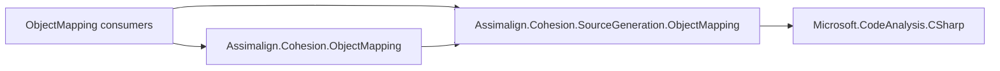

# ObjectMapping generator design

## Ownership and dependencies

The generator belongs to the ObjectMapping area because its source contract lives in
`libraries/ObjectMapping`. Owner decision 59 (2026-10-13) moves it from the root
`Assimalign.Cohesion.SourceGeneration` project to
`Assimalign.Cohesion.SourceGeneration.ObjectMapping`.

The library and its consumers reference the generator as a compiler component. The generator
depends on Roslyn and recognizes the mapper contract by metadata name, so it has no runtime
library reference. Its tests reference the actual ObjectMapping library to check generated code
against that contract. These reference directions are shown below.

The generator owns its `Internal/IsExternalInit.cs` compiler polyfill. It does not depend on
the root analyzer assembly or link another analyzer's helpers.

## Generation contract

For an eligible top-level, non-generic partial profile, the generator adds a
`TryConfigureGenerated` override. The override replays the fluent `MapMember`,
`MapMemberTypes`, and `MapMemberEnumerables` chain through delegate overloads. Nested scalar
targets create null intermediate objects as needed; collection materialization follows the
target member's declared type.

For an eligible inline `MapperBuilder.AddProfile<TTarget, TSource>(lambda)` call, a C#
interceptor substitutes a generated profile. Interceptors stay in
`Assimalign.Cohesion.ObjectMapping.Generated`, and source hint names remain
`<Profile>.MapperProfile.g.cs` and `MapperInlineInterceptors.g.cs`. The generated code keeps
its existing trim/AOT suppressions for unreachable reflection configuration.

Unsupported configuration is left untouched and uses the runtime reflection fallback. This
project currently declares no custom diagnostic IDs, so there are no diagnostic release
entries to relocate. Future diagnostics require `AnalyzerReleases.Shipped.md` and
`AnalyzerReleases.Unshipped.md` tracking under the analyzer rules.

## Compatibility

The area move changes the tooling assembly and the public generator type's namespace:
`Assimalign.Cohesion.SourceGeneration.MapperProfileGenerator` becomes
`Assimalign.Cohesion.SourceGeneration.ObjectMapping.MapperProfileGenerator`. A consumer that
references the compiler component directly must update its reference. The ObjectMapping
runtime public API, generated API, emitted source text, and diagnostic behavior are unchanged.

The compiler component retains the sanctioned `netstandard2.0` / `IsAotCompatible=false`
exception. The emitted mapping code remains compatible with NativeAOT.

## Verification

The generator-driver tests compile scalar class profiles and inline interceptors against the
actual mapper assembly and pin the unsupported-profile fallback. These characterize behavior
that already existed before the move. The ObjectMapping library's existing tests continue to
exercise mapping results, nested objects, collections, and generated-profile selection.

`libraries/ObjectMapping/Assimalign.Cohesion.ObjectMapping/samples/Assimalign.Cohesion.ObjectMapping.AotSample`
is the consumer guard with trim/AOT diagnostics promoted to errors.
