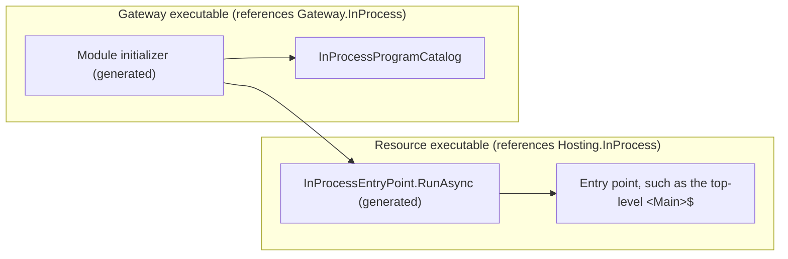

# Assimalign.Cohesion.SourceGeneration Design

## Contract and delivery

Component integrations are internal Cohesion build declarations. The shared module
`libraries/Core/Assimalign.Cohesion.Core/shared/ComponentIntegration/` owns the attribute, enums,
and metadata catalog. A contributing project opts in explicitly:

```xml
<CohesionSharedSource Include="Assimalign.Cohesion.Core" Module="ComponentIntegration" />
```

Each opted-in assembly compiles its own internal copy. Core's shipped runtime assembly does not
contain the attribute or catalog, and applications cannot use a public Core attribute to declare
integrations. This is a source-sharing convention within the repository, not a runtime service.
The generator also compiles the module; this creates no runtime assembly dependency on Core or DI.

`ComponentIntegrationGenerator` scans assembly attributes in the current and referenced assemblies.
It recognizes assembly-local copies by metadata name and validates constructor and named-property
shapes. It does not require the contributing assembly to reference Core, or require a globally
visible attribute symbol in the consuming compilation. An absent target suppresses the verb and
reports COHCMP0005. The incremental output model contains values only, never cached Roslyn symbols.

The root generator belongs here because the contract is owned by Core. Core's NuGet package still
ships the analyzer; the App targeting pack supplies it to SDK consumers. In-repository consumers
reference `CohesionAnalyzerReference Include="Assimalign.Cohesion.SourceGeneration"` when they call
projected verbs. The analyzer targets netstandard2.0; consuming projects use C# 14 and .NET 10.

## Closed target catalog

The schema is version 2. Constructor arguments are:

```csharp
ComponentIntegration(
    ComponentIntegrationTarget target,
    ComponentIntegrationMethod targetMethod,
    Type factoryType,
    string factoryMethodName,
    ComponentIntegrationTemplate template)
```

| Enum | Allowed values |
| --- | --- |
| `ComponentIntegrationTarget` | `ServiceProviderBuilder` |
| `ComponentIntegrationMethod` | `AddSingleton`, `AddScoped`, `AddTransient` |
| `ComponentIntegrationTemplate` | `Factory`, `Builder`, `BuilderWithServiceProvider`, `Custom` |

`ComponentIntegrationCatalog` is the single mapping from these enum values to metadata/member
names. Unknown numeric values are diagnosed. The target resolves to
`Assimalign.Cohesion.DependencyInjection.IServiceProviderBuilder`, without a contributor referencing
its assembly. Adding a seam is an explicit catalog change with generator and integration coverage.
`Verb` optionally supplies the generated feature name; `Contract` supplies an explicit generic
argument to the selected registration method. Neither is a lifetime selector.

A declaration chooses one template. In particular, the generator does not automatically add a
provider overload when a declaration selects `Builder`. Declare both overloads explicitly:

```csharp
[assembly: ComponentIntegration(
    ComponentIntegrationTarget.ServiceProviderBuilder, ComponentIntegrationMethod.AddSingleton,
    typeof(HttpClientFactoryBuilder), nameof(HttpClientFactoryBuilder.Build),
    ComponentIntegrationTemplate.Builder,
    Verb = "AddHttpClientFactory", Contract = typeof(IHttpClientFactory))]

[assembly: ComponentIntegration(
    ComponentIntegrationTarget.ServiceProviderBuilder, ComponentIntegrationMethod.AddSingleton,
    typeof(HttpClientFactoryBuilder), nameof(HttpClientFactoryBuilder.Build),
    ComponentIntegrationTemplate.BuilderWithServiceProvider,
    Verb = "AddHttpClientFactory", Contract = typeof(IHttpClientFactory))]
```

This is an intentional authoring break from the former public string-based attribute. All repository
contributors use version 2. Mixed old/new contract versions are not a supported package configuration.

## Templates and lifetime

`Builder` emits `Verb(Action<TBuilder>? configure = null)`. It constructs the builder, optionally
configures it, calls its build method eagerly, then registers `_ => component`. Bare and untyped-null
calls build the defaults. Validation therefore runs at registration. Because the same component is
returned on every producer invocation, use this template for singleton registrations.

`BuilderWithServiceProvider` emits `Verb(Action<IServiceProvider, TBuilder> configure)`. The callback
is required; typed null is rejected during registration. Construction, configuration, validation,
and the build method run inside the selected registration method's producer. Each invocation gets a
fresh builder. Singleton/scoped/transient lifetime and disposal belong to that registration method.
Singleton configuration runs on first resolve and can resolve services registered later in composition.
The BCL `OverloadResolutionPriority(-1)` attribute on this overload preserves existing untyped-null
calls as calls to the ordinary builder overload. Method groups and typed delegates also bind normally.

Both builder templates require an externally visible, closed, concrete builder with a public
parameterless constructor, and a public, non-generic, zero-parameter instance build method returning
an externally visible type. A method group mixing static and instance members is rejected.

`Factory` forwards each supported public static overload of the explicitly named factory method.
It preserves parameter types, names, defaults, nullable annotations, and `params`. Generic methods,
by-reference parameters, void returns, and inaccessible signature types are rejected. Static factory
behavior is unchanged. Disposable static products should be returned through `Func<IServiceProvider,
T>` so the container captures them; COHCMP0007 warns about directly returned disposable instances.

Existing Web feature declarations select `AddSingleton`, as required by Web.Hosting. The catalog
also supports scoped and transient registrations for integrations whose component contract allows them.
There are no implicit additional lifetime variants sharing the same generated name and signature.

## Custom signatures and complete bodies

`Custom` replaces the generated parameter list and entire method body. Supply `Signature` without
parentheses and `Body` as a complete C# block, including the return statement. The factory type
anchors the generated namespace and supplies placeholders; the custom block owns construction,
registration, validation, and disposal behavior. The generator does not append a return or wrap it
in a registration template.

```csharp
[assembly: ComponentIntegration(
    ComponentIntegrationTarget.ServiceProviderBuilder, ComponentIntegrationMethod.AddSingleton,
    typeof(HttpClientFactoryBuilder), nameof(HttpClientFactoryBuilder.Build),
    ComponentIntegrationTemplate.Custom,
    Verb = "AddHttpClientFactory", Contract = typeof(IHttpClientFactory),
    Signature = "global::System.Action<global::Assimalign.Cohesion.Http.HttpClientFactoryBuilder>? configure = null",
    Body = """
    {
        var clients = new $factoryType$();
        ($arguments$)?.Invoke(clients);
        var component = clients.$factoryMethod$();
        $receiver$.$targetMethod$<$contract$>(_ => component);
        return $receiver$;
    }
    """)]
```

| Placeholder | Expansion |
| --- | --- |
| `$receiver$` | Collision-free extension receiver identifier |
| `$arguments$` | Comma-separated parameter identifiers with required ref/out/in modifiers |
| `$targetMethod$` | Selected catalog method name, without generic arguments |
| `$seamType$` | Fully qualified receiver type |
| `$factoryType$` | Fully qualified factory/builder type |
| `$factoryMethod$` | Escaped factory member name |
| `$contract$` | Fully qualified Contract type, or empty if omitted |

Placeholder syntax is reserved throughout the body, including string literals. Unknown placeholders,
malformed signatures, missing custom fields, and malformed blocks report COHCMP0003 and emit no
method. Syntax is checked before emission; names and types bind in the consuming compilation and
normal compiler diagnostics report inaccessible or missing APIs. Qualify body and signature types:
only the seam's namespace is imported automatically. This supports code referencing a seam library
without adding that library to the contributing project's references.

Raw body text and relative indentation are preserved, including raw string literals. Shared output
containers remain internal, grouped in one generated file per contributor, under the factory's
namespace. Generated block namespaces are the existing exception to the file-scoped namespace rule.

## Diagnostics and verification

| ID | Severity | Meaning |
| --- | --- | --- |
| COHCMP0001 | Warning | Malformed declaration, schema, or unknown catalog value |
| COHCMP0002 | Warning | Inaccessible factory, builder, or signature type |
| COHCMP0003 | Warning | Unsupported factory/template shape or invalid custom implementation |
| COHCMP0004 | Warning | Duplicate generated signature |
| COHCMP0005 | Info | Target seam is absent |
| COHCMP0006 | Warning | Consumer language version is older than C# 14 |
| COHCMP0007 | Warning | Static factory returns a disposable instance directly |

Two-stage Roslyn tests compile contributors with their own internal contract, then compile and execute
consumers. They cover ordinary/provider callbacks, lifetime-owned construction, disposal, custom block
execution, placeholders, schema errors, and independent overload declarations. IntegrationCheck calls
every declared feature overload against the real DI seam. The shared-source regression script checks
module isolation, recursive files, multiple modules per owner, duplicate imports, missing metadata,
unknown owners/modules, traversal, and wildcards under Core and Visual Studio MSBuild.

## In-process program bindings

A gateway that runs its resources in process calls each resource program's entry point
(ApplicationModel.Gateway.InProcess I15). A top-level program compiles to an internal `Program` with a
private `<Main>$`, which nothing outside its assembly can name, so the binding takes two builds: the
resource's exposes its entry point, and the gateway's registers it. Two generators in
`src/ApplicationModel/` do that. They live in this project, not in an ApplicationModel generator
project, because this one already reaches both compilations with no wiring of their own: Core's
package carries it to every Cohesion package consumer, and the App targeting pack to every SDK
consumer. An `Sdk.Web` resource gets it from both; the .NET SDK's analyzer conflict resolution
(`ResolvePackageFileConflicts`, which takes `@(Analyzer)`) keeps one copy of the same-named
assembly, so the generators run once.



**Bridge (`InProcessProgramBridgeGenerator`).** It runs on an executable (`ConsoleApplication` or
`WindowsApplication`) that references `Assimalign.Cohesion.ApplicationModel.Hosting.InProcess`, can
see its `InProcessProgramAttribute`, and does not reference `Assimalign.Cohesion.ApplicationModel.Gateway`:
a gateway is never a resource. The checks read only the output kind and the referenced assembly
names before the compilation's entry point is bound. It emits:

- a public, `[EditorBrowsable(Never)]` static class `InProcessEntryPoint` in
  `Assimalign.Cohesion.Generated.<assembly name>`, each segment made a valid identifier. The
  namespace comes from the assembly name, not the root namespace, so two resources whose code
  declares the same namespace still get distinct bridges in one gateway.
- `public static Task RunAsync(string[] args)`, which calls `Compilation.GetEntryPoint`. An entry
  point the bridge can name (not private, in types that are not private) is called directly.
  Otherwise an `[UnsafeAccessor(UnsafeAccessorKind.StaticMethod, Name = "<Main>$")]` extern reaches
  it, typed by its declaring type, or, for a static class, which cannot be a parameter type, by that
  type's runtime name with .NET 10's `[UnsafeAccessorType]`. The runtime binds both without
  reflection, so the bridge works under NativeAOT and trimming. `void`, `int`, `Task` and
  `Task<int>` entry points, with or without `string[] args`, are supported; a nonzero exit code
  faults the returned task with an `InvalidOperationException`.
- `[assembly: InProcessProgram(typeof(InProcessEntryPoint), "<provider>")]`. The provider is the
  area segment of the one referenced `Assimalign.Cohesion.<Area>.Hosting.ApplicationModel` assembly
  (every area's resources take the area as their provider). With none or several, the attribute
  records no provider and the gateway's reference must supply one.

**Catalog (`InProcessProgramCatalogGenerator`).** Sdk.Gateway turns each resolved project reference
with `CohesionResource` metadata into an additional file (the referenced project file) carrying
`CohesionResource`, the optional `CohesionProvider`, and `CohesionResourceAssembly`, the referenced
assembly's name, as compiler-visible metadata (Sdk.Gateway Tasks DESIGN). In a compilation that can
see `InProcessProgramCatalog` (it references Gateway.InProcess), the generator finds each named
assembly's `InProcessProgramAttribute` and emits one internal `[ModuleInitializer]` that calls
`InProcessProgramCatalog.Register(provider, name, <bridge>.RunAsync)` per resource, so every
binding is in place before the gateway program's first statement. `CohesionProvider` overrides the
recorded provider. A reference is skipped, with a diagnostic, when its assembly records no program,
when no provider is known, or when an earlier reference (in assembly-name order) already bound the
same provider and name.

| Id | Severity | Meaning |
| --- | --- | --- |
| COHAPM0001 | Warning | A `CohesionResource` reference names an assembly with no in-process program: not an executable, or it does not reference ApplicationModel.Hosting.InProcess |
| COHAPM0002 | Warning | The program records no provider and the reference sets no `CohesionProvider` |
| COHAPM0003 | Error | Two references bind the same provider and resource name |

The tests (`InProcessProgramGeneratorTests`) compile against stand-ins with the packages' assembly
names and shapes. They cover each entry-point shape and accessor path, the gating cases (a library,
an executable without the hosting package, a gateway), provider detection, colliding root
namespaces, every diagnostic, and the provider override. They emit the generated code and run it:
the bridges call their entry points through the accessors, and a loaded gateway assembly's module
initializer registers a program that runs the resource's top-level statements. The Sdk.Gateway
package-boundary test runs the whole path with packed SDKs and packages.
