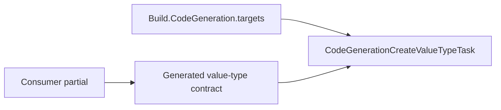

# Cohesion Build Tasks Design

## Design intent

`Assimalign.Cohesion.Build.Tasks` supplies MSBuild tasks used by the repository's shared targets.
It targets `netstandard2.0` to load in process under both Visual Studio's .NET Framework MSBuild
and command-line Core MSBuild. Generated application code remains compatible with NativeAOT.

## Value-type generation

`CodeGenerationCreateValueTypeTask` reads every `CohesionValueType` item and validates metadata
before writing any output. Each invalid value produces a `COHVT` diagnostic naming the item and
metadata. Generation writes CRLF sources only when content changes, preserving incremental
compilation, and removes orphaned generated sources inside its output directory.

Shared targets and compiled consumer partials depend on the generator and generated contract:

`ObjectHasCustomToString="true"` suppresses the parameterless `ToString()` override and
`DebuggerDisplay` together. A checked-in partial supplies both, allowing credential values to
redact diagnostic display without replacing construction, validation, equality or JSON. One
option keeps the two diagnostic surfaces coordinated. It defaults to false and uses the existing
boolean parser and `COHVT005` diagnostic. Non-string formatted overloads, explicit `Value` access,
and JSON still expose the underlying runtime value. The option is additive relative to
10.0.0-preview.1; existing metadata produces unchanged display behavior.

Core's test assembly owns conformance fixtures and direct task tests. A compiled redacted partial
proves the generator leaves both members to handwritten code without runtime reflection. Direct
generation tests cover struct/class and string/numeric kinds, omitted/false behavior, and invalid
metadata. See the [metadata contract](../../../docs/build/MSBUILD_COHESION_PROPS.md#value-types)
for the complete generated surface and compatibility policy.
