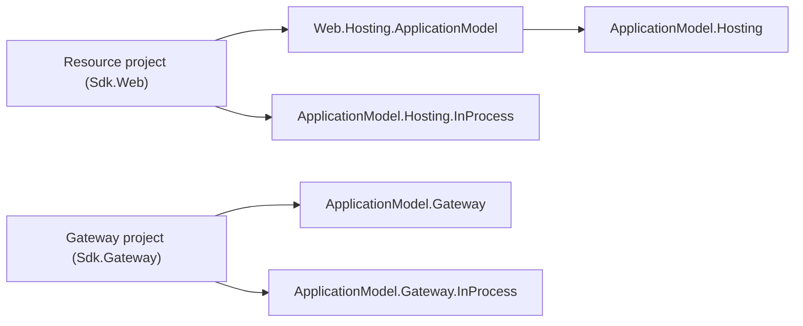

# Cohesion — Developer-Experience Design

> **Status (2026-10-31).** This document keeps the developer-experience decisions that are still in
> force: how a project picks a Cohesion SDK, which frameworks it gets, the canonical runtime API,
> and the hosting decisions the rules cite by id. The application-model content of the earlier
> versions (v4.1, owner rounds R1–R11: generated manifests, typed resource accessors, the
> `CohesionApplicationModel` build switch, per-area definition and gateway-provider packages, the
> realization plan, application sets) described a design the 2026-10-27 restart retired. It was
> removed on 2026-10-31 and survives in this file's git history. The managed-resource design is
> recorded in [docs/libraries/ApplicationModel/DESIGN.md](libraries/ApplicationModel/DESIGN.md);
> the area-integration rule is in `.claude/rules/resource-areas.md`.

## 1. Mental model

**Every deployable thing is an ordinary .NET project that picks a Cohesion SDK; every relationship
is an ordinary project or package reference.**

- A **resource** is an executable on `Assimalign.Cohesion.Sdk.<Area>` (`Sdk.Web`,
  `Sdk.Database`, …): a `Program.cs` with top-level statements that composes the area's
  application through the area builder and runs it, like any .NET executable. Its domain content
  (schemas, policies, pipelines) is application code in that project.
- A resource becomes **managed** by a registration in its own program, not by a build switch:
  `builder.Services.AddResource("orders-api", resource => resource.UseInProcess())`, from the
  area's `<Area>.Hosting.ApplicationModel` package. Without a gateway platform in its environment
  the same program runs unmanaged.
- A **gateway** is an executable on `Assimalign.Cohesion.Sdk.Gateway`: it declares the model it
  runs in code (`ApplicationGateway.CreateBuilder(name)`) and deploys and manages its resources
  through the platforms it references, without loading their runtimes.

Arrows mean "references". A resource references the instance side and the platforms it opts into;
a gateway references the gateway side and its platforms. No resource package references the
gateway family (`COHRES003`).

## 2. SDKs and frameworks

| Project kind | SDK | Frameworks it receives | Output |
| --- | --- | --- | --- |
| Resource | `Assimalign.Cohesion.Sdk.<Area>` → `Assimalign.Cohesion.Sdk` → `Microsoft.NET.Sdk` | `App` (the hosting kernel) and `App.<Area>` | Executable |
| Gateway | `Assimalign.Cohesion.Sdk.Gateway` → `Assimalign.Cohesion.Sdk` | None; it references the `Assimalign.Cohesion.ApplicationModel.Gateway` package | Executable |
| Library or tool | `Assimalign.Cohesion.Sdk` (build tooling only) | None unless referenced explicitly | Any |

- **Chained SDKs.** Each area SDK chains to the base SDK, which chains to `Microsoft.NET.Sdk`. The
  consumer's `global.json` pins every Cohesion SDK in the chain; a chained `<Import Sdk>` never
  carries a version. Packaging details are in `.claude/rules/build-system.md`.
- **Frameworks, not package graphs.** `App` carries the hosting kernel, including
  `Assimalign.Cohesion.ApplicationModel.Hosting`, the instance side every managed resource builds
  on. `App.<Area>` carries the area's libraries, its hosting module, and its
  `<Area>.Hosting.ApplicationModel` integration. Applications get the family with no package
  references; `CohesionAutoIncludeAppFramework=false` opts out.
- **No gateway framework.** The gateway family is never a shared-framework member: there is no
  `App.Gateway`, and no `ApplicationModel.Gateway*` assembly ships in `App` or any `App.<Area>`.
  Platform packages (`ApplicationModel.Hosting.InProcess`, `ApplicationModel.Gateway.InProcess`,
  and the `cohesion-platforms` pairs) are NuGet packages the project references.

## 3. The canonical runtime API

Writing a resource is a `Program.cs` that calls `<Area>Application.CreateBuilder(args)`, which
returns the area's public concrete builder; its `Build()` returns the public concrete
`Host<TContext>` application, run with `RunAsync()`. The area root defines the dependency-free
seam (`I<Area>ApplicationBuilder`, `I<Area>Application`), the `<Area>.Hosting` module implements
it, and feature packages ship their own registration verbs. Background work is registered with
`AddService` on the concrete builder, never on the root contract.

## 4. Decisions in force

| Id | Decision | Status |
| --- | --- | --- |
| O2 | No gateway type reaches a runtime by accident: the gateway family is NuGet-only and no shared framework carries it; there is no `App.Gateway`. | Superseded in part on 2026-10-31: the instance side, `ApplicationModel.Hosting` and its identity and protocol closure, is an `App` kernel member, because every area integration builds on it. |
| O15 | The L02 unification epics #17/#18/#19/#130–#132 are closed as superseded: `IHost` is the lifecycle surface, per-area builders are the composition seam, `IApplication` is not `IHost`, and `IHostBuilder` is a `Build()`-only marker; #304 is re-scoped to the nested-lifecycle fixes and #305 is satisfied by the per-area seam. | Landed; the `AddService` half is superseded by O34. |
| O20 | Keep one SDK per area plus `Sdk.Gateway` rather than one SDK with a resource-kind property: per-area SDKs keep the per-area framework auto-reference and keep each area's build tasks in its own package. | Landed |
| O34 | Area roots and feature libraries reference no `Assimalign.Cohesion.Hosting*` library; `AddService` lives on the concrete `<Area>.Hosting` builders; `COHRES004` enforces it. Reaffirmed 2026-10-11 for Database: the root `IDatabaseApplicationBuilder.Build()` stays parameterless, like all 18 areas; the cancellable `Build(CancellationToken)` belongs only to the concrete `DatabaseApplicationBuilder`. | Landed (owner, 2026-09-15) |
| O34a | Database engines are concrete-first: `resources/Database/**` uses sealed concrete types, plus abstract bases with public non-virtual members over protected abstract cores where real variants exist, where `Database.Hosting` must stay model-agnostic, or where a lower assembly drives a seam a higher assembly or the application implements. The `I<Area>Application` seam is unchanged. Rule: `.claude/rules/database-area.md`; plan of record: [DATABASE_CONCRETE_TYPES_PLAN.md](programs/DATABASE_CONCRETE_TYPES_PLAN.md). | Accepted (owner, 2026-10-04; amended 2026-10-06, 2026-10-09, 2026-10-16) |
| O35 | The exact `<Area>.Hosting` module may consume its own hosting family; the family never references the module (`COHRES001`), except `<Area>.Hosting.ApplicationModel`, which the rule sanctions by name (2026-10-31). Since the owner decision of 2026-10-09, `COHRES002` lets the module reference any library in its own area except `<Area>.Testing`, `<Area>.Hosting.ApplicationModel`, the framework producers, and harnesses. | Landed (owner, 2026-09-16; relaxed 2026-10-09) |
| R6 | Endpoints are `System.Uri` everywhere, with a Core `UriExtensions` block (C# 14 `extension(Uri)`) for what `Uri` lacks; no Cohesion endpoint-address type. | Landed (owner, 2026-09-07) |
| R9 | The runtime contract's .NET home is Core's `AppEnvironment`: its readers, and the constants and name builders in the nested `AppEnvironment.Variables` ([RUNTIME_CONTRACT.md](RUNTIME_CONTRACT.md)). | Landed (2026-09-26) |
