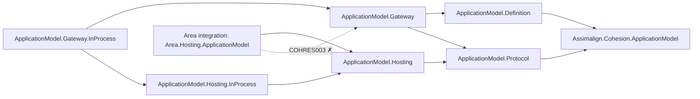

# ApplicationModel — Area Design

> **Status (2026-10-31).** The area record of the application model as rebuilt since the owner's
> restart of 2026-10-27. Each project's `docs/DESIGN.md` owns its decisions; this record says how
> the projects fit together, how a resource area plugs in, and where each decision lives. The
> project map is the [area README](../../../libraries/ApplicationModel/README.md).

## 1. Mental model

A **gateway** runs one application model: the resources it deploys, their dependencies, settings,
and platform extensions. It deploys them through a **platform** and manages them afterwards. A
**resource instance** is an ordinary application (an area's `Program.cs`) that opted into being
managed: it publishes a manifest of itself to its gateway, restores the state the gateway kept, and
runs the gateway's actions on its control plane. The two sides never load each other's code; they
share only the identity and the wire.

- **The logical side** is what a gateway declares (`ApplicationModel.Definition`): resources, their
  dependencies, settings, outputs, and platform extensions, and the parent gateway it joins. Each
  gateway has its own model, and a child gateway joins its parent; there is no hierarchy inside one
  model (Definition D21).
- **The physical side** is what runs (`ApplicationModel.Hosting`): an instance, its actions and their
  state, its health contributors, its control plane, and the host service that joins it to its
  gateway (Hosting D16).
- **A platform is a pair of packages** that owns every transport between the two sides (root C5,
  Hosting D19, Gateway G9): its instance half is the client an instance publishes through and
  receives the gateway's calls on; its gateway half is the infrastructure provider that deploys
  workloads and is also the gateway's inbound channel (Gateway G39), plus the client the gateway
  calls instances with. The in-process pair lives here; Kubernetes and Docker live in
  `cohesion-platforms`.

The logical and physical sides are never merged: a gateway references the protocol but not the
instance runtime, and an instance references the protocol but not the definitions.

## 2. Family map

Arrows mean "references". Every package reaches the identity root.



The dotted edge is prohibited: no shipped project under `resources/**` may resolve an
`ApplicationModel.Gateway*` assembly (`COHRES003`). Gateway.InProcess references Hosting.InProcess
for the in-process rendezvous only; a later chunk removes that edge.

| Package | Role | Design |
| --- | --- | --- |
| `Assimalign.Cohesion.ApplicationModel` | The shared identity: `IApplicationResource`, `ProviderName`/`ProviderId`, `ResourceName`/`ResourceId`, `PlatformName` | [DESIGN](../../../libraries/ApplicationModel/Assimalign.Cohesion.ApplicationModel/docs/DESIGN.md) |
| `Assimalign.Cohesion.ApplicationModel.Protocol` | The gateway-to-instance wire: `InstanceKey`, `DeploymentId`, `ActionName`, `ApplicationInstanceManifest`, action invocation and results, snapshots, `IApplicationInstancePublisher`, `JsonApplicationContentSerializer` | [DESIGN](../../../libraries/ApplicationModel/Assimalign.Cohesion.ApplicationModel.Protocol/docs/DESIGN.md) |
| `Assimalign.Cohesion.ApplicationModel.Definition` | The logical model one gateway runs | [DESIGN](../../../libraries/ApplicationModel/Assimalign.Cohesion.ApplicationModel.Definition/docs/DESIGN.md) |
| `Assimalign.Cohesion.ApplicationModel.Hosting` | The instance runtime: `IApplicationInstance`, `IApplicationInstanceAction`, `ApplicationInstanceOptions`, `ApplicationInstanceControlPlane`, `ApplicationInstanceService`, `IApplicationInstanceGatewayClient` | [DESIGN](../../../libraries/ApplicationModel/Assimalign.Cohesion.ApplicationModel.Hosting/docs/DESIGN.md) |
| `Assimalign.Cohesion.ApplicationModel.Hosting.InProcess` | The in-process platform's instance half: `UseInProcess()` on a resource's options | [DESIGN](../../../libraries/ApplicationModel/Assimalign.Cohesion.ApplicationModel.Hosting.InProcess/docs/DESIGN.md) |
| `Assimalign.Cohesion.ApplicationModel.Gateway` | The gateway: `ApplicationGateway.CreateBuilder(name)` → `ApplicationGatewayBuilder`, `IApplicationGateway` (`StartAsync`, `StopAsync`, `Completion`), and the `RunAsync` extension | [DESIGN](../../../libraries/ApplicationModel/Assimalign.Cohesion.ApplicationModel.Gateway/docs/DESIGN.md) |
| `Assimalign.Cohesion.ApplicationModel.Gateway.InProcess` | The in-process platform's gateway half: `InProcessInfrastructure` and `UseInProcess(infrastructure)`; runs each resource's program on a thread and in an environment scope of its own | [DESIGN](../../../libraries/ApplicationModel/Assimalign.Cohesion.ApplicationModel.Gateway.InProcess/docs/DESIGN.md) |

## 3. A gateway program

A gateway is an executable on `Assimalign.Cohesion.Sdk.Gateway`, which references the Gateway
package and generates nothing. Its `Program.cs` declares the model, registers the platforms it
deploys through, and runs:

```csharp
await using var infrastructure = new InProcessInfrastructure();
infrastructure
    .AddProgram("Web", "orders-api", Orders.Program.MainAsync)
    .AddProgram("Web", "storefront", Storefront.Program.MainAsync);

ApplicationGatewayBuilder builder = ApplicationGateway.CreateBuilder("local").UseInProcess(infrastructure);
IApplicationResourceDefinition orders = builder.AddResource("Web", "orders-api");
builder.AddResource("Web", "storefront").WithSetting("Orders:Url", orders.Endpoint);

await builder.Build().RunAsync(cancellationToken);
```

`StartAsync` takes the gateway's record over with a new epoch, deploys the resources in dependency
order (independent ones at once), waits for an instance of each deployment to publish, reads its
outputs, and tears down what the model no longer declares; the run then continues until
`StopAsync`, a shutdown signal, or a failure `Completion` reports (Gateway G17, G18, G35, G40). An
operator's action runs on one instance and a write is restored on every instance (Gateway G38). A
resource is declared generically by provider and name: no area ships a gateway-side package.

The program above creates its platform and lends it to the builder, so it disposes the platform
itself once the gateway has stopped. A platform can instead reach the builder as a factory,
`UsePlatform(() => platform)`, which a platform's own verb calls with its builder: the factory runs
in `Build()`, the gateway owns what it creates, and `await using` the gateway stops the run and then
disposes the platform. An infrastructure or instance client given to `UseInfrastructure` or
`UseInstanceClient` stays borrowed, and a later call for either role replaces the platform in that
role only (Gateway G42).

## 4. A managed resource

A resource area makes its application a managed instance with **one** package,
`Assimalign.Cohesion.<Area>.Hosting.ApplicationModel`, which references the area's `<Area>.Hosting`
runtime module, DependencyInjection, Hosting, and ApplicationModel.Hosting. The application calls an
`extension(IServiceProviderBuilder)` member on its builder's `Services`:

```csharp
var builder = WebApplication.CreateBuilder(args);
builder.Services.AddResource("orders-api", resource => resource.UseInProcess());

var app = builder.Build();
await app.RunAsync();
```

- **Unmanaged** — no `COHESION_GATEWAY` platform in the environment — `AddResource` registers
  nothing, and the program runs as a plain application with the state its code defines.
- **Managed**, it registers one singleton `IHostService` factory: an `ApplicationInstanceService`
  over an `ApplicationInstanceControlPlane` over the area's internal `IApplicationInstance`. In
  `StartingAsync` the service publishes the manifest and restores the gateway's snapshots through the
  client of the platform the environment names, before any of the application's services or
  servers start; in `StartAsync` it opens the control plane to the gateway's calls; in `StopAsync`
  it closes it and stops renewing its lease (Hosting D14, D15, D19).
- A platform the resource did not opt into fails the application's build, naming the platform.
- The resource's actions are the area's own (Web: one per registered setting it knows, such as the
  `cors` setting) followed by the ones the application adds with `AddAction` (Hosting D21).

The package is a public member of the area's `App.<Area>` framework, and ApplicationModel.Hosting
ships in the `App` kernel, so an `Sdk.<Area>` application needs no package reference except the
platforms it opts into. Web's integration is the reference implementation
([Web.Hosting.ApplicationModel](../../../resources/Web/Assimalign.Cohesion.Web.Hosting.ApplicationModel/docs/DESIGN.md));
EmailHub's is the template the other areas are generated from. The dependency rules for the package
are in `.claude/rules/resource-areas.md`.

## 5. The wire and the environment

Everything a platform tells a workload arrives in its environment: the `COHESION_*` variables of the
[runtime contract](../../RUNTIME_CONTRACT.md), read through Core's `AppEnvironment`. Out of process
that is the process environment; in process it is the `AppEnvironmentScope` the in-process gateway
enters on each program's thread (Gateway.InProcess I3, I4). `COHESION_GATEWAY` selects the platform
client, `COHESION_MANIFEST_ENDPOINT` says where it reaches its gateway, and `COHESION_DEPLOYMENT`
names the deployment the instance repeats in its manifest (Gateway G34). What crosses the wire is
JSON over source-generated contexts (Protocol P1, Hosting D12): a platform stores snapshots as
opaque bytes and needs no area's types.

## 6. Boundaries

- **Libraries never depend on resources** (`COHLIB001`). The family defines the seams an area
  implements (`IApplicationInstance`, `IApplicationInstanceAction`, `ApplicationInstanceOptions`);
  the area's `<Area>.Hosting.ApplicationModel` implements them.
- **Resources never load a gateway** (`COHRES003`).
- **No ambient state.** An instance is created by its registration, never discovered through a
  process-wide registry (Hosting D1).
- **Transports belong to platforms.** Neither the family's core packages nor an area integration
  carries a transport (root C5).
- **NativeAOT.** No reflection or runtime code generation anywhere in the family; content
  serialization resolves metadata only from source-generated contexts.

## 7. Non-goals

- **Build-time generation.** No manifest, accessor, or registration is generated into a resource
  or a gateway; both compose in code.
- **Area gateway packages.** An area ships no definition or provider package; the gateway declares
  any resource by provider and name.
- **A transport in the core packages.** Each platform brings its own, push or pull.

## 8. Open questions

The open questions live with the project that owns them; the cross-cutting ones are the instance
side's restore ordering and the call window between publication and opening (Hosting open
questions 6 and 7), and authentication of publications and calls, which each platform owns.
