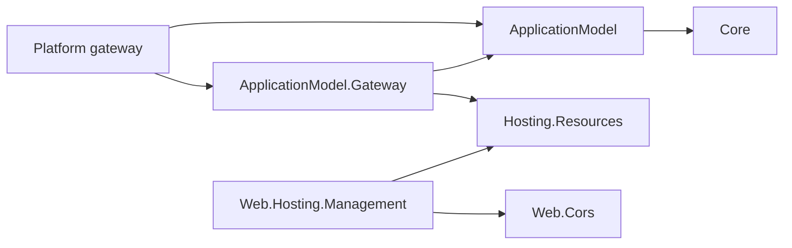

# Resource management

Resources own their runtime surface and health through Hosting.Resources. The Application Model
consolidates deployment requirements, logical resource groups and dependencies. Gateways deploy
resources, deliver each resource's deployment record, and observe the instances that apply it. The
approved design and its phases are in the
[deployment-record program](../../programs/RESOURCE_CONTROL_PLANE_REDESIGN.md); the wire contract is
the [deployment record](../../RUNTIME_CONTRACT.md#deployment-record) section of the runtime contract.

The diagram shows assembly references; manifest and record exchange is data and implies none.



The gateway references Hosting.Resources for the credential, command and mount contracts. The base
ApplicationModel package references no resource runtime, and area model packages describe resources,
dependencies and deployment requirements only: the 17 non-Database area model packages no longer
expose an `<Area>ResourceControlPlane` factory, because generated code in the resource executable
creates the control plane. The Database model is unchanged while its owner's PR is open.

## What a resource exposes

A resource declares its runtime surface in code, from the feature's own options types:

```csharp
CorsPolicyStore cors = CorsPolicyStore.Create(configuredCors);       // code and appsettings: the baseline
builder.Services.AddSingleton<ResourceConfigurationSection>(cors.AsResourceConfiguration());
WebApplication application = builder.Build();
application.UseDynamicCors(cors);
```

`AsResourceConfiguration()` comes from the opt-in `Assimalign.Cohesion.Web.Hosting.Management`
package and creates the live `Web:Cors` section. Any application can create its own sections with
`ResourceConfigurationSection.Create`, and actions and tools with `ResourceAction.Create` and
`ResourceTool.Create`; registered as singletons, they reach the control plane before the host is
attached, which fixes the surface. After every build the SDK's describe step runs the executable
until its host is built and keeps that surface as `resource.runtime.json` beside the output and in the
manifest package, so a gateway knows it without a running instance. The resource serves the surface,
its configuration status and its actions on its own control plane (`/cohesion/v1/configuration`, `/cohesion/v1/configuration/status`,
`/cohesion/v1/actions/{name}`), and applies the record it finds in `COHESION_CONFIG_DIRECTORY`.

A resource keeps no desired state. A management change lives in the record's override layer until the
resource's next deployment, and a change that must survive belongs in code.

## Logical resource groups

Group membership belongs to the composed application, so the same producer manifest can be used in
different groups by different applications:

```csharp
builder.AddResourceGroup("data", group => group.AddResource(databaseManifest));
builder.AddResourceGroup("frontend", group => group.AddResource(apiManifest));
```

The consolidated application document includes:

```json
"resourceGroups": [
  { "name": "data", "resources": ["database"] },
  { "name": "frontend", "resources": ["api"] }
]
```

Groups are flat, application-local containers. Resource names remain unique across the application,
and dependencies can cross groups. Changing membership does not change Kubernetes namespaces,
authorization, ownership, lifecycle, or workload hashes and does not trigger a deployment. See
[resource groups](RESOURCE_GROUPS.md) for the wire shape.

## Code-first deployment configuration

The gateway's `Program.cs` declares a resource's deployment layer next to the resource, validated
against the surface its build described:

```csharp
IWebResourceDescriptor api = builder.AddWeb(Manifests.OrdersApi)
    .Configure("Web:Cors", """{"defaultPolicy":{"origins":["https://portal.example.com"]}}""");
```

`Configure` and the platform-extension members beneath typed verbs such as `ConfigureHpa`
(`SetExtension`, `TryGetExtension`) are `ResourceConfigurationExtensions` members, generic over the
descriptor so area verbs still chain. Sdk.Gateway attaches each resource's `resource.runtime.json` to
its generated manifest (`ResourceManifest.Surface`, parsed as `ResourceSurface`); `Build()` copies the
patches into `ResourcePlan.Configuration` and the extension data into `ResourcePlan.Extensions`, and
refuses an unknown section, an unknown member or a value of the wrong type with the resource and path
named.

## Gateway side

The gateway owns the record and the management API (phases P2 and P3):

- **Records.** `IResourceRecordStore` keeps each resource's record where the platform keeps its
  deployments: the Local and in-process gateways use `FileResourceRecordStore`, the Docker gateway
  keeps files on the gateway machine and copies them into the container, and the Kubernetes gateway
  keeps ConfigMaps. Before a resource starts, the gateway writes the plan's deployment layer for the
  current generation (a hash of the plan and the build it deploys), keeps the override layer and the
  platform overrides when the generation is unchanged, drops them and reports the drop when it
  changed, and keeps claims either way. Teardown deletes the record. After an override or claims
  write, `OnRecordChangedAsync` lets a platform deliver what its instances cannot read for
  themselves, such as a copy into a container or a restart for a restart-class section.
- **Management API.** The gateway control plane serves `/cohesion/v2/resources/{resource}/…`:
  configuration with provenance, override PATCH, PUT and DELETE, convergence status, claims, actions,
  instances and platform surfaces. It authorizes against management grants, then calls the gateway's
  `IResourceManagementProvider`; the route table is in the
  [program document](../../programs/RESOURCE_CONTROL_PLANE_REDESIGN.md#management-api-p2).
- **Management grants.** `TrustedIssuer.AllowedManagementOperations` and
  `ApplicationCaller.AllowedManagementOperations` are a grant list separate from command kinds: an
  empty list grants no management access, unlike the command rule where an empty list permits every
  kind. Trusted-issuer documents persist the list as `allowedManagementOperations`, and
  `ResourceManagementOperations` names the grants. The application's own trust key grants all of
  them.
- **Instance inventory.** `ApplicationGateway.GetInstancesAsync(application, resource)` lists a
  realized resource's individually addressable control planes. The default reports the plan's
  control-plane endpoint for a single instance and refuses a plan that runs several; the Local
  gateway reports its supervised process while it is still starting, and platform gateways override
  `ObserveResourceInstancesAsync` with their own inventory. Status reads each instance's
  `configuration/status`, and every-instance actions fan out through the same list; an in-process
  resource is reached through its control plane directly.
- **Events.** Every management write, every override a deployment discards, and every failure to
  deliver a stored change to the platform is posted to the application's registered telemetry sink
  as an OTLP log record naming the operation, target, caller and generation, never a value.

## Platform surfaces and scale bounds (phase P3)

Platform code stays in the gateway's `Program.cs`, beside the platform-neutral bounds:

```csharp
IWebResourceDescriptor api = builder.AddWeb(Manifests.OrdersApi)
    .ScaleBetween(2, 10)                                              // ApplicationModel, any platform
    .ConfigureHpa(hpa => hpa.TargetCpuUtilizationPercentage = 70)     // Gateway.Kubernetes
    .ConfigurePodDisruptionBudget(budget => budget.MinAvailable = 1); // Gateway.Kubernetes
```

- **Scale bounds.** `ScaleBetween(minimum, maximum)` puts `ScaleBounds` in the plan
  (`WorkloadSpec.Scale`). `Build()` refuses bounds on a Job or a DaemonSet, and a maximum above the
  manifest's `maxReplicas`. A platform that autoscales keeps the replica count between them; the
  Docker, Local and in-process gateways run the plan's replica count and ignore them.
- **Platform surfaces.** A platform gateway publishes the manageable settings of its own objects as
  `ResourcePlatformSurface` values (`GetPlatformSurfaces`): a `<platform>/<name>` key, a closed JSON
  schema, the value code declares, and an optional rule. The management API serves each at
  `platform/{platform}/{name}`. GET returns the declared value, the override, the value in force and
  what the platform observes. PATCH composes an RFC 7396 merge patch into the override, validates the
  value it produces, stores the override in the record for the current generation, and applies the
  value to the platform at once (`ApplyPlatformSurfaceAsync`); a JSON `null` body drops the override.
  Compilers receive the overrides as `ResourceInputs.PlatformOverrides`, so every reconcile in the
  generation keeps them. Instances never see them, so they count in the record's version but not in
  its digest.
- **Kubernetes** publishes `kubernetes/hpa` and `kubernetes/pod-disruption-budget`. Changing either in
  code or through the API restarts no pod; a change in code is still a new generation, which
  discards the resource's overrides. The objects, the record ConfigMaps and the restart rules are in
  the Kubernetes gateway's `docs/DESIGN.md` in cohesion-platforms.

## Programmatic commands

Explicitly authored commands keep their transport, authorization and owner semantics until claims
and actions replace them (phase P4). Producer manifests no longer list command kinds or input-resolver
requirements (`cohesion/resource/v2`); the receiving control plane validates the kind and payload.

## Migration from the parked design

The codex refactor parked on `feature/resource-runtime-manifests` added runtime-discovered state
handlers, a gateway-owned management store and coordinator, per-process state admission, and
`/cohesion/v2/resources/{resource}/state…` routes. All of that is removed, along with the manifest's
opaque `runtime` member, `COHESION_RESOURCE_STATE_PATH`, and the versioned CORS and TLS certificate
adapters. Database files are untouched; a whole-repository build can fail until the Database tree
migrates on its own branch.
