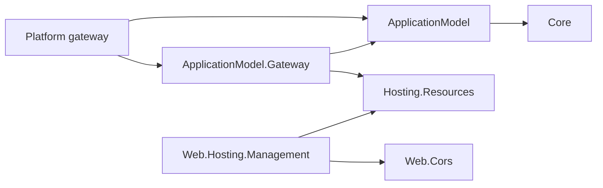

# Resource management

Resources own their runtime surface and health through Hosting.Resources. The Application Model
consolidates deployment requirements, logical resource groups and dependencies. Gateways deploy
resources, deliver each resource's deployment record, and observe the instances that apply it. The
approved design and its phases are in the
[deployment-record program](../../programs/RESOURCE_CONTROL_PLANE_REDESIGN.md); the wire contract is
the [deployment record](../../RUNTIME_CONTRACT.md#deployment-record) section of the runtime contract.

The diagram shows assembly references; manifest and record exchange is data and implies none.



The gateway references Hosting.Resources for the credential, command and mount contracts. The base
ApplicationModel package references no resource runtime, and area model packages describe resources,
dependencies and deployment requirements only: the 17 non-Database area model packages no longer
expose an `<Area>ResourceControlPlane` factory, because generated code in the resource executable
creates the control plane. The Database model is unchanged while its owner's PR is open.

## What a resource exposes

A resource declares its runtime surface in code, from the feature's own options types:

```csharp
CorsPolicyStore cors = CorsPolicyStore.Create(configuredCors);       // code and appsettings: the baseline
builder.Services.AddSingleton<ResourceConfigurationSection>(cors.AsResourceConfiguration());
WebApplication application = builder.Build();
application.UseDynamicCors(cors);
```

`AsResourceConfiguration()` comes from the opt-in `Assimalign.Cohesion.Web.Hosting.Management`
package and creates the live `Web:Cors` section. Any application can create its own sections with
`ResourceConfigurationSection.Create`, and actions and tools with `ResourceAction.Create` and
`ResourceTool.Create`; registered as singletons, they reach the control plane before the host is
attached, which fixes the surface. After every build the SDK's describe step runs the executable
until its host is built and keeps that surface as `resource.runtime.json` beside the output and in the
manifest package, so a gateway knows it without a running instance. The resource serves the surface,
its configuration status and its actions on its own control plane (`/cohesion/v1/configuration`, `/cohesion/v1/configuration/status`,
`/cohesion/v1/actions/{name}`), and applies the record it finds in `COHESION_CONFIG_DIRECTORY`.

A resource keeps no desired state. A management change lives in the record's override layer until the
resource's next deployment, and a change that must survive belongs in code.

## Logical resource groups

Group membership belongs to the composed application, so the same producer manifest can be used in
different groups by different applications:

```csharp
builder.AddResourceGroup("data", group => group.AddResource(databaseManifest));
builder.AddResourceGroup("frontend", group => group.AddResource(apiManifest));
```

The consolidated application document includes:

```json
"resourceGroups": [
  { "name": "data", "resources": ["database"] },
  { "name": "frontend", "resources": ["api"] }
]
```

Groups are flat, application-local containers. Resource names remain unique across the application,
and dependencies can cross groups. Changing membership does not change Kubernetes namespaces,
authorization, ownership, lifecycle, or workload hashes and does not trigger a deployment. See
[resource groups](RESOURCE_GROUPS.md) for the wire shape.

## Gateway side

The gateway management API over the record (`/cohesion/v2/resources/{resource}/configuration…`,
claims, platform surfaces and action fan-out) is phase P2 and is not built. Two pieces it will use
exist now:

- **Management grants.** `TrustedIssuer.AllowedManagementOperations` and
  `ApplicationCaller.AllowedManagementOperations` are a grant list separate from command kinds: an
  empty list grants no management access, unlike the command rule where an empty list permits every
  kind. Trusted-issuer documents persist the list as `allowedManagementOperations`.
- **Instance inventory.** `ApplicationGateway.GetInstancesAsync(application, resource)` lists a
  realized resource's individually addressable control planes. The default reports the plan's
  control-plane endpoint for a single instance and refuses a plan that runs several; the Local
  gateway reports its supervised process while it is still starting, and platform gateways override
  `ObserveResourceInstancesAsync` with their own inventory. The gateway will read each instance's
  configuration status and fan every-instance actions out through it.

## Programmatic commands

Explicitly authored commands keep their transport, authorization and owner semantics until claims
and actions replace them (phase P4). Producer manifests no longer list command kinds or input-resolver
requirements (`cohesion/resource/v2`); the receiving control plane validates the kind and payload.

## Migration from the parked design

The codex refactor parked on `feature/resource-runtime-manifests` added runtime-discovered state
handlers, a gateway-owned management store and coordinator, per-process state admission, and
`/cohesion/v2/resources/{resource}/state…` routes. All of that is removed, along with the manifest's
opaque `runtime` member, `COHESION_RESOURCE_STATE_PATH`, and the versioned CORS and TLS certificate
adapters. Database files are untouched; a whole-repository build can fail until the Database tree
migrates on its own branch.
