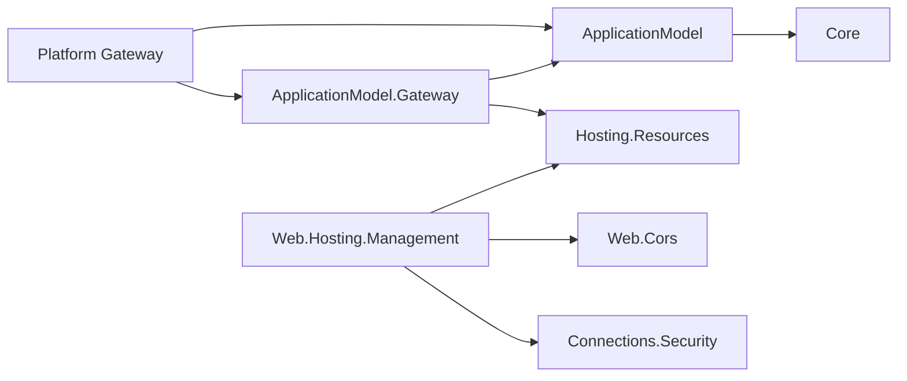

# Resource runtime state management

Resources own runtime capabilities and health through Hosting.Resources. The Application Model
consolidates deployment bindings, logical resource groups and dependencies. Gateways deploy resources,
discover authenticated startup catalogs and reconcile durable desired state across live instances.



The Gateway references Hosting.Resources for the runtime state, command and mount contracts.
Gateway.InProcess owns the direct runtime adapter. The base ApplicationModel package has no resource-runtime reference. Area model packages
describe resources, dependencies and deployment requirements; runtime factories belong to generated
resource executables. The Database model migration is separately gated by its owner's active PR.

## Producer declaration and hosting registration

An enabled SDK resource publishes its logical management binding. Add the optional
`Assimalign.Cohesion.Web.Hosting.Management` package for the built-in Web adapters:

```xml
<ItemGroup>
  <CohesionPackageReference Include="Assimalign.Cohesion.Web.Hosting.Management" />
</ItemGroup>
```

The SDK emits `cohesion/resource/v2`. Its opaque runtime fragment contains only the protocol and
management endpoint/path; it contains no commands, capability catalog, or initial values.
`CohesionResourceState`, `CohesionResourceInitialState` and external build-time runtime catalogs are
retired. Handlers provide their own schemas and canonical digests at startup. Register adapters
after applying effective `appsettings.json`, `appsettings.{environment}.json` and code configuration:

```csharp
CorsPolicyStore cors = CorsPolicyStore.Create(initialCors);
builder.Services.AddSingleton<IResourceStateHandler>(
    CorsResourceStateHandler.Create(cors));

// After Build, compose the middleware over that same feature-owned store.
application.UseDynamicCors(cors);
```

The certificate adapter is registered the same way. Its explicit `IResourceCertificateResolver`
must authorize and return the exact immutable provider/key/version with its private key. Call
`ConfigureTls` on the listener's `TlsServerOptions` before creating the listener. New handshakes
select the committed certificate; existing connections keep their TLS session. Dispose the adapter
after the listener drains. Only the version reference is exposed as state.

The CORS adapter captures the configured store as its immutable baseline. Later remote changes
update actual state without changing that baseline. Certificate registration optionally takes an
immutable startup reference so a clear operation can restore it; an unidentifiable borrowed
certificate has no reproducible baseline. This change establishes the configuration handoff;
it does not add configuration binding for every area builder API.

Hosting freezes the handlers' catalog and configured baselines, including recomputed
contract digests, before attaching the host. The local dispatcher validates keys, payloads, target
process identity and desired digest, then delegates to the actual feature. Features commit their
value and applied revision/digest atomically; the state path keeps no caller/request replay ledger.
Unknown protocol versions, unsupported schema constraints and missing handlers fail explicitly.

The v1 schema dialect supports type, const, enum, properties, required, additionalProperties, items,
string lengths, numeric bounds and array bounds. It allows schema identity/documentation annotations.
Other validation keywords are refused; adapters additionally enforce their domain rules.

## Logical resource groups

Group membership belongs to the composed application, so the same producer manifest can be used
in different groups by different applications:

```csharp
builder.AddResourceGroup("data", group => group.AddResource(databaseManifest));
builder.AddResourceGroup("frontend", group => group.AddResource(apiManifest));
```

The consolidated application document includes:

```json
"resourceGroups": [
  { "name": "data", "resources": ["database"] },
  { "name": "frontend", "resources": ["api"] }
]
```

Groups are flat, application-local containers. Resource names remain unique across the application,
and dependencies can cross groups. Changing membership does not change Kubernetes namespaces,
authorization, ownership, lifecycle, or workload hashes and does not trigger a deployment.

## Logical management API

| Method | Route | Meaning |
| --- | --- | --- |
| GET | `/cohesion/v2/resources/{resource}/state-contracts` | Catalog, excluding initial desired values |
| GET | `/cohesion/v2/resources/{resource}/instances` | Platform-owned process inventory |
| GET | `/cohesion/v2/resources/{resource}/state/{name}/{key}` | Desired revision and dated convergence |
| PUT | `/cohesion/v2/resources/{resource}/state/{name}/{key}` | Replace logical desired state |
| DELETE | `/cohesion/v2/resources/{resource}/state/{name}/{key}` | Clear override and restore the current explicit baseline |
| GET | `/cohesion/v2/resources/{resource}/operations/{id}` | Resource-scoped durable operation |

PUT carries `{"exists":true,"value":{...}}`. An explicit absent value requires a contract that
supports absence. DELETE does not infer a destructive reset when no baseline exists.
Use `If-None-Match: *` to create a slot, or `If-Match: "42"` to replace its revision. DELETE requires
If-Match. Every mutation requires a stable UUID `Idempotency-Key`. Successful writes return 202,
ETag and a resource-scoped operation Location after intent and retry receipt are durable.
Acceptance does not mean every process has applied the value.

Authenticated caller grants are separate from command grants. Examples are
`api/state/web.cors/read`, `api/state/web.cors/write`, `api/state-contracts/read` and
`api/instances/read`; `*` is an explicit management-wide grant. Developer writes remain refused.
Use ApplicationCallerKind.Operator for a management-only identity; it cannot dispatch legacy commands. An authenticator supplies an authority-qualified stable subject and grants through `ApplicationCaller.AllowedManagementOperations`;
trusted issuer documents persist `allowedManagementOperations`. Empty or unrestricted legacy
command grants do not confer management access. The gateway uses its own resource credentials and
transport trust for delivery. Callers never supply instance URLs.

## Reconciliation and platform ownership

The gateway contacts starting instances before readiness to discover their catalogs and configured
baselines. Reachable instances must agree on both before a new fleet mutation proceeds. Different
startup configuration during a rollout pauses reconciliation until the instances agree. The model
remains a deployment document; discovered runtime state is kept in the gateway's live management
view. Management transport and protected projections remain reachable before traffic admission.

Catalogs are cached in gateway memory after discovery. A newly started gateway with no reachable
resource process cannot discover contracts and rejects management writes until a process returns.
Persisted desired state still survives that gateway restart; a warm gateway can use its previously
validated catalog while processes in the same deployment incarnation are temporarily unavailable.

The gateway atomically persists conditional desired state and the subject-scoped retry receipt.
The local file store uses cross-process locking, atomic replacement, Windows DPAPI or private POSIX
files. Kubernetes uses an owned Secret with resourceVersion compare-and-swap and a separate SSA
field manager. Only its workload projection is mounted into resource processes; private receipts
and caller history remain gateway-only. Desired state, including overrides, survives gateway restart.

`everyInstance` targets every current process and is retained for future processes. `sharedState`
selects one leased executor; an adapter advertising it must enforce backend idempotency and fencing.
No built-in Web adapter advertises shared-state semantics. Legacy singleton stores are not assumed
to implement backend fencing merely because their gateway has a lease.

Kubernetes inventory includes pod UID, container ID, direct pod address, termination and live desired
replica count. TLS connects to the trusted pod IP while verifying the logical resource server name.
The resource handshake confirms the injected pod UID and a fresh process-start UUID. Starting pods
receive the latest Secret projection before traffic admission; a surviving gateway continues to
observe convergence and execute shared-state work. A new HPA process can bootstrap the last accepted
every-instance projection while the gateway is temporarily unavailable. Plan reapply relinquishes
replica ownership held by a scale controller. Ordinary dependency discovery still uses Service DNS.

Local uses the supervisor's starting process bindings; Docker uses the inspected container generation
and a private loopback management binding; InProcess dispatches directly to the invocation's plane.
Their single-instance deployment limits remain in force. Nine successful deliveries out of ten are
degraded progress. A restart invalidates the former process acknowledgement. Completion is dated
against a complete inventory and reevaluated on every reconciliation pass. Fleet changes converge
eventually; this protocol does not implement simultaneous fleet cutover.

## Programmatic commands

Explicitly authored commands retain their own transport, authorization and owner/replay semantics.
The producer manifest no longer advertises command kinds or input-resolver requirements. Kind
validation belongs to registered runtime handlers. Commands do not acquire management grants,
instance fan-out, or shared-state guarantees. Native state management
uses the discovered runtime catalog and the new protocol rather than translating arbitrary command payloads.

| Existing capability | Classification / migration decision |
| --- | --- |
| CORS replacement | Native `web.cors`, every instance |
| Certificate selection update | Native `web.tls.certificate`, every instance, immutable reference |
| Configuration namespace/value, identity audience/client, DNS records, secret publication | Declarative backend mutations retained on v1 until their adapters define actual ownership, absence and backend fencing |
| Certificate issuance | Action; issuing a new certificate is distinct from selecting a version |
| Trust grant | Security-policy mutation; retained with its explicit trust authorization |
| Database/database-principal declaration | Database source is frozen; its owner will migrate on the Database branch |

Custom state handlers can be registered by every non-Database hosting module without adding area
runtime dependencies to ApplicationModel. ResourceMount remains a protected input/storage abstraction;
health, stop and ordinary observed endpoints retain their lifecycle/discovery responsibilities.

## Migration

The 17 non-Database area model packages no longer expose their static `AreaResourceControlPlane`
factories or reference Hosting.Resources. Rebuild enabled executables with the updated area SDK;
generated code creates the generic runtime plane and configures its management binding. Handlers
register their capabilities and effective startup baselines. Commands are absent from resource
manifests, and the previous resource/v1 manifest schema is retired.

Database files remain untouched. Its old Health references and SDK/runtime assumptions are
intentionally left for migration on the Database branch; this branch provides no shim or build
workaround. A whole-repository or Database build can fail until that separate migration.
