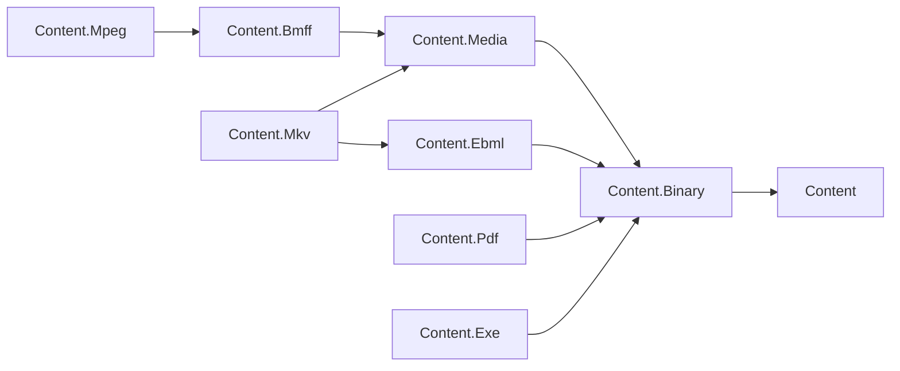

# Content area design

## Design intent

Content is the L1 foundation for reading, streaming and manipulating content. The root owns
format-neutral identity, ownership and composition contracts; format packages own their grammar,
reader, writer and document model. A static content engine builds on Text, Markdown and YAML;
MediaHub builds on media containers; OpenApi uses YAML serialization. Hosting, storage selection,
media workflows and job orchestration remain with the consuming service or its adapters.

The family must handle a 40 GB source, a non-seekable upload and hostile bytes without requiring a
whole-file allocation. Keeping these concerns in libraries lets services share format correctness
without sharing a runtime or storage backend. This record defines the architecture and acceptance
policy; the [Content foundation program plan](../../programs/CONTENT_FOUNDATION_PLAN.md) owns
sequencing, delivery work and open owner decisions. The contracts below are the target, not a claim
that every package already implements them.

## Access modes

Every container format follows the reader / writer / document triad in plan D1. The comparison is
`System.Text.Json`'s `Utf8JsonReader`, `Utf8JsonWriter` and `JsonDocument`: callers choose a streaming
surface or a document surface according to their access needs. Content's document surface also
supports mutation and saving; the analogy does not make `JsonDocument` mutable.

| Mode | Contract | Why it is separate |
| --- | --- | --- |
| Reader | Forward-only, element-by-element access over seekable or non-seekable input; descend into or skip a container; skip payloads without buffering them. | Inspecting metadata or ingesting a live upload must not materialize media payloads. Skipping on a non-seekable source may consume bytes, but never retains the whole payload. |
| Writer | Forward-only emission. Precompute or accept declared sizes on non-seekable output, or buffer one bounded unit; back-patch only when output is seekable. Choose large-size and unknown-size encodings deliberately. | Network output cannot assume a later seek, and a size field must never force buffering an entire file. |
| Document | Build a tree from the reader over a seekable source, edit it, then save through the writer. Untouched payloads remain lazy source segments and copy through on save. Recompute sizes and dependent offsets. | Random access and mutation cost metadata memory, while unchanged media stays outside the managed heap. |

Round-trip fidelity is an explicit goal: preserve unknown structure and untouched payload bytes,
and preserve the meaning of edited structure. Moving BMFF's `moov` requires updating `stco`/`co64`;
changing a Matroska layout requires updating `SeekHead`/`Cues`. A document retains access to its
source until lazy segments have been copied. Ownership is explicit, and a borrowed source is never
disposed by a slice. Non-seekable ingestion uses the reader; a document needing later random access
requires a caller-provided seekable source.

BMFF's existing composite box tree **is its document model**: `BmffBox`, `BmffBoxComposite`, visitors
and the one-class-per-box layout remain. A second document tree would duplicate both structure and
mutation rules. The program completes that design and repairs the stream layer beneath it.

The triad applies to container formats, not to the root contracts or primitive-only packages.
Text's line/token surfaces and YAML/Markdown's existing in-memory models retain their documented
scope. YAML preserves document semantics rather than comments; Markdown writes a canonical form
of its retained subset. Those policies must be explicit in their round-trip tests.

## Shared primitives

`Content.Binary` owns the exact-read, skip and copy operations, bounded `ContentSliceStream`, lazy
`BinarySegment`, span-based `BinaryContentReader`/`BinaryContentWriter`, FourCC and fixed-point
values (plan D2). Binary formats reuse these so partial reads, absolute positions and source
ownership have one implementation. Core's `OffsetStream` cannot substitute for a bounded stream
that returns short reads and supports forward-only input; Media's unchecked partial-read helper
was retired with Stage 1. The [Content.Binary design](../../../libraries/Content/Assimalign.Cohesion.Content.Binary/docs/DESIGN.md)
holds the primitive contracts and trade-offs.

## Family map

The diagram shows the **target** direct dependencies from plan D5; every arrow means "depends on".
Text depends on Content, and YAML and Markdown each depend on both Content and Text; that unchanged
text branch is recorded in the table rather than adding nodes to this nine-node graph.



All package names below have the `Assimalign.Cohesion.` prefix. "Today" means the direct
`CohesionProjectReference` items at base commit `f7197e97f`, without inferred transitive edges.

| Package | Role | Depends on today | Target dependency | Classification |
| --- | --- | --- | --- | --- |
| `Content` | Identity, ownership, composition and reader/writer contracts | None | None | Strategic |
| `Content.Binary` | Shared binary primitives and lazy payload references | Content | Content | Strategic |
| `Content.Text` | Unicode encoding detection, lines and tokens | Content | Content | Strategic |
| `Content.Yaml` | YAML document model, parser and emitter | Content, Content.Text | Content, Content.Text | Strategic |
| `Content.Markdown` | Markdown model, parser, canonical writer and HTML renderer | Content, Content.Text | Content, Content.Text | Strategic |
| `Content.Media` | Shared media descriptions; track/sample/timeline model planned | Content.Binary | Content.Binary | Strategic |
| `Content.Bmff` | ISO BMFF box reader, writer and composite document tree | Content.Media | Content.Media | Strategic |
| `Content.Mpeg` | MP4 profile over BMFF | None | Content.Bmff | Strategic |
| `Content.Ebml` | Generic EBML container, VInt and element model | None | Content.Binary | Strategic |
| `Content.Mkv` | Matroska profile over EBML, with shared media descriptions | Content.Bmff | Content.Ebml, Content.Media | Strategic |
| `Content.Pdf` | PDF object, document and cross-reference structure | None | Content.Binary | Strategic |
| `Content.Exe` | Executable-file inspection (PE/COFF, ELF, Mach-O) and, as a separate type family, process invocation | Content.Binary | Content.Binary | Strategic |

The code does not yet have every target arrow: MKV still references BMFF; EBML, MPEG and PDF
reference nothing. The program replaces MKV's dependency with EBML and Media and adds Binary to
EBML and PDF and BMFF to MPEG. EBML stays on Binary because it is a generic container; the Matroska
profile adds media semantics. Dependencies point toward shared contracts and primitives, never
back from the root into a format or into another package's internals.

## Classification

**Strategic** means retained, built to the stabilization gates and shipped. It describes the
destination, not readiness at this snapshot. **Experimental** means kept in the tree, not shipped,
with scope undecided. **Archive** means a candidate for deletion on which nothing builds. No
package is experimental or archive today: `Content.Exe` was experimental until owner decision O-C1
settled its scope. These classifications follow the program plan's survey, section 1.

| Package | Classification | Reason |
| --- | --- | --- |
| `Content` | Strategic | Implemented neutral contracts anchor the family; creation-facade alignment remains program work. |
| `Content.Binary` | Strategic | Shared exact reads and lazy segments are required by every retained binary format; implemented and in CI since Stage 1. |
| `Content.Text` | Strategic | Implemented encoding, line and token primitives support text formats and the static content engine. |
| `Content.Yaml` | Strategic | Implemented YAML model/parser/emitter serves OpenApi; the existing corpus records conformance gaps. |
| `Content.Markdown` | Strategic | Implemented CommonMark subset, canonical writer and HTML renderer serve static content. |
| `Content.Media` | Strategic | The shared track, sample and timeline model is needed by MP4 and Matroska; the base is scaffolding. |
| `Content.Bmff` | Strategic | Retain and complete the composite box design; it builds but its reader/writer and many boxes are incomplete. |
| `Content.Ebml` | Strategic | Tested VInt is a useful base for the generic container; reader, writer and document work remain. |
| `Content.Mkv` | Strategic | Retained Matroska profile, currently a placeholder with the wrong dependency. |
| `Content.Mpeg` | Strategic | Retained MP4 profile over BMFF, currently an empty project. |
| `Content.Pdf` | Strategic | Retained document-structure reader and manipulation surface, currently an empty project. |
| `Content.Exe` | Strategic | Owner decision O-C1 keeps both concerns here, separated: format inspection and process invocation. |

O-C1 was decided by the owner on 2026-10-16: "Keep process invocation in Content.Exe, separated
from inspection, with timeout, cancellation and process-tree cleanup." Inspection types never start
a process and invocation types never parse a file format. Process launching brings security and
lifecycle obligations no other Content package has (no shell, argument lists only, bounded output
capture, process-tree termination on timeout or cancellation), so `Content.Exe` carries
process-lifecycle tests in addition to its format corpus.

## Standards

These are named specification baselines, not claims of complete conformance. A package's compliance
tests identify the edition and section or example they exercise and document its retained subset.
For a living registry or online specification, fixture provenance also records the revision or
retrieval date; the online references below were reviewed on 2026-10-16.

| Package | Governing specification and edition | Scope today |
| --- | --- | --- |
| `Content`, `Content.Binary`, `Content.Media` | No independent file-format standard; family contracts and format-specific consumers govern these layers. | Root contracts implemented; Binary and the shared media model planned. |
| `Content.Bmff` | [ISO/IEC 14496-12:2026, edition 8](https://www.iso.org/standard/85596.html), with the [MP4RA registry](https://mp4ra.org/). | Composite box model and incomplete reader/writer; compliant parsing, emission and unknown-box preservation remain in progress. |
| `Content.Mpeg` | [ISO/IEC 14496-14:2020, edition 3](https://www.iso.org/standard/79110.html). | **Planned:** MP4 brands, tracks and samples over BMFF; MPEG-2 transport streams are separate scope. |
| `Content.Ebml` | [RFC 8794 (2020)](https://www.rfc-editor.org/rfc/rfc8794). | VInt encoding/decoding implemented and tested; full elements, schema, reader/writer and document model planned. |
| `Content.Mkv` | [RFC 9559 (2024)](https://datatracker.ietf.org/doc/html/rfc9559) and the [Matroska element specification, version 4 table](https://www.matroska.org/technical/elements.html). | **Planned:** segment, track, cluster, tag and cue structure over EBML; no codec decoding. |
| `Content.Pdf` | [ISO 32000-2:2020, edition 2 (PDF 2.0)](https://www.iso.org/standard/75839.html). | **Planned:** objects, document structure, tokenizer/parser and cross-reference handling, including reading PDF 1.x files; no rendering. |
| `Content.Exe` | [Microsoft PE/COFF specification, online revision 2026-09-10](https://learn.microsoft.com/en-us/windows/win32/debug/pe-format); [System V ABI / ELF gABI, ELF object format 4.3 draft](https://gabi.xinuos.com/). | **Planned:** PE/COFF, ELF and Mach-O header inspection (Mach-O against Apple's Mach-O file format reference); process invocation is a runtime contract, not a file-format standard. |
| `Content.Yaml` | [YAML 1.2.2](https://yaml.org/spec/1.2.2/). | Model, parser and emitter with core-schema semantics; supported subset and excluded official-suite cases documented by the package. |
| `Content.Markdown` | [CommonMark 0.31.2](https://spec.commonmark.org/0.31.2/). | Retained subset with canonical Markdown output and HTML rendering; exclusions are explicit in the package design. |
| `Content.Text` | [Unicode 17.0.0, encoding forms](https://www.unicode.org/versions/Unicode17.0.0/) and [RFC 3629 (2003), UTF-8](https://www.rfc-editor.org/rfc/rfc3629). | UTF-8/16/32 detection and decoding, line endings and literal tokenization; no normalization or legacy code-page policy. |

## Error model

Plan D3 defines one malformed-input vocabulary: `ContentFormatException` (or a format-derived
type) carries `ContentFormatErrorCode` and the absolute source position, an absolute byte offset
for binary readers. The codes are `Truncated`, `InvalidStructure`, `InvalidValue`,
`LimitExceeded` and `Unsupported`, with `Unspecified` for the legacy constructors. Text formats may add line and column diagnostics. This lets
consumers handle failures without depending on localized message wording or a proliferation of
exception classes. Tests assert codes and positions, never message text. Argument misuse and
underlying I/O failure remain distinct from malformed format bytes.

Readers must not leak `IndexOutOfRangeException`, `ArgumentOutOfRangeException`,
`OverflowException`, `EndOfStreamException` or `InvalidCastException` for malformed input. The
shared code enum shipped with Stage 1 and `Content.Binary` already reports through it; EBML's errors
still need migration, and Text can still surface `DecoderFallbackException` (#1556). This is an
acceptance contract for the program, not the current behavior of every reader.

Declared sizes are untrusted (plan D4). Validate lengths, arithmetic and container boundaries
before allocating; reader options cap buffered payloads at 16 MiB by default and also cap nesting
depth. Larger document payloads stay lazy when the source permits it. If bytes would have to be
buffered beyond the cap, reject with `LimitExceeded`. Truncation, oversized lengths and excessive
depth belong in each format's malformed-input corpus. Raising a caller-selected cap is explicit;
the wire never selects an allocation budget.

## Fixtures and corpora

Plan D6 makes fixtures license-clean and self-contained. Build bytes in code, transcribe permitted
specification examples with attribution, or use small files produced by the family's own writer.
Never download test data or require developer-local media paths. Tests must run from the checkout
without network access. Existing vendored material retains its license and provenance; the YAML
corpus already records its upstream commit and excluded cases, and is not fetched during tests.

New fixtures live in `tests/TestObjects/`. Each checked-in file has an adjacent provenance note or
test comment naming its producer (writer and generation recipe, or specification edition, section
and example), the origin and license/permission, and any intentional byte edits. A malformed
variant records the valid seed and how it was truncated or mutated, so the expectation can be
reproduced without an external corpus.

Every retained format carries three complementary corpora:

1. **Golden round trips:** deterministic examples read, written through the package's own writer
   and read again; check semantics and promised byte fidelity, including unknown structure and
   untouched payloads. Canonical text formats assert their documented normalization.
2. **Malformed input:** truncate at every header byte, declare oversized lengths and exceed depth
   limits; assert the format error code and position. For a grammar that accepts all text, such as
   Markdown, test specified fallback and resource bounds instead of inventing syntax errors.
3. **Specification-mapped compliance:** map each test to an edition and section/example, cover
   the retained subset, and list unsupported cases explicitly. A passing selected corpus is not a
   claim of full specification compliance.

## Stabilization gates

A format package must pass every applicable gate before a service takes a new dependency on it.
Classification alone is not approval. Apply the same checks to the shared layers it relies on,
with non-format requirements marked inapplicable only for an explicit reason.

1. **Build and release coverage.** The package builds in the Content CI matrix, its tests run
   there, and it is in the release inventory. Check `.github/workflows/library-content.yml`, run
   the package build/test commands and `Assert-CohesionReleaseInventory` from
   `installer/scripts/modules/CohesionPackaging.psm1`. An inventory exclusion is not a pass.
2. **Implemented, controlled failure paths.** No public member throws `NotImplementedException`,
   and no reader leaks a raw BCL exception for malformed input. Search source with `rg`, review
   reachable parsing paths and run malformed-input tests. An empty implementation or an empty
   test does not establish this gate; argument misuse and transport I/O failures are distinct.
3. **Named specification and mapped compliance.** Package documentation pins the governing
   edition and retained scope. Passing compliance tests map to specification sections/examples
   or versioned official-suite cases; exclusions are recorded. Check the docs, case metadata and
   test results together, not just the existence of a specification URL.
4. **Golden round trips through the writer.** Golden cases run through the package's own writer
   and back through its reader. Assert stable output and semantic equivalence, plus preservation
   of unknown structure and untouched payload bytes where the format promises it. Run the
   round-trip suite; a primitive VInt test alone does not qualify an EBML document writer.
5. **Malformed-input corpus and limits.** Tests cover truncation at every header byte, oversized
   declared lengths and depth limits, asserting `ContentFormatErrorCode` and absolute positions.
   Run the corpus with the default limits and boundary cases. For text without binary headers,
   test the corresponding encoding/token boundaries and resource limits. Markdown's total
   grammar requires fallback tests rather than syntax-error tests; actual limit failures still
   need the shared error vocabulary.
6. **Streaming and lazy save (container formats).** A test stream that rejects seeking proves
   the forward-only reader can descend, skip and consume elements. Instrumented source and
   output streams prove the document saves through the writer without loading untouched
   payloads into memory. Verify bounded buffering and unchanged payload bytes, not merely a
   successful parse over `MemoryStream`.
7. **Current documentation and complete public API docs.** Review `docs/OVERVIEW.md` and
   `docs/DESIGN.md` against the delivered behavior, and review every public member's XML
   documentation, including parameters, returns and exceptions. File existence and a build
   without documentation warnings are insufficient checks.
8. **NativeAOT analyzer cleanliness.** Build with `IsAotCompatible=true` and enabled AOT/trim
   analyzers; no `IL2xxx` or `IL3xxx` warnings may remain or be suppressed to pass. Check evaluated
   MSBuild properties and build diagnostics. This is the analyzer gate, not a claim that a
   native executable has been published for every platform.
9. **Recorded performance baseline, pending G2.** Once program gap G2 lands, record the benchmark
   commit, runtime/machine, corpus, throughput and allocation results for the package's retained
   operations in `cohesion-benchmarks`, against the budgets G2 defines. Review that reproducible
   record before marking this gate passed. Until G2 exists this gate is pending, shown as `n/a`
   below; it does not silently become a pass or impose an invented budget.

### Base snapshot

This table is a snapshot of base commit `f7197e97f` (2026-10-16); the program's close-out re-verifies
every gate against the integrated implementation.

`pass` means the named check has evidence for the retained scope; `fail` means a known gap or
missing required implementation/evidence, not necessarily a failing unit test. `n/a` means an
inapplicable surface, except gate 9 where it means pending G2. Gate 1 includes the repository
inventory guard, so its current failure prevents a complete pass even for the five listed packages.

| Package | 1 CI/release | 2 Failures | 3 Spec tests | 4 Round trip | 5 Malformed | 6 Streaming | 7 Docs | 8 AOT | 9 Perf |
| --- | --- | --- | --- | --- | --- | --- | --- | --- | --- |
| `Content` | fail | pass | n/a | n/a | n/a | n/a | fail | pass | n/a |
| `Content.Binary` | fail | fail | n/a | n/a | n/a | n/a | fail | pass | n/a |
| `Content.Text` | fail | fail | fail | n/a | fail | n/a | fail | pass | n/a |
| `Content.Yaml` | fail | fail | pass | pass | fail | n/a | fail | pass | n/a |
| `Content.Markdown` | fail | fail | pass | pass | fail | n/a | fail | pass | n/a |
| `Content.Media` | fail | fail | n/a | n/a | n/a | n/a | fail | pass | n/a |
| `Content.Bmff` | fail | fail | fail | fail | fail | fail | fail | pass | n/a |
| `Content.Ebml` | fail | fail | fail | fail | fail | fail | fail | pass | n/a |
| `Content.Mkv` | fail | fail | fail | fail | fail | fail | fail | pass | n/a |
| `Content.Mpeg` | fail | fail | fail | fail | fail | fail | fail | pass | n/a |
| `Content.Pdf` | fail | fail | fail | fail | fail | fail | fail | pass | n/a |
| `Content.Exe` | fail | fail | fail | fail | fail | n/a | fail | pass | n/a |

Content, Binary and Media have no independent file-format grammar, so gates 3-6 do not apply as
format corpora; their primitives still require implementation and failure-path evidence under
gate 2. Text has no format writer or lazy container model (gates 4 and 6). YAML and Markdown have
documented in-memory text models, outside D1's container gate 6. Exe is not a container format,
so gate 6 does not apply; its invocation half is held to the process-lifecycle contract in the
classification section instead.

### Executed checks and evidence

The following commands were run from the repository root. In the first three commands, `P` is
`Assimalign.Cohesion.` plus each package name in the results table; each invocation passed the
explicit csproj path. `dotnet test` ran for every existing test project, without filters or added
skips. Builds used the default Debug configuration.

```powershell
dotnet build libraries/Content/<P>/src/<P>.csproj
dotnet test libraries/Content/<P>/tests/<P>.Tests.csproj
dotnet msbuild libraries/Content/<P>/src/<P>.csproj -getProperty:IsAotCompatible,EnableAotAnalyzer,EnableTrimAnalyzer
pwsh -NoProfile -Command "Import-Module ./installer/scripts/modules/CohesionPackaging.psm1 -Force; Assert-CohesionReleaseInventory"
rg -n 'NotImplementedException' libraries/Content -g '*.cs' -g '!**/obj/**' -g '!**/bin/**'
rg -n 'ContentFormatErrorCode|MaxDepth|DepthLimit|LimitExceeded' libraries/Content -g '*.cs' -g '!**/obj/**' -g '!**/bin/**'
```

| Package | Build result (warnings / errors) | Tests passed / failed / skipped | CI matrix and release entry |
| --- | --- | --- | --- |
| `Content` | pass (0 / 0) | 20 / 0 / 0 | Both present |
| `Content.Binary` | pass (0 / 0) | 1 / 0 / 0 | Excluded |
| `Content.Text` | pass (0 / 0) | 46 / 0 / 0 | Both present |
| `Content.Yaml` | pass (0 / 0) | 413 / 0 / 0 | Both present |
| `Content.Markdown` | pass (0 / 0) | 142 / 0 / 0 | Both present |
| `Content.Media` | pass (0 / 0) | 1 / 0 / 0 | Excluded |
| `Content.Bmff` | pass (26 / 0) | 0 / 0 / 1 | Excluded |
| `Content.Ebml` | pass (2 / 0) | 60 / 0 / 0 | Both present |
| `Content.Mkv` | pass (0 / 0) | 0 / 0 / 1 | Excluded |
| `Content.Mpeg` | pass (0 / 0) | n/a: no test project | Absent; stale exclusion |
| `Content.Pdf` | pass (0 / 0) | n/a: no test project | Absent; no source |
| `Content.Exe` | pass (0 / 0) | 1 / 0 / 0 | Excluded |

All builds exit 0, and every test command exits 0: 684 passed, 0 failed, 2 skipped in total.
Binary, Media and Exe each pass one empty `UnitTest1`, and their test projects do not reference
their libraries. BMFF and MKV each have only a pre-existing skipped developer-fixture test;
MKV's download helper was not executed. These results establish buildability, not format coverage.

The inventory command exits 1: `Content.Mpeg`'s CI matrix exclusion is stale because the project
has no source. This was reproduced in a clean detached checkout of `f7197e97f` under `%TEMP%`,
after successfully running `dotnet build build/Tasks/Assimalign.Cohesion.Build.Tasks.csproj` there;
the checkout was then removed. PDF is also source-less but has no exclusion entry. This refines
the plan survey's shorthand that all seven unlisted packages are excluded. CI and release
inventory repairs belong to the implementation work, not this snapshot.

The source search finds 216 matching lines: 206 in BMFF and 10 in EBML; it finds none in the other
packages. These are line counts, not counts of public members. Public boxes/visitors and
`EbmlStream` still throw `NotImplementedException`. Inspection also finds BMFF's generic unknown-box
exception, Media's unchecked partial reads, and EBML's raw `ReadExactly` truncation exception.
`EbmlVIntReadTests` currently **asserts `EndOfStreamException`**, so its 60 passing tests are not
evidence for the target error contract. The shared error-code/limit-name search has no matches.

Text's `DecodedTextContent.OpenText` directly returns a `StreamReader` using the caller's supplied
`Encoding`; a strict decoder can therefore expose `DecoderFallbackException` on malformed bytes.
YAML and Markdown's `Parse(ITextContent)` read from that text reader without translating decoding
failures. This source inspection is the gate 2 gap for those three packages, distinct from their
successful string-parsing tests. Binary has no implemented primitives, and MKV, MPEG, PDF and Exe
have no implemented format readers that could establish the gate.

The corpus evidence is specific to its scope:

- YAML's `YamlTestSuiteTests` executes the versioned official-suite subset documented in
  [its provenance record](../../../libraries/Content/Assimalign.Cohesion.Content.Yaml/tests/TestData/yaml-test-suite/README.md).
  `YamlEmitterTests` supplies golden output and stable writer/reader round trips. Those support
  gates 3 and 4 for the documented subset, not complete YAML conformance. Error cases assert the
  exception type, with no shared error code or bounded-depth corpus, so gate 5 fails.
- Markdown's `MarkdownSpecCorpusTests` names CommonMark sections; `MarkdownRoundTripTests` checks
  canonical output and rendered equivalence through its writer. Gates 3 and 4 pass for that
  subset. Existing fallback/depth tests do not establish a bounded-input corpus or shared limit
  error codes; whole-input buffering remains, so gate 5 fails.
- Text has encoding/line/token tests but no specification-mapped Unicode/UTF-8 compliance corpus.
  EBML's coverage is VInt only. None of the binary container packages has the complete document
  round-trip, malformed-header/depth or lazy-save corpus required by gates 3-6.

Gate 7 fails for concrete documentation gaps. Binary, EBML, Media, MPEG and PDF lack both required
documents; BMFF, MKV and Exe lack `docs/OVERVIEW.md`. The four packages with both files still have
public API documentation gaps: `ContentFactory.FromStream` and `TextContentFactory.FromString`
omit their null-argument exceptions, `YamlText.Parse(string)` does likewise, and
`MarkdownDocument.this[int]` omits its out-of-range exception. These are source-review findings;
ordinary build success does not check the complete XML contract.

All twelve evaluated projects report `IsAotCompatible`, `EnableAotAnalyzer` and `EnableTrimAnalyzer`
as `true`; the build logs contain no `IL2xxx`/`IL3xxx` diagnostics. BMFF's 26 warnings and EBML's two
warnings are C# diagnostics. Gate 8 therefore passes as defined, including for placeholders;
it gives no parser-readiness or native-publication assurance. No performance baseline is claimed
while G2 remains open.

## Non-goals

- Codec decoding, transcoding and playback; the family describes and moves encoded content.
- PDF rendering; the retained scope is document structure and manipulation.
- DRM or encryption implementation, including key acquisition and policy.
- Media workflows, packaging jobs and orchestration; services own their lifecycle and scheduling.
- Storage adapters; file systems and blob stores integrate at the edge through content contracts.
