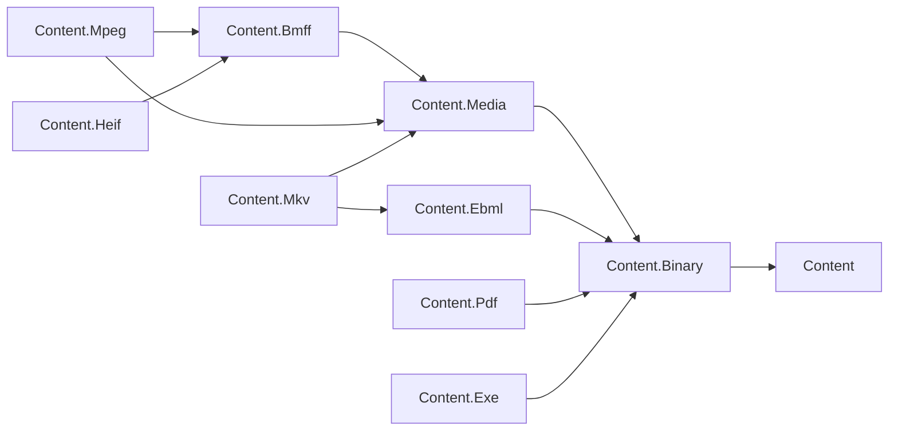

# Content area design

## Design intent

Content is the L1 foundation for reading, streaming and manipulating content. The root owns
format-neutral identity, ownership and composition contracts; format packages own their grammar,
reader, writer and document model. A static content engine builds on Text, Markdown and YAML;
MediaHub builds on media containers; OpenApi uses YAML serialization. Hosting, storage selection,
media workflows and job orchestration remain with the consuming service or its adapters.

The family must handle a 40 GB source, a non-seekable upload and hostile bytes without requiring a
whole-file allocation. Keeping these concerns in libraries lets services share format correctness
without sharing a runtime or storage backend. This record defines the architecture and acceptance
policy; the [Content foundation program plan](../../programs/CONTENT_FOUNDATION_PLAN.md) owns
sequencing, delivery work and open owner decisions. The contracts below are the target, not a claim
that every package already implements them.

## Access modes

Every container format follows the reader / writer / document triad in plan D1. The comparison is
`System.Text.Json`'s `Utf8JsonReader`, `Utf8JsonWriter` and `JsonDocument`: callers choose a streaming
surface or a document surface according to their access needs. Content's document surface also
supports mutation and saving; the analogy does not make `JsonDocument` mutable.

| Mode | Contract | Why it is separate |
| --- | --- | --- |
| Reader | Forward-only, element-by-element access over seekable or non-seekable input; descend into or skip a container; skip payloads without buffering them. | Inspecting metadata or ingesting a live upload must not materialize media payloads. Skipping on a non-seekable source may consume bytes, but never retains the whole payload. |
| Writer | Forward-only emission. Precompute or accept declared sizes on non-seekable output, or buffer one bounded unit; back-patch only when output is seekable. Choose large-size and unknown-size encodings deliberately. | Network output cannot assume a later seek, and a size field must never force buffering an entire file. |
| Document | Build a tree from the reader over a seekable source, edit it, then save through the writer. Untouched payloads remain lazy source segments and copy through on save. Recompute sizes and dependent offsets. | Random access and mutation cost metadata memory, while unchanged media stays outside the managed heap. |

Round-trip fidelity is an explicit goal: preserve unknown structure and untouched payload bytes,
and preserve the meaning of edited structure. Moving BMFF's `moov` requires updating `stco`/`co64`;
changing a Matroska layout requires updating `SeekHead`/`Cues`. A document retains access to its
source until lazy segments have been copied. Ownership is explicit, and a borrowed source is never
disposed by a slice. Non-seekable ingestion uses the reader; a document needing later random access
requires a caller-provided seekable source.

BMFF's existing composite box tree **is its document model**: `BmffBox`, `BmffBoxComposite`, visitors
and the one-class-per-box layout remain. A second document tree would duplicate both structure and
mutation rules. The integrated implementation retains that design and uses bounded shared stream primitives.

The triad applies to container formats, not to the root contracts or primitive-only packages.
Text's line/token surfaces and YAML/Markdown's existing in-memory models retain their documented
scope. YAML preserves document semantics rather than comments; Markdown writes a canonical form
of its retained subset. Those policies must be explicit in their round-trip tests.

## Shared primitives

`Content.Binary` owns the exact-read, skip and copy operations, bounded `ContentSliceStream`, lazy
`BinarySegment`, span-based `BinaryContentReader`/`BinaryContentWriter`, FourCC and fixed-point
values (plan D2). Binary formats reuse these so partial reads, absolute positions and source
ownership have one implementation. Core's `OffsetStream` cannot substitute for a bounded stream
that returns short reads and supports forward-only input; Media's unchecked partial-read helper
was retired with Stage 1. The [Content.Binary design](../../../libraries/Content/Assimalign.Cohesion.Content.Binary/docs/DESIGN.md)
holds the primitive contracts and trade-offs.

## Family map

The diagram shows the integrated direct dependencies at `17e58c2a1`; every arrow means "depends on".
Text depends on Content, and YAML and Markdown each depend on both Content and Text; that unchanged
text branch is recorded in the table rather than adding nodes to this ten-node graph.



All package names below have the `Assimalign.Cohesion.` prefix. Dependencies are the direct
`CohesionProjectReference` items at `17e58c2a1`, without inferred transitive edges.

| Package | Delivered role | Direct dependencies | Classification |
| --- | --- | --- | --- |
| `Content` | Identity, ownership, composition and reader/writer contracts | None | Strategic |
| `Content.Binary` | Shared binary primitives and lazy payload references | Content | Strategic |
| `Content.Text` | Unicode detection, bounded lines and tokens | Content | Strategic |
| `Content.Yaml` | YAML model, parser, emitter and bounded depth/alias expansion | Content, Content.Text | Strategic |
| `Content.Markdown` | Retained CommonMark model, parser, canonical writer and HTML renderer | Content, Content.Text | Strategic |
| `Content.Media` | Tracks, exact timestamps, lazy sample indexes and seek ranges | Content.Binary | Strategic |
| `Content.Bmff` | ISO BMFF streaming I/O, composite tree, profile registry and relocation | Content.Media | Strategic |
| `Content.Mpeg` | MP4 tracks/sample entries, fast start and retained CMAF checks | Content.Bmff, Content.Media | Strategic |
| `Content.Heif` | HEIF/AVIF still-image items, derived images and metadata editing/erasure | Content.Bmff | Strategic |
| `Content.Ebml` | Generic EBML streaming I/O, schemas, DocType registry and editable documents | Content.Binary | Strategic |
| `Content.Mkv` | Matroska/WebM tracks, blocks/laces, typed chapters and metadata editing | Content.Ebml, Content.Media | Strategic |
| `Content.Pdf` | PDF structure, random-access reader, filters, full and incremental save | Content.Binary | Strategic |
| `Content.Exe` | PE/ELF/Mach-O inspection and separate process invocation | Content.Binary | Strategic |

The dependency migrations are integrated. EBML stays on Binary because it is a generic container;
Matroska adds the media semantics. MPEG directly references both BMFF and Media. HEIF references
BMFF only. Dependencies point toward shared contracts and primitives, never back from the root
into a format or into another package's internals.

## BMFF-derived format retention — O-C3

Owner decision O-C3 (2026-10-16): "Retain HEIF/AVIF as Content.Heif (still images:
ftyp/meta/iloc/iprp model), and keep CMAF as a profile inside Content.Mpeg."

A BMFF-derived format gets its own package when its data model materially diverges from the MP4
track model. HEIF represents still images as metadata items with locations, properties and item
references, so `Assimalign.Cohesion.Content.Heif` is retained as a separate strategic package.
A constrained subset of the MP4 track model, such as CMAF, remains a profile inside Content.Mpeg.
A brand alone does not justify a package. Other derived formats require an explicit retention
decision before scaffolding.

Content.Heif references Content.Bmff only. Both HEIF and MPEG reuse BMFF's registry, composite
tree, streaming reader/writer, unknown preservation and offset relocation; neither profile
references the other. HEIF image sequences (`msf1` and AVIF sequence brands) are outside this
first wave. A future sequence implementation should reuse the MP4 profile's track interpretation
rather than treating tracks as HEIF items; that dependency decision belongs to the future scope.
Pixel codecs, TIFF/Exif parsing (gap #1553), and CMAF implementation are outside this package.

## Classification

**Strategic** means retained and included in CI and release inventory, with the stabilization
gates still governing readiness for new service dependencies. Implementation is not gate approval.
**Experimental** means kept in the tree, not shipped,
with scope undecided. **Archive** means a candidate for deletion on which nothing builds. No
package is experimental or archive today: `Content.Exe` was experimental until owner decision O-C1
settled its scope. These classifications follow the program plan's survey, section 1.

| Package | Classification | Reason |
| --- | --- | --- |
| `Content` | Strategic | Neutral contracts and concrete memory/stream/composite implementations anchor every format. |
| `Content.Binary` | Strategic | Implemented exact I/O, slices and lazy segments are shared by the retained binary formats. |
| `Content.Text` | Strategic | Implemented encoding, bounded line and token primitives support text formats and the static content engine. |
| `Content.Yaml` | Strategic | Implemented YAML model/parser/emitter serves OpenApi; the official subset and generated-doc gap remain explicit. |
| `Content.Markdown` | Strategic | Implemented CommonMark subset, canonical writer and HTML renderer serve static content. |
| `Content.Media` | Strategic | Implemented track, sample and exact-timeline contracts are consumed by MP4 and Matroska. |
| `Content.Bmff` | Strategic | Implemented streaming I/O, strategic box fields, lazy tree and relocation; deferred field grammars remain opaque. |
| `Content.Ebml` | Strategic | Implemented generic reader/writer/document, schema validation, CRC and forward-only payload access. |
| `Content.Mkv` | Strategic | Implemented Matroska/WebM profile over EBML and Media, including typed chapters and streamed frames. |
| `Content.Mpeg` | Strategic | Implemented MP4 profile over BMFF and Media, with retained CMAF checks and lazy native sample indexes. |
| `Content.Heif` | Strategic | O-C3 retains implemented HEIF/AVIF still-image items, metadata editing and physical payload erasure. |
| `Content.Pdf` | Strategic | Implemented structural read/edit/save, including incremental updates; documented seekable input is required for trailing cross-reference data. |
| `Content.Exe` | Strategic | O-C1 retains implemented inspection and separate bounded process invocation with cleanup tests. |

O-C1 was decided by the owner on 2026-10-16: "Keep process invocation in Content.Exe, separated
from inspection, with timeout, cancellation and process-tree cleanup." Inspection types never start
a process and invocation types never parse a file format. Process launching brings security and
lifecycle obligations no other Content package has (no shell, argument lists only, bounded output
capture, process-tree termination on timeout or cancellation), so `Content.Exe` carries
process-lifecycle tests in addition to its format corpus.

## Standards

These are named specification baselines, not claims of complete conformance. A package's compliance
tests identify the edition and section or example they exercise and document its retained subset.
For a living registry or online specification, fixture provenance also records the revision or
retrieval date; the online references below were reviewed on 2026-10-16.

| Package | Governing specification and edition | Scope today |
| --- | --- | --- |
| `Content`, `Content.Binary`, `Content.Media` | No independent file-format standard; family contracts and format-specific consumers govern these layers. | Implemented neutral contracts, exact binary I/O/lazy segments and shared tracks, rational time, indexes and seek ranges. |
| `Content.Bmff` | [ISO/IEC 14496-12:2026, edition 8](https://www.iso.org/standard/85596.html), with the [MP4RA registry](https://mp4ra.org/). | Implemented strategic box fields, bounded reader/writer, lazy composite documents, unknown preservation and relocation; deferred field grammars are explicit. |
| `Content.Mpeg` | [ISO/IEC 14496-14:2020, edition 3](https://www.iso.org/standard/79110.html). | Implemented MP4 brands, 13 sample-entry types, media mapping, edits and fast start; retained CMAF container checks. No MPEG-2 transport streams or codec decoding. |
| `Content.Heif` | [ISO/IEC 23008-12:2025, edition 3](https://www.iso.org/standard/89035.html) over ISO/IEC 14496-12; [AVIF v1.2.0](https://aomediacodec.github.io/av1-avif/v1.2.0.html); [MP4RA](https://mp4ra.org/) brands, items and properties (reviewed 2026-10-16). | Implemented still-image items/properties/references, grids/overlays, metadata edits and removal of unshared payload bytes. No sequence tracks or pixel decoding. |
| `Content.Ebml` | [RFC 8794 (2020)](https://www.rfc-editor.org/rfc/rfc8794). | Implemented VInt and element I/O, schemas/DocTypes, CRC, unknown-size masters, payload streams and lazy document saves. |
| `Content.Mkv` | [RFC 9559 (2024)](https://datatracker.ietf.org/doc/html/rfc9559) and the [Matroska element specification, version 4 table](https://www.matroska.org/technical/elements.html). | Implemented retained Matroska/WebM tracks, clusters, all lacing modes, tags, attachments, chapters and index maintenance. No codec decoding or full-conformance claim. |
| `Content.Pdf` | [ISO 32000-2:2020, edition 2 (PDF 2.0)](https://www.iso.org/standard/75839.html). | Implemented PDF 1.0–1.7/2.0 structural parsing, xrefs/object streams, retained filters, lazy streams, full saves and incremental updates; seekable input required, no rendering. |
| `Content.Exe` | [Microsoft PE/COFF specification, online revision 2026-09-10](https://learn.microsoft.com/en-us/windows/win32/debug/pe-format); [System V ABI / ELF gABI, ELF object format 4.3 draft](https://gabi.xinuos.com/). | Implemented PE image headers/tables, ELF headers/sections/program tables and thin/universal Mach-O headers. No executable serializer; invocation is a separate runtime contract. |
| `Content.Yaml` | [YAML 1.2.2](https://yaml.org/spec/1.2.2/). | Model, parser and emitter with core-schema semantics; supported subset and excluded official-suite cases documented by the package. |
| `Content.Markdown` | [CommonMark 0.31.2](https://spec.commonmark.org/0.31.2/). | Retained subset with canonical Markdown output and HTML rendering; exclusions are explicit in the package design. |
| `Content.Text` | [Unicode 17.0.0, encoding forms](https://www.unicode.org/versions/Unicode17.0.0/) and [RFC 3629 (2003), UTF-8](https://www.rfc-editor.org/rfc/rfc3629). | UTF-8/16/32 detection and decoding, line endings and literal tokenization; no normalization or legacy code-page policy. |

The [MP4 profile record](../../../libraries/Content/Assimalign.Cohesion.Content.Mpeg/docs/DESIGN.md#brand-interpretation) records the retained CMAF constraints.
The [Exe scope table](../../../libraries/Content/Assimalign.Cohesion.Content.Exe/docs/DESIGN.md#retained-inspection-scope-476) links Apple's Mach-O wire references and lists excluded structures. The corpus evidence below tests retained scopes, not entire standards.

## Error model

Plan D3 defines one malformed-input vocabulary: `ContentFormatException` (or a format-derived
type) carries `ContentFormatErrorCode` and the absolute source position, an absolute byte offset
for binary readers. The codes are `Truncated`, `InvalidStructure`, `InvalidValue`,
`LimitExceeded` and `Unsupported`, with `Unspecified` for the legacy constructors. Text formats may add line and column diagnostics. This lets
consumers handle failures without depending on localized message wording or a proliferation of
exception classes. Tests assert codes and positions, never message text. Argument misuse and
underlying I/O failure remain distinct from malformed format bytes.

Readers must not leak `IndexOutOfRangeException`, `ArgumentOutOfRangeException`,
`OverflowException`, `EndOfStreamException` or `InvalidCastException` for malformed input. The
shared code enum is used by Binary and all retained format readers. EBML's derived errors now
carry the shared code and absolute position. Text strict decoding normalizes decoder failures to
`InvalidValue` with a byte position when known; lenient decoding retains replacement behavior.
Caller-supplied readers and transport failures keep their own contracts. The executed scans and
malformed-input corpora below establish the reviewed scope of this claim.

Declared sizes are untrusted (plan D4). Validate lengths, arithmetic and container boundaries
before allocating; reader options cap buffered payloads at 16 MiB by default and also cap nesting
depth. Larger document payloads stay lazy when the source permits it. If bytes would have to be
buffered beyond the cap, reject with `LimitExceeded`. Truncation, oversized lengths and excessive
depth belong in each format's malformed-input corpus. Raising a caller-selected cap is explicit;
the wire never selects an allocation budget.

## Fixtures and corpora

Plan D6 makes fixtures license-clean and self-contained. Build bytes in code, transcribe permitted
specification examples with attribution, or use small files produced by the family's own writer.
Never download test data or require developer-local media paths. Tests must run from the checkout
without network access. Existing vendored material retains its license and provenance; the YAML
corpus already records its upstream commit and excluded cases, and is not fetched during tests.

New fixtures live in `tests/TestObjects/`. Each checked-in file has an adjacent provenance note or
test comment naming its producer (writer and generation recipe, or specification edition, section
and example), the origin and license/permission, and any intentional byte edits. A malformed
variant records the valid seed and how it was truncated or mutated, so the expectation can be
reproduced without an external corpus.

Every retained format carries three complementary corpora:

1. **Golden round trips:** deterministic examples read, written through the package's own writer
   and read again; check semantics and promised byte fidelity, including unknown structure and
   untouched payloads. Canonical text formats assert their documented normalization.
2. **Malformed input:** truncate at every header byte, declare oversized lengths and exceed depth
   limits; assert the format error code and position. For a grammar that accepts all text, such as
   Markdown, test specified fallback and resource bounds instead of inventing syntax errors.
3. **Specification-mapped compliance:** map each test to an edition and section/example, cover
   the retained subset, and list unsupported cases explicitly. A passing selected corpus is not a
   claim of full specification compliance.

## Stabilization gates

A format package must pass every applicable gate before a service takes a new dependency on it.
Classification alone is not approval. Apply the same checks to the shared layers it relies on,
with non-format requirements marked inapplicable only for an explicit reason.

1. **Build and release coverage.** The package builds in the Content CI matrix, its tests run
   there, and it is in the release inventory. Check `.github/workflows/library-content.yml`, run
   the package build/test commands and `Assert-CohesionReleaseInventory` from
   `scripts/modules/CohesionPackaging.psm1`. An inventory exclusion is not a pass.
2. **Implemented, controlled failure paths.** No public member throws `NotImplementedException`,
   and no reader leaks a raw BCL exception for malformed input. Search source with `rg`, review
   reachable parsing paths and run malformed-input tests. An empty implementation or an empty
   test does not establish this gate; argument misuse and transport I/O failures are distinct.
3. **Named specification and mapped compliance.** Package documentation pins the governing
   edition and retained scope. Passing compliance tests map to specification sections/examples
   or versioned official-suite cases; exclusions are recorded. Check the docs, case metadata and
   test results together, not just the existence of a specification URL.
4. **Golden round trips through the writer.** Golden cases run through the package's own writer
   and back through its reader. Assert stable output and semantic equivalence, plus preservation
   of unknown structure and untouched payload bytes where the format promises it. Run the
   round-trip suite; a primitive VInt test alone does not qualify an EBML document writer.
5. **Malformed-input corpus and limits.** Tests cover truncation at every header byte, oversized
   declared lengths and depth limits, asserting `ContentFormatErrorCode` and absolute positions.
   Run the corpus with the default limits and boundary cases. For text without binary headers,
   test the corresponding encoding/token boundaries and resource limits. Markdown's total
   grammar requires fallback tests rather than syntax-error tests; actual limit failures still
   need the shared error vocabulary.
6. **Streaming and lazy save (container formats).** A test stream that rejects seeking proves
   the forward-only reader can descend, skip and consume elements. Instrumented source and
   output streams prove the document saves through the writer without loading untouched
   payloads into memory. Verify bounded buffering and unchanged payload bytes, not merely a
   successful parse over `MemoryStream`. A format whose structure requires random access,
   such as PDF with its trailing cross-reference data, is judged on lazy loading and bounded
   saving rather than a non-seekable reader: its documented seekable-source requirement is
   the contract. This exception does not imply spooling a non-seekable source into memory.
7. **Current documentation and complete public API docs.** Review `docs/OVERVIEW.md` and
   `docs/DESIGN.md` against the delivered behavior, and review every public member's XML
   documentation, including parameters, returns and exceptions. File existence and a build
   without documentation warnings are insufficient checks.
8. **NativeAOT analyzer cleanliness.** Build with `IsAotCompatible=true` and enabled AOT/trim
   analyzers; no `IL2xxx` or `IL3xxx` warnings may remain or be suppressed to pass. Check evaluated
   MSBuild properties and build diagnostics. This is the analyzer gate, not a claim that a
   native executable has been published for every platform.
9. **Recorded performance baseline, pending G2.** Once program gap G2 lands, record the benchmark
   commit, runtime/machine, corpus, throughput and allocation results for the package's retained
   operations in `cohesion-benchmarks`, against the budgets G2 defines. Review that reproducible
   record before marking this gate passed. Until G2 exists this gate is `pending` (the historical
   baseline used `n/a`); it does not silently become a pass or impose an invented budget.

### Final implementation snapshot — `17e58c2a1`

Re-verified on 2026-10-16 at the integrated base `17e58c2a1`, before the close-out
documentation edits. All thirteen retained packages are implemented, built, tested and listed
for release. This is **not an all-gates-pass declaration**. `fail` includes missing acceptance
evidence even when the implementation and its existing tests succeed. `n/a` has the explicit
scope explanations below; gate 9 is **pending** [#1549](https://github.com/assimalign/cohesion/issues/1549).
The historical `f7197e97f` table and its evidence are preserved below this snapshot. The later
[documentation delta](#close-out-documentation-delta) records repairs without rewriting the base evidence.
The six gate 6 cells include the later [bounded-save evidence](#gate-6-bounded-save-evidence)
from #1564; every other cell retains the close-out's recorded value.

| Package | 1 CI/release | 2 Failures | 3 Spec tests | 4 Round trip | 5 Malformed | 6 Streaming | 7 Docs | 8 AOT | 9 Perf |
| --- | --- | --- | --- | --- | --- | --- | --- | --- | --- |
| `Content` | pass | pass | n/a | n/a | n/a | n/a | fail | pass | pending |
| `Content.Binary` | pass | pass | n/a | n/a | n/a | n/a | fail | pass | pending |
| `Content.Media` | pass | pass | n/a | n/a | n/a | n/a | fail | pass | pending |
| `Content.Bmff` | pass | pass | pass | pass | pass | pass | fail | pass | pending |
| `Content.Mpeg` | pass | pass | pass | pass | pass | pass | fail | pass | pending |
| `Content.Heif` | pass | pass | pass | pass | pass | pass | fail | pass | pending |
| `Content.Ebml` | pass | pass | pass | pass | pass | pass | fail | pass | pending |
| `Content.Mkv` | pass | pass | pass | pass | pass | pass | fail | pass | pending |
| `Content.Pdf` | pass | pass | pass | pass | pass | pass | fail | pass | pending |
| `Content.Exe` | pass | pass | pass | n/a | pass | n/a | fail | pass | pending |
| `Content.Text` | pass | pass | pass | n/a | pass | n/a | fail | pass | pending |
| `Content.Markdown` | pass | pass | pass | pass | pass | n/a | fail | pass | pending |
| `Content.Yaml` | pass | pass | pass | pass | pass | n/a | fail | pass | pending |

Content, Binary and Media have no independent format grammar: gates 3–6 are inapplicable,
but their actual contract, primitive and media-model tests establish gates 1–2. Text has no
format writer or lazy document (gates 4 and 6). YAML and Markdown retain whole-input text
models, outside the container triad (gate 6); depth/alias/fallback tests do not claim a total
input-memory budget. Exe is explicitly an inspector, not an executable writer or editable
container: gates 4 and 6 are inapplicable. This corrects the baseline's gate-4 failure against
a surface that the delivered, documented inspection scope does not promise. Exe invocation
is separately covered by `ExecutableInvocationTests`, including timeout/cancellation and
descendant cleanup; format inspection never invokes the inspected file.

#### Executed commands and counts

From the repository root, `P` was each exact `Assimalign.Cohesion.`-prefixed package in the
table below. Each build/test invocation named its csproj, used Debug, and ran without a test
filter or added skip. SDK: `10.0.401`. Logs and the review-only Roslyn inventory were kept in
`%TEMP%/content-s7-closeout`, outside the committed tree. No pack/install command ran.

```powershell
git log -1 --oneline
dotnet --version
dotnet build libraries/Content/<P>/src/<P>.csproj
dotnet test libraries/Content/<P>/tests/<P>.Tests.csproj
dotnet msbuild libraries/Content/<P>/src/<P>.csproj -getProperty:IsAotCompatible,EnableAotAnalyzer,EnableTrimAnalyzer,GenerateDocumentationFile,NoWarn,RunAnalyzersDuringBuild
dotnet build libraries/Content/<P>/src/<P>.csproj -p:GenerateDocumentationFile=true -p:EmitCompilerGeneratedFiles=true "-p:CompilerGeneratedFilesOutputPath=$taskScratch/generated/<Package>"
pwsh -NoProfile -Command "Import-Module ./scripts/modules/CohesionPackaging.psm1 -Force; Assert-CohesionReleaseInventory"
rg -n 'NotImplementedException' libraries/Content -g '*.cs' -g '!**/obj/**' -g '!**/bin/**'
rg -n 'throw new (IndexOutOfRangeException|ArgumentOutOfRangeException|OverflowException|EndOfStreamException|InvalidCastException|ArgumentException|InvalidOperationException|FormatException|DecoderFallbackException)|(?:ArgumentNullException|ArgumentOutOfRangeException)\.ThrowIf' libraries/Content -g '**/src/**/*.cs' -g '!**/obj/**' -g '!**/bin/**'
rg -n 'ReadExactly|checked\(|catch .*Exception' libraries/Content -g '**/src/**/*.cs' -g '!**/obj/**' -g '!**/bin/**'
rg -n 'ContentFormatErrorCode|MaxDepth|DepthLimit|LimitExceeded' libraries/Content -g '*.cs' -g '!**/obj/**' -g '!**/bin/**'
rg -n 'IL[23][0-9]{3}|NoWarn|SuppressMessage' libraries/Content -g '*.cs' -g '*.csproj' -g '*.props' -g '!**/obj/**' -g '!**/bin/**'
```

For the XML builds, `$taskScratch` was `Join-Path $env:TEMP 'content-s7-closeout'`, and
`<Package>` was the short package name in this table. XML generation was enabled only on
the command line. No project settings or suppressions changed.

| Package | Ordinary build warnings / errors | Tests passed / failed / skipped | XML build warnings / errors | BCL-search lines |
| --- | --- | --- | --- | --- |
| `Content` | 0 / 0 | 22 / 0 / 0 | 0 / 0 | 3 |
| `Content.Binary` | 0 / 0 | 201 / 0 / 0 | 0 / 0 | 72 |
| `Content.Media` | 0 / 0 | 93 / 0 / 0 | 0 / 0 | 17 |
| `Content.Bmff` | 0 / 0 | 413 / 0 / 0 | 81 / 0 | 81 |
| `Content.Mpeg` | 0 / 0 | 104 / 0 / 0 | 0 / 0 | 11 |
| `Content.Heif` | 0 / 0 | 85 / 0 / 0 | 0 / 0 | 16 |
| `Content.Ebml` | 0 / 0 | 267 / 0 / 0 | 1 / 0 | 104 |
| `Content.Mkv` | 0 / 0 | 77 / 0 / 0 | 0 / 0 | 35 |
| `Content.Pdf` | 0 / 0 | 256 / 0 / 0 | 0 / 0 | 37 |
| `Content.Exe` | 0 / 0 | 107 / 0 / 0 | 0 / 0 | 20 |
| `Content.Text` | 0 / 0 | 505 / 0 / 0 | 0 / 0 | 10 |
| `Content.Markdown` | 0 / 0 | 1,536 / 0 / 0 | 0 / 0 | 20 |
| `Content.Yaml` | 0 / 0 | 480 / 0 / 0 | 0 / 0 | 19 |

All 26 ordinary build/test commands and all thirteen XML builds exit 0: **4,146 passed,
0 failed, 0 skipped**. The inventory guard exits 0: 231 libraries/resources, 21 SDK packs,
19 framework families × 7 RIDs. Its four source-less CI exclusions are Amqp and the three
Dns.Client transports, not Content. All thirteen Content entries appear in both
`.github/workflows/library-content.yml` and `CohesionPackaging.psm1`; every package has a
test csproj discovered by the shared CI action. This is local verification plus configuration
inspection, not a claim that a new remote CI run or publication occurred.

#### Gates 2 and 5 — reachable failures and resource limits

The `NotImplementedException` search exits 1 with **zero matches**, including tests. The BCL
search exits 0 with **445 matching source lines** (counts above), not 445 parser defects.
Review distinguishes caller guards, state/capability errors, model-edit errors and transport
failures from malformed wire paths. Binary span reads check remaining bytes; container readers
check counts/ranges before constructing slices and segments. MP4 checked timestamp/fragment
arithmetic is translated to classified failures; Matroska uses checked wide intermediates and
classified timestamp errors. EBML strict text decoding and Content.Text's decoder adapter
translate decoder failures; PDF translates invalid compressed data. No raw malformed-input
escape was identified in these reviewed paths or exercised corpora. This evidence is bounded
to the retained operations and tested mutations, not a proof for every possible byte string.

| Package / format | Executed failure and boundary evidence |
| --- | --- |
| Content / Binary / Media | Root ownership/reopen tests; `BinaryContentReaderTests`, `ContentStreamExtensionsTests`, `ContentSliceStreamTests`, `BinarySegmentTests`; `MediaTimestampTests` and `MediaSampleIndexTests` cover argument, overflow, capability and cancellation contracts. Media is not a parser; its arithmetic exceptions must be translated by profiles. |
| BMFF | `BmffMalformedTests.Load_TruncatedStrategicHeader_ReportsAbsolutePosition`, `Load_CountBeyondPayload_RejectsBeforeAllocation`, `Load_NestedSubsamples_EnforcesCumulativeBudget`; `BmffComplianceTests` covers depth and buffered-payload limits. Unsupported deferred boxes remain opaque in lenient mode and fail with `Unsupported` in strict mode. |
| MP4 | `Mp4MalformedTests.Load_TruncatedVisualPrefix_ShouldReportAbsoluteEnd`, `Load_DeepSampleEntryChildren_ShouldRetainBmffDepthLimit`, `Load_ExceededLimits_ShouldRejectBeforeExpansion`, count/range disagreements and unsupported edit programs. |
| HEIF/AVIF | `HeifComplianceTests` and the malformed cases in `HeifDocumentTests`/`HeifBoxTests` cover truncated headers, extent arithmetic, item/property/reference caps and invalid derived images; fixture mutations are in `HeifMalformedFixtures`. Inherited BMFF depth/buffer checks also run. |
| EBML | `EbmlMalformedElementTests.ReadBinary_OversizedDeclaration_ReportsTruncationOrLimit`, `Skip_RecursiveDepthBomb_ReportsLimit`, `ReadNext_NestedSlice_ReportsSourcePosition`, and `ReadNext_DeterministicHostileInputs_ReportsOnlyFormatFailures`; schema-defined `0x80` and raw payload truncation regressions run. |
| Matroska/WebM | `MkvMalformedTests.Parse_TruncatedBlockHeaders_ReportsAbsoluteTruncation`, `Read_TruncatedEbmlHeaders_UsesSharedCorpus`, `Load_RecursiveTagBomb_ReportsDepthLimit`, `Load_MetadataCaps_ReportsLimit`, `ReadSamples_TimestampOverflow_ReportsInvalidValue`; frame-reader tests add streamed truncation and ownership. |
| PDF | `PdfMalformedCorpusTests.ReadIndirect_TruncatedStreamPrefixes_ReportsTruncated`, `Resolve_ObjectStreamCountBomb_ReportsLimitExceeded`, `Resolve_DepthBomb_ReportsLimitExceeded`, `Read_SlicedSource_ReportsAbsolutePosition`; filter and structure boundary suites cover decoding, cycles and deterministic corruptions. |
| PE/ELF/Mach-O | `ExecutableCorpusTests` applies every-prefix truncation to seven complete authored fixtures, sync and async; `ExecutableMalformedInputTests.Read_MalformedCorpus_ReportsCodeAndAbsolutePosition`, `Read_ReaderLimit_ReportsLimitExceeded`, `Read_MutatedHeaders_UsesFormatExceptionVocabulary`. No recursive executable-member descent is claimed. |
| Text | `UnicodeCorpusTests`, `TextDecodingFailureTests.OpenText_InvalidUtf8_ReportsContentFailureAsync`, `OpenText_ReaderEntryPoint_TranslatesFailureAsync`, `TextLineReaderLimitTests.TryReadLine_EndlessInput_BoundsWorkAndAllocation`. Line-limit positions are decoded UTF-16 offsets; decoder positions are byte offsets. |
| Markdown | `MarkdownMalformedCorpusTests`, `MarkdownParserOptionsTests.Parse_ContainerLimit_DegradesExcessMarkers`, `Parse_DestinationDepthBoundary_DegradesOnlyExcess`, child-process `ParserResourceLimitTests`, and strict-decoder regressions. Excess syntax degrades to text rather than inventing a syntax exception. |
| YAML | `YamlResourceLimitTests.Parse_DefaultDepthBoundary_Accepts`, `Parse_AliasBudgetBoundary_ChargesExpandedNodes`, `Parse_AliasBomb_UsesBoundedTimeAndAllocation`, child-process `ParserResourceLimitTests`, and decoding/error-position regressions. Syntax/limit errors carry shared codes and original decoded-character positions. |

#### Gates 3 and 4 — mapped corpora and writer round trips

The standards table names the area baselines. These tests establish the **documented retained
subsets**, including explicit exclusions; no row asserts full codec or specification certification.
No fixture was downloaded during close-out. Existing YAML and CommonMark vendoring keeps its
recorded provenance and licenses; other binary fixtures are authored bytes or writer output.

| Format | Specification mapping and corpus | Writer evidence |
| --- | --- | --- |
| BMFF | `BmffModelTests` / `BmffFlagVersionTests` map ISO/IEC 14496-12 box clauses; `BmffGoldenFixtures` builds progressive, fast-start, fragmented and HEIF-shaped structures. Deferred boxes are listed in package DESIGN. | `BmffGoldenTests.Save_GoldenFile_IsByteIdentical`; `BmffMutationTests` checks metadata growth, chunk/fragment/item relocation and repeated saves; `BmffIndexRelocationTests` covers sidx/saio. |
| MP4/CMAF subset | `Mp4GoldenTests`, `Mp4RegistryTests`, `Mp4SampleTests`, `Mp4BoundaryTests` map ISO/IEC 14496-14, 14496-12 and retained 23000-19 clauses; `Mp4GoldenFixtures` produces five structural goldens with placeholder codec bytes. | `Save_CheckedInGolden_ShouldMatchWriterAndRoundTrip`; fast-start, sample and auxiliary-offset preservation tests. External muxer interoperability and full CMAF certification remain outside the evidence. |
| HEIF/AVIF | [Corpus provenance](../../../libraries/Content/Assimalign.Cohesion.Content.Heif/tests/TestObjects/Corpus/PROVENANCE.md): ISO/IEC 23008-12 clause titles, BMFF item clauses, AVIF v1.2.0 sections; four writer-produced fixtures. | `HeifCorpusTests.Load_CheckedFixture_MatchesWriterAndRoundTrips`; `HeifDocumentTests` metadata edits; `HeifErasureTests.Save_RemovedMetadata_ContainsNoMarkersAndPreservesImages` covers physical erasure and retained images. |
| EBML | `Rfc8794Corpus`, `EbmlComplianceTests` and `EbmlSchemaIdentifierTests`: RFC 8794 §§5–8, 11, 15, explicit schema authority and retained width limits. | `EbmlDocumentTests.Save_ConstructedDocument_PreservesBytesAndLazyUnknowns`, `Save_EditedMetadata_UpdatesSizesAndCopiesBinary`, and CRC/async round trips. |
| Matroska/WebM | `MkvSchema`, `MkvGoldenCorpusTests`, `MkvChapterTests` and `MkvFrameReaderTests`: RFC 9559 / RFC 8794 sections and the documented 2026-10-16 element-table snapshot; four `MkvFixtures.Create` goldens. | `Save_GoldenFile_PreservesEveryByte`, `Save_RepeatedGrowthAndShrink_PreservesWholeClustersAndPositions`, typed chapter edits and all lace modes. |
| PDF | `PdfCorpusTests`, `PdfParserTests`, `PdfCrossReferenceTests`, filter/boundary suites and the package DESIGN clause table map ISO 32000-2:2020 §7. Authored reader goldens and six `PdfWriterGoldenBuilder` files cover table/stream/hybrid revisions. | `PdfWriterComplianceTests.Read_WriterGolden_PreservesGraphsAcrossSaves`, `Write_RepeatedSaves_AreByteIdentical`, full/incremental save suites, nested mutation and four successive revisions. |
| PE/COFF, ELF, Mach-O | `ExecutableMetadataTests` / `ExecutableCorpusTests`: PE File/Optional/Section headers, gABI ELF headers/sections/program headers, Apple thin/fat headers and load commands; authored fixtures plus the test runtime's file-backed PE. | n/a — inspection snapshots have no executable serializer. |
| Text | `UnicodeCorpus` / `UnicodeCorpusTests`: Unicode 17.0 §§3.9/3.10/5.8 and RFC 3629 §§3/4/6; exact scalar boundaries, BOMs, malformed subparts and line semantics. | n/a — decoding/line/token primitives, not a format writer. |
| Markdown | [CommonMark 0.31.2 provenance](../../../libraries/Content/Assimalign.Cohesion.Content.Markdown/tests/TestObjects/CommonMark/PROVENANCE.md): all 652 official examples, 406 retained and 246 pinned degradations, plus the construct corpus. | All 652 canonical structural round trips plus `MarkdownRoundTripTests`; exclusions stay explicit rather than becoming test skips. |
| YAML | [Versioned official-suite subset](../../../libraries/Content/Assimalign.Cohesion.Content.Yaml/tests/TestData/yaml-test-suite/README.md), commit `6ad3d2c62885d82fc349026c136ef560838fdf3d`: 223 vendored cases from 333 runnable cases at vendoring, 110 explicitly excluded; YAML 1.2.2 core-schema and boundary tests. | `YamlEmitterTests.Write_RoundTrip_IsStable`, facade seams and anchor/tag shared-node regressions. Comments and original presentation are not preserved. |

#### Gate 6 — gaps recorded at the documentation close-out

This table preserves the gaps recorded before #1564; the later
[bounded-save evidence](#gate-6-bounded-save-evidence) closes them. All named tests below ran
in the full suites above. A sparse **load** test, a tiny round trip
or a save that fails before reaching the payload does not establish a bounded successful
large-payload save. At close-out, the five media/container rows needed a completed save above
the buffering cap, with instrumented input/output and a buffering/allocation bound plus payload equality.
No acceptance test was added or weakened in this documentation-only review.

| Package | Forward-only and lazy evidence present | Why gate 6 still fails |
| --- | --- | --- |
| BMFF | `BmffComplianceTests.Read_NonSeekableSource_ReachesFinalBoxWithBoundedTransfers`, `Skip_NonSeekableMedia_DrainsWithoutMaterialization`, `ReadChildren_NonSeekableContainers_ReachesSibling`; `BmffLazyLeafTests.SaveAsync_ProfileLeafAboveCap_CopiesIdenticalBytes`; `BmffWriterTests.WriteAsync_RootContract_PreservesBytes`. | The lazy-save test copies five bytes above a four-byte cap with a probed output, but no save-time source/allocation bound. The 40 GiB source is exercised on load/relocation, not a completed bounded save. |
| MP4 | `Mp4BoundaryTests.Read_NonSeekablePartialDelivery_ShouldSkipWithoutBufferingMedia`, sparse load/fast-start and million-sample tests; golden saves use the BMFF writer. | No instrumented completed profile-document save proves unchanged large media/configuration payloads stay bounded. Generic BMFF support and small goldens do not establish that regression gate. |
| HEIF | `HeifStreamingTests.Read_NonSeekableInput_DescendsIntoMeta`, `Save_NonSeekableOutput_CopiesUnchangedImages`, `Load_FortyGiBIdat_DoesNotReadImagePayload`; physical-erasure regressions. | The completed probed save uses small image bytes. `HeifErasureTests.Save_SparseImage_CompactsUsingBorrowedSlicesOnly` deliberately throws on output before copying the 40 GiB image; it proves lazy planning, not successful bounded copy-through. |
| EBML | `EbmlReaderTests.ReadNext_UnknownMasterOnNonSeekableInput_PreservesSibling`, `EbmlPayloadStreamTests.OpenPayloadStream_NonSeekablePayload_StopsAtBoundary`, `EbmlWriterTests.WriteElement_ForwardOnlyOutput_RoundTrips`, `EbmlDocumentTests.ReadAsync_AsyncOnlyStreams_RoundTripsWithoutSyncIo`. | Sparse 40 GiB coverage is load/measurement only. `WriteAsync_NestedCrcMasters_KeepsCopyPassesBounded` bounds passes over eight payload bytes, not buffering during a completed large save. |
| Matroska | `MkvStreamingTests.Read_LivePartialReads_DoesNotBufferBlocks`, `Write_ForwardOnlyOutput_RoundTripsLiveMasters`, `Load_FortyGiBBlock_ReadsOnlyFraming`; `MkvFrameReaderTests.ReadAsync_LargeFrame_StreamsWithoutMaterializing`; repeated metadata saves preserve complete cluster bytes. | The large-block tests cover load/frame access. Metadata-save tests compare small cluster bytes without a save-time source/allocation bound. EBML raw-copy support alone does not establish the document's complete save regression. |
| PDF | `PdfFullSaveTests.WriteAsync_NonSeekableDestination_EmitsReadablePdf`; `PdfIncrementalSaveTests.Write_UntouchedOpaqueStream_CopiesWithoutDecodingOrMaterialization` measures one bounded copy of a 2 MiB opaque payload in both save modes. | `PdfMalformedCorpusTests.Read_StreamCapabilities_RejectsNonSeekableAndHandlesShortReads` explicitly rejects non-seekable input. Package DESIGN specializes the reader for random-access xrefs, but the area gate/plan D1 still requires a forward-only reader. The owner must resolve that contract conflict; this review grants no waiver. |

#### Gates 7–9 — documentation, analyzers and pending measurements

Gate 7 is measured before repairs. Review covered the source declarations, inherited contracts,
public collection accessors, helper-propagated guards/failures, and the two generated YAML value
types. Compiler XML warnings are only one signal. Concrete findings include:

| Package | Documentation finding at `17e58c2a1` |
| --- | --- |
| Content | Async cancellation/read-only-write exceptions omitted from inherited contracts; root DESIGN still describes completed error/dependency migrations as future work. |
| Binary | Slice `Remaining`/`Flush` disposal and span-write failure docs incomplete; DESIGN still describes EBML/PDF references as migrations. |
| Media | DESIGN's dashed Stage 4 profile dependencies and planned-adapter table are stale; public XML contracts are reviewed separately from this status failure. |
| BMFF | Missing/empty enum and deferred-box summaries, undocumented explicit content seams, guard/cancellation exceptions omitted on several stream/writer members. |
| MPEG | `Mp4File.Load` omits null/options guards and inherited async read omits cancellation; profile setter and inherited box exceptions require review. |
| HEIF | Inherited BMFF box contracts omit guards; item-view and edit operations need the propagated failure contracts checked, including source lifetime and save failures. |
| EBML | `EbmlElementType.None` has no summary; save null guard and reader/writer disposal/state failure documentation is incomplete. |
| MKV | Async open-read cancellation and delegated collection/edit/source failure contracts are incomplete. |
| PDF | Explicit nongeneric enumeration and delegated collection/lazy resolution/source failures require documentation; ordinary zero XML warnings do not cover them. |
| Exe | Invocation documents unexpected cleanup failures only in remarks, without exception elements for the propagated I/O/process errors. |
| Text | Detection/open-text can propagate source disposal, reopen/capability and I/O failures; async cancellation must be documented through the inherited contract. |
| Markdown | Explicit nongeneric enumeration and stream/text-content failure contracts are incomplete. |
| YAML | Null guards on writes/scalar construction and helper-propagated parse guards are undocumented; generated operators inherit parameter names different from `a`/`b`, and generated JSON writer exception contracts require generator-owned repairs. |

Gate 8 passes **for each shipped library's analyzer build**: evaluated `IsAotCompatible`,
`EnableAotAnalyzer` and `EnableTrimAnalyzer` are all `true`; `NoWarn` is `1701;1702`,
`GenerateDocumentationFile` is initially `false`, and `RunAnalyzersDuringBuild` has no false
override. Ordinary and XML-enabled build logs have **0 IL2xxx / 0 IL3xxx diagnostics per
package**, with no library AOT/trim suppression. The sole Content source suppression is
test-only `IL3000` on `ExecutableCorpusTests`' file-backed runtime-PE fixture, whose comment
explicitly excludes single-file test publication. It does not waive a library warning. No
native executable publication or cross-platform benchmark run is claimed.

Gate 9 remains pending for all thirteen packages. Local allocation assertions in the media
and parser tests are useful regressions, but are not the pinned, machine/runtime/corpus
benchmark record and budgets required by #1549.


### Close-out documentation delta

Apart from the later gate 6 update, the implementation matrix above remains the evidence at
`17e58c2a1`. XML repairs in `714312eca` and the accompanying record refresh change gate 7 as follows; no implementation,
public signature, fixture, test, dependency or build property changed.

| Package | Declarations reviewed | XML declarations edited | Exception tags added | Gate 7 after close-out |
| --- | --- | --- | --- | --- |
| `Content` | 93 | 9 | 36 | pass |
| `Content.Binary` | 175 | 24 | 57 | pass |
| `Content.Media` | 94 | 8 | 28 | pass |
| `Content.Bmff` | 1530 | 202 | 219 | pass |
| `Content.Mpeg` | 256 | 11 | 23 | pass |
| `Content.Heif` | 313 | 22 | 82 | pass |
| `Content.Ebml` | 156 | 39 | 142 | pass |
| `Content.Mkv` | 81 | 15 | 25 | pass |
| `Content.Pdf` | 122 | 7 | 11 | pass |
| `Content.Exe` | 172 | 1 | 3 | pass |
| `Content.Text` | 89 | 4 | 10 | pass |
| `Content.Markdown` | 72 | 7 | 17 | pass |
| `Content.Yaml` | 171 (46 generated) | 21 | 29 | fail |

The review inventories **3,324 public/protected/explicit declarations**: 3,278 handwritten and
46 generated. It resolves XML inheritance through source interfaces/base types and the .NET 10
reference documentation; it also checks indexer returns and follows guards, lazy reads and
internal implementations behind public abstract contracts. Call-path findings were inspected to
exclude fixed/prevalidated argument paths, caught exceptions and cancellation tokens cleared
before public access. Missing or empty summaries, parameter/return documentation and explicit
throw/guard exception tags have no remaining gaps in handwritten source. Changes affect 370
declarations in 79 files, including 682 exception tags, four return tags and ten inheritdoc tags.
Twelve displaced BMFF summaries now precede attributes; seven empty summaries have text.
No handwritten parameter tag was needed beyond repaired inherited contracts.

YAML gate 7 remains **fail**. The generated `YamlAnchorName` and `YamlTag` each expose six
comparison/equality operators declaring `a`/`b` but inheriting `left`/`right` parameter docs;
24 matching parameter entries are absent. Their four JSON converter write/property-name methods
also omit propagated writer-state exceptions. The owning
[value-type generator](../../../build/Tasks/Tasks/CodeGeneration/CodeGenerationCreateValueTypeTask.cs)
is outside this close-out's permitted paths. Generated `obj` output was inspected, not edited or
committed. The orchestrator must authorize the generator repair; zero compiler warnings do not
waive this finding.

The final ordinary builds and tests were rerun for **all thirteen exact csproj paths listed above**:
0 build warnings/errors each, the same per-package counts, **4,146 passed / 0 failed / 0 skipped**.
The following additional checks also ran:

```powershell
dotnet build libraries/Content/<P>/src/<P>.csproj -p:GenerateDocumentationFile=true
dotnet run --project (Join-Path $taskScratch 'audit/Audit.csproj') -- C:\cw\ct\s7-closeout final
node (Join-Path $taskScratch 'doc-counts.cjs')
git diff --check
```

Each XML-enabled library build has **0 warnings / 0 errors**, down from BMFF's 81 and EBML's one.
All AOT/trim properties remain true and all library logs still have **0 IL2xxx / 0 IL3xxx** warnings.
The review-only Roslyn helper reports zero compilation errors and verifies that every non-trivia
C# token in all 79 edited files matches `17e58c2a1`. BOM/newline and whitespace checks pass.
The area card now links the delivered package overviews; the area and package dependency/status
records describe the integrated implementation. Documentation validation ran:

```powershell
node (Join-Path $taskScratch 'verify-docs.cjs')
node (Join-Path $taskScratch 'verify-evidence.cjs')
pwsh -NoProfile -File (Join-Path $taskScratch 'Render-Mermaid.ps1')
```

The link/dependency guard passes: eight Markdown files, 33 relative links (including local
heading anchors), all thirteen direct-reference rows, and eleven README map nodes. It also
checks that the original baseline below is unchanged apart from its heading. All 63 named test
references resolve to source, and Markdown BOM/newline checks pass. All eight Mermaid
blocks in the touched records render to SVG with exit 0 using mermaid-cli 11.12.0 and an isolated
headless renderer under the scratch directory. No desktop automation or image inspection ran.
The initial missing-browser/launch failures were renderer setup failures, resolved before this
successful run; they were not diagram parse failures.

The remaining failed gates at the documentation close-out were as follows. The six gate 6
rows are superseded by the [bounded-save evidence](#gate-6-bounded-save-evidence); the YAML
gate 7 finding remains unchanged.

| Package | Failed gate | Reason still open after documentation close-out |
| --- | --- | --- |
| `Content.Bmff` | 6 | Completed lazy saves are small; no large above-cap save combines source/output instrumentation, payload equality and a buffering/allocation bound. |
| `Content.Mpeg` | 6 | Sparse 40 GiB load/fast-start and small saved goldens do not prove a completed large profile save with bounded copying. |
| `Content.Heif` | 6 | The instrumented completed save is small; the sparse 40 GiB erasure-save test stops at the deliberately failing output before image copying. |
| `Content.Ebml` | 6 | Sparse load/measure and an eight-byte CRC copy-pass test do not prove bounded large document save. |
| `Content.Mkv` | 6 | Large frame streaming and sparse load pass; completed metadata saves verify only small cluster payloads without a large-save memory bound. |
| `Content.Pdf` | 6 | Lazy-save evidence passes, but the reader explicitly rejects non-seekable input; reconcile the package's random-access specialization with area gate 6 and plan D1. |
| `Content.Yaml` | 7 | Generated operator parameter docs and JSON writer exception docs need the out-of-scope shared generator repair. |

Content, Binary, Media, Exe, Text and Markdown have no failed gates after these documentation
repairs; inapplicable gates retain the scope reasons above. **All thirteen packages remain pending
on gate 9 / #1549.** This content close-out records delivered work and unresolved acceptance;
it does not grant an all-gates-pass approval or close GitHub issues. The orchestrator owns program
plan updates and any changes to the allowed scope.

### Gate 6 bounded-save evidence

[Task #1564](https://github.com/assimalign/cohesion/issues/1564) adds the missing save evidence
in `87dc9d1d3`, based on `6cf8f88ea`. All six container formats now pass gate 6. No production
source or existing test changed, and no unbounded save was found. Gate 7 still uses the
close-out documentation delta above; gate 9 remains pending for every package.

Each new theory loads an original, license-clean virtual source with a 4 GiB or 40 GiB
payload, makes the metadata edit below, and completes a synchronous save to a non-seekable
counting sink that retains no output. Tests assert the exact output length, source bytes
read during copying, lazy payload state and maximum output transfer size. Two
`GC.GetAllocatedBytesForCurrentThread()` samples enclose only the save on the same thread.
Setup and assertions are outside the measurement; neither payload size gets a larger budget.

The existing sparse helpers are reused directly or through new companions under each package's
`tests/TestObjects/`. BMFF's load-only helper rejects payload reads, so its authored framing is
reused with readable implicit zeros. HEIF delegates framing to its existing probe and supplies
zeros inside idat. PDF reuses its sparse four-object prefix with a small authored 64-bit xref
stream: classic tables cannot encode a new /Info object beyond their ten-digit offset limit.
Every payload chunk is actually read and written; no stream overrides copy-through to skip it.
The byte-preserving goldens and metadata round trips cited above supply payload-fidelity evidence.

| Format | Completed bounded-save regression and edit | Named forward-only evidence or random-access contract |
| --- | --- | --- |
| BMFF | [`BmffBoundedSaveTests.Save_MetadataEditOverVirtualPayload_UsesFixedAllocationBudget`](../../../libraries/Content/Assimalign.Cohesion.Content.Bmff/tests/BmffBoundedSaveTests.cs): insert udta before mdat. | `BmffComplianceTests.Read_NonSeekableSource_ReachesFinalBoxWithBoundedTransfers`, `ReadChildren_NonSeekableContainers_ReachesSibling`, `Skip_NonSeekableMedia_DrainsWithoutMaterialization`. |
| MP4 | [`Mp4BoundedSaveTests.Save_MetadataEditOverVirtualPayload_UsesFixedAllocationBudget`](../../../libraries/Content/Assimalign.Cohesion.Content.Mpeg/tests/Mp4BoundedSaveTests.cs): change the major brand through the loaded MP4 document. | `Mp4BoundaryTests.Read_NonSeekablePartialDelivery_ShouldSkipWithoutBufferingMedia`. |
| HEIF | [`HeifBoundedSaveTests.Save_MetadataEditOverVirtualPayload_UsesFixedAllocationBudget`](../../../libraries/Content/Assimalign.Cohesion.Content.Heif/tests/HeifBoundedSaveTests.cs): rotate the primary image over a lazy idat extent. | `HeifStreamingTests.Read_NonSeekableInput_DescendsIntoMeta`. |
| EBML | [`EbmlBoundedSaveTests.Save_MetadataEditOverVirtualPayload_UsesFixedAllocationBudget`](../../../libraries/Content/Assimalign.Cohesion.Content.Ebml/tests/EbmlBoundedSaveTests.cs): insert a UTF-8 title beside a lazy binary element. | `EbmlReaderTests.ReadNext_UnknownMasterOnNonSeekableInput_PreservesSibling`, `EbmlPayloadStreamTests.OpenPayloadStream_NonSeekablePayload_StopsAtBoundary`. |
| Matroska | [`MkvBoundedSaveTests.Save_MetadataEditOverVirtualPayload_UsesFixedAllocationBudget`](../../../libraries/Content/Assimalign.Cohesion.Content.Mkv/tests/MkvBoundedSaveTests.cs): change the segment title while copying an untouched cluster with a huge frame. | `MkvStreamingTests.Read_LivePartialReads_DoesNotBufferBlocks`, `MkvFrameReaderTests.ReadFrame_NonSeekableLiveSource_EqualsSeekableFrames`. |
| PDF | [`PdfBoundedSaveTests.Write_InfoEditOverVirtualPayload_UsesFixedAllocationBudget`](../../../libraries/Content/Assimalign.Cohesion.Content.Pdf/tests/PdfBoundedSaveTests.cs): add /Info, exercising both full and incremental writes at both sizes. | `PdfMalformedCorpusTests.Read_LargeSparseSource_SeeksWithoutMaterializingPayload` and `Read_StreamCapabilities_RejectsNonSeekableAndHandlesShortReads`; the [documented seekable-source contract](../../../libraries/Content/Assimalign.Cohesion.Content.Pdf/docs/DESIGN.md#source-ownership-and-caching) applies under gate 6's random-access exception. |

Measured on 2026-10-16 with SDK `10.0.401` and .NET `10.0.13`, Debug, on the Windows arm64
host; `--arch x64` runs the installed x64 runtime under Windows emulation. The test output
records `RuntimeInformation.ProcessArchitecture` as Arm64 or X64. Values below are **allocated
bytes during save**, not resident memory or payload bytes. Arm64 values come from the final
full suites; x64 values come from the filtered acceptance runs.

| Save | arm64, 4 GiB | arm64, 40 GiB | x64, 4 GiB | x64, 40 GiB | Asserted budget, arm64 / x64 |
| --- | ---: | ---: | ---: | ---: | ---: |
| BMFF | 5,104 | 137,160 | 5,104 | 136,872 | 262,144 / 262,144 |
| MP4 | 20,616 | 151,712 | 20,616 | 151,800 | 262,144 / 262,144 |
| HEIF | 155,784 | 24,688 | 155,832 | 24,688 | 262,144 / 262,144 |
| EBML | 134,688 | 3,592 | 134,800 | 3,592 | 262,144 / 262,144 |
| Matroska | 100,760 | 232,224 | 100,760 | 232,224 | 524,288 / 524,288 |
| PDF full | 35,552 | 35,312 | 35,552 | 35,312 | 262,144 / 262,144 |
| PDF incremental | 143,896 | 12,744 | 152,136 | 12,744 | 262,144 / 262,144 |

Budgets were selected from the measured runs with headroom: 256 KiB exceeds the largest
155,832-byte measurement outside Matroska, and 512 KiB exceeds Matroska's 232,224 bytes.
The first case on a thread can pay for a 128 KiB pooled transfer buffer; case ordering and
pool state explain the different 4/40 GiB measurements. The assertion is the same fixed
budget at both sizes, including that first rental. This proves payload-size independence
for the tested metadata shape, not a bound independent of object/box/element count, and
does not replace the gate 9 performance baseline.

Final verification ran the following exact csproj command forms from the repository root.
`P` is `Assimalign.Cohesion.` plus each package in the table; the x64 command ran for the
six container packages only. Logs are under `%TEMP%/content-s8-gate6`.

```powershell
dotnet build libraries/Content/<P>/src/<P>.csproj
dotnet test libraries/Content/<P>/tests/<P>.Tests.csproj --logger "console;verbosity=detailed"
dotnet test libraries/Content/<P>/tests/<P>.Tests.csproj --arch x64 --filter FullyQualifiedName~BoundedSaveTests --logger "console;verbosity=detailed"
git diff --check
git diff --cached --check
```

| Package | arm64 build warnings / errors | arm64 tests passed / failed / skipped | x64 acceptance passed / failed / skipped |
| --- | --- | --- | --- |
| Content | 0 / 0 | 22 / 0 / 0 | n/a |
| Content.Binary | 0 / 0 | 201 / 0 / 0 | n/a |
| Content.Media | 0 / 0 | 93 / 0 / 0 | n/a |
| Content.Bmff | 0 / 0 | 415 / 0 / 0 | 2 / 0 / 0 |
| Content.Mpeg | 0 / 0 | 106 / 0 / 0 | 2 / 0 / 0 |
| Content.Heif | 0 / 0 | 87 / 0 / 0 | 2 / 0 / 0 |
| Content.Ebml | 0 / 0 | 269 / 0 / 0 | 2 / 0 / 0 |
| Content.Mkv | 0 / 0 | 79 / 0 / 0 | 2 / 0 / 0 |
| Content.Pdf | 0 / 0 | 260 / 0 / 0 | 4 / 0 / 0 |
| Content.Exe | 0 / 0 | 107 / 0 / 0 | n/a |
| Content.Text | 0 / 0 | 505 / 0 / 0 | n/a |
| Content.Markdown | 0 / 0 | 1,536 / 0 / 0 | n/a |
| Content.Yaml | 0 / 0 | 480 / 0 / 0 | n/a |

All 32 final build/test commands exit 0: **4,160 arm64 tests** and **14 x64 acceptance cases**,
with no failures or skips. No references, workflow, packaging configuration or Mermaid blocks
changed. The random-access exception specializes the generic reader triad for PDF; the
orchestrator-owned program plan was not edited. The historical baseline below is unchanged.

The scratch guard `node (Join-Path $env:TEMP 'content-s8-gate6/verify-gate6.cjs')` exits 0:
only the six final gate 6 cells change, all 28 allocation measurements and the test totals
match their logs, 16 relative links and 17 named tests resolve, and the historical baseline,
Mermaid blocks, permitted paths and CRLF/UTF-8 encoding checks pass.

### f7197e97f baseline (original snapshot)

This table is a snapshot of base commit `f7197e97f` (2026-10-16); the program's close-out re-verifies
every gate against the integrated implementation.

`pass` means the named check has evidence for the retained scope; `fail` means a known gap or
missing required implementation/evidence, not necessarily a failing unit test. `n/a` means an
inapplicable surface, except gate 9 where it means pending G2. Gate 1 includes the repository
inventory guard, so its current failure prevents a complete pass even for the five listed packages.

| Package | 1 CI/release | 2 Failures | 3 Spec tests | 4 Round trip | 5 Malformed | 6 Streaming | 7 Docs | 8 AOT | 9 Perf |
| --- | --- | --- | --- | --- | --- | --- | --- | --- | --- |
| `Content` | fail | pass | n/a | n/a | n/a | n/a | fail | pass | n/a |
| `Content.Binary` | fail | fail | n/a | n/a | n/a | n/a | fail | pass | n/a |
| `Content.Text` | fail | fail | fail | n/a | fail | n/a | fail | pass | n/a |
| `Content.Yaml` | fail | fail | pass | pass | fail | n/a | fail | pass | n/a |
| `Content.Markdown` | fail | fail | pass | pass | fail | n/a | fail | pass | n/a |
| `Content.Media` | fail | fail | n/a | n/a | n/a | n/a | fail | pass | n/a |
| `Content.Bmff` | fail | fail | fail | fail | fail | fail | fail | pass | n/a |
| `Content.Ebml` | fail | fail | fail | fail | fail | fail | fail | pass | n/a |
| `Content.Mkv` | fail | fail | fail | fail | fail | fail | fail | pass | n/a |
| `Content.Mpeg` | fail | fail | fail | fail | fail | fail | fail | pass | n/a |
| `Content.Pdf` | fail | fail | fail | fail | fail | fail | fail | pass | n/a |
| `Content.Exe` | fail | fail | fail | fail | fail | n/a | fail | pass | n/a |

Content, Binary and Media have no independent file-format grammar, so gates 3-6 do not apply as
format corpora; their primitives still require implementation and failure-path evidence under
gate 2. Text has no format writer or lazy container model (gates 4 and 6). YAML and Markdown have
documented in-memory text models, outside D1's container gate 6. Exe is not a container format,
so gate 6 does not apply; its invocation half is held to the process-lifecycle contract in the
classification section instead.

### Executed checks and evidence

The following commands were run from the repository root. In the first three commands, `P` is
`Assimalign.Cohesion.` plus each package name in the results table; each invocation passed the
explicit csproj path. `dotnet test` ran for every existing test project, without filters or added
skips. Builds used the default Debug configuration.

```powershell
dotnet build libraries/Content/<P>/src/<P>.csproj
dotnet test libraries/Content/<P>/tests/<P>.Tests.csproj
dotnet msbuild libraries/Content/<P>/src/<P>.csproj -getProperty:IsAotCompatible,EnableAotAnalyzer,EnableTrimAnalyzer
pwsh -NoProfile -Command "Import-Module ./scripts/modules/CohesionPackaging.psm1 -Force; Assert-CohesionReleaseInventory"
rg -n 'NotImplementedException' libraries/Content -g '*.cs' -g '!**/obj/**' -g '!**/bin/**'
rg -n 'ContentFormatErrorCode|MaxDepth|DepthLimit|LimitExceeded' libraries/Content -g '*.cs' -g '!**/obj/**' -g '!**/bin/**'
```

| Package | Build result (warnings / errors) | Tests passed / failed / skipped | CI matrix and release entry |
| --- | --- | --- | --- |
| `Content` | pass (0 / 0) | 20 / 0 / 0 | Both present |
| `Content.Binary` | pass (0 / 0) | 1 / 0 / 0 | Excluded |
| `Content.Text` | pass (0 / 0) | 46 / 0 / 0 | Both present |
| `Content.Yaml` | pass (0 / 0) | 413 / 0 / 0 | Both present |
| `Content.Markdown` | pass (0 / 0) | 142 / 0 / 0 | Both present |
| `Content.Media` | pass (0 / 0) | 1 / 0 / 0 | Excluded |
| `Content.Bmff` | pass (26 / 0) | 0 / 0 / 1 | Excluded |
| `Content.Ebml` | pass (2 / 0) | 60 / 0 / 0 | Both present |
| `Content.Mkv` | pass (0 / 0) | 0 / 0 / 1 | Excluded |
| `Content.Mpeg` | pass (0 / 0) | n/a: no test project | Absent; stale exclusion |
| `Content.Pdf` | pass (0 / 0) | n/a: no test project | Absent; no source |
| `Content.Exe` | pass (0 / 0) | 1 / 0 / 0 | Excluded |

All builds exit 0, and every test command exits 0: 684 passed, 0 failed, 2 skipped in total.
Binary, Media and Exe each pass one empty `UnitTest1`, and their test projects do not reference
their libraries. BMFF and MKV each have only a pre-existing skipped developer-fixture test;
MKV's download helper was not executed. These results establish buildability, not format coverage.

The inventory command exits 1: `Content.Mpeg`'s CI matrix exclusion is stale because the project
has no source. This was reproduced in a clean detached checkout of `f7197e97f` under `%TEMP%`,
after successfully running `dotnet build build/Tasks/Assimalign.Cohesion.Build.Tasks.csproj` there;
the checkout was then removed. PDF is also source-less but has no exclusion entry. This refines
the plan survey's shorthand that all seven unlisted packages are excluded. CI and release
inventory repairs belong to the implementation work, not this snapshot.

The source search finds 216 matching lines: 206 in BMFF and 10 in EBML; it finds none in the other
packages. These are line counts, not counts of public members. Public boxes/visitors and
`EbmlStream` still throw `NotImplementedException`. Inspection also finds BMFF's generic unknown-box
exception, Media's unchecked partial reads, and EBML's raw `ReadExactly` truncation exception.
`EbmlVIntReadTests` currently **asserts `EndOfStreamException`**, so its 60 passing tests are not
evidence for the target error contract. The shared error-code/limit-name search has no matches.

Text's `DecodedTextContent.OpenText` directly returns a `StreamReader` using the caller's supplied
`Encoding`; a strict decoder can therefore expose `DecoderFallbackException` on malformed bytes.
YAML and Markdown's `Parse(ITextContent)` read from that text reader without translating decoding
failures. This source inspection is the gate 2 gap for those three packages, distinct from their
successful string-parsing tests. Binary has no implemented primitives, and MKV, MPEG, PDF and Exe
have no implemented format readers that could establish the gate.

The corpus evidence is specific to its scope:

- YAML's `YamlTestSuiteTests` executes the versioned official-suite subset documented in
  [its provenance record](../../../libraries/Content/Assimalign.Cohesion.Content.Yaml/tests/TestData/yaml-test-suite/README.md).
  `YamlEmitterTests` supplies golden output and stable writer/reader round trips. Those support
  gates 3 and 4 for the documented subset, not complete YAML conformance. Error cases assert the
  exception type, with no shared error code or bounded-depth corpus, so gate 5 fails.
- Markdown's `MarkdownSpecCorpusTests` names CommonMark sections; `MarkdownRoundTripTests` checks
  canonical output and rendered equivalence through its writer. Gates 3 and 4 pass for that
  subset. Existing fallback/depth tests do not establish a bounded-input corpus or shared limit
  error codes; whole-input buffering remains, so gate 5 fails.
- Text has encoding/line/token tests but no specification-mapped Unicode/UTF-8 compliance corpus.
  EBML's coverage is VInt only. None of the binary container packages has the complete document
  round-trip, malformed-header/depth or lazy-save corpus required by gates 3-6.

Gate 7 fails for concrete documentation gaps. Binary, EBML, Media, MPEG and PDF lack both required
documents; BMFF, MKV and Exe lack `docs/OVERVIEW.md`. The four packages with both files still have
public API documentation gaps: `ContentFactory.FromStream` and `TextContentFactory.FromString`
omit their null-argument exceptions, `YamlText.Parse(string)` does likewise, and
`MarkdownDocument.this[int]` omits its out-of-range exception. These are source-review findings;
ordinary build success does not check the complete XML contract.

All twelve evaluated projects report `IsAotCompatible`, `EnableAotAnalyzer` and `EnableTrimAnalyzer`
as `true`; the build logs contain no `IL2xxx`/`IL3xxx` diagnostics. BMFF's 26 warnings and EBML's two
warnings are C# diagnostics. Gate 8 therefore passes as defined, including for placeholders;
it gives no parser-readiness or native-publication assurance. No performance baseline is claimed
while G2 remains open.

## Non-goals

- Codec decoding, transcoding and playback; the family describes and moves encoded content.
- PDF rendering; the retained scope is document structure and manipulation.
- DRM or encryption implementation, including key acquisition and policy.
- Media workflows, packaging jobs and orchestration; services own their lifecycle and scheduling.
- Storage adapters; file systems and blob stores integrate at the edge through content contracts.
