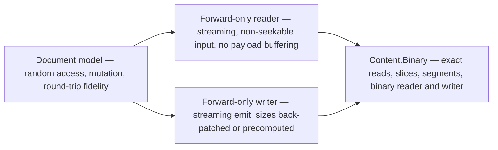
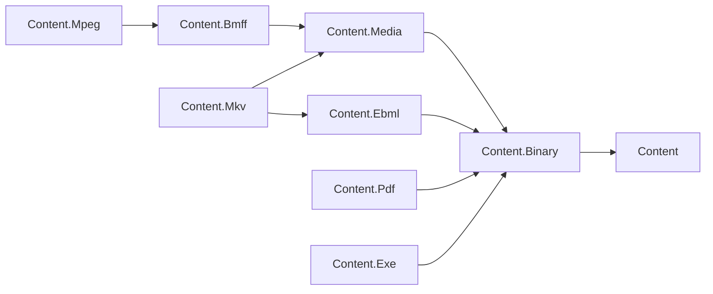

# Content Foundation Program Plan

**Status:** active · **Created:** 2026-10-16 · **Owner:** Chase Crawford · **Scope:** the Content
library family (`libraries/Content/**`), GitHub area epic **#14 / L01.01.05 Foundation - Content**.
**Integration branch:** `feature/L01.01.05-content-foundations` (one pull request, updated stage by
stage).

> **Why this file exists.** The epic spans 11 open features and about 30 open tasks across nine
> packages, implemented by several Codex sessions in parallel. GitHub issues hold the *what*; this
> file holds the shared design every session builds on, the *order*, and the decisions the owner
> still has to make. When the epic drains, fold the durable parts into
> `docs/libraries/Content/DESIGN.md` and the package `docs/DESIGN.md` files, then delete this file.

## 1. Where the family stands (survey, 2026-10-16)

| Package | Surveyed state | Classification |
|---|---|---|
| `Content` | Root contracts implemented (identity, ownership, composition, reader/writer seam). `ContentFactory` is a creation-only facade the repo rules now forbid (decision 59). | Strategic |
| `Content.Text` | Implemented: encoding detection, line model, `TextTokenizer`. | Strategic |
| `Content.Yaml` | Implemented: YAML 1.2 model, parser, emitter (413 tests). | Strategic |
| `Content.Markdown` | Implemented: CommonMark 0.31.2 subset, HTML renderer, canonical writer. | Strategic |
| `Content.Binary` | Placeholder: one empty interface. | Strategic (this program) |
| `Content.Media` | Placeholder plus a `StreamExtensions.ReadBytes` that ignores `Stream.Read`'s return value, so a partial read silently returns zero-filled bytes. | Strategic (this program) |
| `Content.Bmff` | 4.6k lines; composite box tree, visitors and one class per box are sound, but 64 of 75 box files throw `NotImplementedException`, the reader throws `Exception` on an unknown box, and `BmffStream` violates the `Stream` contract. | Strategic — finish, keep the composite design |
| `Content.Ebml` | `VInt` implemented and tested (60 tests); reader, writer, elements are empty shells. | Strategic |
| `Content.Mkv` | Empty; references `Content.Bmff` instead of `Content.Ebml`; its test project downloads a zip from SourceForge to a developer path. | Strategic |
| `Content.Mpeg` | Empty; references nothing. | Strategic |
| `Content.Pdf` | Empty project, no tests. | Strategic |
| `Content.Exe` | Placeholder interface with `InvokeAsync()`. | Strategic (O-C1: inspection and invocation, separated) |

Only `Content`, `Text`, `Ebml`, `Markdown` and `Yaml` are in the CI matrix and the release
inventory; the other seven sit in `$script:CohesionCiMatrixExclusion`. A package leaves that list in
the same commit its tests join `.github/workflows/library-content.yml`.

The legacy namespaces ported with the old code (`Assimalign.IO.*`, `Assimalign.Cohesion.Files.*`,
`Assimalign.Cohesion.MediaFile.*`) were moved onto `Assimalign.Cohesion.Content.*` in `5ac7bce98`
(owner request, 2026-10-16).

## 2. Shared design (every session builds on this)

### D1 — Three access modes per container format

The family is for reading, streaming **and** manipulating content, so every container format ships
the same three surfaces, the way `System.Text.Json` ships `Utf8JsonReader`, `Utf8JsonWriter` and
`JsonDocument`:

The reader, the writer and the document model each depend on the shared primitives; the document
model is built from the reader and saved through the writer.

| Mode | Use | Contract |
|---|---|---|
| Reader | Inspect a 40 GB file, ingest a live upload, find `moov` without reading `mdat` | Forward-only, element-by-element; skips payloads without buffering; works on non-seekable streams; a caller can descend into or skip any container |
| Writer | Emit fragmented MP4 / Matroska clusters to a network stream | Forward-only; a box/element size is back-patched when the output is seekable, otherwise the caller supplies it or the writer buffers one bounded unit; large-size (`size==1`) and unknown-size encodings chosen deliberately |
| Document | Edit metadata, relocate `moov` (fast start), rewrite tags, preserve unknown structure | Tree loaded from a seekable source; unchanged payloads stay **lazy** (`BinarySegment` over the source) and are copied through on save, never loaded; sizes and dependent offsets (`stco`/`co64`, Matroska `SeekHead`/`Cues`) recomputed on save |

BMFF keeps its composite design as its document model (owner request, 2026-10-16): `BmffBox`,
`BmffBoxComposite`, the visitors and the one-sealed-class-per-box layout stay; the work fills in
their bodies and repairs the stream layer under them.

### D2 — Shared primitives live in `Content.Binary`

Feature `L01.01.05.03` (#438) builds them; every binary format consumes them instead of hand-rolling
exact reads.

| Primitive | Shape | Why |
|---|---|---|
| `BinaryContentReader` | `ref struct` over `ReadOnlySpan<byte>` with a base offset; big- and little-endian 8–64-bit and 24-bit integers, FourCC, fixed point, null-terminated strings; `Try*` non-throwing variants; absolute `Position` | Parse a buffered payload with no allocation; malformed input reports the absolute byte position |
| `BinaryContentWriter` | `ref struct` over `IBufferWriter<byte>`; the counterpart of each reader method | Allocation-free emit into pooled buffers |
| Stream extension members | `TryReadExactly` (clean end returns `false`, a partial read is truncation), `ReadContentExactly`, `SkipExactly`, `CopyExactlyTo`, each sync and async | The one place that tells "no more elements" apart from "truncated element", and the place every partial-read bug is fixed once |
| `ContentSliceStream` | `public sealed` read-only `Stream` window over a parent: random access over a seekable parent, forward-only over a non-seekable one; returns short counts at the boundary; never disposes a borrowed parent | Nested container parsing and handing a payload to a consumer without copying |
| `BinarySegment` | A `(source, offset, length)` reference into a seekable source; `OpenRead()` and `CopyToAsync()` | Lazy payloads for the document model: edit a 40 GB file's metadata without reading its media |
| `FourCC`, fixed-point value types | `readonly` structs over the raw integer (`16.16`, `8.8`, `2.30`) | BMFF box types (including unknown ones), RIFF, matrices and volume; replaces Media's `FPoint` |

**Rejected:** Core's `System.IO.OffsetStream` throws `InvalidOperationException` when `count`
exceeds the remaining bytes instead of returning a short count, which breaks every caller that reads
"up to" a buffer, and it has no forward-only mode. Media's `StreamExtensions` is deleted (partial-read
corruption, above).

### D3 — One malformed-input vocabulary

`ContentFormatException` (root) gains a `ContentFormatErrorCode` (`Truncated`, `InvalidStructure`,
`InvalidValue`, `LimitExceeded`, `Unsupported`, and `Unspecified` for the legacy constructors) alongside its `Position`. Every format reader
throws it or a derived type; EBML's `EbmlDataFormatException` migrates onto it (#459). Tests assert
the code, not message text.

### D4 — Declared sizes are never trusted

A reader never allocates from a size it read off the wire. Each format reader takes options with a
buffered-payload cap (default 16 MiB); a larger payload stays a lazy segment in the document model or
is refused with `LimitExceeded` when it would have to be buffered. Nesting depth is capped the same
way. These limits are part of each format's malformed-input corpus.

### D5 — Dependency direction

Binary references the root; Media, EBML, PDF and Exe reference Binary; BMFF references Media; MPEG
references BMFF; MKV references EBML and Media. EBML is a generic container (it is not only media), so
it sits on Binary, and MKV adds Media. Text, Yaml and Markdown are unchanged. Corrections this program
makes: MKV moves off BMFF onto EBML and Media; EBML, MPEG, PDF gain their references.

### D6 — Fixtures are license-clean and self-contained

No downloaded media. Fixtures are hand-built byte arrays, specification examples, and files produced
by the family's own writers; a fixture whose bytes are checked in names how it was produced. Each
retained format carries: golden round-trip tests, a malformed-input corpus (truncation at every
header byte, oversize declared lengths, depth bombs), and specification-mapped compliance tests.

## 3. Stages

A stage starts when everything it is blocked by is integrated on the branch. Sessions inside one
stage run in parallel, each in its own worktree; the orchestrator integrates, verifies, pushes.

| Stage | Session | Work items | Blocked by |
|---|---|---|---|
| 1 | s1-binary — root error vocabulary and decision-59 alignment, `Content.Binary` primitives, Media cleanup, CI onboarding of Binary and Media | #439, #440, #441 (feature #438) | — |
| 1 | s1-docs — area architecture record, package classification, stabilization gates | #127, #129 (feature #16) | — |
| 2 | s2-bmff-core — stream repair, reader/writer lifecycle, box registry, unknown and large boxes | #443, #444, #445 (feature #442) | Stage 1 |
| 2 | s2-ebml-core — VInt/reader/writer/document, schema and element registry, RFC 8794 fixtures | #459, #460, #461 (feature #458) | Stage 1 |
| 2 | s2-pdf — object/document/xref model, tokenizer and parser, corpora | #471, #472, #473 (feature #470) | Stage 1 |
| 2 | s2-exe — format scope, PE/ELF/Mach-O inspection, process invocation, corpora | #476, #477, #478 (feature #474) | Stage 1 |
| 3 | s3-bmff-boxes — standard boxes, unknown-box preservation, round-trip mutation, golden files | #447, #448, #449 (feature #446) | s2-bmff-core |
| 3 | s3-media — shared track, sample and timeline model | #1550 (§5, G3) | Stage 1 |
| 3 | s3-text-corpus — Unicode, UTF-8 and Markdown corpora; text decoding errors as `ContentFormatException` | #469, #1556 | Stage 1 |
| 3 | s3-pdf-writer — PDF full save and incremental update | #1555 | s2-pdf |
| 4 | s4-mkv — Matroska element model, segment/track/cluster/cue behavior, harness replacement | #463, #464, #465 (feature #462) | s2-ebml-core, s3-media |
| 4 | s4-mp4 — BMFF profile model, MP4 brands/tracks/samples, golden files | #451, #452, #453 (feature #450) | s3-bmff-boxes, s3-media |
| 5 | s5-bmff-profiles — retained BMFF-derived formats and their packages | #455, #456, #457 (feature #454) | s4-mp4, O-C3 |
| 5 | close-out — gates applied to every retained package, CI and inventory complete, fuzzing harness, #16 closed | #16, #1554 | all above |

## 4. Owner decisions

| # | Question | Recommendation | Status |
|---|---|---|---|
| O-C1 | Does process **invocation** belong in a Content package? | Orchestrator recommended inspection only. | **Decided 2026-10-16 (owner):** "Keep process invocation in Content.Exe, separated from inspection, with timeout, cancellation and process-tree cleanup." Inspection types never start a process; invocation types never parse a file format. |
| O-C2 | Root API changes: `ContentFormatErrorCode` on `ContentFormatException`; `ContentFactory` replaced by public `MemoryContent`/`StreamContent`/`CompositeContent` with `Create` methods | Both follow existing rules (error codes over exception sprawl; decision 59). No consumer outside Content calls `ContentFactory`. | In this PR, flagged for review |
| O-C3 | Which BMFF-derived formats are retained beyond MP4? | HEIF/AVIF (still images, an `ftyp`/`meta`/`iloc`/`iprp` model that diverges from MP4's track model) as `Content.Heif`; CMAF stays a profile inside `Content.Mpeg` because it is constrained fragmented MP4. Decide before Stage 5. | Open |
| O-C4 | Gap packages (§5) | File as Backlog features; build none without a decision. | Open |

## 5. Gaps found during the survey

Filed 2026-10-16 as Backlog features under #14 (G7 as a task under #16):

- **G1 (#1548) — Format detection.** Services need to classify bytes without a file extension; the root
  `DESIGN.md` deferred sniffing to stabilization. A `ContentFormat` detector registry with
  magic-number probes contributed by each format package.
- **G2 (#1549) — Performance baseline.** No Content benchmarks exist. Throughput and allocation budgets for
  BMFF/EBML parse, skip and copy-through, PDF xref load, YAML/Markdown parse, in
  `cohesion-benchmarks`; plus positional reads (`RandomAccess`) so one source can be parsed
  concurrently, which the root design currently rules out.
- **G3 (#1550) — Shared media track, sample and timeline model** in `Content.Media`, consumed by MP4 and
  Matroska: tracks, codecs, rational timestamps, sample/keyframe index, and time-to-byte-range
  mapping for HTTP range serving and seeking. Scheduled as Stage 3 because both profiles need it.
- **G4 (#1551) — Adaptive-streaming manifests.** HLS (`.m3u8`, RFC 8216) and DASH (MPD, ISO/IEC 23009-1).
- **G5 (#1552) — MPEG-2 Transport Stream** (ISO/IEC 13818-1), the other HLS segment format. Note that
  `Content.Mpeg` is scoped to MP4 over BMFF; a transport-stream package would be separate.
- **G6 (#1553) — Image metadata and RIFF.** EXIF/XMP/ICC and PNG, JPEG, GIF, WebP headers; RIFF is also the
  container of WebP, WAV and AVI.
- **G7 (#1554) — Fuzzing.** A coverage-guided harness over every reader, run outside CI; a task under #16.

## 6. Progress Log

| Date | Change |
|---|---|
| 2026-10-16 | Survey; namespace correction `5ac7bce98`; plan written. |
| 2026-10-16 | O-C1 decided by the owner: `Content.Exe` keeps invocation, separated from inspection. Stage 1 sessions s1-binary and s1-docs started. |
| 2026-10-16 | Gap items filed: #1548–#1553 (G1–G6), #1554 (G7). Discovered tasks: #1555 (PDF writer, under #470), #1556 (Text decoding errors, under #466). |
| 2026-10-16 | Stage 1 integrated: s1-docs (`7b1b52985`) and s1-binary (`ca5729b0b`) merged; follow-ups `dc315ca81` (stale MPEG inventory exclusion) and `ac9cb6328` (absolute slice error positions). |
| 2026-10-16 | Draft PR #1557 opened. Stage 2 (s2-bmff-core, s2-ebml-core, s2-pdf, s2-exe) and s3-text-corpus started on `d452c5fe4`. |
| 2026-10-16 | s3-text-corpus integrated (`d18e7d64d`): full CommonMark 0.31.2 harness (406 retained, 246 pinned degradations), Unicode/UTF-8 corpus, decoding errors as `ContentFormatException` (#1556), 13 Markdown parser/writer defects fixed. |
| 2026-10-16 | s2-pdf integrated (`b2bcd4f61`): PDF object model, lexer/parser, xref tables and streams, object streams, structural filters with predictors, page tree, opt-in recovery; 152 tests; Pdf joins CI and the release inventory. #1555 (writer) is next for PDF. |
| 2026-10-16 | s3-pdf-writer started on `f5c966cfb`. s2-exe integrated (`d85c26b47`): PE/COFF, ELF, Mach-O inspection; `IExecutableInvoker` over `Process` (argument lists, no shell, bounded capture, timeout, cancellation, process-tree kill); `IExecutableFile` is now inspection metadata, not `IContent`; 107 tests; Exe joins CI and the release inventory. |
| 2026-10-16 | s2-bmff-core integrated (`fe38bdd85`): box headers (large size, `uuid`, size-zero), `BmffFullBox`, repaired `BmffStream`, immutable `BmffBoxRegistry`, `UnknownBox`, forward-only reader and writer, `BmffDocument` with lazy `mdat`; composite design and every per-box class kept; 138 tests; BMFF and Media join CI and the release inventory. s2-ebml-core integrated (`1a0e53b2b`): EBML reader, writer, document, schema and DocType registry, CRC-32, RFC 8794 corpus; 235 tests. Stage 2 complete. |
