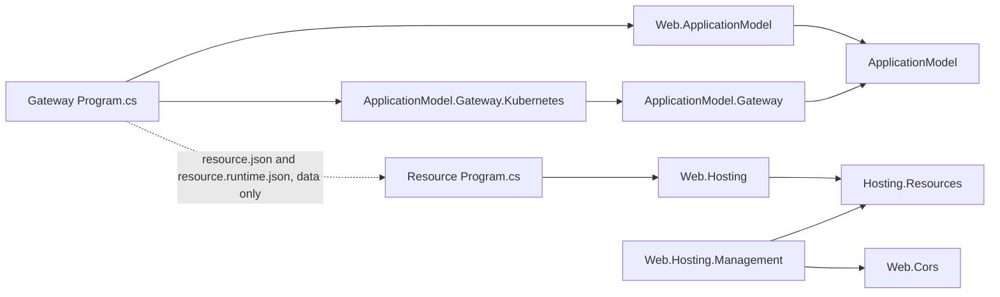

# Resource control plane redesign: the deployment record

Status: **APPROVED by the owner, 2026-10-24 (decisions D1–D8 below). P0, P1, P1b, P2 and P3 are
implemented on `feature/deployment-record-control-plane` in `cohesion` and `cohesion-platforms`;
P4 and P5 are not built.** The choices each phase made where the design left room are listed for
review in [P2 as built](#p2-as-built-choices-for-review) and
[P3 as built](#p3-as-built-choices-for-review). This design
supersedes the codex refactor parked on `feature/resource-runtime-manifests` (commit `376f022a8` in
`cohesion`, `f678395` in `cohesion-platforms`), which remains there for reference. The wire contract
is the [deployment record](../RUNTIME_CONTRACT.md#deployment-record) section of the runtime contract.

Code is the source of truth. A resource's desired runtime configuration lives in the deployment
record the platform already keeps: the code-first deploy writes the record and the platform delivers
it. The management API adjusts the record until that resource's next deployment. Resource processes
keep no desired state. Gateways keep platform-specific APIs; the management API never shows the
platform.

## Why not the parked design

- "Stateless" cannot be literal: a live CORS edit has to be stored somewhere, or a restarted or
  scaled-out instance comes up without it. The requirement is that Cohesion owns no state store, so a
  control-plane change lives in the current deployment's record until the next deployment replaces it.
- The parked work built the opposite: a gateway-owned intent store with receipts, an idempotency
  ledger, leases, fences and a per-process admission handshake. Its overrides outlived deployments.
- Its state contracts were discovered from live processes, so a gateway with no reachable instance
  refused every management write, and a portal showed an empty blade exactly when it was needed.
- Worth keeping, and kept: health contracts folded into Hosting.Resources, resource groups,
  ApplicationModel staying off Hosting.Resources, commands out of `resource.json`, and per-instance
  inventory (repurposed for status and every-instance actions).

## Three owners, no shared runtime types

The resource, the model and the gateway exchange JSON documents and HTTP calls; none references
another's runtime types. Arrows are references; the dotted edge is data the gateway reads from each
resource's build output without loading its code.



| Owner | Declares | Never knows about |
| --- | --- | --- |
| Resource (Hosting.Resources) | The runtime surface: configuration sections (path, schema generated from the options type with UI metadata, mutability, scope, claimable), actions, tools, and a status route | Gateways, platforms, generations, other applications |
| Model (ApplicationModel) | The consolidated application manifest: dependencies, groups, each resource's deployment layer (merge patches validated against the surface at `Build()`), platform extensions stored as data | Hosting.Resources types; Kubernetes or Docker types |
| Gateway and platform package | The record store, the plan compiler, the management API, and convergence derived from what instances report; typed platform extensions such as `ConfigureHpa` and their manageable surfaces | Any area package |

Web.Cors references nothing in the hosting or management families. The CORS section is the opt-in
`Web.Hosting.Management` package's `CorsPolicyStore.AsResourceConfiguration()`, so the feature keeps
its options type, its JSON context and its atomic replace.

## The deployment record

Each resource has one record of three layers. Every layer maps a section path to an RFC 7396 merge
patch, and each layer is its own file so each writer owns exactly one.

| Layer | Written by | Lives |
| --- | --- | --- |
| `deployment.json` | The code-first deploy: what the gateway's `Program.cs` declares for the resource | One generation |
| `claims.<owner>.json` | Each claiming application's code: keyed entries it adds to claimable sections (replaces cross-application commands) | The resource's lifetime, until the owner withdraws |
| `override.json` | The management API: operator changes; deleting one returns the code value | Until the next deployment |

Effective value = the resource's own configuration (code and appsettings, the baseline) ⊕ deployment ⊕
claims ⊕ override, merged as JSON documents. Arrays replace. The layers cannot go through the
flat-key configuration merge: the JSON provider flattens arrays into `Origins:0`, `Origins:1` keys, so
a one-origin override over a three-origin baseline would leave two stale origins in force.

Convergence is derived on read and never stored. Each instance reports the digest of the record it
applied and each section's outcome; the gateway compares those reports with the record it reads from
the platform.

## Override lifetime

A **generation** is a hash of one resource's deployment content: its plan plus its deployment layer.
Overrides belong to a generation, which follows Kubernetes: an unchanged spec changes nothing.

| Event | What happens to overrides |
| --- | --- |
| Operator PATCH | Stored in the current generation; every instance sees it, including restarts and scale-out |
| Identical re-apply of the same build | Same generation; overrides kept |
| This resource's deployment changed | New generation without overrides; `--mode plan` and apply list each discarded override first |
| Another resource deployed | No effect |
| PATCH on a `backend` section | 409 not-overridable (D7); change it in code, through a claim, or with an action |
| Claims | Not overrides: they survive the target's redeploys; new code that collides with one gets 409 claim-conflict |

## Per platform

| Platform | Where the record lives | Concurrency | In-generation delivery | New generation |
| --- | --- | --- | --- | --- |
| Kubernetes | `<resource>-config-<generation>` (deployment and override keys; a Secret for sensitive sections) plus `<resource>-claims`, projected into one directory volume; one server-side-apply field manager per key | `resourceVersion` | kubelet refreshes the volume, typically within a minute; never `subPath` or `envFrom` | Pod template points at the new ConfigMap: a rolling update; a restart-class override rolls through a `cohesion.io/restart-digest` annotation |
| Docker | `config/<generation>/` plus `claims/`, bind-mounted from the gateway's state root | Content hash and file lock | The resource's 2-second poll | Container recreate |
| Local / on-premises | The same layout under `.cohesion/<app>/<resource>/` | Content hash and file lock | The resource's poll | Supervisor restarts the process |
| InProcess | The same files | Same | The resource's poll | Entry re-invocation |

A scale-out instance mounts the current record when it starts, so it needs no admission handshake. A
gateway restart loses nothing, because the gateway holds no desired state.

As built, the Local layout ([P2](#p2-as-built-choices-for-review)) and the Kubernetes and Docker rows
([P3](#p3-as-built-choices-for-review)) differ from this table where those sections say.

## Resource side (P1, implemented)

`Assimalign.Cohesion.Hosting.Resources` owns the surface and applies the record:

- `ResourceConfigurationSection.Create<T>(path, typeInfo, mutability, baseline, apply, scope, claimable)`
  binds through the feature's source-generated `JsonTypeInfo<T>`, which also produces the section's
  JSON schema (`JsonSchemaExporter`, with `DisplayName`/`Description` attributes as `title` and
  `description`). `ResourceAction.Create` and `ResourceTool.Create` declare actions and tools.
- The application registers sections, actions and tools as singletons in its services; the area
  builder hands them to the control plane before the host is attached, which freezes the surface.
- `COHESION_CONFIG_DIRECTORY` wraps the host runner: the record applies in the Startup phase before
  the host starts, then the runner polls. A startup rejection holds readiness, not liveness; the
  `cohesion.configuration` health contribution is Degraded while a section is rejected or pending
  a restart.
- `COHESION_DESCRIBE_PATH` makes the built host write its `cohesion/runtime/v1` surface and exit.
  After each build, the SDK's describe step (P1b) runs the executable that way, with placeholder
  reference endpoints, and keeps `resource.runtime.json` beside the build output and in the manifest
  package: `resource.json` is embedded before compile, so the surface cannot live inside it. A run
  that fails is warning COHSDK012, never a failed build.
- Web serves `GET /cohesion/v1/configuration`, `GET /cohesion/v1/configuration/status` and
  `POST /cohesion/v1/actions/{name}` through its control-plane middleware, as do the area hosts that
  delegate to it. ConfigurationStore, IdentityHub and SecretStore route their control planes
  themselves; since P2 they serve the same three routes through
  `ResourceControlPlaneMiddleware.TryServeRuntimeSurfaceAsync`, after their own authorization.

```csharp
// A Web resource's Program.cs
WebApplicationBuilder builder = WebApplication.CreateBuilder(args);
CorsPolicyStore cors = CorsPolicyStore.Create(configuredCors);
builder.Services.AddSingleton<ResourceConfigurationSection>(cors.AsResourceConfiguration()); // Web:Cors, live
WebApplication app = builder.Build();
app.UseDynamicCors(cors);
await app.RunAsync();
```

## Gateway `Program.cs`: platform APIs allowed here, and only here (P2, P3)

```csharp
IApplicationBuilder builder = Gateway.CreateBuilder(args);
IDatabaseResourceDescriptor database = builder.AddDatabase(Manifests.OrdersDb)
    .ConfigureHpa(hpa => hpa.MaxReplicas = 3);               // Gateway.Kubernetes
IWebResourceDescriptor api = builder.AddWeb(Manifests.OrdersApi)
    .Configure("Web:Cors", """{"defaultPolicy":{"origins":["https://portal.example.com"]}}""")
    .ConfigureHpa(hpa => { hpa.MinReplicas = 2; hpa.MaxReplicas = 10; })
    .DependsOn(database);
builder.UseGateway(args);
await builder.Build().RunAsync();
```

- `ConfigureHpa` is a generic C# 14 extension block in the Kubernetes package over any
  `IApplicationResourceDescriptor`, so area verbs still chain after it and it never references an
  area package.
- Extensions are stored as JSON under a platform-qualified key (`kubernetes/hpa`), not as callbacks,
  so they survive describe and export round trips. The selected compiler owns its keys and fails on
  an unknown one; other platforms ignore them. Neutral replica bounds go in the plan.
- `Build()` validates each deployment patch against the surface: an unknown member, a wrong type, or
  an unknown section fails the build with the resource and path named.
- This amends signed decision O29 (D5); platform code still lives only in the domain gateway, and
  `KubernetesGatewayOptions.Patch<T>` stays the raw escape hatch.
- Built in P2: `Configure(section, patch)` and the extension data underneath `ConfigureHpa`
  (`SetExtension(key, value)`, `TryGetExtension`) are `ResourceConfigurationExtensions` members in
  ApplicationModel; `Build()` copies both into `ResourcePlan.Configuration` and `ResourcePlan.Extensions`.
  Sdk.Gateway embeds each resource's `resource.runtime.json` beside its manifest
  (`ResourceManifest.Surface`).
- Built in P3: the neutral bounds are `ScaleBetween(minimum, maximum)` (`WorkloadSpec.Scale`), and
  the Kubernetes package ships `ConfigureHpa` and `ConfigurePodDisruptionBudget`, each published as
  a manageable platform surface (`kubernetes/hpa`, `kubernetes/pod-disruption-budget`).

## Management API (P2)

Same shape on every platform. A write is a conditional edit of the current generation's record and
returns 200 with the new ETag and the generation the override expires with; `If-Match` on the
platform version replaces any operation resource or idempotency key.

| Method | Route (`/cohesion/v2/resources/{resource}…`) | Effect |
| --- | --- | --- |
| GET | `/configuration` | Surface, all layers with provenance, current generation, ETag |
| PATCH | `/configuration/{section}` | Merges into `override.json`; a `null` is stored as a tombstone |
| PUT | `/configuration/{section}` | Replaces the section's override |
| DELETE | `/configuration/{section}` | Drops the override; the code value returns |
| GET | `/configuration/status` | Each instance's record digest and outcome, converged n/m |
| GET, PATCH | `/platform/{platform}/{extension}` | A platform-published surface such as `kubernetes/hpa` |
| PUT | `/claims/{owner}` | The owner's whole entry set; empty withdraws |
| POST | `/actions/{action}` | Forwarded to any or every instance; nothing stored |
| GET | `/instances` | Platform inventory, for diagnostics |

Refusals: 400 invalid-configuration, 404 unknown-section, 409 deployment-only, 409 not-overridable,
409 claim-conflict, 412 version-moved. Grants are per section on the trusted-issuer model
(`TrustedIssuer.AllowedManagementOperations`). Every write emits a management event to the
application's telemetry sink (D8).

As built in P2, the gateway control plane serves these routes over the gateway's
`IResourceManagementProvider`, and records live in an `IResourceRecordStore`: the Local and in-process
gateways keep them as files (`FileResourceRecordStore`); since P3 the Docker gateway keeps files on
the gateway machine and the Kubernetes gateway keeps ConfigMaps.
Beyond the refusals above, the API answers 400 invalid-input (an action input), 404 unknown-resource,
unknown-action and unknown-platform-surface, 409 not-claimable, 501 records-unsupported (a gateway
with no record store), 503 unavailable (no record deployed yet, or no instance answered), and 403
forbidden for a caller without the grant.

## Portal and tools (later; hooks in P1 and P2)

A portal sits on the management API and needs no platform code; platform controls arrive as platform
surfaces. It renders from the static surface, so a resource with no running instance still has a
working configuration blade. History is the telemetry sink's data, not control-plane state. Tools
such as a SQL editor reach a resource through a gateway-terminated WebSocket tunnel over extended
CONNECT (browsers cannot send CONNECT themselves); control-plane permission never implies data access.

## Commands, retired (P4)

| Today | Becomes |
| --- | --- |
| `database.add-database` | `Database:Databases`, a backend-scoped claimable section (after #1709) |
| `configurationstore.add-namespace`, `set-value` | A claimable `ConfigurationStore:Namespaces` section |
| IdentityHub audiences and clients, Rezolvr records | Claimable sections |
| `secretstore.issue-certificate` | A desired `SecretStore:Certificates` entry the store issues and renews |
| `secretstore.add-secret` | A data-plane write through the Orchestration client; secret values never enter a ConfigMap |
| Web TLS certificate selection | A Secret-backed mount update the listener reloads for new handshakes |
| Backup now, rotate now, flush cache | Actions |

## Phases

| Phase | Scope | State |
| --- | --- | --- |
| P0 | Park codex's uncommitted work on a branch in each repository | Done |
| P1 | Hosting.Resources surface (UI metadata, tools), status and describe; the Web CORS section; codex's state machinery removed | Done, resource side |
| P1b | SDK describe step writing `resource.runtime.json` | Done |
| P2 | Model parses the surface, `Configure` and `Build()` validation, extensions as data; gateway record manager over a store with generations, Local and InProcess stores, the routes, management events | Done; `--mode plan` deferred, neutral replica bounds built in P3 ([as built](#p2-as-built-choices-for-review)) |
| P3 | cohesion-platforms: Kubernetes and Docker stores, record and claims ConfigMaps, restart digest, platform surfaces, `ConfigureHpa` | Done; hermetic tests only, no live cluster or daemon run ([as built](#p3-as-built-choices-for-review)) |
| P4 | Claims for ConfigurationStore, IdentityHub, Rezolvr, SecretStore; commands deleted; Database after #1709 | Not started |
| P5 | Sdk.Gateway generates typed configuration accessors from surface schemas | Not started |
| Later | Portal, tool tunnel and SQL editor, groups as permission scopes, watch API | Not started |

## Limits accepted knowingly

- Live updates are eventual: kubelet refreshes mounted ConfigMaps on its sync period, typically within
  a minute or two. Nothing gives a fleet-wide atomic cutover.
- A configuration-only code change rolls the instances: it is a new generation.
- The describe run executes `Program.cs` up to `Build()`, so side effects before `Build()` run too.
- A schema-valid but domain-invalid value is accepted by the gateway and refused by every instance,
  which keeps its last good value and reports the rejection.
- An override that must survive belongs in code; apply reports what a deployment discards. A
  ConfigMap's 1 MiB limit bounds each layer.

## P2 as built: choices for review

P2 settled these points, which the design above left open. Each is a default the owner can revise.

| Choice | As built |
| --- | --- |
| Generation | The first 16 hex digits of SHA-256 over the plan's JSON (which carries the deployment layer and extensions) and the build the artifact holds: an image digest, the apphost and its managed assembly, or an in-process entry assembly's module version id. A resource whose build output changed is a new deployment even when its plan is unchanged, which is how "identical re-apply of the same build" is read: re-applying the same build, or a deterministic rebuild of unchanged code, keeps the generation and its overrides. An image counts as changed whenever its digest does, so a non-reproducible image build starts a new generation every time. |
| Grants | `configuration:read`, `configuration:write[:<section>]`, `claims:write`, `actions:invoke[:<action>]`, `platform:read[:<key>]`, `platform:write[:<key>]` and `*` (`ResourceManagementOperations`). The application's own trust key grants `*`, so the developer credentials `--mode trust-issue` mints manage the application; every other issuer needs explicit grants. |
| Claims | A caller writes only its own application's claims, under `claims:write`. An entry conflicts when another owner claims the key or the resource's own deployment layer sets it. Claim entries are objects without null members, and claims survive generations. |
| Local layout | One record directory per resource, `<state>/<application>/<resource>/.state/record/`, with the generation in `.state/record.json`, instead of the table's `config/<generation>/` plus `claims/`. A new generation is a new Local gateway session, which restarts the process; an orphan that a restarted gateway recovers keeps running and polls the new record (live sections apply, restart sections report `restartRequired`). |
| Delivery | On a gateway with a record store, every realized resource receives `COHESION_CONFIG_DIRECTORY`, with or without deployment configuration, so a later management change reaches it. |
| Discarded overrides | Reported on standard error and as a `configuration:discard` management event when a deployment starts a new generation. There is no `--mode plan` dry run yet; it is a follow-up. |
| Patch composition | PATCH and repeated `Configure` calls compose merge patches and keep tombstones. A later object after an earlier null merges into the current value instead of replacing it; PUT states an exact override. |
| Events | One OTLP/HTTP JSON log record per write, posted to the registered telemetry sink's `/v1/logs` with the gateway as the emitter, best effort within two seconds. It names the operation, target, caller subject and generation, never a value. |
| Validation | The gateway checks the JSON-schema subset the exporter writes, and treats an object schema that lists its members as closed, so a member the resource's options type would silently drop is refused. |
| Surface carriage | `ResourceManifest.Surface` is not part of `resource.json`; generated gateway code attaches it, and model documents carry it beside the manifest. Its digest covers the compact document, so reformatting keeps it equal to the digest an instance reports. |
| Platform surfaces | The routes existed and answered unknown-platform-surface; P3 replaced the two placeholder hooks with the generic surface flow ([P3 as built](#p3-as-built-choices-for-review)). |

## P3 as built: choices for review

P3 settled these points, which the design above left open or stated differently. Each is a default
the owner can revise.

| Choice | As built |
| --- | --- |
| Surface flow | Generic in the Gateway base. A platform gateway publishes `ResourcePlatformSurface` values (`GetPlatformSurfaces`: key, closed JSON schema, the value code declares, an optional rule) and applies and observes them (`ApplyPlatformSurfaceAsync`, `ObservePlatformSurfaceAsync`). A PATCH composes an RFC 7396 merge patch into the stored override and validates the value it produces; a JSON `null` body drops the override. |
| Where platform overrides live | In the record, as `ResourceRecord.PlatformOverrides`, for the current generation, not on the platform objects. They count in the record version (the ETag) but not in the digest instances report, because no instance reads them. A new generation drops them and reports it, like configuration overrides. Compilers receive them as `ResourceInputs.PlatformOverrides`, so every reconcile in the generation keeps them. |
| Apply race | The gateway applies an override to the platform object at once, and every later compile applies it again. A management write that lands while a reconcile of the same resource applies its objects can be overwritten by that reconcile's older value until the next reconcile. |
| Neutral scale bounds | `ScaleBetween(minimum, maximum)` sets `WorkloadSpec.Scale`. `Build()` refuses bounds on a Job or DaemonSet and a maximum above the manifest's `maxReplicas`. Kubernetes autoscales between them; Docker, Local and InProcess ignore them and run the plan's replica count. |
| `ConfigureHpa` | Writes its bounds as `ScaleBounds` and its targets as `kubernetes/hpa` data; calls compose. Bounds without a target give an autoscaler at 80 % CPU. The workload's `replicas` is left to the autoscaler and readiness waits for its minimum. `ConfigurePodDisruptionBudget` was added beside it as the second Kubernetes surface. |
| No pod restarts for platform objects | A code change to the bounds, the autoscaler or the budget is a new generation, so it discards overrides (D3), but it restarts no pod: the Kubernetes plan hash leaves those out, and the record ConfigMap is named for the pod template (the first 16 hex digits of the plan hash), not for the generation as the table above says. A generation that changes nothing the pods read rewrites their ConfigMap in place; one that changes what they run is a new name and a rollout. |
| Kubernetes record | `<resource>-record-<key>` and `<resource>-claims`, labelled `cohesion.io/record` so pruning ignores them. Writes are server-side applies at the read `resourceVersion` under the gateway's one field manager, not one manager per key, serialized per resource in process. The previous record ConfigMap is kept for a rollout in progress and older ones are deleted. There is no Secret for sensitive sections: the runtime surface has no way to mark a section sensitive yet. Platform overrides are keys of the record ConfigMap that pods never project. |
| Restart digest | `ResourceRecord.GetRestartDigest(surface)` hashes what overrides and claims set for restart-class sections. Each deployment stamps it on the pod template (`ResourceInputs.RestartDigest`, `cohesion.io/restart-digest`, `none` when nothing sets one), so a deployment that discards a restart-class override still rolls the pods; between deployments a management write that moves it JSON-patches the same annotation under the `cohesion-restart` field manager. Jobs carry none. |
| Instance identity | Every pod receives `COHESION_RESOURCE_INSTANCE` from `metadata.uid`. The inventory addresses pods by IP, which needs the in-cluster gateway. |
| Empty layer | A layer file holding `{}` counts as absent: it is not framed into the digest and names no claim owner (a runtime contract amendment). Docker needs it because the engine's archive API cannot delete a file. |
| Docker record | Files on the gateway machine under `DockerGatewayOptions.StateDirectory`, copied into the container's `/var/run/cohesion-config` through the archive API before it starts and after each management change, instead of the table's bind mount, so a remote engine works. A withdrawn layer is written as `{}`. What each container last received is remembered in memory only, so after a gateway restart a withdrawn layer can stay in the container until it is recreated. Docker restarts nothing for restart-class sections: they wait for the next start. The control-plane binding is always published on loopback, and the plan hash leaves out scale bounds and extensions. |
| Teardown | Uninstall deletes each resource's record, which P2 left behind. |
| Delivery failures | A failed platform apply or record copy is reported on standard error and as a `record:deliver` management event naming the exception type, never its message; the stored change converges at the next reconcile or start. |
| Verification | Hermetic tests with fakes cover every row. Nothing ran against a live Kind cluster or a Docker daemon. |

## Decisions

| Id | Decision | State |
| --- | --- | --- |
| D1 | The platform's deployment record is the only desired state; the gateway store, the coordinator and process admission are deleted | Approved |
| D2 | The surface is static, produced by describe at build, never discovered from live instances | Approved |
| D3 | Overrides last until that resource's next deployment; an identical re-apply keeps them, and plan and apply list what a deployment discards | Approved (revised) |
| D4 | Commands are removed entirely; claims and actions replace them; Database follows after #1709 | Approved |
| D5 | Amend O29: platform extensions attach to descriptors as data and publish manageable surfaces; neutral scale bounds go in the plan | Approved (extended) |
| D6 | Before refactoring, park codex's uncommitted work on a branch in each repository | Approved, done |
| D7 | Data-shaping (`backend`) sections accept no overrides: code, claims or actions only | Approved |
| D8 | Portal hooks ship now: UI metadata and tools in the surface (P1), management events to the telemetry sink (P2) | Approved |
