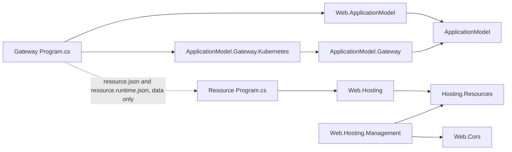

# Resource control plane redesign: the deployment record

Status: **APPROVED by the owner, 2026-10-24 (decisions D1–D8 below). P0 and the resource side of P1
are implemented on `feature/deployment-record-control-plane`; P1b–P5 are not built.** This design
supersedes the codex refactor parked on `feature/resource-runtime-manifests` (commit `376f022a8` in
`cohesion`, `f678395` in `cohesion-platforms`), which remains there for reference. The wire contract
is the [deployment record](../RUNTIME_CONTRACT.md#deployment-record) section of the runtime contract.

Code is the source of truth. A resource's desired runtime configuration lives in the deployment
record the platform already keeps: the code-first deploy writes the record and the platform delivers
it. The management API adjusts the record until that resource's next deployment. Resource processes
keep no desired state. Gateways keep platform-specific APIs; the management API never shows the
platform.

## Why not the parked design

- "Stateless" cannot be literal: a live CORS edit has to be stored somewhere, or a restarted or
  scaled-out instance comes up without it. The requirement is that Cohesion owns no state store, so a
  control-plane change lives in the current deployment's record until the next deployment replaces it.
- The parked work built the opposite: a gateway-owned intent store with receipts, an idempotency
  ledger, leases, fences and a per-process admission handshake. Its overrides outlived deployments.
- Its state contracts were discovered from live processes, so a gateway with no reachable instance
  refused every management write, and a portal showed an empty blade exactly when it was needed.
- Worth keeping, and kept: health contracts folded into Hosting.Resources, resource groups,
  ApplicationModel staying off Hosting.Resources, commands out of `resource.json`, and per-instance
  inventory (repurposed for status and every-instance actions).

## Three owners, no shared runtime types

The resource, the model and the gateway exchange JSON documents and HTTP calls; none references
another's runtime types. Arrows are references; the dotted edge is data the gateway reads from each
resource's build output without loading its code.



| Owner | Declares | Never knows about |
| --- | --- | --- |
| Resource (Hosting.Resources) | The runtime surface: configuration sections (path, schema generated from the options type with UI metadata, mutability, scope, claimable), actions, tools, and a status route | Gateways, platforms, generations, other applications |
| Model (ApplicationModel) | The consolidated application manifest: dependencies, groups, each resource's deployment layer (merge patches validated against the surface at `Build()`), platform extensions stored as data | Hosting.Resources types; Kubernetes or Docker types |
| Gateway and platform package | The record store, the plan compiler, the management API, and convergence derived from what instances report; typed platform extensions such as `ConfigureHpa` and their manageable surfaces | Any area package |

Web.Cors references nothing in the hosting or management families. The CORS section is the opt-in
`Web.Hosting.Management` package's `CorsPolicyStore.AsResourceConfiguration()`, so the feature keeps
its options type, its JSON context and its atomic replace.

## The deployment record

Each resource has one record of three layers. Every layer maps a section path to an RFC 7396 merge
patch, and each layer is its own file so each writer owns exactly one.

| Layer | Written by | Lives |
| --- | --- | --- |
| `deployment.json` | The code-first deploy: what the gateway's `Program.cs` declares for the resource | One generation |
| `claims.<owner>.json` | Each claiming application's code: keyed entries it adds to claimable sections (replaces cross-application commands) | The resource's lifetime, until the owner withdraws |
| `override.json` | The management API: operator changes; deleting one returns the code value | Until the next deployment |

Effective value = the resource's own configuration (code and appsettings, the baseline) ⊕ deployment ⊕
claims ⊕ override, merged as JSON documents. Arrays replace. The layers cannot go through the
flat-key configuration merge: the JSON provider flattens arrays into `Origins:0`, `Origins:1` keys, so
a one-origin override over a three-origin baseline would leave two stale origins in force.

Convergence is derived on read and never stored. Each instance reports the digest of the record it
applied and each section's outcome; the gateway compares those reports with the record it reads from
the platform.

## Override lifetime

A **generation** is a hash of one resource's deployment content: its plan plus its deployment layer.
Overrides belong to a generation, which follows Kubernetes: an unchanged spec changes nothing.

| Event | What happens to overrides |
| --- | --- |
| Operator PATCH | Stored in the current generation; every instance sees it, including restarts and scale-out |
| Identical re-apply of the same build | Same generation; overrides kept |
| This resource's deployment changed | New generation without overrides; `--mode plan` and apply list each discarded override first |
| Another resource deployed | No effect |
| PATCH on a `backend` section | 409 not-overridable (D7); change it in code, through a claim, or with an action |
| Claims | Not overrides: they survive the target's redeploys; new code that collides with one gets 409 claim-conflict |

## Per platform

| Platform | Where the record lives | Concurrency | In-generation delivery | New generation |
| --- | --- | --- | --- | --- |
| Kubernetes | `<resource>-config-<generation>` (deployment and override keys; a Secret for sensitive sections) plus `<resource>-claims`, projected into one directory volume; one server-side-apply field manager per key | `resourceVersion` | kubelet refreshes the volume, typically within a minute; never `subPath` or `envFrom` | Pod template points at the new ConfigMap: a rolling update; a restart-class override rolls through a `cohesion.io/restart-digest` annotation |
| Docker | `config/<generation>/` plus `claims/`, bind-mounted from the gateway's state root | Content hash and file lock | The resource's 2-second poll | Container recreate |
| Local / on-premises | The same layout under `.cohesion/<app>/<resource>/` | Content hash and file lock | The resource's poll | Supervisor restarts the process |
| InProcess | The same files | Same | The resource's poll | Entry re-invocation |

A scale-out instance mounts the current record when it starts, so it needs no admission handshake. A
gateway restart loses nothing, because the gateway holds no desired state.

## Resource side (P1, implemented)

`Assimalign.Cohesion.Hosting.Resources` owns the surface and applies the record:

- `ResourceConfigurationSection.Create<T>(path, typeInfo, mutability, baseline, apply, scope, claimable)`
  binds through the feature's source-generated `JsonTypeInfo<T>`, which also produces the section's
  JSON schema (`JsonSchemaExporter`, with `DisplayName`/`Description` attributes as `title` and
  `description`). `ResourceAction.Create` and `ResourceTool.Create` declare actions and tools.
- The application registers sections, actions and tools as singletons in its services; the area
  builder hands them to the control plane before the host is attached, which freezes the surface.
- `COHESION_CONFIG_DIRECTORY` wraps the host runner: the record applies in the Startup phase before
  the host starts, then the runner polls. A startup rejection holds readiness, not liveness; the
  `cohesion.configuration` health contribution is Degraded while a section is rejected or pending
  a restart.
- `COHESION_DESCRIBE_PATH` makes the built host write its `cohesion/runtime/v1` surface and exit.
  The SDK step that runs it and writes `resource.runtime.json` beside the build output is P1b, not
  built: `resource.json` is embedded before compile, so the surface cannot live inside it.
- Web serves `GET /cohesion/v1/configuration`, `GET /cohesion/v1/configuration/status` and
  `POST /cohesion/v1/actions/{name}` through its control-plane middleware, as do the area hosts that
  delegate to it. ConfigurationStore, IdentityHub and SecretStore route their control planes
  themselves and do not serve these three routes yet.

```csharp
// A Web resource's Program.cs
WebApplicationBuilder builder = WebApplication.CreateBuilder(args);
CorsPolicyStore cors = CorsPolicyStore.Create(configuredCors);
builder.Services.AddSingleton<ResourceConfigurationSection>(cors.AsResourceConfiguration()); // Web:Cors, live
WebApplication app = builder.Build();
app.UseDynamicCors(cors);
await app.RunAsync();
```

## Gateway `Program.cs`: platform APIs allowed here, and only here (P2, P3)

```csharp
IApplicationBuilder builder = Gateway.CreateBuilder(args);
IDatabaseResourceDescriptor database = builder.AddDatabase(Manifests.OrdersDb)
    .ConfigureHpa(hpa => hpa.MaxReplicas = 3);               // Gateway.Kubernetes
IWebResourceDescriptor api = builder.AddWeb(Manifests.OrdersApi)
    .Configure("Web:Cors", """{"defaultPolicy":{"origins":["https://portal.example.com"]}}""")
    .ConfigureHpa(hpa => { hpa.MinReplicas = 2; hpa.MaxReplicas = 10; })
    .DependsOn(database);
builder.UseGateway(args);
await builder.Build().RunAsync();
```

- `ConfigureHpa` is a generic C# 14 extension block in the Kubernetes package over any
  `IApplicationResourceDescriptor`, so area verbs still chain after it and it never references an
  area package.
- Extensions are stored as JSON under a platform-qualified key (`kubernetes/hpa`), not as callbacks,
  so they survive describe and export round trips. The selected compiler owns its keys and fails on
  an unknown one; other platforms ignore them. Neutral replica bounds go in the plan.
- `Build()` validates each deployment patch against the surface: an unknown member, a wrong type, or
  an unknown section fails the build with the resource and path named.
- This amends signed decision O29 (D5); platform code still lives only in the domain gateway, and
  `KubernetesGatewayOptions.Patch<T>` stays the raw escape hatch.

## Management API (P2)

Same shape on every platform. A write is a conditional edit of the current generation's record and
returns 200 with the new ETag and the generation the override expires with; `If-Match` on the
platform version replaces any operation resource or idempotency key.

| Method | Route (`/cohesion/v2/resources/{resource}…`) | Effect |
| --- | --- | --- |
| GET | `/configuration` | Surface, all layers with provenance, current generation, ETag |
| PATCH | `/configuration/{section}` | Merges into `override.json`; a `null` is stored as a tombstone |
| PUT | `/configuration/{section}` | Replaces the section's override |
| DELETE | `/configuration/{section}` | Drops the override; the code value returns |
| GET | `/configuration/status` | Each instance's record digest and outcome, converged n/m |
| GET, PATCH | `/platform/{platform}/{extension}` | A platform-published surface such as `kubernetes/hpa` |
| PUT | `/claims/{owner}` | The owner's whole entry set; empty withdraws |
| POST | `/actions/{action}` | Forwarded to any or every instance; nothing stored |
| GET | `/instances` | Platform inventory, for diagnostics |

Refusals: 400 invalid-configuration, 404 unknown-section, 409 deployment-only, 409 not-overridable,
409 claim-conflict, 412 version-moved. Grants are per section on the trusted-issuer model
(`TrustedIssuer.AllowedManagementOperations`). Every write emits a management event to the
application's telemetry sink (D8).

## Portal and tools (later; hooks in P1 and P2)

A portal sits on the management API and needs no platform code; platform controls arrive as platform
surfaces. It renders from the static surface, so a resource with no running instance still has a
working configuration blade. History is the telemetry sink's data, not control-plane state. Tools
such as a SQL editor reach a resource through a gateway-terminated WebSocket tunnel over extended
CONNECT (browsers cannot send CONNECT themselves); control-plane permission never implies data access.

## Commands, retired (P4)

| Today | Becomes |
| --- | --- |
| `database.add-database` | `Database:Databases`, a backend-scoped claimable section (after #1709) |
| `configurationstore.add-namespace`, `set-value` | A claimable `ConfigurationStore:Namespaces` section |
| IdentityHub audiences and clients, Rezolvr records | Claimable sections |
| `secretstore.issue-certificate` | A desired `SecretStore:Certificates` entry the store issues and renews |
| `secretstore.add-secret` | A data-plane write through the Orchestration client; secret values never enter a ConfigMap |
| Web TLS certificate selection | A Secret-backed mount update the listener reloads for new handshakes |
| Backup now, rotate now, flush cache | Actions |

## Phases

| Phase | Scope | State |
| --- | --- | --- |
| P0 | Park codex's uncommitted work on a branch in each repository | Done |
| P1 | Hosting.Resources surface (UI metadata, tools), status and describe; the Web CORS section; codex's state machinery removed | Done, resource side |
| P1b | SDK describe step writing `resource.runtime.json` | Not started |
| P2 | Model parses the surface, `Configure` and `Build()` validation, extensions as data; gateway record manager over a store with generations, Local and InProcess stores, the routes, management events | Not started |
| P3 | cohesion-platforms: Kubernetes and Docker stores, per-generation and claims ConfigMaps, restart digest, platform surfaces, `ConfigureHpa` | Not started |
| P4 | Claims for ConfigurationStore, IdentityHub, Rezolvr, SecretStore; commands deleted; Database after #1709 | Not started |
| P5 | Sdk.Gateway generates typed configuration accessors from surface schemas | Not started |
| Later | Portal, tool tunnel and SQL editor, groups as permission scopes, watch API | Not started |

## Limits accepted knowingly

- Live updates are eventual: kubelet refreshes mounted ConfigMaps on its sync period, typically within
  a minute or two. Nothing gives a fleet-wide atomic cutover.
- A configuration-only code change rolls the instances: it is a new generation.
- The describe run executes `Program.cs` up to `Build()`, so side effects before `Build()` run too.
- A schema-valid but domain-invalid value is accepted by the gateway and refused by every instance,
  which keeps its last good value and reports the rejection.
- An override that must survive belongs in code; the plan output shows what a deployment discards.
  A ConfigMap's 1 MiB limit bounds each layer.

## Decisions

| Id | Decision | State |
| --- | --- | --- |
| D1 | The platform's deployment record is the only desired state; the gateway store, the coordinator and process admission are deleted | Approved |
| D2 | The surface is static, produced by describe at build, never discovered from live instances | Approved |
| D3 | Overrides last until that resource's next deployment; an identical re-apply keeps them, and plan and apply list what a deployment discards | Approved (revised) |
| D4 | Commands are removed entirely; claims and actions replace them; Database follows after #1709 | Approved |
| D5 | Amend O29: platform extensions attach to descriptors as data and publish manageable surfaces; neutral scale bounds go in the plan | Approved (extended) |
| D6 | Before refactoring, park codex's uncommitted work on a branch in each repository | Approved, done |
| D7 | Data-shaping (`backend`) sections accept no overrides: code, claims or actions only | Approved |
| D8 | Portal hooks ship now: UI metadata and tools in the surface (P1), management events to the telemetry sink (P2) | Approved |
