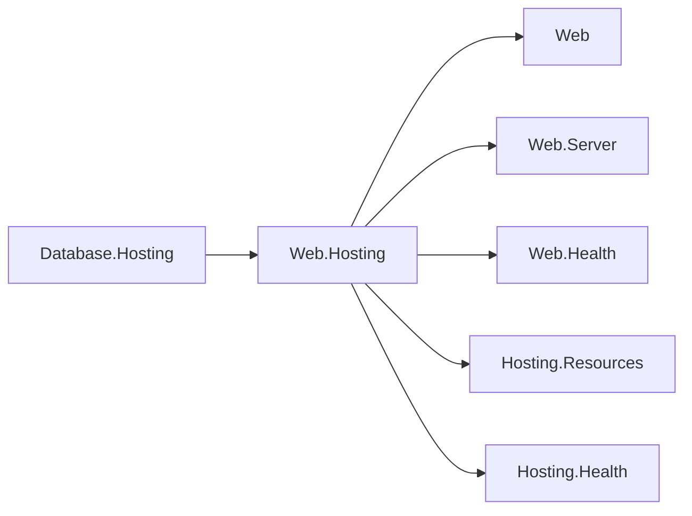

# Web area design

## Control-plane integration

Web.Hosting integrates Hosting.Resources and Hosting.Health itself (owner decision 57,
2026-10-13). Its public middleware stays in the `Assimalign.Cohesion.Web.Hosting.Resources`
namespace under `src/Resources/`; the health adapter stays in
`Assimalign.Cohesion.Web.Hosting.Health` under `src/Health/`. There are no separate packages
for either integration. The module references the Web root, Web.Server, Web.Health,
Hosting.Resources, Hosting.Health, and IdentityModel.Token.JsonWebToken for these integrations.
COHRES001 prevents Web roots and features from referencing it. Web.Testing names only
Web.Hosting in its explicit exemption.

Web.Hosting and Database.Hosting use the same terminal, with Web.Server's
IWebResponseCompletionFeature seam for deferred stop. The seam lived in the Web root until
#1379 moved the server's per-exchange contracts to Web.Server (owner decision 33). A real
Program factory compares the Web wrapper with the direct verb as a composition regression.
The integration owns authentication and AOT-safe JSON; each area host owns its listener,
readiness gate, and lifecycle. The hosting context owns the retained verifier key internally.

The integrations are public through Web.Hosting in App.Web and private in each other area
framework. Cross-area hosting implementation references use the coordinated
CohesionPrivateProjectReference / CohesionFrameworkPrivateAssembly pair. Web.Health now joins
the 16 area framework closures that lacked it; Database already carried it. Area ApplicationModel
packages remain NuGet-only, and Web.Hosting's resolved closure carries neither Web.ApplicationModel
nor Web.ApplicationModel.Orchestration. Database's health adapter preserves its readiness-only
accepting gate while Web.Health retains an independent model with no Hosting reference.

See [the hosting design](../../../resources/Web/Assimalign.Cohesion.Web.Hosting/docs/DESIGN.md#resource-control-plane)
for the exact protocol and the public response-completion contract.

Database references the Web hosting module, which integrates the shared health and resource contracts.

## Diagnostic signal ownership

Web and transport diagnostics answer different questions. Web.Hosting owns the server spans and
Meter instruments for requests that reach the Web pipeline. The HTTP transport also rejects input before
dispatch and enforces protocol rules after dispatch; it owns those outcomes even when no Web span
exists. Each owner reports its own events rather than forwarding another package's internal source.

| Question or outcome | Signal | Owner | What it reports |
| --- | --- | --- | --- |
| What happened during a dispatched HTTP request? | `ActivitySource` named `Assimalign.Cohesion.Web.Hosting` | Web.Hosting | One server span, caller trace context, method, route, final status, duration and cancellation/fault outcome. |
| How much dispatched work is active, and how long does it take? | `Meter` named `Assimalign.Cohesion.Web.Hosting` | Web.Hosting | `http.server.active_requests` and `http.server.request.duration`, including Web middleware's rejection statuses. |
| Did HTTP reject a request or fail a protocol operation? | `Meter` and `EventSource` named `Assimalign.Cohesion.Http.Connections` (#1300) | HTTP transport | Pre-dispatch rejection statuses, HTTP/2 and HTTP/3 protocol errors, request-rate enforcement and slow-reader response aborts. These are not Web application faults. |
| Did a listener bind, drain or stop, and did server machinery fail? | `EventSource` named `Assimalign.Cohesion.Web.Hosting` | Web.Hosting | Lifecycle, bind/accept/connection failures, completion-callback failures, refused response heads, capacity waits and drain timeouts, correlated by process-unique `serverId`. Peer-ended connections are Verbose and do not increment `connection-faults`. |
| Which application fault reached the exception boundary? | `EventSource` named `Assimalign.Cohesion.Web.ErrorHandling` | Web exception boundary | Pipeline and handler failures, expected faults and abandoned responses; client-caused and cancelled exchanges do not become application-fault counts. |
| Which middleware rejected or degraded an exchange, and why? | The owning Web assembly's `EventSource` | Web feature package | Bounded rejection reasons and exact attribution counters for authentication, authorization, antiforgery, edge policies, timeouts, rate limits, compression, forms and content handling. There are no duplicate request start/stop events or general request counters. |
| Did health or control-plane work fail? | `Web.Health`, `Web.Hosting` and `Hosting.Resources` event sources | Web health/HTTP control surface, or shared control-plane producer | Health transitions and failed checks; HTTP authentication/command-input failures; producer-owned contributor failures and command outcomes. |
| Did the underlying connection or TLS handshake fail? | Connections driver event sources; runtime `System.Net.Security` | Connection transport and TLS runtime | Listener, connection and stream lifecycle, driver counters and TLS handshake diagnostics. These sources are outside default Web forwarding. |
| What should the application's HTTP access log contain? | `ILogger` entries, default category `Assimalign.Cohesion.Web.Diagnostics.HttpLogging` | Web.Diagnostics middleware | Explicitly composed access logging at Information with its own redaction options. The `Web.Diagnostics` EventSource reports failures of logging itself, rather than duplicating access entries. |

The [event-source catalog](../../EVENT_SOURCES.md#cohesion-event-sources) lists all 21 instrumented Web
assemblies and links their event schemas, counters and payload policies. The
[deliberately uninstrumented list](../../EVENT_SOURCES.md#web-assemblies-deliberately-left-uninstrumented)
records where visible status codes, thrown failures or contract-only packages need no extra source.
The package-level details of request spans and metrics live in
[Web.Hosting's telemetry design](../../../resources/Web/Assimalign.Cohesion.Web.Hosting/docs/DESIGN.md#server-telemetry-1064),
and its operator events in
[Web.Hosting's diagnostics design](../../../resources/Web/Assimalign.Cohesion.Web.Hosting/docs/DESIGN.md#diagnostics).

Request event correlation and the access log read `IWebRequestIdFeature`, published by Web.Hosting
through the Web.Server contract. Its identifier remains stable when no `ActivityListener` is
attached; sources never infer it from ambient `Activity.Current`. Event payloads omit request paths,
queries, header values and bodies. A `routeTemplate`, when the owning package references routing,
describes the configured route rather than the request target. Application exception messages remain
subject to each package's documented payload policy.

Entry-point `CreateBuilder(args)` applications forward the `Assimalign.Cohesion.Web.` prefix and
the exact `Assimalign.Cohesion.Http.Connections` name into configured logging sinks. Nested builders
register no default listener, and an application-selected forwarder or
`EnableEventSourceForwarding = false` takes precedence. Forwarding changes neither providers nor
filter rules, so the HTTP access log's Information level is preserved. Event listeners observe the
whole process: `serverId`, `resourceName` and request identifiers provide attribution when several
servers or control planes coexist. Control-plane events share the Web.Hosting provider, so the
entry-point forwarder observes them through the same Web prefix.
EventSource counters are inspected separately from forwarded events, and Web feature Meter
instruments remain the distinct #317 workstream.
