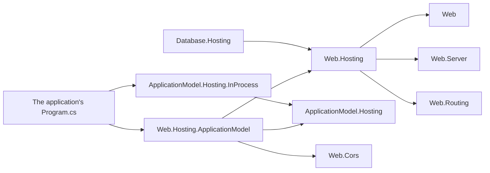

# Web area design

## Application-model integration

Web.Hosting is a plain host. It references the Web root, Web.Routing, Web.Server, and non-Web
infrastructure (Hosting, DependencyInjection, configuration, logging, file system, the HTTP
transport, and the connection drivers), and no application-model package. COHRES001 prevents Web
roots and features from referencing it.

A Web application becomes a managed resource instance through
[Web.Hosting.ApplicationModel](../../../resources/Web/Assimalign.Cohesion.Web.Hosting.ApplicationModel/docs/DESIGN.md),
the area's one application-model integration:
`builder.Services.AddResource("orders-api", resource => resource.UseInProcess())`. The package
references Web.Hosting, the one reference `COHRES001` sanctions by the integration's exact name, plus Web.Cors,
DependencyInjection, Hosting, and ApplicationModel.Hosting, and it carries no transport: the
platform the resource opts into publishes for it and carries the gateway's calls in. Unmanaged, it
registers nothing; managed, it registers one `IHostService` factory, and the resource's actions come
from the settings the application's features registered (the `cors` setting becomes the `cors`
action). It is a public member of App.Web; ApplicationModel.Hosting arrives with the App kernel.

Web.Hosting is a private member of the 17 other area frameworks: Database.Hosting references it
privately for its admin endpoint, through the coordinated
CohesionPrivateProjectReference / CohesionFrameworkPrivateAssembly pair. Web.Testing and
Web.Hosting.ApplicationModel are the only Web packages that reference Web.Hosting.

Arrows mean "references".

## Diagnostic signal ownership

Web and transport diagnostics answer different questions. Web.Server owns the server spans and
Meter instruments for requests that reach the Web pipeline. The HTTP transport also rejects input before
dispatch and enforces protocol rules after dispatch; it owns those outcomes even when no Web span
exists. Each owner reports its own events rather than forwarding another package's internal source.

| Question or outcome | Signal | Owner | What it reports |
| --- | --- | --- | --- |
| What happened during a dispatched HTTP request? | `ActivitySource` named `Assimalign.Cohesion.Web.Server` | Web.Server | One server span, caller trace context, method, route, final status, duration and cancellation/fault outcome. |
| How much dispatched work is active, and how long does it take? | `Meter` named `Assimalign.Cohesion.Web.Server` | Web.Server | `http.server.active_requests` and `http.server.request.duration`, including Web middleware's rejection statuses. |
| Did HTTP reject a request or fail a protocol operation? | `Meter` and `EventSource` named `Assimalign.Cohesion.Http.Connections` (#1300) | HTTP transport | Pre-dispatch rejection statuses, HTTP/2 and HTTP/3 protocol errors, request-rate enforcement and slow-reader response aborts. These are not Web application faults. |
| Did a listener bind, drain or stop, and did server machinery fail? | `EventSource` named `Assimalign.Cohesion.Web.Server` | Web.Server | Lifecycle, bind/accept/connection failures, completion-callback failures, refused response heads, capacity waits and drain timeouts, correlated by process-unique `serverId`. Peer-ended connections are Verbose and do not increment `connection-faults`. |
| Which application fault reached the exception boundary? | `EventSource` named `Assimalign.Cohesion.Web.ErrorHandling` | Web exception boundary | Pipeline and handler failures, expected faults and abandoned responses; client-caused and cancelled exchanges do not become application-fault counts. |
| Which middleware rejected or degraded an exchange, and why? | The owning Web assembly's `EventSource` | Web feature package | Bounded rejection reasons and exact attribution counters for authentication, authorization, antiforgery, edge policies, timeouts, rate limits, compression, forms and content handling. There are no duplicate request start/stop events or general request counters. |
| Did health work fail? | `EventSource` named `Assimalign.Cohesion.Web.Health` | Web.Health | Health transitions and failed checks. |
| Did the underlying connection or TLS handshake fail? | Connections driver event sources; runtime `System.Net.Security` | Connection transport and TLS runtime | Listener, connection and stream lifecycle, driver counters and TLS handshake diagnostics. These sources are outside default Web forwarding. |
| What should the application's HTTP access log contain? | `ILogger` entries, default category `Assimalign.Cohesion.Web.Diagnostics.HttpLogging` | Web.Diagnostics middleware | Explicitly composed access logging at Information with its own redaction options. The `Web.Diagnostics` EventSource reports failures of logging itself, rather than duplicating access entries. |

The [event-source catalog](../../EVENT_SOURCES.md#cohesion-event-sources) lists all 22 instrumented Web
assemblies and links their event schemas, counters and payload policies. The
[deliberately uninstrumented list](../../EVENT_SOURCES.md#web-assemblies-deliberately-left-uninstrumented)
records where visible status codes, thrown failures or contract-only packages need no extra source.
The package-level details of request spans and metrics live in
[Web.Server's telemetry design](../../../resources/Web/Assimalign.Cohesion.Web.Server/docs/DESIGN.md#server-telemetry-1064),
and its operator events in
[Web.Server's diagnostics design](../../../resources/Web/Assimalign.Cohesion.Web.Server/docs/DESIGN.md#diagnostics).

Request event correlation and the access log read `IWebRequestIdFeature`, published by the Web.Server engine. Its identifier remains stable when no `ActivityListener` is
attached; sources never infer it from ambient `Activity.Current`. Event payloads omit request paths,
queries, header values and bodies. A `routeTemplate`, when the owning package references routing,
describes the configured route rather than the request target. Application exception messages remain
subject to each package's documented payload policy.

Entry-point `CreateBuilder(args)` applications forward the `Assimalign.Cohesion.Web.` prefix and
the exact `Assimalign.Cohesion.Http.Connections` name into configured logging sinks. Nested builders
register no default listener, and an application-selected forwarder or
`EnableEventSourceForwarding = false` takes precedence. Forwarding changes neither providers nor
filter rules, so the HTTP access log's Information level is preserved. Event listeners observe the
whole process: `serverId` and request identifiers provide attribution when several servers
coexist.
EventSource counters are inspected separately from forwarded events, and Web feature Meter
instruments remain the distinct #317 workstream.
