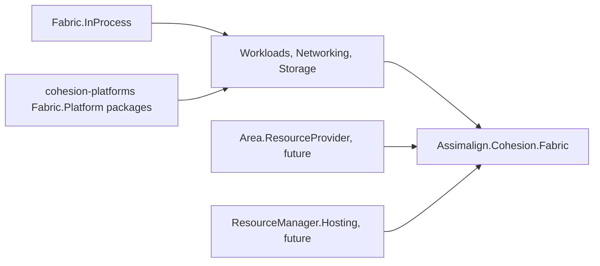

# Assimalign.Cohesion.Fabric Design

## Design intent

An application is a resource. A stateful ResourceManager stores resources, reconciles them
level-triggered through providers, and drives exactly one platform per environment. This
assembly is the vocabulary all of those parts share, and nothing else: no store, no reconciler,
no HTTP, no platform client. It references nothing outside the BCL, so the AppHost, the
ResourceManager, the fabric areas, and `cohesion-platforms` can all take it.

The source is the v2 design document (`application-model-redesign/APPLICATION_MODEL_RESOURCE_PROVIDERS.md`
in the project files), sections 4, 5.4, and 7.

## Where it sits

The root references nothing. The fabric areas and the providers reference it, and the
ResourceManager reaches providers and platforms only through it.

## Decisions

- **`id` is the address, `uid` is the identity.** `ResourceId` can change when a resource moves
  between applications; `ResourceUid` is a version 7 UUID assigned at create and never reused.
  Every edge (owner, `$ref`, operation, platform label) is stored by uid. Retrofitting this later
  would touch every stored edge, so it is fixed now.
- **Identifiers are value objects.** Each has one grammar, checked once in `IsValid`
  (`general-rules.md`). The grammars are allocation-free span checks in `Internal/FabricGrammar`,
  not regular expressions. A child name is `{owner}.{suffix}`; user names cannot contain a dot, so
  the two never collide.
- **The spec is JSON in the envelope.** `ResourceEnvelope.Spec` is a `JsonElement`, so the store
  and the API stay type-agnostic and a provider owns its spec type and versions.
- **References are structural.** `{ "$ref": "{Namespace}/{type}/{name}", "path": "..." }`, read by
  `FabricRef.TryRead`, with unknown members refused. A closed `FabricStringValueJsonConverter` keeps
  `FabricValue<string>` AOT-safe; a generic converter factory would need reflection.
- **Faults are data.** `FabricFault` carries a closed `FaultCode`, a `FaultDisposition`, a Cohesion
  sentence, and the platform's own `PlatformDetail`, verbatim. Platforms add reasons through their
  `IFabricFaultClassifier`, never codes. A reconcile returns every cause, not the first.
- **Unknown fields are fatal.** `FabricJsonContext` uses `UnmappedMemberHandling.Disallow`.
- **Interface first, with guided bases.** `IFabricPlatform` and `IFabricExtension` are the
  contracts; `FabricPlatform` and `FabricExtension<THub>` are the bases platforms derive from.
- **One registration per platform.** `FabricPlatformRegistration.Create` runs a platform's
  `Configure`, refuses duplicate resource types, duplicate extension host types, another
  platform's extension, and registration after configuration ends.

## Deliberately absent

These depend on open decisions in the v2 design's §15, so they are not guessed here:

| Piece | Waits on |
| --- | --- |
| `IFabricPlatformBuilder.AddSystemDriver` and `IFabricSystemDriver` | Decision 2, how the ResourceManager is deployed |
| `BuiltInRoleAttribute` and the permission model | Decision 4, grouping and permissions |
| Tier entries and the program bridge | Decision 9, framework-owned tier entries |

One gap is the design's, not a decision: `IFabricPlatformBuilder` has no way to register the
fabric areas' drivers (`IWorkloadDriver<T>` and siblings), and the root cannot name them because
it references no area (rule F4). It needs a design answer before a platform can run anything.

## AOT posture

No reflection. Every JSON contract is source-generated; value objects carry generated converters.

## Non-goals

- No store, reconciler, admission, or API surface: those belong to `ResourceManager.Hosting`.
- No authoring verbs (`AddWorkload`, `ForKubernetes`): those belong to the AppHost's SDK and
  each platform's contract package.
- No platform code.
