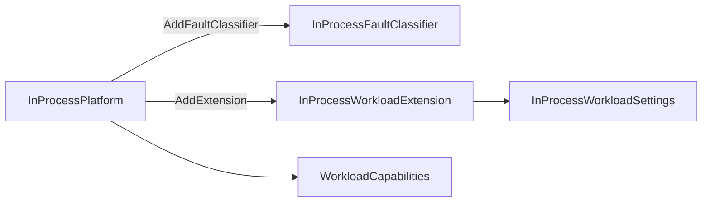

# Assimalign.Cohesion.Fabric.InProcess Design

## Design intent

The in-process platform uses the same mechanism as Docker and Kubernetes, which keeps the
platform contract honest: if the in-process platform needs a back door, so will the others. It
replaces the old `ApplicationModel.Gateway.InProcess` and `ApplicationModel.Hosting.InProcess`
pair, which phase 2 of the removal deletes.

## What it registers

Configuring the platform registers its classifier and its workload extension; the capabilities
are published as a static value for validation at emit.

## Decisions

- **Capabilities.** Programs only (images are Unsupported), one replica, no isolation; mounts,
  state, and probes are Emulated, so they need an environment policy that allows emulation.
  One-shot programs are Native.
- **Unknown reasons need a change.** The classifier maps an unknown reason to `PlatformError`
  with `NeedsChange`: in process there is no remote API whose failures clear by themselves, so
  retrying an unknown cause only loops.
- **Extension version 2026-12-01.** One block field, `contentRoot`. Unknown fields and unknown
  versions are refused.

## Not yet

The platform does not run programs. That needs two things the v2 design has not settled:

1. A program bridge that turns a program reference into an entry point the platform can call.
   It depends on decision 9 (framework-owned tier entries through SDK-generated programs).
2. A way for a platform to register its area drivers (`IWorkloadDriver<T>`); see the fabric
   root's DESIGN.md.

## Non-goals

No process isolation, no containers, no more than one replica.
