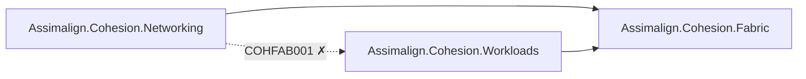

# Assimalign.Cohesion.Networking Design

## Design intent

Exposure intent is part of the portable core: "this port is public" is said once and each
platform implements it (a Service and an Ingress on Kubernetes) or emulates it (a loopback port
in process). This area holds only that intent.

## Dependency direction

The area references the fabric root and nothing else. It reaches a workload through a `$ref`,
never through the Workloads area's types.

The dotted edge is the reference COHFAB001 rejects (rule F4).

## Decisions

- **Minimal on purpose.** Target, port, visibility. Routing through an owned gateway (a host, a
  path, a gateway resource, egress) has been proposed in examples but not designed, so nothing
  here commits to a shape. `ExposureSpec` uses init properties so it can be added without a break.

## Non-goals

No platform code, no network policy (a platform-native tier T2 type), no DNS.
