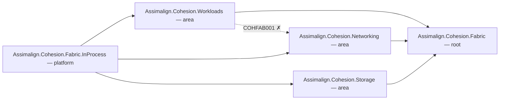

# fabric/

The application model's root. An application is itself a resource, run by an ARM-style
ResourceManager (one per environment) with opt-in providers. `fabric/` holds what that model is
made of, independent of any resource area and any out-of-process platform:

- **The fabric root** (`Fabric/`): the resource envelope and identity, structural `$ref` values, the
  platform-neutral fault contract, the resource-provider contract, and the compile-time platform
  contract.
- **The fabric areas** (`Workloads/`, `Networking/`, `Storage/`): the small portable core every
  platform implements, emulates, or rejects: what to run, ports, replicas, exposure, volumes.
- **The in-process platform** (`InProcess/`): local development through the same platform contract
  as the Docker and Kubernetes platforms in `cohesion-platforms`.

The design is the v2 "application model as resource providers" document. Its layout is approved;
its open decisions (deployment of the ResourceManager, permissions, tier entries, and others) are
not, so the pieces that depend on them are absent rather than guessed. Each project's
`docs/DESIGN.md` says which.

## Layering

`fabric/` sits between `libraries/` and `resources/`: it may reference `libraries/`, never
`resources/`, and inside `resources/` only the ResourceManager's hosting module and an area's
`<Area>.ResourceProvider` may reference it. The fabric areas meet through `$ref` values in the
resource document, never through a type reference. The rules are in
[`.claude/rules/fabric.md`](../.claude/rules/fabric.md) and are enforced by the build.

The project map below shows what references what. The fabric root references no area; each area
references only the root; the in-process platform references all three areas.

The dotted edge is one that COHFAB001 rejects: a fabric area may not reference another fabric area.

| Project | Role | References |
| --- | --- | --- |
| [`Assimalign.Cohesion.Fabric`](Fabric/Assimalign.Cohesion.Fabric/docs/OVERVIEW.md) | Root contracts | Nothing |
| [`Assimalign.Cohesion.Workloads`](Workloads/Assimalign.Cohesion.Workloads/docs/OVERVIEW.md) | Workload spec, driver contract, capabilities | Fabric root |
| [`Assimalign.Cohesion.Networking`](Networking/Assimalign.Cohesion.Networking/docs/OVERVIEW.md) | Exposure spec | Fabric root |
| [`Assimalign.Cohesion.Storage`](Storage/Assimalign.Cohesion.Storage/docs/OVERVIEW.md) | Volume spec | Fabric root |
| [`Assimalign.Cohesion.Fabric.InProcess`](InProcess/Assimalign.Cohesion.Fabric.InProcess/docs/OVERVIEW.md) | In-process platform | The three areas |

Out-of-process platforms (`Fabric.<Platform>` contract packages and `Fabric.<Platform>.Drivers`)
live in `cohesion-platforms`; `fabric/` holds no platform client (rule F2).
