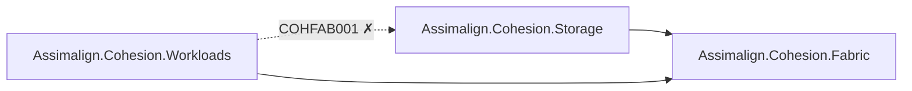

# Assimalign.Cohesion.Storage Design

## Design intent

The portable core of storage: how much, and who may mount it. A platform provisions it natively
(a PersistentVolumeClaim) or emulates it (a directory under the content root in process).

## Dependency direction

The area references the fabric root only. Workloads mount volumes by `$ref`, so neither area
references the other.

The dotted edge is the reference COHFAB001 rejects (rule F4).

## Decisions

- **Capacity is a number of bytes**, a primitive (`general-rules.md`: numbers stay primitives).
- **Minimal on purpose.** Storage classes, snapshots, and backup are platform blocks or later
  portable fields; `VolumeSpec` uses init properties so they can be added without a break.

## Non-goals

No platform code, no database or object storage (those are service providers, not fabric).
