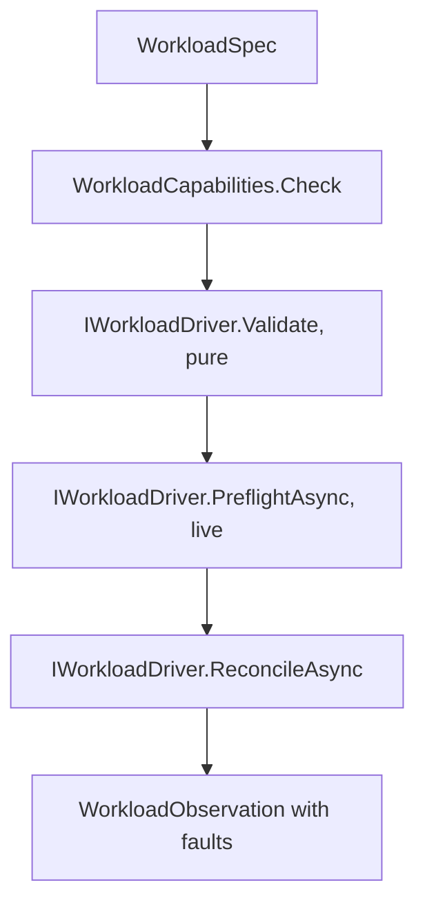

# Assimalign.Cohesion.Workloads Design

## Design intent

The local environment, and portability in general, exist because a few things can be said once
and run anywhere: what to run, ports, replicas, settings, probes. This area is that small portable
core for workloads, plus the contract a platform implements to run one. Everything else about a
workload belongs to a platform, as a typed block under `spec.platforms.<platform>`.

## Validation flow

A workload is checked against the platform's capabilities at emit (for each targeted platform)
and at admission (for the environment's platform), then by the driver's own pure `Validate`, then
live by `PreflightAsync` before the first apply, then observed by `ReconcileAsync`.

## Decisions

- **Capabilities make degradation loud.** Every portable field resolves to Native, Emulated, or
  Unsupported. Unsupported is always an error. Emulated is an error unless the environment's
  policy allows emulation, and a warning when it does. A value limit is a capability too:
  `MaxReplicas`.
- **The spec grows; the driver contract does not.** `WorkloadSpec` uses init properties, so a field
  can be added. `IWorkloadDriver<T>` is pinned across repositories by `cohesion-platforms`, so it
  stays small. A T1 field moves into the spec once two drivers implement it natively.
- **Mounts reach Storage by `$ref`.** `WorkloadMount.Volume` is a `FabricRef`, so the area does
  not reference Storage (rule F4).
- **A source names exactly one of a program or an image.** The factories enforce it; a source read
  from JSON can break it, and `Check` reports `WorkloadSourceAmbiguous`.
- **Revision and workload-hash logic stays in the driver.** Deciding create, update, or nothing is
  each platform's business (today's platform rule 3), not this contract's.

## Open

How a platform registers its workload driver is not in the v2 design; see the fabric root's
DESIGN.md. No workload resource provider exists yet for the same reason.

## AOT posture

Source-generated JSON only (`WorkloadsJsonContext`), with the fabric root's closed converters.

## Non-goals

No platform code, no authoring verbs, no exposure or storage types.
