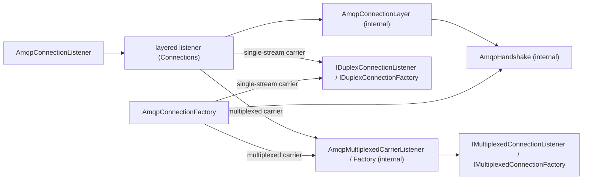
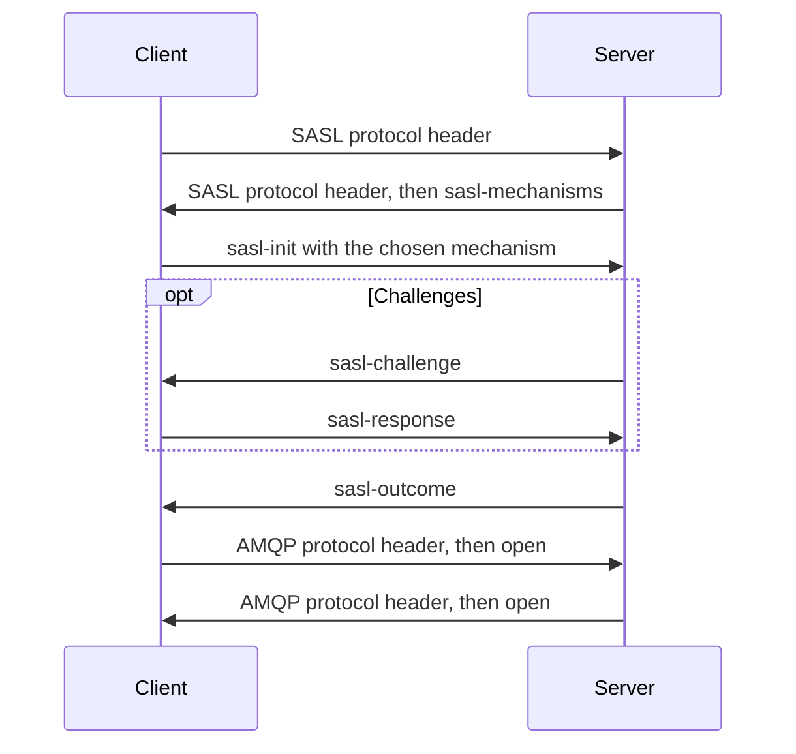
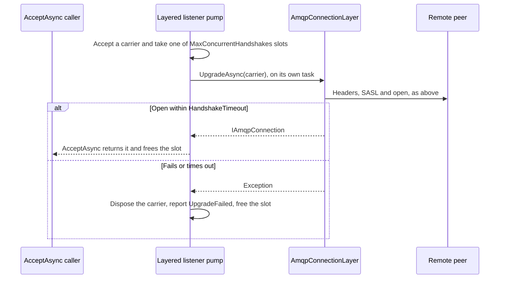
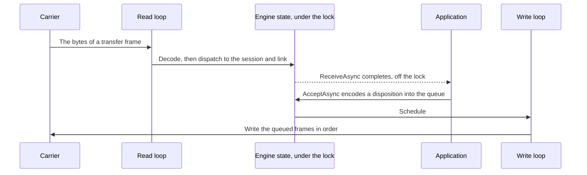

# Assimalign.Cohesion.Amqp.Connections — Design

## Design intent

This package is the AMQP 1.0 engine. It implements the contracts of the root
`Assimalign.Cohesion.Amqp` package over carrier connections produced by the
`Assimalign.Cohesion.Connections` contracts: it establishes connections (protocol headers, the SASL
layer and the `open` exchange), runs the connection, session and link state machines of Part 2,
checks every frame against the specification in both directions, and encodes and decodes the Part 1
type system and the Part 3 message format.

Its public surface is small on purpose: `AmqpConnectionListener`, `AmqpConnectionFactory`, their
interfaces and options, and `AmqpMessageCodec`. Everything protocol-shaped (performatives, frames,
the encoder and reader, the state machines) is internal, so every frame on the wire is written by a
state machine that has checked it. The root package's
[DESIGN.md](../../Assimalign.Cohesion.Amqp/docs/DESIGN.md) records the model an application sees;
this file records how the engine implements it.

## The shape at a glance

An AMQP endpoint is composed like any other Cohesion connection endpoint: a listener accepts, a
factory connects, and both return connections that are open.

| Role | Type | Carrier it consumes | Produces |
|---|---|---|---|
| Server | `AmqpConnectionListener : ConnectionListener<IAmqpConnection>, IAmqpConnectionListener` | `IDuplexConnectionListener` or `IMultiplexedConnectionListener` | an open `IAmqpConnection` from `AcceptAsync` |
| Client | `AmqpConnectionFactory : ConnectionFactory<IAmqpConnection>, IAmqpConnectionFactory` | `IDuplexConnectionFactory` or `IMultiplexedConnectionFactory` | an open `IAmqpConnection` from `ConnectAsync(EndPoint)` |
| Connection | the internal `AmqpConnectionEndpoint`, which implements the root `IAmqpConnection : IConnection` | the carrier's byte stream | sessions, links and deliveries |

The listener wraps its carrier in the Connections layered listener and gives it one establishment
step, the internal `AmqpConnectionLayer`; the factory runs the same handshake inside its own
`ConnectCoreAsync`. A multiplexed carrier first passes through an internal adapter that presents it
in the duplex shape. In this diagram an arrow means "holds a reference to":

## Direction is structural: a listener and a factory

Preview.1 shipped `AmqpServerTransport` and `AmqpClientTransport`, the shape of the retired
transport design. The Connections design dissolved that abstraction (its `DESIGN.md`, "Why the old
transport abstraction dissolved"): a server is an `IConnectionListener<T>`, a client an
`IConnectionFactory<T>`, and the direction is the type. The AMQP pair follows it (#1890).

- **`AmqpConnectionListener`** derives from `ConnectionListener<IAmqpConnection>`. Its `Id` is the
  carrier listener's, because both represent one bound endpoint. `BindAsync` binds the carrier
  listener. Accepted connections are tracked in the base's concurrent live set, `Connections`,
  until each one's `ConnectionClosed` fires.
- **`AmqpConnectionFactory`** derives from `ConnectionFactory<IAmqpConnection>` and connects a new
  carrier on every `ConnectAsync(EndPoint)` call. The endpoint is the call's argument, as on every
  other factory, and the factory keeps no list of the connections it returned.
- **Both carry a container identifier** (`ContainerId`), which every connection they produce sends
  in its `open`. Left unset, each listener or factory takes a unique one when it is created; a
  service that restarts sets its own, so peers that resume links recognize it.
- **Rejected: keeping the names over the new base classes.** "Transport" is the word the
  Connections design retired, and an object that is both a server transport and a listener reads
  as two concepts. References to the AMQP 1.0 Part 2 transport layer stay, because that is the
  specification's own name.

## A connection is open when it is produced

`AcceptAsync` and `ConnectAsync` return a connection whose protocol headers, SASL exchange (when
configured) and `open` frames are done. The application begins and accepts sessions on it at once.

- **Preview.1's connection was a frame pipe.** It exposed the protocol headers (`NegotiateAsync`,
  `SwitchProtocolAsync`) and raw frames (`SendAsync`, `ReceiveAsync`), and left the `open`
  exchange, sessions, links and SASL to a layer that did not exist. Every consumer would have
  rebuilt the state machines, and any of them could send a frame the protocol state did not allow.
- **`IAmqpConnection` is an `IConnection`, not an `IDuplexConnection`.** Its traffic is frames
  multiplexed into sessions, not a byte stream, so it exposes no pipe. It shares the carrier's id,
  endpoints and capabilities, and its feature collection falls back to the carrier's, so the facts
  a lower layer registered, such as TLS (`connection.Tls`), stay visible. After SASL it adds
  `IAmqpSaslConnectionInfo` (`connection.AmqpSasl`).
- **The implementation derives from `DuplexConnection` anyway**, because the Connections layered
  listener carries upgraded connections as `IDuplexConnection`. Its `Input` and `Output` throw
  `NotSupportedException`; nothing outside the engine sees that type.
- **Rejected: keeping a frame-level API beside the state machines.** Two writers to one connection
  cannot both own its state. A consumer that needs a performative the model does not expose needs
  a model change, not a back door.

## Establishment

`AmqpHandshake` establishes a connection over a carrier, under one token that it cancels after
`HandshakeTimeout`:

1. on a multiplexed carrier, the AMQP stream is acquired (see "A multiplexed carrier is adapted to
   the duplex shape");
2. with a SASL mechanism configured, the SASL header is exchanged and the SASL exchange runs;
3. the AMQP header is exchanged, and each side sends its `open` right behind its header, without
   waiting for the peer's (Part 2 §2.4.1 permits this pipelining);
4. the peer's `open` is read and checked, and the connection starts its read and write loops.

This sequence shows a client and a server that both use SASL:

- **The header phase is held to Part 2 and Part 5.** A server answers a header it does not accept
  (another version, another protocol id, or bytes that are not a header) with the header it does
  accept and refuses the connection (§2.2). A client whose header is answered with another fails
  before any frame. During SASL only SASL frames travel, in the order the exchange defines; after
  it, only the AMQP header. A `sasl-outcome` other than `ok` ends the connection, as does a
  mechanism the server does not offer.
- **SASL frames are at most 512 bytes**, in both directions, because SASL negotiates no larger size
  (Part 5 §5.3.1). A peer's SASL frame is refused from the size its header declares, before its
  body arrives; a local one is refused before it is written. A SASL frame carries exactly one
  performative, never none. Credentials too large for a frame, such as bearer tokens, belong on a
  link after the connection opens.
- **The `open` frames are bounded.** The local `open` must fit the 512 bytes a peer accepts before
  the connection opens; the peer's is accepted up to the local `MaxFrameSize`, which bounds what the
  engine buffers whatever the peer declares. The peer's `open` comes first after its header, on
  channel 0; anything else in its place, but an empty frame on channel 0 (H14), is refused with
  `close`. A peer that declares a maximum under 512 bytes is sent frames of up to 512 (H20).
- **The peer's idle timeout must be one the engine can keep.** A peer that asks for less than 100
  milliseconds is refused with `close` and `amqp:not-implemented`, as §2.4.5 allows.
- **A peer that breaks the protocol after both `open` frames are on their way** is sent `close`
  with the error before the carrier is released, so it learns why.
- **A timeout is a `TimeoutException`.** When the handshake's own timer fires and the caller's token
  did not, the handshake throws `TimeoutException` with the `OperationCanceledException` as its
  inner exception, so a caller can tell a slow peer from its own cancellation. The message format is
  read once into a static field, because a stalled peer can make every handshake time out.

### On a listener: a connection layer

The listener composes `AmqpConnectionLayer : IConnectionLayer` onto its carrier listener with
`listener.Use(layer, MaxConcurrentHandshakes)`, the same seam TLS uses through `UseTls`, and so
inherits #1304's containment exactly as TLS does. Each establishment runs on its own thread-pool
task. At most `MaxConcurrentHandshakes` connections are held at once, counted until `AcceptAsync`
returns them, and they are returned in the order their establishment completes. An establishment
that fails or times out disposes only its carrier, is reported as `UpgradeFailed` through the
`Assimalign.Cohesion.Connections` event source, and frees its slot; the listener keeps accepting.
An exception from `AcceptAsync` therefore means the carrier listener itself failed.

- **Each layer keeps its own bound and timeout.** AMQP over TLS composes two layered listeners,
  `AmqpConnectionListener.Create(tcpListener.UseTls(tlsServerOptions), amqpOptions)`. The TLS handshake
  runs under `TlsServerOptions.HandshakeTimeout` and `MaxConcurrentHandshakes`; the AMQP
  `HandshakeTimeout` starts only once the AMQP layer has a connection whose TLS handshake completed.
- **Rejected: an accept loop of AMQP's own.** It would rebuild the pump's concurrency, bound,
  containment, disposal and diagnostics, and drift from TLS. The Connections design calls the
  layered listener the one place that knows which failures belong to a connection.

### On a factory: the caller's call

`ConnectAsync` connects a carrier and runs the connecting side of the handshake in the caller's
call. A factory runs one establishment per call and has no pump to bound, so it does not compose a
layered factory. When establishment fails, the carrier is disposed before the exception reaches the
caller. The `open`'s host name is `AmqpConnectionFactoryOptions.HostName`, or the host of a
`DnsEndPoint` the caller connected to.

## A multiplexed carrier is adapted to the duplex shape

AMQP 1.0 runs over one ordered byte stream, so a multiplexed (QUIC-shaped) carrier carries exactly
one AMQP connection, on one bidirectional stream. The Connections layer seam is duplex
(`IConnectionLayer.UpgradeAsync(IDuplexConnection)`), so internal adapters,
`AmqpMultiplexedCarrierListener` and `AmqpMultiplexedCarrierFactory`, present a multiplexed listener
or factory as a duplex one. Their connections are `AmqpMultiplexedCarrier : DuplexConnection`, and
both carrier kinds share one handshake.

- **The stream is acquired during establishment**, under the handshake timeout and the bound. The
  listener side accepts the first stream its peer opens; the factory side opens a bidirectional
  stream. A first stream that is not bidirectional is refused with `AmqpException`
  (`ProtocolViolation`), and the stream is released with the carrier.
- **Identity and capabilities.** The connection's id, endpoints and features are the multiplexed
  connection's. Its capabilities are those of one stream: the connection's, with
  `IsMultiplexed = false`. The listener's and the factory's `Capabilities` report the same.
- **Lifetime.** `ConnectionClosed` fires when either the stream or the multiplexed connection ends,
  so a peer that resets the AMQP stream on a connection it keeps open still ends the AMQP
  connection. While the multiplexed connection is open, `State` is the stream's.
- **Disposal and abort.** Disposing disposes the stream, then the multiplexed connection. Aborting
  aborts the multiplexed connection, which ends every stream.
- **Non-goal:** several AMQP connections over one multiplexed carrier, until a consumer needs it.

## Carriers are chosen by capability, at creation

AMQP 1.0 framing assumes a reliable, ordered byte stream. `Create` therefore requires
`Delivery == Stream`, `IsReliable` and `IsOrdered` of the carrier's `ConnectionCapabilities`, and
throws `ArgumentException`, with `ParamName` `listener` or `factory`, otherwise.

- **Capability, never protocol identity.** `ConnectionProtocol` is diagnostic only and is never
  branched on: TCP, Unix domain sockets, named pipes, QUIC, the in-memory driver, or a future
  reliable userspace protocol all qualify by capability alone.
- **At creation, not at accept.** A mismatch is a composition error, so it surfaces at the
  composition root rather than at the first `AcceptAsync` or `ConnectAsync`. A listener `Create`
  refuses is not taken over, and so not disposed.

## Creation and options

- **`public sealed`, private constructor, static `Create`** (owner decisions 59 and 61), with one
  `Create` overload per carrier kind on each type. There is no implementation variance to abstract
  over, and the interfaces remain the contracts consumers depend on.
- **Options are split by role.** `AmqpConnectionListenerOptions` and `AmqpConnectionFactoryOptions`
  share `ContainerId`, `MaxFrameSize` (default 262,144 bytes, at least 512), `ChannelMax` (default
  255), `IdleTimeout` (default one minute), `HandshakeTimeout` (default 10 seconds),
  `SessionOptions`, and the `open`'s `OfferedCapabilities`, `DesiredCapabilities` and `Properties`.
  The listener adds `MaxConcurrentHandshakes` (default 512, at least 1: TLS's default and the TCP
  listener's default backlog) and `SaslMechanisms`, the server mechanisms it offers in order. The
  factory adds `HostName` and `SaslMechanism`, the one client mechanism it uses.
- **Options are read once**, at `Create`, into an internal immutable `AmqpConnectionSettings`.
  Changing an options object afterwards does not affect a listener or factory created from it.
- **Timeouts have floors and ceilings.** A non-positive `HandshakeTimeout` disables the limit, and a
  value above `uint.MaxValue - 1` milliseconds, the timer's ceiling, is refused when assigned. An
  `IdleTimeout` other than zero is at least 200 milliseconds, so the half a connection declares is
  one the engine keeps (see "Idle timeout").

## The engine: one lock, a read loop and a write loop

An open connection is one `AmqpConnectionEndpoint` with its `AmqpSessionEndpoint`s, their
`AmqpSenderEndpoint`s and `AmqpReceiverEndpoint`s, and the deliveries on them.

- **One lock guards the connection and everything on it.** Members whose names end in `Locked` run
  under it. A read loop decodes the peer's frames and dispatches each under the lock; application
  calls take the same lock, update the state and encode their frames into the frame writer's queue.
  A finer-grained scheme (a lock per session or link) would have to order its locks across the
  frames that span levels, such as a `disposition` that settles deliveries of several links or an
  `end` that detaches every link of a session, for no gain the carrier would notice: encoding a frame
  is cheap next to writing it.
- **No application code runs under the lock.** Every completion the engine signals
  (`TaskCompletionSource` with `RunContinuationsAsynchronously`, the waiters, the accept channels)
  runs its continuations asynchronously.
- **One write loop per connection.** `AmqpFrameWriter` queues frames in the order they were encoded,
  and its loop swaps the buffer callers fill for the one it writes, so encoding continues while the
  carrier writes. A sender that produces faster than the carrier drains waits once the queued bytes
  pass a high-water mark (four maximum frames, between 64 KiB and 8 MiB); frames the engine answers
  with, such as a `flow` or a `close`, never wait.
- **A frame that fails leaves nothing written.** A frame whose encoding fails (a value the encoder
  refuses, or a frame larger than the peer's maximum) is removed from the queue before the error is
  raised, so a half-encoded frame never reaches the wire.
- **The loops do not capture the caller's execution context.** They outlive the call that
  establishes the connection, and an ambient activity would otherwise parent every frame they
  process.

This sequence shows a delivery arriving and the application accepting it:

### Sessions

- **A session pairs a local and a remote channel.** A session the application begins waits for the
  peer's answering `begin`; a session the peer begins is answered at once and handed to
  `AcceptSessionAsync`. It stops carrying links as soon as either peer sends `end`, and has ended
  once both have.
- **The incoming window is refilled at half.** The engine declares `AmqpSessionOptions.IncomingWindow`
  (2,048 by default) and sends a `flow` that restores it once half is used, before the peer runs
  out. A peer that sends past the window ends the session with `amqp:session:window-violation`.
- **The engine never limits itself by an outgoing window.** It declares `int.MaxValue`, the largest
  value peers that read the field as signed still accept, and sends within the peer's incoming
  window.
- **Handles are bounded both ways.** The engine attaches links on handles up to the peer's
  `handle-max`. A peer that attaches above the local `HandleMax` (1,023 by default) closes the
  connection with `amqp:connection:framing-error`, as §2.7.2 requires, and one that attaches on a
  handle in use ends the session with `amqp:session:handle-in-use`.
- **Unsettled deliveries are tracked by delivery-id on the session**, because a `disposition` names
  a range of delivery-ids on the session, not a link. Serial-number arithmetic (RFC 1982,
  `AmqpSerialNumber`) handles the 32-bit wraparound of transfer ids, delivery ids and delivery
  counts.

### Links

- **A link the application attaches** starts in `AttachSent` and completes when the peer answers; a
  refusal (an `attach` with no terminus followed by a `detach`) fails it with the peer's error. **A
  link the peer attaches** is created with its handle and name reserved and handed out as an
  `IAmqpLinkRequest`; answering it only decides what the local `attach` carries.
- **The attach rules are checked where a single field cannot see them** (`AmqpAttachRules`): rules
  that span fields, and the values inside termini Part 3 does not allow. A peer's opening `attach`
  that breaks one is refused with `amqp:invalid-field`, ending only that link; a local one is refused
  before it is sent. A peer's answering `attach` is not checked, because a refusal's reason travels in
  the `detach` that follows it.
- **Sends are serialized by a semaphore per link**, so the frames of one delivery are contiguous. A
  send takes the lock only to encode frames; it waits for credit, window or carrier capacity outside
  it, and releases the semaphore once its last frame is queued, so it awaits the outcome without
  holding up the next send.
- **A receiver with a positive prefetch keeps that many deliveries granted or buffered**, topping
  credit up once half has been taken, so it sends one `flow` for many deliveries.
- **A delivery is reassembled under the lock and handed out whole.** Its payload never changes after
  its last frame arrives. A delivery the sender aborts is discarded, unless it was resumed (see
  "Compliance maps", the resume map).

### Closing, ending and detaching

- **Every close waits for the peer's answer, bounded.** `CloseAsync`, `EndAsync`, `CloseAsync` on a
  link and `DetachAsync` send their performative and wait for the peer's, at most the handshake
  timeout, or 30 seconds when that is disabled. A peer that never answers still releases its carrier.
- **After sending `close`, an endpoint ignores everything but the peer's `close`**, and accepts that
  `close` on any channel: refusing it would only hold the carrier until the timeout.
- **A violation ends the smallest scope that contains it.** A frame that breaks a link's rules
  detaches the link; one that breaks a session's ends the session; one that breaks the connection's,
  or bytes that no longer form frames, close the connection. Each carries the specification's error
  condition.
- **An error too large for a frame still closes**, without its details: the engine sends the
  condition alone.

### Idle timeout

A connection declares half its `IdleTimeout` in its `open`, as Part 2 §2.4.5 recommends, so a peer
that sends a frame at least that often never trips it. When the peer stays silent past the full
timeout, the connection closes with `amqp:resource-limit-exceeded`. Whatever its own timeout, a
connection keeps the peer's by sending an empty frame whenever it has written nothing for half of
it. Both run on one timer per connection, whose period follows the shorter of the two.

## Compliance maps

Each part of the specification the engine enforces has a map in the tests: a list of rules, each
with its statement, its section, whether it forbids something, and the tests that pin it. The first
test of each map checks that every rule names tests that exist, so a rule cannot lose its coverage
silently. Rules that record a leniency say so.

| Map | Tests | Rules | Covers |
|---|---|---|---|
| Header phase | `AmqpHeaderPhaseComplianceTests` over `AmqpHeaderPhaseCorpus` | H1 to H20 | protocol headers, the SASL exchange and its frames, the `open` exchange, idle timeouts, channels and frame layout |
| Type system | `AmqpTypeSystemComplianceTests` over `AmqpTypeSystemCorpus` | one case per constructor, CLR type and refusal | the Part 1 type surface (see "The type surface") |
| Message format | `AmqpMessageFormatComplianceTests` over `AmqpMessageFormatCorpus` | MF1 to MF9 | section order, repetition and body kinds, descriptors, message ids, annotation and property keys |
| Termini | `AmqpTerminusComplianceTests` over `AmqpTerminusCorpus` | T1 to T10 | terminus defaults, dynamic nodes and their owner, node properties, filters, durability, expiry, default outcomes |
| Transactions | `AmqpTransactionComplianceTests` | T1 to T14 | declare and discharge, transactional work on transfers and dispositions, acquisition, identifiers, capabilities |
| Transfer | `AmqpTransferComplianceTests` | F1 to F20 | splitting and reassembly, settlement on frames, aborts, malformed fragmentation, terminal outcomes, credit and drains |
| Resume | `AmqpResumeComplianceTests` | R1 to R11 | unsettled-map comparison at both ends, resuming and aborting, the `received` state, new deliveries while maps are incomplete, the Part 3 §3.4.6 example end to end |

The leniencies, each accepted because the meaning is clear and nothing is at risk:

- **H14:** an empty frame on channel 0 before the peer's `open` is skipped; on another channel it is
  a framing error.
- **H20:** a `max-frame-size` under 512 bytes, the lower bound of the agreed maximum (Part 2
  §2.8.19), is taken as 512, since both peers must accept frames that large.
- **MF3:** a message with no body section, which widely used libraries send, decodes.
- **MF9:** an application property value of any type decodes, since other libraries send lists;
  the engine never sends one.
- **Transactions T5:** a later frame without a state keeps its delivery in the transaction its first
  frame named.
- **Transactions T13:** a coordinator that announces no capabilities is taken to support those the
  controller asked for, because older coordinators omit the field.
- **F12:** a later frame that clears `settled` leaves a settled delivery settled.
- **F13:** a first frame without a message format is read as format 0.
- **F17:** a receiver does not check that a new delivery's tag differs from its unsettled
  deliveries' tags, since deliveries settle by delivery-id.
- **F20:** a receiver ignores the `drain` field of the sender's `flow`, which should repeat the
  receiver's own: the delivery-count already says whether a drain ended.
- **R11:** a later frame of a delivery that is not resumed may set `resume`; only the first frame
  decides.

## Regression register (#433)

`AmqpRegressionRegister` in the tests lists every defect the engine is known to have had: what it
did wrong, the work item that found or fixed it, the section of AMQP 1.0 it broke, the compliance-map
rule it falls under, and the tests and corpus cases that fail if it returns. A defect is wrong
behavior in code that existed: a stall or a hang, data lost or changed, a valid input refused, or
invalid output written. Accepting what a peer should not send is a leniency, which the compliance
maps record instead (above).

| Category | Entries | Exposed by |
|---|---|---|
| Malformed frame | D1 to D4 | a frame too large, written only in part, or read under the wrong limit |
| Malformed message | D5 to D17, D27 | a value or message the type system or message format refuses, or one the codec changed |
| Invalid state | D18, D19 | an operation in a state where it behaved wrongly: a failed answer to an attach, a disposal |
| Invalid negotiation | D20 to D26 | a protocol header, SASL exchange or `open` negotiated wrongly or stalled on |

`AmqpRegressionTests` checks the register: every category holds an entry, every entry cites a
section of the specification and a work item and names at least one test or corpus case, and every
rule and case it names exists in its map. Tests are named with `nameof`, so renaming or deleting one
breaks the build. A corpus case names the rules the defect broke: a returning defect fails more
cases than it lists, such as every case that pipelines its frames. The same test class holds the
tests for the defects nothing else pinned: an encoder failure that left part of a frame behind (D1,
D2) and a disposal held up by a peer that never answers `close` (D19).

**Verified on 2026-11-20.** Each entry's defect was put back into the engine on its own, by an exact
edit of the code that fixed it, and the tests and cases the entry names were run: all 27 entries
failed as named (D27 the same day, when #1929 found and fixed it). Two were put back in their
original form rather than by removing the fix: D8 counts each compound twice, and D13 restores the
old check that only annotations come first and the footer last.

Two past defects have no entry:

- An array whose count claims more elements than its bytes carry was refused before its fix as
  well, only with another message, so it never behaved wrongly.
- #426: a stopping link could fail a waiting receive before it canceled `LinkDetached`, so the
  receive's continuation, which runs on another thread, could see the failure while the token was
  still uncanceled. The window is a few instructions wide and no test can force it: with the defect
  back, every test outside the interop collection still passed. The comment in
  `AmqpLinkEndpoint.StopLocked` holds the order instead.

Defects outside this project are pinned by their own project's tests, which the register cannot
name: the root package's `AmqpOptionsTests` refuses settlement modes the specification does not
define and its `AmqpPropertiesTests` refuses identifiers outside the four identifier types, and the
TCP close race (#1086) is pinned by `TcpConnectionDisposeTests` and by the NativeAOT guard
("AOT posture").

**Adding an entry.** When a defect is fixed, write a test that fails without the fix, then add an
entry under the category of the input or event that exposed it, citing the work item and the
specification. A defect that breaks a rule in a compliance map names the rule and the map's cases
that fail. Put the defect back once and see every test and case the entry names fail before
committing.

**CI.** `library-amqp.yml` runs the whole suite, the register included, on every push that touches
`libraries/Amqp/**`, the Connections, InMemory or Tcp carriers, or the build, so a change that brings
a registered defect back fails the build.

## Interoperability (#432)

The engine is tested against an independent implementation, AMQPNetLite.Core 2.5.5, in both
directions over TCP loopback. The tests sit in `tests/Interop/` beside the unit tests, carry
`[Trait("Category", "Interop")]`, need nothing but `dotnet test`, and run in one collection without
parallelism, because AMQPNetLite's frame trace is process-wide. `--filter "Category=Interop"` runs
them alone and `--filter "Category!=Interop"` leaves them out; CI runs both.

| Direction | Tests | Scenarios |
|---|---|---|
| AMQPNetLite client, Cohesion listener | `AmqpNetLiteClientInteropTests` (20) | SASL PLAIN and ANONYMOUS; a refused password while the listener keeps accepting; each outcome and pre-settled transfers both ways; every type AMQPNetLite encodes, through both codecs; every message section both ways; messages split across frames both ways; order across sessions and links; a refused link; a close with an error both ways; a committed and an abandoned `TransactionScope` through the broker's coordinator; drain; idle timeout kept with empty frames |
| Cohesion client, AMQPNetLite `ContainerHost` | `AmqpNetLiteHostInteropTests` (11) | SASL PLAIN and ANONYMOUS; a refused password; close; each outcome from a message processor; 50 sends within a credit of 5, in order; split sends; settlements reported to a message source; 300 messages within a prefetch of 50, in order; split receives; a link refused with `amqp:not-found` |

**Reading a failure.** Each test prints every frame AMQPNetLite sent and received. A failure is
Cohesion's when its frames break a rule, which the compliance maps name; it is the peer's when
AMQPNetLite's frames break one or it lacks the feature. A peer's failure moves the scenario to the
list below with the evidence: no test is skipped. Two harness rules follow from how AMQPNetLite
works. It completes sends on its I/O thread, so a test never blocks a continuation (a blocking
`TransactionScope` commit there deadlocks the peer; the tests commit with
`CommittableTransaction.BeginCommit`). And its `CloseAsync(timeout, error)` fails with the error it
sent even when the answering `close` carries none, so the tests read the `close` they received
through a protocol handler (`AmqpNetLiteConnectionEvents`).

What the suite does not cover, and why:

- **Drain by an AMQPNetLite receiver in `CreditMode.Drain`, more than once.** AMQPNetLite leaves
  drain mode only on a sender `flow` that clears `drain`, or once deliveries use up its credit, and
  until then ignores a new drain. Cohesion's `flow` keeps the receiver's value, as Part 2 §2.6.7
  says (rule F18), and so do Microsoft.Azure.Amqp, Qpid Proton-C and Qpid Proton-J. rhea, the
  Node.js library, sees a drain end only in a `flow` that keeps the flag, so clearing it would trade
  one client for another. An AMQPNetLite receiver calls `SetCredit(0, CreditMode.Manual)` before
  its next drain, which the drain test does.
- **Drain by Cohesion against an AMQPNetLite listener.** AMQPNetLite's `ListenerLink` reads a
  drain `flow` that keeps the delivery limit as reduced credit: it zeroes its credit and answers
  without advancing its delivery-count. By rule F19 the drain has not ended, so `DrainAsync` waits;
  a `flow` the sender wrote before it read the drain looks the same, so the engine does not guess.
  AMQPNetLite's `SenderLink` does not answer a drain at all.
- **`decimal32`, `decimal64` and `decimal128`.** AMQPNetLite cannot encode `System.Decimal`; the
  type corpus pins these encodings against byte vectors instead.
- **A list that ends in `null`.** AMQPNetLite drops the trailing nulls of every list it encodes,
  which shortens a plain list; the type test puts the null inside.
- **Not exercised here:** resuming a link (AMQPNetLite keeps no unsettled map), Cohesion as a
  transaction controller (`ContainerHost` has no coordinator), multiplexed carriers, TLS and SASL
  EXTERNAL.

## Framing and the codec

- **Frame layout** follows Part 2 §2.3: a 4-byte big-endian size, the data offset, the frame type and
  the channel, then the performative as a described list and, on a `transfer`, part of a payload.
  Reading is incremental over a `ReadOnlySequence<byte>`: a partial frame waits for more bytes.
- **The maximum frame size is enforced in both directions.** On send, a frame is split or refused
  against the peer's maximum before anything is written. On receive, a frame header that declares
  more than the local `MaxFrameSize` closes the connection with `amqp:connection:framing-error` as
  soon as its size arrives, before its body is buffered (#1919). Before the `open` exchange the limit
  is 512 bytes, and every SASL frame is held to it.
- **The frame type follows the phase.** Once the connection is open only AMQP frames (type 0) travel;
  a SASL frame (type 1) then is a framing error.
- **Channels are bounded.** A frame on a channel above the declared `ChannelMax` is a framing error,
  empty or not (§2.7.1).
- **The message codec is the one public codec.** `AmqpMessageCodec` encodes and decodes the root
  `AmqpMessage` and, for intermediaries, returns the bare message's bytes as received
  (`GetBareMessage`) and replaces the annotated sections around them without re-encoding them
  (`Reannotate`). A broker needs it without a connection; the frame and performative codecs it never
  needs stay internal.

## The type surface (#408)

The codec supports the whole AMQP 1.0 Part 1 type system and nothing outside it. Each type decodes
to one CLR type and is written from a short, closed list of CLR types; anything else is refused
rather than guessed at. The table is the decision. Its executable form is `AmqpTypeSystemCorpus` in
the tests: an encoding for each of the 40 constructors (Part 1's 39 format codes and `0x00`, which
begins a described value), each supported CLR type, and each refusal, checked in both directions.

| AMQP type (Part 1) | Constructors | Decodes to | Written from |
| --- | --- | --- | --- |
| null (§1.6.1) | `0x40` | `null` | `null` |
| boolean (§1.6.2) | `0x41`, `0x42`, `0x56` | `bool` | `bool` |
| ubyte (§1.6.3) | `0x50` | `byte` | `byte` |
| ushort (§1.6.4) | `0x60` | `ushort` | `ushort` |
| uint (§1.6.5) | `0x43`, `0x52`, `0x70` | `uint` | `uint` |
| ulong (§1.6.6) | `0x44`, `0x53`, `0x80` | `ulong` | `ulong` |
| byte (§1.6.7) | `0x51` | `sbyte` | `sbyte` |
| short (§1.6.8) | `0x61` | `short` | `short` |
| int (§1.6.9) | `0x54`, `0x71` | `int` | `int` |
| long (§1.6.10) | `0x55`, `0x81` | `long` | `long` |
| float (§1.6.11) | `0x72` | `float` | `float` |
| double (§1.6.12) | `0x82` | `double` | `double` |
| decimal32, decimal64, decimal128 (§1.6.13 to §1.6.15) | `0x74`, `0x84`, `0x94` | `AmqpDecimal32`, `AmqpDecimal64`, `AmqpDecimal128` | the same |
| char (§1.6.16) | `0x73` | `Rune` | `Rune`, `char` |
| timestamp (§1.6.17) | `0x83` | `DateTimeOffset`, offset zero | `DateTimeOffset`, `DateTime` |
| uuid (§1.6.18) | `0x98` | `Guid` | `Guid` |
| binary (§1.6.19) | `0xa0`, `0xb0` | `byte[]` | `byte[]`, `ReadOnlyMemory<byte>`, `Memory<byte>`, `ArraySegment<byte>`, `AmqpDeliveryTag` |
| string (§1.6.20) | `0xa1`, `0xb1` | `string` | `string` |
| symbol (§1.6.21) | `0xa3`, `0xb3` | `AmqpSymbol` | `AmqpSymbol` |
| list (§1.6.22) | `0x45`, `0xc0`, `0xd0` | `List<object?>` | `IReadOnlyList<object?>`, `IList` |
| map (§1.6.23) | `0xc1`, `0xd1` | `Dictionary<object, object?>`, keys compared as AMQP values | `IReadOnlyDictionary<AmqpSymbol, object?>`, `IReadOnlyDictionary<string, object?>`, `IReadOnlyDictionary<object, object?>`, `IDictionary` |
| array (§1.6.24) | `0xe0`, `0xf0` | a typed CLR array, by element type, or `AmqpArray` (below) | a typed CLR array or `AmqpArray` (below) |
| described (§1.2, §1.5) | `0x00` | the model type its descriptor names, such as `AmqpError` or `AmqpSource`; otherwise `AmqpDescribedValue` | `AmqpDescribedValue` and the model types |

- **Every constructor is read; the smallest is written.** The encoder picks `uint0`, `smalluint`,
  the 8-bit forms of variable-width and compound values, and so on, as the value allows. The reader
  accepts the wider forms a peer may send.
- **Arrays are typed by their element.** An array of symbol, string, binary, boolean, byte, short,
  ushort, int, uint, long, ulong, float, double, a decimal, char, timestamp or uuid decodes to
  `AmqpSymbol[]`, `string[]`, `byte[][]`, `bool[]`, `sbyte[]`, the matching numeric array,
  `AmqpDecimalNN[]`, `Rune[]`, `DateTimeOffset[]` or `Guid[]`, and the encoder writes each of those,
  plus `char[]` and `DateTime[]`, as an array. Any other CLR collection is written as a list.
- **Every other array is an `AmqpArray` (#1929):** an array of ubyte (a `byte[]` is binary), of
  null, of lists, maps or arrays, and any array whose elements are described, whose descriptor the
  `AmqpArray` keeps once for all of them. Until #1929 these came back as `object?[]`, which
  re-encodes as a list, so a relay changed their type on the wire. The encoder writes an `AmqpArray`
  back as the same array: its element type's constructor and its descriptor. An `AmqpArray` of a
  type that has a CLR array, an array of int say, is written the same way and decodes as an `int[]`
  unless it is described.
- **Every element of an `AmqpArray` is checked before any of it is written.** An element that is
  not a value of the element type, by the CLR types the type table names, is refused with
  `ArgumentException`, as are a null element and an array of null that counts any. A list, map or
  array element is encoded on its own first, which checks everything it holds and refuses a value
  that encodes as anything else, such as a described list. The checks are type tests on each
  element, no reflection, so they stay NativeAOT-safe.
- **Array elements share the narrowest constructor that fits all of them.** One string, binary or
  symbol past 255 octets, or one list, map or array past 254 octets after its count, widens every
  element, as the elements share the constructor. Fixed-width elements take their full width (an
  array of uint uses `0x70`), as they do in a typed array. So a peer's array of `list32` elements
  that would fit `list8` comes back as `list8`: the type survives decode and encode, the width may
  not.
- **An array holds no null.** A null string or binary, or a default `AmqpSymbol`, in an array is
  refused with `ArgumentException` before any of the array is written; a list can hold null. On
  decode, an element constructor with no width (`null`, `true`, `uint0`, ...) in a non-empty array is
  refused, because a few octets could otherwise claim any number of elements; an array that claims
  more elements than its octets carry at each element's minimum width is refused before anything
  is allocated for them; and an element constructor Part 1 does not define is refused even in an
  empty array.
- **Strings are Unicode, both ways.** The encoder refuses half of a surrogate pair with
  `ArgumentException` instead of writing U+FFFD, and the reader refuses malformed UTF-8 (overlong
  forms and encoded surrogates included) with `amqp:decode-error` instead of replacing it. A
  replacement would change the string in transit, and two different strings, such as two addresses
  or message ids, could decode as one. Mainstream AMQP stacks send valid UTF-8, so the rule costs no
  interoperability.
- **A char is one Unicode scalar value.** A `char` that is half of a surrogate pair is refused on
  encode; write the pair as a `Rune` or a string. A surrogate or a code point past U+10FFFF is
  refused on decode.
- **A timestamp counts UTC milliseconds.** The encoder drops sub-millisecond ticks, takes a
  `DateTime` of unspecified kind as UTC and converts a local one. A decoded timestamp outside the
  range of `DateTimeOffset` is refused.
- **Decimals keep their bits.** The decimal types carry the IEEE 754-2008 encoding unchanged.
  `System.Decimal` is not converted, because its range and precision differ; it is refused like any
  other unsupported type.
- **Maps have distinct, non-null keys.** A decoded map with a null key or a repeated key is
  refused; keys compare as AMQP values, so two binary keys with the same octets are the same key,
  and a binary key is never the same key as an array of byte with the same octets (D27).
- **Unsupported CLR types are refused by name.** `decimal`, `TimeSpan`, `Half`, `Int128`,
  `UInt128`, `BigInteger`, `DateOnly`, `TimeOnly`, enums, `nint`, `nuint`, `Uri`, sets and any other
  type throw `ArgumentException` naming the type. An enum is not written as its underlying number.
- **Nesting is bounded.** Compound and described values nest at most 64 deep, counted the same way
  by the encoder and the reader, so whatever one writes the other reads. The descriptor a described
  array's elements share counts as one level inside the array.

### Symbols and frame sizes (#1484)

`AmqpSymbol`, in the root package, is a `CohesionValueType` with one ASCII rule in its static
`IsValid`: [Part 1 §1.6.21](https://docs.oasis-open.org/amqp/core/v1.0/os/amqp-core-types-v1.0-os.html#type-symbol)
defines a symbol as seven-bit ASCII, empty text is valid, and identity is ordinal. Wire decoding
uses `TryCreate` and refuses invalid symbol text with `amqp:decode-error`, inside arrays too.

Maximum frame sizes stay numeric. Both options classes reject values below 512 with
`ArgumentOutOfRangeException` when assigned, as
[Part 2 MIN-MAX-FRAME-SIZE](https://docs.oasis-open.org/amqp/core/v1.0/os/amqp-core-transport-v1.0-os.html#constant-MIN-MAX-FRAME-SIZE)
requires. A peer's `open` that declares less is taken as 512 (H20), the size every peer accepts.

## Lifecycle and ownership

- **The listener owns its carrier listener.** `DisposeAsync` disposes the layered listener, which
  cancels every establishment in flight, disposes the carrier listener, waits for those
  establishments to finish, and disposes every connection established but not yet returned. A
  pending `AcceptAsync` then fails with `ObjectDisposedException`, as do later `AcceptAsync` and
  `BindAsync` calls. A cancellation caused by disposal is not reported as a failure.
- **Connections already returned belong to their owners.** Disposing the listener does not close
  them. A returned connection leaves `Connections` when it closes, by disposal, abort or the peer.
- **The factory owns nothing it returns**, and does not own its carrier factory, which is not
  disposable by contract.
- **A connection owns its carrier.** `DisposeAsync` closes without an error: it sends `close`,
  waits for the peer's (bounded, as above), flushes what is queued and disposes the carrier.
  `Abort` ends the connection at once, without the `close` exchange, and aborts the carrier.
  `ConnectionClosed` fires on close, abort or the carrier's end, and every operation waiting on the
  connection, its sessions or its links fails with the matching `AmqpErrorCode`.
- **A carrier that ends** (reset, abort, end of input) closes the connection with
  `AmqpErrorCode.ConnectionClosed`, whose inner exception is the carrier's failure.

## Error model

- **One exception type, the root's.** Protocol failures are `AmqpException` with an
  `AmqpErrorCode` (`ProtocolViolation`, `ConnectionClosed`, `SessionEnded`, `LinkDetached`,
  `AuthenticationFailed`, `MessageSizeExceeded`, `TransactionFailed`) and, when the peer sent
  one, its `AmqpError`. Preview.1's `AmqpProtocolException` is gone: a second root would have split
  one failure into two catch clauses.
- **On the wire, violations are error conditions.** The engine ends the smallest scope the
  violation touches with the condition the specification names (`amqp:decode-error`,
  `amqp:invalid-field`, `amqp:illegal-state`, `amqp:connection:framing-error`,
  `amqp:session:window-violation`, ...). The local operations waiting on that scope fail with the
  matching code.
- **Composition errors are argument exceptions**, from `Create` or an options setter:
  `ArgumentNullException` for a missing carrier, `ArgumentException` for a capability mismatch, and
  `ArgumentOutOfRangeException` for a `MaxFrameSize` below 512, an out-of-range timeout, or a
  `MaxConcurrentHandshakes` below 1.
- **Establishment errors are contained on the listener** (the carrier is disposed, `UpgradeFailed`
  is reported, and `AcceptAsync` returns the next connection). **On the factory, `ConnectAsync`
  throws them** after disposing the carrier: `AmqpException` for a protocol violation or a failed
  SASL exchange, `TimeoutException` when `HandshakeTimeout` elapses, `OperationCanceledException`
  when the caller cancels, or the carrier's own exception.
- **Local misuse never reaches the wire.** A value the encoder refuses is an `ArgumentException`,
  a call the state does not allow an `InvalidOperationException`, both before anything is queued.
- **Messages are resources.** Every exception message comes from `Properties/ErrorMessages.resx`
  through the build-generated `ErrorMessages` class.

## Diagnostics

This assembly has no event source yet. A failed establishment on a listener is reported by the
`Assimalign.Cohesion.Connections` source as `UpgradeFailed` (Warning; `connectionId`,
`remoteEndPoint`, `exceptionType`, `exceptionMessage`) and counted by its `failed-upgrades`
counter, and `current-upgrades` counts establishments in flight. A timed-out establishment reports
`System.TimeoutException`. The carrier is reported by the driver that carries it, under the same
`connectionId`. Events of the engine's own (connections opened and closed, sessions, links, and the
violations that end them, with their conditions) and their counters are planned as an
`Assimalign.Cohesion.Amqp.Connections` source following `.claude/rules/event-source.md`; until it
ships, an application observes them through `ConnectionClosed`, `SessionEnded`, `LinkDetached` and
the exceptions they carry.

## AOT posture

No reflection, no runtime code generation, no serializers. Performative dispatch is a `switch` over
numeric descriptors in both directions; encoding and decoding are span and buffer arithmetic over
pooled buffers and `ReadOnlySequence<byte>`. Fully NativeAOT compatible (`IsAotCompatible` is set
for the whole `libraries/` tree).

A guard proves it on every change to the area (#433).
`samples/Assimalign.Cohesion.Amqp.Connections.AotSample` publishes with `PublishAot=true` and every
trim and AOT warning as an error, then runs eleven checks over TCP loopback: establishment with SASL
PLAIN, every Part 1 type (`AmqpArray`s of ubyte, described strings, lists, maps and arrays
included), every Part 3 section, the four outcomes, a pre-settled and a multi-frame
transfer, a transaction, the codec, a refused link, a refused login, and a close with an error. The
`aot-guard` job in `.github/workflows/library-amqp.yml` publishes it for `linux-x64` and fails on
any IL warning, a non-zero exit, or a summary line that does not report every check passed.

## Non-goals

- **No broker semantics.** Queues, routing, persistence and redelivery belong to the service that
  answers link requests (MessageHub).
- **No delivery state across attachments.** A resumed link's unsettled state is the application's
  to keep and supply; the engine compares the two maps and enforces what they allow.
- **No pipelined resume.** The engine sends on a resumed link only once it holds the receiver's
  unsettled map, so it refuses the one resume the specification allows before then (see the root
  design, "Resuming a link").
- **No claims-based security (CBS) and no management draft.** Both are message exchanges over
  ordinary links, so they build on the model without changes here.
- **No TLS inside this package.** Security is a connection layer composed below AMQP, with
  `UseTls` from `Assimalign.Cohesion.Connections.Security`; the AMQP header's TLS protocol id (2) is
  never sent.
- **No AMQP 0-9-1 (RabbitMQ classic) compatibility.** This is AMQP 1.0 only.
- **No sharing of one multiplexed carrier between AMQP connections.**

## Relationships

- **`Assimalign.Cohesion.Amqp`**: the model this package implements and references, never the
  reverse.
- **`Assimalign.Cohesion.Connections`**: the carrier contracts this package consumes by
  capability, the listener and factory bases, `DuplexConnection`, `IConnectionLayer` and the
  layered listener that runs establishment.
- **`Assimalign.Cohesion.Connections.Security`**: TLS as a `UseTls` layer composed on the carrier
  listener or factory, below AMQP.
- **`Assimalign.Cohesion.Http.Connections`**: the sibling application protocol. Both consume the
  connection contracts by capability, with TLS composed below them.

## Breaking changes from 10.0.0-preview.1 (#1459, #1890, #398)

These are source and binary breaks, accepted during previews under owner decisions 15 and 58.
#1459 moved the package onto the carrier hierarchy, #1890 replaced the transport shape, and #398
split the model into the root package and made the engine's wire surface internal. AMQP 1.0 on the
wire is unchanged: a peer of preview.1 interoperates with this version.

| Preview.1 | Replacement |
| --- | --- |
| `new AmqpServerTransport(listener, AmqpTransportOptions?)` | `AmqpConnectionListener.Create(listener, AmqpConnectionListenerOptions?)`, for an `IDuplexConnectionListener` or an `IMultiplexedConnectionListener` |
| `new AmqpClientTransport(factory, EndPoint, AmqpTransportOptions?)`, then `ConnectAsync()` | `AmqpConnectionFactory.Create(factory, AmqpConnectionFactoryOptions?)`, then `ConnectAsync(EndPoint)` |
| `AmqpTransportOptions` | `AmqpConnectionListenerOptions` and `AmqpConnectionFactoryOptions` |
| `IAmqpConnection` (`Assimalign.Cohesion.Amqp.Connections`), `Open()` / `OpenAsync()`, and `IAmqpConnectionContext` | `IAmqpConnection : IConnection` in `Assimalign.Cohesion.Amqp`, open when produced, with sessions instead of frames |
| `AmqpConnection` and `AmqpConnectionContext` guided bases | Removed: a test double implements `IAmqpConnection` |
| `SendAsync(AmqpFrame)`, `ReceiveAsync()`, `NegotiateAsync`, `SwitchProtocolAsync`, `LocalProtocolHeader`, `RemoteProtocolHeader` | Removed: establishment runs the headers, SASL and `open`; sessions, links and deliveries carry the traffic |
| `AmqpFrame`, `AmqpFrameType`, `AmqpProtocolHeader`, `AmqpProtocolId`, the 14 performative classes | Internal |
| `AmqpFrameCodec`, `AmqpProtocolCodec` | Internal |
| `AmqpMessage` (flat properties) and `AmqpMessageCodec.Decode(ReadOnlySpan<byte>)` | `AmqpMessage` in `Assimalign.Cohesion.Amqp`, one property per section; `AmqpMessageCodec.Decode(ReadOnlyMemory<byte>)`, plus `GetBareMessage` and `Reannotate` |
| `AmqpSource`, `AmqpTarget`, `AmqpError`, `AmqpSymbol`, `AmqpDescribedValue`, `AmqpSenderSettleMode`, `AmqpReceiverSettleMode`, `AmqpSaslCode` | The same names in `Assimalign.Cohesion.Amqp` |
| `AmqpProtocolException` | `AmqpException` with `AmqpErrorCode`, in `Assimalign.Cohesion.Amqp` |
| `AmqpServerTransport.Connections` / `AmqpClientTransport.Connections` | `AmqpConnectionListener.Connections`, from `ConnectionListener<T>`; the factory tracks nothing |

Behavior changes that keep a signature or have none:

- **Disposing the listener leaves returned connections open.** Their owners dispose them.
- **Establishment has a deadline.** A peer that does not complete the headers, SASL and `open`
  within `HandshakeTimeout`, 10 seconds by default, loses its connection. On a listener it never
  reaches `AcceptAsync`; on a factory `ConnectAsync` throws `TimeoutException`.
- **`AcceptAsync` does not throw for one connection's failure**, and returns connections in the
  order their establishment completes, not the order they arrived.
- **Received frames are held to the local maximum frame size**, and SASL frames to 512 bytes, in
  both directions.
- **An idle peer is closed.** A connection closes a peer that sends nothing for its `IdleTimeout`
  (one minute by default) and keeps the peer's own timeout with empty frames.
- **`AmqpSymbol` validates its text (#1484).** Non-ASCII or null text throws `ArgumentException` on
  construction and implicit conversion, and decoding refuses it with `amqp:decode-error`.
  `default(AmqpSymbol)` holds no value: its `ToString()` returns an empty string, it hashes and
  compares (distinct from an empty symbol), and encoding refuses it. The generated JSON converter
  writes a symbol as a JSON string and `default` as null.

Rebuild callers against the new types. Custom carriers implement the duplex or multiplexed
contracts, or derive from `DuplexConnectionListener`, `DuplexConnectionFactory` and
`DuplexConnection`, whose bases use `AcceptCoreAsync` and `ConnectCoreAsync`.
