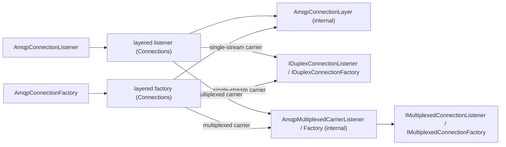
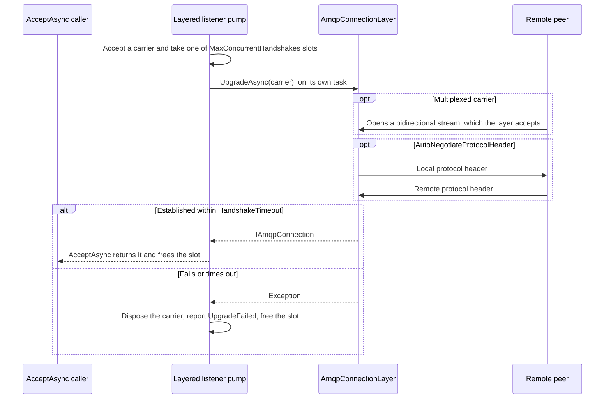

# Assimalign.Cohesion.Amqp.Connections — Design

## Design intent

This library is AMQP 1.0's transport layer in the specification's sense (Part 2): protocol-header
negotiation, framing for the AMQP and SASL protocol phases, the performative and message wire
format, and the listener and factory that establish AMQP connections over carrier connections
produced by the `Assimalign.Cohesion.Connections` contracts.

It deliberately stops at the wire. The performatives (`Open`, `Begin`, `Attach`, `Flow`,
`Transfer`, `Disposition`, `Detach`, `End`, `Close`, and the SASL family) are plain DTOs that
encode and decode faithfully, but nothing in this package acts on them. Session windows, link
credit, delivery settlement, container and broker semantics, and SASL mechanism execution belong
to the layer above: the sibling `Assimalign.Cohesion.Amqp` library (a placeholder today; #398 sets
its boundaries) and the connection, session and link state machines of #414.

## The shape at a glance

An AMQP endpoint is composed like any other Cohesion connection endpoint: a listener accepts, a
factory connects, and both return connections that are ready to use.

| Role | Type | Carrier it consumes | Produces |
|---|---|---|---|
| Server | `AmqpConnectionListener : ConnectionListener<IAmqpConnection>, IAmqpConnectionListener` | `IDuplexConnectionListener` or `IMultiplexedConnectionListener` | an established `IAmqpConnection` from `AcceptAsync` |
| Client | `AmqpConnectionFactory : ConnectionFactory<IAmqpConnection>, IAmqpConnectionFactory` | `IDuplexConnectionFactory` or `IMultiplexedConnectionFactory` | an established `IAmqpConnection` from `ConnectAsync(EndPoint)` |
| Connection | `IAmqpConnection : IDuplexConnection`, with the guided base `AmqpConnection : DuplexConnection` | the carrier's byte stream | protocol headers and frames |

Both entry points wrap their carrier in the Connections layered decorator and give it one internal
establishment step, `AmqpConnectionLayer`. A multiplexed carrier first passes through an internal
adapter that presents it in the duplex shape. In this diagram an arrow means "holds a reference
to":

## Direction is structural: a listener and a factory

Preview.1 shipped `AmqpServerTransport` and `AmqpClientTransport`, the shape of the retired
transport design. The Connections design dissolved that abstraction (its `DESIGN.md`, "Why the old
transport abstraction dissolved"): a server is an `IConnectionListener<T>`, a client an
`IConnectionFactory<T>`, and the direction is the type. The AMQP pair follows it (#1890).

- **`AmqpConnectionListener`** derives from `ConnectionListener<IAmqpConnection>`. Its `Id` is the
  carrier listener's, because both represent one bound endpoint. `BindAsync` binds the carrier
  listener, which the old server transport never did. Accepted connections are tracked in the
  base's concurrent live set, `Connections`, until each one's `ConnectionClosed` fires; that
  replaces an unsynchronized `List<T>`.
- **`AmqpConnectionFactory`** derives from `ConnectionFactory<IAmqpConnection>` and connects a new
  carrier on every `ConnectAsync(EndPoint)` call. The endpoint moved from the constructor to the
  call, as on every other factory, and the factory keeps no list of the connections it returned.
- **Rejected: keeping the names over the new base classes.** "Transport" is the word the
  Connections design retired, and an object that is both a server transport and a listener reads
  as two concepts. References to the AMQP 1.0 Part 2 transport layer stay, because that is the
  specification's own name.

## A connection is live when it is produced

Preview.1 split a connection in two: `IAmqpConnection` carried identity and lifetime, and its
`Open()` / `OpenAsync()` produced an `IAmqpConnectionContext` that carried the pipe, the protocol
headers and the frames. Now `IAmqpConnection : IDuplexConnection` is one object: the carrier's
identity, endpoints, capabilities, features, lifetime and pipe, plus `LocalProtocolHeader`,
`RemoteProtocolHeader`, `NegotiateAsync`, `SwitchProtocolAsync`, `ReceiveAsync` and `SendAsync`.

- **The open step was the shape the Connections design rejects by name**: "returning the raw
  connection and deferring the upgrade to a step the consumer awaits" (its "Layered Listeners"
  section). The consumer awaited the handshake after accept, with no timeout, no concurrency bound
  and no failure containment, and `Open()` blocked on `OpenAsync()`.
- **The context hid the carrier.** An AMQP connection had no endpoints, capabilities or features,
  so the carrier's features, such as its TLS facts (`connection.Tls`), were unreachable. They now
  pass through: the connection's feature collection falls back to the carrier's.
- **The open cache was unsynchronized**: two concurrent first opens on a multiplexed carrier could
  acquire two streams. Establishment now runs exactly once, before anyone holds the connection.
- **`Open` would have collided** with the AMQP `open` performative that #415's connection lifecycle
  introduces.
- **Interface-first with a guided base.** `IAmqpConnection` is the contract, `AmqpConnection` its
  public abstract base over `DuplexConnection`, and the shipped implementation,
  `AmqpCarrierConnection`, is internal. Derive from the base for a test double or for a source of
  AMQP connections these types do not cover. `AsStream()` is the Connections extension every
  `IDuplexConnection` has; it replaces the context's member of the same name.

## Establishment runs as a connection layer

`AcceptAsync` and `ConnectAsync` return established connections. Establishment is the internal
`AmqpConnectionLayer : IConnectionLayer`, composed with `listener.Use(layer, MaxConcurrentHandshakes)`
and `factory.Use(layer)`: the same seam TLS uses through `UseTls`. Its `UpgradeAsync`, under one
token that it cancels after `HandshakeTimeout`:

1. acquires the AMQP stream, on a multiplexed carrier (see the next section);
2. wraps the carrier in `AmqpCarrierConnection`;
3. exchanges the protocol headers, when `AutoNegotiateProtocolHeader` is on.

When there is nothing to wait for, which is a single-stream carrier with auto-negotiation off, it
wraps the carrier synchronously and arms no timer.

The listener inherits #1304's containment from the layered listener, exactly as TLS does. Each
establishment runs on its own thread-pool task. At most `MaxConcurrentHandshakes` connections are
held at once, counted until `AcceptAsync` returns them, and they are returned in the order their
establishment completes. An establishment that fails or times out disposes only its carrier, is
reported as `UpgradeFailed` through the `Assimalign.Cohesion.Connections` event source, and frees
its slot; the listener keeps accepting. An exception from `AcceptAsync` therefore means the carrier
listener itself failed. The factory inherits the layered factory's rule instead: the carrier is
disposed before the establishment's exception reaches the caller.

This sequence shows one establishment on a listener:

- **A timeout is a `TimeoutException`.** When the layer's own timer fires and the caller's token
  did not, the layer throws `TimeoutException` with the `OperationCanceledException` as its inner
  exception. A factory caller can tell a slow peer from its own cancellation, and `UpgradeFailed`
  names `System.TimeoutException` rather than a cancellation. TLS reports its handshake timeout as
  `OperationCanceledException`, which the Connections design notes is also what a disposed
  in-memory listener throws, so the type alone cannot tell the two apart. The message format is
  read once into a static field, because a stalled peer can make every handshake time out.
- **Each layer keeps its own bound and timeout.** AMQP over TLS composes two layered listeners,
  `AmqpConnectionListener.Create(tcpListener.UseTls(tlsServerOptions), amqpOptions)`. The TLS handshake
  runs under `TlsServerOptions.HandshakeTimeout` and `MaxConcurrentHandshakes`; the AMQP
  `HandshakeTimeout` starts only once the AMQP layer has a connection whose TLS handshake completed.
- **A non-positive `HandshakeTimeout` disables the limit**, and a value above `uint.MaxValue - 1`
  milliseconds, the timer's ceiling, is refused when assigned. With the limit disabled, a peer that
  never sends its header holds a slot until it disconnects.
- **Rejected: an accept loop of AMQP's own.** It would rebuild the pump's concurrency, bound,
  containment, disposal and diagnostics, and drift from TLS. The Connections design calls the
  layered listener the one place that knows which failures belong to a connection.
- **Rejected: an AMQP event source.** `UpgradeFailed` already reports each failed establishment with
  its connection id, remote endpoint, and exception type and message, and an assembly that raises
  nothing has no source (`.claude/rules/event-source.md`). AMQP-specific events, such as protocol
  phase changes, belong with the state machines that would raise them.

## A multiplexed carrier is adapted to the duplex shape

AMQP 1.0 runs over one ordered byte stream, so a multiplexed (QUIC-shaped) carrier carries exactly
one AMQP connection, on one bidirectional stream. The Connections layer seam is duplex
(`IConnectionLayer.UpgradeAsync(IDuplexConnection)`, composed onto duplex listeners and
factories), so internal adapters, `AmqpMultiplexedCarrierListener` and
`AmqpMultiplexedCarrierFactory`, present a multiplexed listener or factory as a duplex one. Their
connections are `AmqpMultiplexedCarrier : DuplexConnection`, and both carrier kinds share one layer
and one pump.

- **The stream is acquired during establishment**, under the handshake timeout and the bound. The
  listener side accepts the first stream its peer opens; the factory side opens a bidirectional
  stream. A first stream that is not bidirectional is refused with `AmqpProtocolException`, and the
  stream is released with the carrier.
- **Identity and capabilities.** The connection's id, endpoints and features are the multiplexed
  connection's. Its capabilities are those of one stream: the connection's, with
  `IsMultiplexed = false`. The listener's and the factory's `Capabilities` report the same.
- **Lifetime.** `ConnectionClosed` fires when either the stream or the multiplexed connection ends,
  so a peer that resets the AMQP stream on a connection it keeps open still ends the AMQP
  connection. While the multiplexed connection is open, `State` is the stream's.
- **Disposal and abort.** Disposing disposes the stream, then the multiplexed connection. Aborting
  aborts the multiplexed connection, which ends every stream.
- **Non-goal:** several AMQP connections over one multiplexed carrier, until a consumer needs it.

## Carriers are chosen by capability, at creation

AMQP 1.0 framing assumes a reliable, ordered byte stream. `Create` therefore requires
`Delivery == Stream`, `IsReliable` and `IsOrdered` of the carrier's `ConnectionCapabilities`, and
throws `ArgumentException`, with `ParamName` `listener` or `factory`, otherwise.

- **Capability, never protocol identity.** `ConnectionProtocol` is diagnostic only and is never
  branched on: TCP, Unix domain sockets, named pipes, QUIC, the in-memory driver, or a future
  reliable userspace protocol all qualify by capability alone.
- **At creation, not at accept.** A mismatch is a composition error, so it surfaces at the
  composition root rather than at the first `AcceptAsync` or `ConnectAsync`. A listener `Create`
  refuses is not taken over, and so not disposed.

## Creation and options

- **`public sealed`, private constructor, static `Create`** (owner decisions 59 and 61), with one
  `Create` overload per carrier kind on each type. There is no implementation variance to abstract
  over, and the interfaces remain the contracts consumers depend on.
- **Options are split by role.** `AmqpConnectionListenerOptions` and `AmqpConnectionFactoryOptions`
  share `InitialProtocolHeader` (default `AmqpProtocolHeader.Amqp10`), `AutoNegotiateProtocolHeader`
  (default `true`), `MaxFrameSize` (default 262,144 bytes, at least 512) and `HandshakeTimeout`
  (default 10 seconds). Only the listener has `MaxConcurrentHandshakes` (default 512, at least 1:
  TLS's default and the TCP listener's default backlog). A factory runs one establishment per
  caller's call and has no pump to bound.
- **Options are read once**, at `Create`, into an internal immutable `AmqpConnectionSettings`.
  Changing an options object afterwards does not affect a listener or factory created from it.

## Lifecycle and ownership

- **The listener owns its carrier listener.** `DisposeAsync` disposes the layered listener, which
  cancels every establishment in flight, disposes the carrier listener, waits for those
  establishments to finish, and disposes every connection established but not yet returned. A
  pending `AcceptAsync` then fails with `ObjectDisposedException`, as do later `AcceptAsync` and
  `BindAsync` calls. A cancellation caused by disposal is not reported as a failure.
- **Connections already returned belong to their owners.** Disposing the listener does not close
  them; preview.1's server transport did. A returned connection leaves `Connections` when it closes,
  by disposal, abort or the peer.
- **The factory owns nothing it returns**, and does not own its carrier factory, which is not
  disposable by contract.
- **A connection owns its carrier.** `DisposeAsync` disposes the carrier (on a multiplexed carrier,
  the stream and then the connection), and `Abort` aborts it. `ConnectionClosed` fires on
  disposal, abort or the peer's close, no later than when disposal completes.

## Protocol phases and header negotiation

- **The header** is the fixed eight bytes `"AMQP"`, the protocol id, and `major.minor.revision`.
  `AmqpProtocolId` carries the specification's values (`Amqp = 0`, `Tls = 2`, `Sasl = 3`), and
  `AmqpProtocolHeader.Amqp10` and `.Sasl10` are the common constants.
- **A phase is one pair of headers.** `LocalProtocolHeader` and `RemoteProtocolHeader` belong to
  the current phase and are replaced together, as one immutable object, so a reader that takes no
  lock never sees one phase's local header beside another phase's remote header. A protocol lock
  serializes `NegotiateAsync` and `SwitchProtocolAsync`, and a write lock keeps header and frame
  writes from interleaving.
- **`NegotiateAsync` is idempotent.** It writes the local header, reads the remote one, records it,
  and returns the recorded header on every later call.
- **`SwitchProtocolAsync` starts the next phase**, which is the SASL to AMQP transition: negotiate
  the SASL phase (an `InitialProtocolHeader` of `Sasl10`), exchange SASL frames, then switch with
  `Amqp10`. The previous phase ends as soon as the switch starts. Until the peer's header for the
  next phase arrives, frames are refused with `InvalidOperationException` rather than encoded for a
  phase neither side is in.
- **The phase selects the frame type** (`AmqpProtocolHeader.FrameType`: AMQP is 0, SASL is 1), and
  the decoder rejects a frame whose type does not match.
- **With `AutoNegotiateProtocolHeader` on** (the default), establishment exchanges the headers, so
  frames flow as soon as the connection is returned. With it off, no bytes are exchanged until the
  owner calls `NegotiateAsync`, and `SendAsync` and `ReceiveAsync` throw `InvalidOperationException`
  until then. Neither ever negotiates implicitly.
- **Reads consume exactly what they decode.** The header read advances past exactly eight bytes.
  When the consumer stops after a frame, `ReceiveAsync` marks examined only what it decoded. Bytes a
  peer sent together with its header, such as a server's SASL header and `sasl-mechanisms` frame in
  one write, and a header sent right after a frame, such as the AMQP header after `sasl-init`, are
  therefore read at once instead of waiting for new bytes (#727, #1910). Only a partial frame marks
  the whole buffer examined, because only then must the next read wait.
- **TLS is not done through protocol id 2.** The `Tls` id exists for wire fidelity, but transport
  security is a connection layer composed below AMQP: `listener.UseTls(...)` or
  `factory.UseTls(...)` from `Assimalign.Cohesion.Connections.Security`. The carrier's
  `Capabilities.Security` then reports `ConnectionSecurity.Tls`, and its features carry the TLS
  facts. That is AMQP's pure-TLS variant, with TLS established before any header, and it keeps the
  security seam identical to HTTP's.

## Framing and codec surface

- **Frame layout** follows the specification: a 4-byte big-endian size, the data offset, the frame
  type and the channel, then the performative as a described list and an optional payload. Reading
  is incremental over a `ReadOnlySequence<byte>`: a partial frame waits for more bytes, and a stream
  that ends inside a frame is an `AmqpProtocolException`.
- **The maximum frame size is enforced on send.** An encoded frame larger than the connection's
  `MaxFrameSize` throws `AmqpProtocolException` before any bytes are written.
- **It is not yet enforced on receive (#1919).** A frame header may announce any size up to
  `uint.MaxValue`, and the reader waits until that many bytes are buffered. A frame larger than the
  carrier's receive buffer (`MaxReadBufferSize` on TCP and QUIC, 1 MiB by default) can never
  complete, so keep `MaxFrameSize` at or below that buffer. SASL frames are not yet held to the
  512-byte limit AMQP 1.0 Part 5 sets for them.
- **Receives are a single-reader pull loop.** `ReceiveAsync` yields decoded frames until the peer
  ends its output. A consumer uses either the frame members or the raw pipe (`Input` and `Output`,
  or `AsStream()`) for a given direction, never both.
- **The message format.** `AmqpMessageCodec` covers the section-based AMQP 1.0 message format:
  header, delivery and message annotations, properties, application properties, data, sequence and
  value bodies, and footer.
- **Codecs are public static facades** (`AmqpProtocolCodec`, `AmqpFrameCodec`, `AmqpMessageCodec`)
  over the internal `AmqpEncoding` toolbox, so the wire format is testable and reusable without a
  connection.

### Symbol and frame-size validation (#1484)

`AmqpSymbol` uses `CohesionValueType` with a single ASCII rule in static `IsValid`.
[AMQP 1.0 Part 1 §1.6.21](https://docs.oasis-open.org/amqp/core/v1.0/os/amqp-core-types-v1.0-os.html#type-symbol)
defines symbol encoding as seven-bit ASCII; empty text is valid, and generic symbol identity
has no case-folding rule. `ObjectComparison="Ordinal"` therefore preserves exact spelling.
The existing constructor, `Value`, conversions and equality members remain available. Generated
hashing and equality support `default`, which holds a null value distinct from an empty symbol;
encoding still refuses that missing value. Wire decoding uses `TryCreate` and translates invalid
symbol text to `AmqpProtocolException`, including symbols inside arrays.

Maximum frame sizes stay numeric. `AmqpConnectionListenerOptions.MaxFrameSize`,
`AmqpConnectionFactoryOptions.MaxFrameSize`, `AmqpOpenPerformative.MaxFrameSize` and the frame
encoder reject values below 512 with `ArgumentOutOfRangeException` before use, as required by
[AMQP 1.0 Part 2 MIN-MAX-FRAME-SIZE](https://docs.oasis-open.org/amqp/core/v1.0/os/amqp-core-transport-v1.0-os.html#constant-MIN-MAX-FRAME-SIZE).
An omitted Open maximum remains valid. The decoder reports a peer's invalid advertised maximum
as `AmqpProtocolException`.

#### Breaking changes from 10.0.0-preview.1 (#1484)

- Non-ASCII symbol construction and implicit conversion now throw `ArgumentException`; wire
  decoding rejects non-ASCII scalar and array symbols with `AmqpProtocolException`.
- A null symbol constructor argument now throws `ArgumentException` instead of
  `ArgumentNullException`, following the generated struct validation contract.
- `default(AmqpSymbol).ToString()` returns an empty string instead of null, and hashing default
  succeeds instead of throwing. Equality stays ordinal, with default distinct from empty.
- The generated JSON converter represents symbols as JSON strings and default as JSON null,
  replacing the former ordinary object representation with a `Value` property. It also supports
  JSON dictionary keys. Existing .NET member signatures remain; the generated validation,
  comparison and converter members are additive.
- Setting an Open maximum below 512 now throws during composition. Passing an encoder maximum
  below 512 throws `ArgumentOutOfRangeException` before body encoding, even when the frame fits;
  zero previously failed later with `AmqpProtocolException`. Decoding a peer Open below 512 now
  throws `AmqpProtocolException`.

## Error model

- **`AmqpProtocolException` is the area root**, inheriting `Exception` directly per the
  repository's exception-scoping rule. It covers malformed headers, malformed or mismatched frames,
  unsupported descriptors, max-frame-size violations, a carrier that ends inside a header or a
  frame, and a multiplexed carrier whose first stream is not bidirectional.
- **Composition errors are argument exceptions**, from `Create` or an options setter:
  `ArgumentNullException` for a missing carrier, `ArgumentException` for a capability mismatch, and
  `ArgumentOutOfRangeException` for a `MaxFrameSize` below 512, a `HandshakeTimeout` above the
  timer's ceiling, or a `MaxConcurrentHandshakes` below 1.
- **Establishment errors are contained on the listener** (the carrier is disposed, `UpgradeFailed`
  is reported, and `AcceptAsync` returns the next connection). **On the factory, `ConnectAsync`
  throws them** after disposing the carrier: `AmqpProtocolException` for a truncated or invalid
  header, `TimeoutException` when `HandshakeTimeout` elapses, `OperationCanceledException` when the
  caller cancels, or the carrier's own exception.
- **Misuse** is `InvalidOperationException` (frame members before the current phase's headers are
  exchanged), `ObjectDisposedException` (`AcceptAsync` or `BindAsync` after the listener is
  disposed), or `ArgumentNullException` (a null endpoint or frame).
- **Messages are resources.** Every exception message comes from `Properties/ErrorMessages.resx`
  through the build-generated `ErrorMessages` class; #1890 adopted the convention for the whole
  package, codec included.
- **Carrier failures** (reset, abort) surface as the Connections family's exceptions from the
  underlying pipes; this package does not wrap them.

## Diagnostics

This assembly has no event source. A failed establishment on a listener is reported by the
`Assimalign.Cohesion.Connections` source as `UpgradeFailed` (Warning; `connectionId`,
`remoteEndPoint`, `exceptionType`, `exceptionMessage`) and counted by its `failed-upgrades`
counter, and `current-upgrades` counts establishments in flight. A timed-out establishment reports
`System.TimeoutException`. The connection itself is reported by the driver that carries it, under
the same `connectionId`. A failure on the factory is the caller's exception and raises no event.

## AOT posture

No reflection, no runtime code generation, no serializers. Performative dispatch is a `switch`
over numeric descriptors in both directions; encoding and decoding are span and buffer arithmetic
over `ArrayBufferWriter<byte>` and `ReadOnlySequence<byte>`. The listener's concurrency is the
Connections layered listener's; this package's only synchronization is a protocol lock and a write
lock per connection. Fully NativeAOT compatible (`IsAotCompatible` is set for the whole
`libraries/` tree).

## Non-goals

- **No broker, container, session or link semantics.** No session windows, link credit, delivery
  settlement or routing: the performatives are wire DTOs only. That orchestration belongs to
  `Assimalign.Cohesion.Amqp` and #414.
- **No SASL mechanism implementations.** The SASL performatives and frame phase are modeled;
  executing PLAIN, ANONYMOUS or EXTERNAL exchanges is the layer above (#422).
- **No TLS inside this package.** Security is a connection layer composed below AMQP (see above).
- **No AMQP 0-9-1 (RabbitMQ classic) compatibility.** This is AMQP 1.0 only.
- **No sharing of one multiplexed carrier between AMQP connections.** One AMQP connection maps to
  one carrier stream.

## Relationships

- **`Assimalign.Cohesion.Connections`**: the carrier contracts this package consumes by
  capability, the listener and factory bases, `DuplexConnection`, `IConnectionLayer` and the
  layered listener and factory that run establishment, and `AsStream()`.
- **`Assimalign.Cohesion.Connections.Security`**: TLS as a `UseTls` layer composed on the carrier
  listener or factory, below AMQP; never an AMQP concern.
- **`Assimalign.Cohesion.Amqp`**: the root AMQP library (a placeholder today; #398), intended to
  build connection, session and link semantics (#414) on this package.
- **`Assimalign.Cohesion.Http.Connections`**: the sibling application protocol. Both consume the
  connection contracts by capability, with TLS composed below them.

## Breaking changes from 10.0.0-preview.1 (#1459, #1890)

These are source and binary breaks, accepted during previews under owner decisions 15 and 58. #1459
moved the package onto the carrier hierarchy (`IDuplexConnectionListener`,
`IDuplexConnectionFactory`); #1890 replaced the transport shape. AMQP wire framing and negotiation
are unchanged: the header exchange moved from `OpenAsync` into establishment, and what it sends did
not change.

| Preview.1 | Replacement |
| --- | --- |
| `new AmqpServerTransport(IConnectionListener, AmqpTransportOptions?)` | `AmqpConnectionListener.Create(IDuplexConnectionListener, AmqpConnectionListenerOptions?)` |
| `new AmqpServerTransport(IMultiplexedConnectionListener, AmqpTransportOptions?)` | `AmqpConnectionListener.Create(IMultiplexedConnectionListener, AmqpConnectionListenerOptions?)` |
| `new AmqpClientTransport(IConnectionFactory, EndPoint, AmqpTransportOptions?)`, then `ConnectAsync()` | `AmqpConnectionFactory.Create(IDuplexConnectionFactory, AmqpConnectionFactoryOptions?)`, then `ConnectAsync(EndPoint)` |
| `new AmqpClientTransport(IMultiplexedConnectionFactory, EndPoint, AmqpTransportOptions?)`, then `ConnectAsync()` | `AmqpConnectionFactory.Create(IMultiplexedConnectionFactory, AmqpConnectionFactoryOptions?)`, then `ConnectAsync(EndPoint)` |
| `AmqpTransportOptions` | `AmqpConnectionListenerOptions` and `AmqpConnectionFactoryOptions`, which add `HandshakeTimeout`; the listener's also add `MaxConcurrentHandshakes` |
| `IAmqpConnection.Open()` / `OpenAsync()` | Removed: `AcceptAsync` and `ConnectAsync` return established connections |
| `IAmqpConnectionContext` / `AmqpConnectionContext` | Removed: their members are on `IAmqpConnection` / `AmqpConnection`, which are now `IDuplexConnection` / `DuplexConnection` |
| `AmqpServerTransport.Connections` / `AmqpClientTransport.Connections` | `AmqpConnectionListener.Connections`, from `ConnectionListener<T>`; the factory tracks nothing |
| `AmqpClientTransport.EndPoint` | The endpoint is the `ConnectAsync` argument |

Behavior changes that keep a signature or have none:

- **Disposing the listener leaves returned connections open.** Their owners dispose them.
- **`BindAsync` binds the carrier listener.** The server transport had no bind step.
- **Establishment has a deadline.** A peer that does not complete the header exchange (and, on a
  multiplexed carrier, open its stream) within `HandshakeTimeout`, 10 seconds by default, loses its
  connection. On a listener it never reaches `AcceptAsync`; on a factory `ConnectAsync` throws
  `TimeoutException`.
- **`AcceptAsync` does not throw for one connection's failure**, and returns connections in the
  order their establishment completes, not the order they arrived.

Rebuild callers against the new types. Custom carriers implement the duplex or multiplexed
contracts, or derive from `DuplexConnectionListener`, `DuplexConnectionFactory` and
`DuplexConnection`, whose bases use `AcceptCoreAsync` and `ConnectCoreAsync`.
