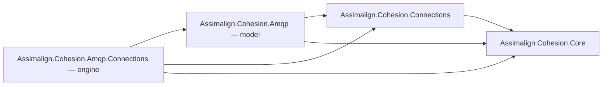
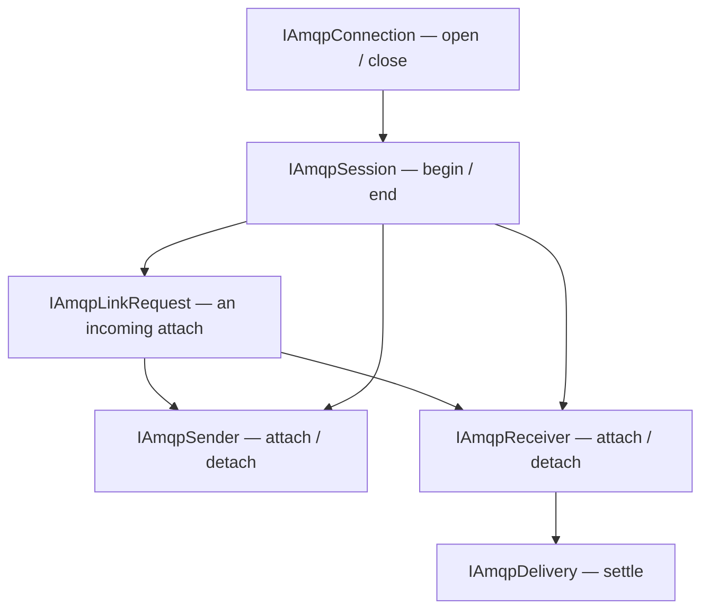
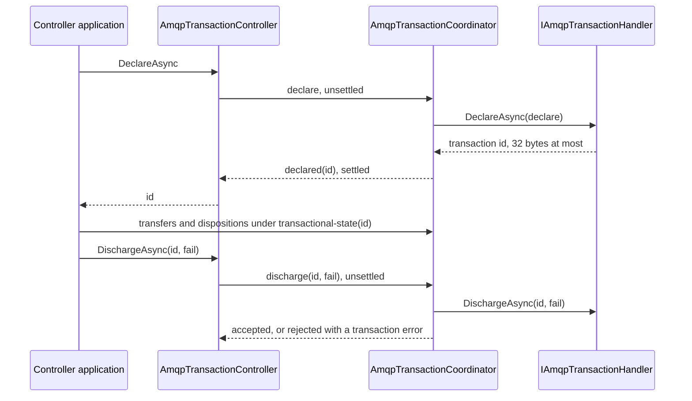

# Assimalign.Cohesion.Amqp — Design

## Design intent

This package is the AMQP 1.0 model: what an application programs against when it speaks AMQP, and
the values it exchanges. It holds the connection, session, link and delivery contracts of Part 2,
the message format of Part 3, the transaction roles of Part 4, the SASL mechanisms of Part 5, and
the Part 1 values that have no CLR equivalent.

It implements no protocol and owns no wire format. `Assimalign.Cohesion.Amqp.Connections` is the
engine: it establishes connections over carriers, runs the state machines, and encodes frames, and
its `AmqpConnectionListener` and `AmqpConnectionFactory` produce the `IAmqpConnection` instances
this package defines. A broker such as MessageHub, a client, or a test double depends on this
package for everything it does with a connection once it has one.

## Family map

An arrow means "references".

| Package | Role |
|---|---|
| `Assimalign.Cohesion.Amqp` | The model: contracts, messages, delivery states, termini, values, SASL mechanisms, transaction controller and coordinator. References `Core` and `Connections`. |
| `Assimalign.Cohesion.Amqp.Connections` | The engine: establishment, the connection, session and link state machines, framing and the codec. Implements this package's contracts and references it. |

The model references `Connections` because an AMQP connection is a Cohesion connection
(`IAmqpConnection : IConnection`): it has the carrier's identity, endpoints, features and lifetime,
and SASL EXTERNAL reads the carrier's TLS facts from its features.

`AmqpPackageBoundaryTests`, in each package's tests, fails when the model uses or declares a
Cohesion assembly other than `Core` and `Connections`, or the engine one other than the model,
`Connections` and `Core` (#401). It reads both lists: the compiled assembly's references, and the
test project's dependency file, which also lists a declared reference nothing uses (the compiler
drops that one from the assembly, and the package would still depend on it). A carrier driver, a
TLS layer or a host is composed by the application, never referenced by either package, and
COHLIB001 already refuses any `resources/` project to both.

## Contracts here, the engine beside them

Preview.1 shipped one package whose public surface was the wire: performative DTOs, frame and
protocol codecs, and a connection that sent and received raw frames. Session windows, link credit,
settlement and SASL were left to "the layer above", which did not exist.

- **The wire is not the API.** A public performative lets any caller send a `transfer` the link's
  state does not allow, or an `attach` that breaks the terminus rules, and freezes the wire shape as
  public API. The performatives, frames and codec are now internal to the engine, and every frame
  is written by a state machine that has checked it. The one public codec is
  `AmqpMessageCodec`, for the message format, which brokers need without a connection.
- **The model is separate from the engine** so that code acting on connections does not take the
  engine's closure, and can be tested against doubles of `IAmqpConnection`, `IAmqpSession` or
  `IAmqpReceiver`. The direction is fixed: the engine references the model, never the reverse.
- **Rejected: one package with internal contracts.** It would put the codec and state machines
  into every assembly that only reads a message or settles a delivery, and leave no seam for a
  second engine (an in-process loopback, or a recording double).
- **Rejected: the model in the engine package with a separate abstractions package.** That is the
  same split with the names reversed. The model package carries real behavior that is not wire
  work (SASL mechanisms, the transaction controller and coordinator), so it is the root, not an
  "abstractions" add-on.

## The object model

A connection holds sessions, a session holds links, and a link carries deliveries. Each level is
initiated by one peer and accepted by the other.

- **Initiating.** `BeginSessionAsync`, `AttachSenderAsync` and `AttachReceiverAsync` send the
  performative and complete when the peer answers. A link the peer refuses (an `attach` with no
  terminus followed by a `detach`) fails with `AmqpErrorCode.LinkDetached` and the peer's error.
- **Accepting is a pull, not a callback.** `AcceptSessionAsync` returns the next session a peer
  began, and `AcceptLinkAsync` the next attach as an `IAmqpLinkRequest`. The application reads the
  request (its name, role, termini, settle modes, capabilities and unsettled state) and answers it
  with `AcceptSenderAsync`, `AcceptReceiverAsync` or `RejectAsync`. This is the Connections model:
  a listener's `AcceptAsync`, one level down. A callback registered up front (AMQPNetLite's link
  processor) cannot apply backpressure and has to decide before it can await anything; a request
  can wait on the application's own lookups, such as whether a queue exists.
- **Ending.** A connection's `CloseAsync` and a session's `EndAsync` send `close` and `end`; a link's
  `CloseAsync` sends a closing `detach` and its `DetachAsync` one that leaves the link resumable.
  Each takes an optional `AmqpError` and completes when the peer answers, and `DisposeAsync` closes
  without an error. A peer's close, end or detach cancels `SessionEnded` or
  `LinkDetached` and fails every operation waiting on that object with the matching
  `AmqpErrorCode`; ending a connection ends its sessions, and ending a session detaches its links.
- **Remote state is read-only.** What the peer announced (capabilities, properties, container id,
  maximum message size, unsettled map) is exposed on each object as `Remote*` properties; what the
  local end announces is set through options before the performative is sent.

## Strict on send, tolerant where the meaning is clear

The engine enforces one principle, and the model's contracts state it where it shows:

- **On send, every rule is enforced.** A value with no AMQP representation, an application property
  that is a list or map, a symbol outside ASCII, a delivery tag over 32 bytes, a settled declare,
  or a transactional state on a control link is refused with an exception before anything is sent.
- **On receive, a rule is enforced** where the specification says a receiver MUST act, where the
  meaning is ambiguous, or where accepting would put state at risk: the peer's connection, session
  or link is ended with the specification's error condition.
- **Where the meaning is clear and nothing is at risk, the engine accepts** what a peer should not
  send, and each such leniency is recorded beside the rule it relaxes, in the engine's compliance
  tests and design. Example: a continuation `transfer` without a state keeps its delivery in the
  transaction its first frame named.

## Sending

- **Credit, then window, then frames.** `SendAsync` waits for link credit, then for room in the
  session's outgoing window, and splits the delivery into as many `transfer` frames as the
  connection's frame size requires. Sends on one link are serialized only while their frames are
  queued: a send releases the link before it waits for the outcome, so concurrent sends pipeline.
- **The result is the outcome.** An unsettled delivery completes with the receiver's terminal
  state; a delivery sent settled, or one the receiver settles without a state, completes with
  `null`. Under `AmqpReceiverSettleMode.Second` the sender settles when the outcome arrives and the
  receiver settles after it.
- **A send canceled after its first frame is aborted** (`aborted` on a final frame), never left
  half sent.
- **Two payload forms.** `SendAsync(AmqpMessage)` encodes a message; `SendAsync(ReadOnlyMemory<byte>)`
  sends an encoded payload unchanged, which is how a broker forwards a stored message without
  decoding it. Both are checked against the peer's `max-message-size` and fail with
  `AmqpErrorCode.MessageSizeExceeded` before anything is sent.
- **Drain.** A receiver can ask the sender to use or give back its credit. With
  `AmqpSenderOptions.AutoCompleteDrain` (the default) the sender answers at once; without it the
  application sends what it has and calls `CompleteDrain`.
- **Delivery tags** are generated per link unless `AmqpDeliveryOptions.DeliveryTag` supplies one. A
  generated tag skips every tag either unsettled map of the link's `attach` listed, since a delivery
  from an earlier attachment may still be unsettled at one end.

## Receiving

- **Prefetch keeps credit topped up.** With `AmqpReceiverOptions.Prefetch` above zero (100 by
  default) the receiver keeps that many deliveries granted or buffered and grants more as the
  application takes them. With zero, the application grants credit with `AddCredit`. `DrainAsync`
  asks the sender to drain and completes when the link has no credit.
- **A delivery is whole when it is received.** `ReceiveAsync` and `TryReceive` return deliveries
  whose last frame has arrived. An aborted delivery is discarded and never returned, unless it was
  resumed from an earlier attachment (see "Resuming a link").
- **What a receiver holds is bounded by default.** Because a delivery is reassembled before it is
  returned, `AmqpReceiverOptions.MaxMessageSize` defaults to 16 MiB, the value RabbitMQ 4 also
  chose, and a link the peer attaches takes it when the application answers without options. A
  larger delivery detaches the link with `amqp:message-size-exceeded`; `null` removes the limit.
  Across a session's links, `AmqpSessionOptions.IncomingWindow` bounds the frames of deliveries the
  application has not taken (see the engine's design, "Sessions"). A sender's `MaxMessageSize`
  stays `null`: it only tells the peer what the sender would accept.
- **Settlement verbs map to outcomes.** `AcceptAsync`, `RejectAsync`, `ReleaseAsync` and
  `ModifyAsync` send the matching outcome; `SettleAsync` sends any state, including a
  transactional one. Under the first settle mode the receiver settles at once; under the second it
  sends the outcome unsettled and settles when the sender does.
- **Decoding is the application's choice.** `Payload` is the delivery's bytes; `GetMessage`
  decodes them on each call and throws `AmqpErrorCode.ProtocolViolation` for a payload that is not
  a valid message. A broker stores and forwards `Payload` and decodes only what it routes on.

## Resuming a link

A link detached without closing (`DetachAsync`) can be attached again under the same name, and the
deliveries it left unsettled carried over to the new attachment (Part 2 §2.6.13). The engine keeps
no delivery state across attachments, so recovery is the application's: it lists the deliveries it
still holds unsettled, each with the state it holds it in, in `AmqpLinkOptions.Unsettled` (and sets
`IncompleteUnsettled` when that map is only part of them), and reads the peer's map from
`RemoteUnsettled`.

`IAmqpLink.UnsettledReconciliation` compares the two maps once both `attach` frames are known, at
both ends alike: the sender's map is the source's and the receiver's the target's, whichever end
attached first. `AmqpUnsettledReconciliation.Create` makes the same comparison without a link. Every
tag either map lists falls in exactly one set:

| Listed by | Set | What happens to the delivery |
|---|---|---|
| Both maps, or the target's while the source's is incomplete | `Resumable` | The sender resumes it or aborts it, once; the receiver takes one resume of it and holds its tag until then |
| The source's only, while the target's is complete | `UnknownToReceiver` | The receiver would ignore a resume, so the sender sends the message again as a new delivery, or nothing when its own state shows the receiver had all of it |
| The target's only, while the source's is complete | `Settled` | The receiver considers it settled, and the sender sends nothing |
| The source's only, while the target's is incomplete | `InDoubt` | The receiver may hold it without having listed it, so it waits for a later attachment |

- **Resuming is a send.** `SendAsync` with `AmqpDeliveryOptions.Resume` and the delivery's tag
  resumes it: from where the receiver's map says it stopped, with an `AmqpReceived` state naming the
  section and offset its payload starts at; whole, with no state; or with no payload at all, to
  convey only the sender's outcome or settlement when the receiver already has the whole message.
  A delivery the sender cannot resume to completion is aborted with `IAmqpSender.AbortDeliveryAsync`,
  one resuming frame with the aborted flag, after which the message may go again as a new delivery.
  Part 3 §3.4.6 walks through every case, and the engine's compliance tests run that example end to
  end.
- **The engine holds both ends to the comparison.** A sender refuses, before sending anything, a
  resume or abort of a delivery that is not resumable or was already resumed, a new delivery under a
  tag that waits to be resumed (`ArgumentException`), and any new delivery while either map is
  incomplete (`InvalidOperationException`): until then the two ends resume and settle what they can,
  then detach and attach again. A receiver ignores a resume of a delivery it does not wait for, as
  §2.6.13 requires, while the delivery still takes its unit of credit, and detaches a link whose
  sender starts a new delivery it should not.
- **The specification allows one resume the engine refuses.** A sender that has not yet seen the
  receiver's map may pipeline a resume of a delivery only the source lists, which the receiver
  ignores. The engine sends only once it holds the receiver's map, so such a resume could only be
  ignored and its delivery would never settle; it is refused instead.
- **The application joins what the link does not keep.** `IAmqpDelivery.IsResumed` marks a resumed
  delivery, and its `RemoteState` says where its payload starts: the application joins that payload
  to the data it kept of the delivery, skipping what it already has. A resumed delivery the sender
  aborts reaches the application with `IsAborted`, settled and empty, so the application can discard
  what it kept.
- **The received state belongs to resumes.** Only the first frame of a resumed delivery carries an
  `AmqpReceived` (Part 3 §3.4.1). A sender refuses one anywhere else, and a receiver detaches a link
  whose sender sends one anywhere else.

## Messages

`AmqpMessage` is the section model of Part 3: `Header`, `DeliveryAnnotations`,
`MessageAnnotations`, `Properties`, `ApplicationProperties`, one body, and `Footer`.

- **Exactly one body kind.** A body is one `AmqpValueBody`, one or more `data` sections
  (`AmqpDataBody`), or one or more `amqp-sequence` sections (`AmqpSequenceBody`). The body classes
  are a closed hierarchy, so a message cannot mix kinds.
- **The bare message is immutable in transit.** Part 3 lets an intermediary change the header,
  delivery annotations, message annotations and footer, never the bare message between them.
  `AmqpMessageCodec.GetBareMessage` returns the bare message's bytes as received, and
  `AmqpMessageCodec.Reannotate` replaces the annotated sections around those bytes without
  re-encoding them, which keeps a signature over the bare message valid.
- **Keys follow the section rules.** Annotation and footer keys are symbols, never null;
  application property keys are strings and their values are simple types, never lists, maps or
  arrays. The engine refuses a message that breaks them on send and a payload that breaks them on
  decode.

## Delivery states and outcomes

`AmqpDeliveryState` is a closed hierarchy: `AmqpReceived` (how far a delivery got),
`AmqpTransactionalState` (work under a transaction), and the outcomes under `AmqpOutcome`:
`AmqpAccepted`, `AmqpRejected` (with an `AmqpError`), `AmqpReleased`, `AmqpModified` (with
`DeliveryFailed`, `UndeliverableHere` and annotations), and `AmqpDeclared` (a coordinator's answer to
a declare). Constructors are `private protected` so every state has a wire form: an application
state with no descriptor could not be sent. Each type exposes its `Descriptor` symbol, which is what
a source's `Outcomes` list names.

A terminal outcome the sender states for a delivery, on a `transfer` or a `disposition`, does not
change afterwards (Part 2 §2.7.5): the engine detaches a link whose sender states a different
outcome later with `amqp:illegal-state`. Outcomes compare by kind, so a `rejected` that restates a
`rejected` with another error stands. An outcome inside an `AmqpTransactionalState` is provisional
until the transaction is discharged (Part 4 §4.4.1), so it is not held.

## Termini

`AmqpSource` and `AmqpTarget` carry Part 3's terminus fields: address, durability, expiry policy
and timeout, dynamic node creation and its properties (lifetime policies, supported distribution
modes), and, on a source, the distribution mode, filter, default outcome and supported outcomes.
`AmqpCoordinator` is Part 4's target for a control link. Both targets implement `IAmqpTarget`, so a
link's `Target` is either, and a link is a control link exactly when its target is a coordinator.
The rules that relate termini to roles (who may ask for a dynamic node, what a refused attach
carries) are enforced by the engine; the types only carry the values.

## Values without a CLR equivalent

- **`AmqpSymbol`** is a generated value object over seven-bit ASCII (Part 1 §1.6.21), compared
  ordinally. `default` holds no value and is refused on encode.
- **`AmqpDeliveryTag`** is at most 32 bytes (Part 2 §2.8.7) and compares by content.
- **`AmqpDecimal32`, `AmqpDecimal64`, `AmqpDecimal128`** hold the IEEE 754-2008 decimal encodings
  as raw bits. `System.Decimal` is a different format (96-bit integer, scale 0 to 28) that cannot
  represent every value of the wire types, so no conversion is implied.
- **`AmqpDescribedValue`** carries a descriptor and a value for described types the model does not
  name, so an application extension type survives a decode and re-encode.
- **`AmqpArray`** carries an AMQP array that no CLR array type holds (Part 1 §1.6.24, #1929): an
  array of ubyte (a `byte[]` is binary), of null, of lists, maps or arrays, or one whose elements
  share a descriptor, which the array carries once for all of them (Part 1 §1.2). Its
  `ElementType` is an `AmqpPrimitiveType`, the primitive types numbered as their sections of Part 1
  §1.6, so `default` names none. Every other array decodes to the typed CLR array of its element
  type, as before.

### Why a model type for arrays, and why it checks so little

Before #1929 the codec decoded those arrays to `object?[]`, which the encoder writes as a *list*,
and a described array to an `object?[]` of `AmqpDescribedValue`, which loses that the descriptor was
shared. A relay that decoded and re-encoded a value changed its type on the wire. A new CLR shape
was the only way to keep it: no typed CLR array can say "array of list" or "array of ubyte" without
clashing with a mapping that already exists (`byte[]` is binary, `object?[]` is a list).

`AmqpArray` follows `AmqpDescribedValue`: a public constructor, and validation only of what the type
itself defines, the element type and the descriptor (through the same descriptor rule both types
share). Whether each element is a value of the element type is the encoder's question, because only
the encoder knows which CLR types it writes each AMQP type from; `AmqpPrimitiveType` documents them
member by member. The encoder checks every element before it writes any of the array, so a refused
array leaves nothing behind, the same promise it makes for typed arrays. The alternative, checking
elements in the constructor, would have put the codec's CLR mapping into the contracts package
twice, once there and once in the encoder, and the two could drift.

## SASL

A mechanism is a factory of per-connection exchanges, on each side.

- **Client.** `IAmqpSaslClientMechanism.CreateExchange` returns an `IAmqpSaslClientExchange` that
  supplies the initial response, answers each challenge, and receives the outcome's additional data.
  The connection factory takes one mechanism (`AmqpConnectionFactoryOptions.SaslMechanism`) and
  fails the connection with `AmqpErrorCode.AuthenticationFailed` when the server does not offer it.
- **Server.** `IAmqpSaslServerMechanism.CreateExchange` returns an `IAmqpSaslServerExchange` whose
  `EvaluateAsync` returns an `AmqpSaslServerStep`: a challenge, a success with the authenticated
  identity, or a failure code. The listener offers its mechanisms in order and runs the one the
  client picks.
- **Built in:** PLAIN (RFC 4616), ANONYMOUS (RFC 4505) and EXTERNAL (RFC 4422, Appendix A), on both
  sides. EXTERNAL authenticates the carrier's TLS client certificate, so it composes with
  `UseTls` below AMQP. PLAIN's credentials are kept out of debugger displays.
- **The result is a connection feature.** After a successful exchange the AMQP connection carries
  `IAmqpSaslConnectionInfo` (`connection.AmqpSasl`): the mechanism, the host name the client asked
  for, the identity the server mechanism returned, and the additional data.
- **Frames are at most 512 bytes** in both directions (Part 5 §5.3.1), so a mechanism whose
  messages exceed that (token-based mechanisms with large tokens) cannot run. Bearer-token
  authorization over AMQP is normally claims-based security (CBS) on a link after the connection
  opens, which is not part of this package.

## Transactions

Part 4 splits a transaction between a **controller**, which declares and discharges transactions
over a control link, and a **coordinator** at the transactional resource, which answers them.
`AmqpTransactionController` and `AmqpTransactionCoordinator` are those two roles over the link
contracts; the transactional work itself (sending or settling under an `AmqpTransactionalState`) is
ordinary link traffic that the engine checks.

- **The controller** attaches a sender to an `AmqpCoordinator` target with the capabilities it needs
  (`AmqpTransactionCapability`), attaches unsettled from a source that supports `accepted`,
  `rejected` and `declared`, and checks that the coordinator announced every capability it asked
  for. A coordinator that announces none is taken to support them, because older coordinators
  omit the field. A refused declare or discharge fails with `AmqpErrorCode.TransactionFailed` and
  the coordinator's `transaction-error`.
- **The coordinator** is a run loop over the control link (`RunAsync`) that hands each declare and
  discharge to the resource's `IAmqpTransactionHandler`. It refuses what it cannot perform with a
  `rejected` outcome carrying the error when the controller's source supports `rejected`, and by
  detaching the link with the error otherwise (§4.2, §4.3). A source that lists no outcomes
  supports only `accepted`, so a refusal detaches.
- **Transactions belong to their control link.** A discharge names only a transaction the same link
  declared, so one controller cannot discharge another's work; any other id is refused with
  `amqp:transaction:unknown-id`. When the link ends for any reason (the controller closes it, the
  session or connection ends, the run is canceled, or the handler throws), every transaction it
  declared and did not discharge is rolled back, in the order declared. A rollback that throws
  does not stop the rest; the first failure is rethrown from `RunAsync` once all were attempted.
- **The handler's identifiers are checked**, because the coordinator would otherwise answer with an
  id the controller cannot use: one over 32 bytes (§4.5.4) or one already live fails the run,
  closes the link with `amqp:internal-error`, and rolls back.
- **Transactional acquisition is opt-in** (`AmqpSenderOptions.TransactionalAcquisition`). A
  receiver names a transaction in its flows (`IAmqpReceiver.SetAcquisitionTransaction`); a sender
  that did not opt in detaches with `amqp:not-implemented`, as §4.4.3 requires. A sender that did
  exposes the transaction as `AcquisitionTransactionId`, the application stamps what it acquires
  with an `AmqpTransactionalState`, and clears the id with `ClearAcquisitionTransaction` after the
  discharge, which only the application sees.
- **A transactionally settled delivery stays settled.** The engine treats a disposition carrying
  `AmqpTransactionalState` with an outcome as terminal (§4.4.4): the outcome applies when the
  transaction commits and is discarded on rollback, but the delivery itself is done. A resource
  that commits a transaction checks `IAmqpReceiver.PartialDeliveryState` first, because discharging
  a transaction against a partly received delivery is an error (§4.4.1).
- **Not here:** distributed transactions and promotion (`amqp:distributed-transactions`,
  `amqp:promotable-transactions`) are capabilities a handler may announce, but the coordinator
  implements only the declare and discharge exchange; the resource gives them meaning.

## Error model

- **One exception root.** `AmqpException` with an `AmqpErrorCode` (`ProtocolViolation`,
  `ConnectionClosed`, `SessionEnded`, `LinkDetached`, `AuthenticationFailed`,
  `MessageSizeExceeded`, `TransactionFailed`, `Other`) for branching, and `Error`, the
  `AmqpError` the peer sent (condition, description and info) when there is one. Codes are stable
  and additive.
- **Conditions are symbols.** `AmqpErrorCondition` names every condition the specification
  defines, for comparing a peer's error and for sending one.
- **Local misuse is not an `AmqpException`.** A value that cannot be encoded is an
  `ArgumentException`, a call the object's state does not allow is an `InvalidOperationException`,
  and a canceled call is an `OperationCanceledException`, before anything reaches the wire.
- **Messages come from `ErrorMessages.resx`**, through the build-generated `ErrorMessages` class.

## AOT posture

The package is `IsAotCompatible` with no reflection, no dynamic code and no reflection-based
serialization. Values are encoded by the engine from a closed list of CLR types, and anything else
is refused. `AmqpSymbol` is generated at build time by `CohesionValueType`.

## Non-goals

- **Broker semantics.** Queues, topics, routing, persistence and redelivery belong to the service
  that uses this package (MessageHub), which answers link requests with its own nodes.
- **Claims-based security (CBS)** and the AMQP management draft. Both are message exchanges over
  ordinary links, so they can be built on this package without changes to it.
- **Link stealing across connections.** A container that sees a second attach for a link name it
  already holds must decide which wins; that decision needs the container's registry of links,
  which belongs to the application.
- **AMQP over WebSockets.** It is a different carrier, so it would arrive as a Connections carrier
  under the engine, not as a change here.

## Relationships

- **`Assimalign.Cohesion.Amqp.Connections`** implements every contract here; its
  [DESIGN.md](../../Assimalign.Cohesion.Amqp.Connections/docs/DESIGN.md) records the engine.
- **`Assimalign.Cohesion.Connections`** supplies `IConnection` and the carrier features SASL
  EXTERNAL reads.
- **Services** under `resources/` build on this package and never the reverse (COHLIB001).
- Public API reference pages live in the `cohesion-docs` repository.
