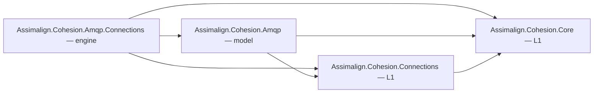

# Amqp

The AMQP 1.0 area of the Cohesion foundation libraries: the model an application programs against,
and the engine that speaks AMQP over Cohesion connections. Services that speak AMQP, such as
MessageHub, build on it.

## Project map

An arrow means "references": `Engine --> Model` reads `Assimalign.Cohesion.Amqp.Connections`
references `Assimalign.Cohesion.Amqp`.

The engine references the model, never the reverse, and both reference `Assimalign.Cohesion.Connections`
and `Assimalign.Cohesion.Core`. The full reference graph is in
[docs/DEPENDENCIES.md](../../docs/DEPENDENCIES.md).

## Projects

| Project | Role |
|---|---|
| [Assimalign.Cohesion.Amqp](Assimalign.Cohesion.Amqp/docs/OVERVIEW.md) | The model: connection, session, link and delivery contracts, the message format, delivery states and outcomes, termini, link resumption, SASL mechanisms, and the transaction controller and coordinator. Design: [DESIGN.md](Assimalign.Cohesion.Amqp/docs/DESIGN.md). |
| [Assimalign.Cohesion.Amqp.Connections](Assimalign.Cohesion.Amqp.Connections/docs/OVERVIEW.md) | The engine: `AmqpConnectionListener` and `AmqpConnectionFactory` establish connections over any reliable, ordered carrier, single-stream or multiplexed; the state machines implement the model and hold every frame to the specification; `AmqpMessageCodec` encodes messages without a connection. Design: [DESIGN.md](Assimalign.Cohesion.Amqp.Connections/docs/DESIGN.md). |

## Layering

The area is L1. It depends only on `libraries/Connections` and `libraries/Core`, and it consumes
connections by capability: an AMQP connection runs over any carrier that delivers a reliable,
ordered byte stream, and never branches on the protocol under it. Transport security is a
connection layer, never implemented here: composed below AMQP with `UseTls` from
`Assimalign.Cohesion.Connections.Security`, or run in band after the AMQP TLS protocol header
through the engine's `TlsLayer` option, which takes any `IConnectionLayer`.
Services under `resources/` that speak AMQP build on this area; libraries never depend on them
(COHLIB001).

Work items live under the AMQP epic, `[L01.01.01] Foundation - Amqp` (#308), in the Cohesion
GitHub Project.
