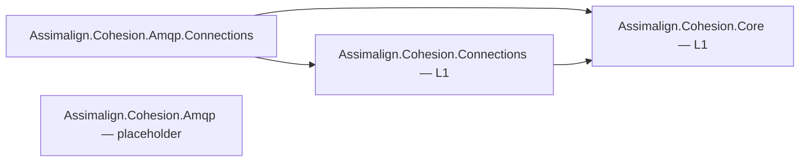

# Amqp

The AMQP 1.0 area of the Cohesion foundation libraries: the wire layer that establishes AMQP
connections over Cohesion connections, and the root package that is to hold AMQP's connection,
session and link semantics.

## Project map

An arrow means "references": `Amqp.Connections --> Connections` reads
`Assimalign.Cohesion.Amqp.Connections` references `Assimalign.Cohesion.Connections`.

`Assimalign.Cohesion.Amqp.Connections` references `Assimalign.Cohesion.Connections` and
`Assimalign.Cohesion.Core`. The root `Assimalign.Cohesion.Amqp` references nothing yet: #398 sets
its boundaries, including how it builds on `Amqp.Connections`. The full reference graph is in
[docs/DEPENDENCIES.md](../../docs/DEPENDENCIES.md).

## Projects

| Project | Role |
|---|---|
| [Assimalign.Cohesion.Amqp.Connections](Assimalign.Cohesion.Amqp.Connections/docs/OVERVIEW.md) | AMQP 1.0's transport layer (Part 2). `AmqpConnectionListener` and `AmqpConnectionFactory` establish connections over any reliable, ordered carrier, single-stream or multiplexed, before handing them out; protocol-header negotiation covers the AMQP and SASL phases; the codecs read and write frames, performatives and messages. Design: [DESIGN.md](Assimalign.Cohesion.Amqp.Connections/docs/DESIGN.md). |
| `Assimalign.Cohesion.Amqp` | Placeholder, with no source yet, for what acts on the performatives: the connection, session and link state machines (#414), SASL mechanisms (#422), and messaging semantics. |

## Layering

The area is L1. It depends only on `libraries/Connections` and `libraries/Core`, and it consumes
connections by capability: an AMQP connection runs over any carrier that delivers a reliable,
ordered byte stream, and never branches on the protocol under it. Transport security is composed
below AMQP, with `UseTls` from `Assimalign.Cohesion.Connections.Security`, never inside it.
Services under `resources/` that speak AMQP build on this area; libraries never depend on them
(COHLIB001).

Work items live under the AMQP epic, `[L01.01.01] Foundation - Amqp` (#308), in the Cohesion
GitHub Project.
