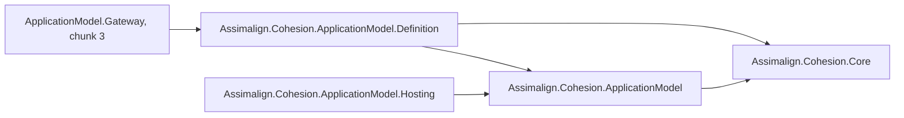
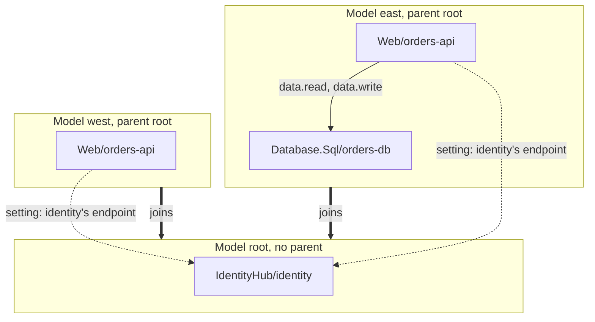

# Assimalign.Cohesion.ApplicationModel.Definition — Design

> **Status (2026-10-29):** chunk 2 of the Application Model rebuild, the logical side. Until
> 2026-10-29 this was the `Assimalign.Cohesion.ApplicationModel` project, which referenced
> Hosting.Resources; the split (D20) moved the types both sides share into
> [ApplicationModel](../../Assimalign.Cohesion.ApplicationModel/docs/DESIGN.md) and the instance
> side into [ApplicationModel.Hosting](../../Assimalign.Cohesion.ApplicationModel.Hosting/docs/DESIGN.md).
> Since D21 and D22 (2026-10-29) it holds the definition only: a model covers one gateway, a child
> gateway names the parent it joins, and the deployment view and the gateway seam live in
> [ApplicationModel.Gateway](../../Assimalign.Cohesion.ApplicationModel.Gateway/docs/DESIGN.md).
> The previous implementation (plans and planners, providers and stores, commands, externals) is
> retired; its source is at commit `6576e7c64`.

## Purpose

The library declares what one gateway runs, and nothing it does at run time:

1. **The builder.** `ApplicationModel.CreateBuilder(name)` returns an `IApplicationModelBuilder`,
   the gateway's set. `UseParent(name)` names the parent gateway it joins, and `Build()` closes
   composition and returns the immutable `IApplicationModel`. ApplicationModel.Gateway's
   `ApplicationBuilder` implements the same interface beside its gateway builder, wrapping this one.
2. **The declarations.** An `IApplicationSet` is one gateway's scope: the application resources it
   runs. An `IApplicationResourceDefinition` declares one resource: through `DependsOn`, the
   resources of the set it needs and the permissions it needs on each; through `WithSetting`, the
   configuration values its instances receive with their deployment, given in the model, filled in
   from another of the set's resources' outputs, or from one of the parent's (`IApplicationParent`).
   `GetManifest()` projects the set as `ApplicationManifest` data.
3. **The model.** `IApplicationModel` is the validated manifest, built in code or from data by
   `ApplicationModel.Create(manifest)`, such as the manifest a child sends when it joins its parent.

A resource's definition, a gateway's deployment of it (ApplicationModel.Gateway's
`IApplicationResourceDeployment`), and each of its instances (ApplicationModel.Hosting's
`IApplicationResourceInstance`) are three forms of one `IApplicationResource`, which the shared
contracts declare. The library references Core and those contracts, never the gateway or the
instance side. The arrow below means "references".

## Gateways and their parents

Each gateway has a model of its own, declared by its own program. A root gateway joins no parent; a
child gateway names its parent with `UseParent`, and joins it when it runs. The parent knows nothing
of a child before it joins, so each gateway deploys on its own. A resource's provider and name are
unique within its set, so `east` and `west` may both run `Web/orders-api`. In the diagram a solid
arrow is a `DependsOn` within one gateway, labeled with its permissions; a dotted arrow is a setting
that uses one of the parent's outputs, and a bold arrow is a child naming its parent.

A dependency orders deployment, and a gateway orders only its own resources, so a dependency stays
within the set. A setting may use an output of the parent's resources: the parent answers the
child's join with its value, which orders the child after the parent's resource without a dependency
(D21).

## The model

| Type | Role |
| --- | --- |
| `IApplicationModelBuilder` | The gateway's set, plus `Parent`, `UseParent`, and `Build`. `ApplicationModel.CreateBuilder(name)` creates one. |
| `IApplicationParent` | The parent a gateway joins, as its model refers to it: `Name`, and `Endpoint(provider, name)` and `Output(provider, name, output)` for placeholders of the parent's resources' outputs. |
| `IApplicationModel`, `ApplicationModel` | The immutable model of one gateway: `Manifest` (validated and read-only), `Name`, `Parent`, and `Role`. `ApplicationModel.Create(manifest)` builds one from data. |
| `ApplicationGatewayRole` | `Root` for a gateway that joins no parent, `Composite` for one that does. |
| `IApplicationSet` | One gateway's scope: `AddResource` declares a resource. |
| `IApplicationResourceDefinition` | One declared resource. `DependsOn(resource, permissions)` records a dependency on another of the set's resources, which also orders deployment; declaring it again adds the new permissions, and one that would close a cycle is refused. `WithSetting(name, value)` and `WithSetting(name, output)` give its instances a configuration value; an output of the set depends on its resource, one of the parent's does not. `WithExtension(platform, name, json)` configures how one platform deploys it. `Endpoint` and `Output(name)` hand out its own output placeholders. |
| `ApplicationManifest`, `ApplicationResourceManifest`, `ApplicationResourceDependency`, `ApplicationResourceSetting`, `ApplicationResourceExtension`, `ApplicationResourceOutputValue` | The gateway's application as data: its name, its parent, and its resources. A dependency names its target by gateway, provider, and name. A setting has a name and either a value or an `ApplicationResourceOutput`. An extension has a platform, a name, and a JSON value. An output value is an output with the value a parent hands a child that joins. |
| `IApplicationResource` (in ApplicationModel) | The base all three forms share: provider, name, and id. |
| `GatewayName`, `GatewayId`, `Permission`, `OutputName`, `SettingName`, `PlatformName`, `ExtensionName` | Value objects. `GatewayId` is a version 5 UUID of the name, like chunk 1's ids. `SettingName` is a configuration key and compares case-insensitively. `PlatformName` names an infrastructure provider's platform, such as `kubernetes`. |

## Decisions

**D1 — Resource names are scoped per gateway.** The management routes put resources under
`/gateways/{gatewayId}`, and one service commonly runs in several child gateways (east and west),
so a resource's provider and name are unique within its set only. Across gateways a resource is
identified by its set's `GatewayId` and its `ResourceId` together. A child joins its parent under its
name, so the children of one parent have different names. This settles chunk 1's first open question
without changing `ResourceId`.

**D2 — Definitions are build-time objects; the gateway works from data.** A parent receives a
child's manifest as data when the child joins, with no definition objects in memory, and a gateway's
deployment of a resource is created from its `ApplicationResourceManifest`. So a dependency is
recorded as data (gateway, provider, name) rather than as a reference to another definition.

**D3 — One set type at every level — superseded by D21.** The root gateway's set and each child
gateway's set were both `IApplicationSet`, nested in one hierarchy. Each gateway now has one set,
in a model of its own.

**D4 — `DependsOn` records access and order, so there are no cycles (owner decision, 2026-10-28).**
A dependency carries the permissions the dependent resource needs, which the gateway registers with
the tenant's identity provider so that provider can issue credentials just in time. It also orders
deployment: the gateway deploys a resource once what it depends on runs and its outputs are known,
so a dependent can be configured from them. A cycle could therefore never start, and it is refused
where it is declared: `DependsOn` refuses a dependency that leads back to its own resource, naming
the path (`east/Database.Sql/db -> east/Web/web -> east/Database.Sql/db`), and `Create` refuses a
manifest whose dependencies form a cycle. Since D21 a dependency stays within its gateway. A resource that must change one
it depends on does so at run time, through an action the other exposes, such as a Web resource
adding its path rule to the application gateway deployed before it. This replaces the first
version of this decision, which recorded access only and accepted mutual dependencies.

**D5–D8 — moved to ApplicationModel.Gateway with the deployment (D22).** Atomic `Register` and
`Record`, filtered version skew, durability in the gateway, and lock-free reads are decisions of
`ApplicationResourceDeployment`, which now lives in the gateway; they are its G28–G31.

**D9 — One set of identity, manifest, and snapshot types — superseded by D20.** A deployment
aggregates the instances that publish to it, so the model and the instance side use the same
identity, instance manifest, and snapshot types. The previous model duplicated `ResourceName` and
`ResourceId` instead. Until D20 the model got those types by referencing Hosting.Resources; they now
live in the shared contracts, ApplicationModel, which both sides reference.

**D10 — The builder is the gateway's set.** `IApplicationModelBuilder` extends `IApplicationSet`,
so a program composes with `builder.AddResource(...)`, and a resource's `Set` is the builder itself.
The alternative, a builder that exposes a separate set object, made `builder.Set.AddResource(...)`
the spelling and gave the set two identities. Until D21 this builder was the root of a hierarchy of
child sets (`AddGateway`).

**D11 — One validation path.** `Build()` projects the manifest and creates the model with
`ApplicationModel.Create(manifest)`, the same call a parent makes for the manifest a child sends when
it joins, and closes the builder only once that succeeds. Composition checks its rules early, at each
`Add` and `DependsOn`, for a precise error at the line that broke them; `Create` is the authority,
and alone checks rules that span declarations, such as a setting using an output of a gateway that
is neither this one nor its parent. `Create` also copies the lists read-only, so a caller that keeps
a deserialized list cannot change a model.

**D12 — Building needs no gateway — superseded by D22.** A build step can still create the model and
its manifest without a gateway; running is the gateway's, through ApplicationModel.Gateway's builder.

**D13 — `IApplicationGateway` is a seed — superseded by D22.** The interface lives in
ApplicationModel.Gateway, which owns what a gateway exposes.

**D14 — A model is for one gateway and keeps the whole hierarchy — superseded by D21.** A model now
covers one gateway and its parent's name; there is no hierarchy to keep.

**D15 — Infrastructure actions sit on the aggregate — moved to ApplicationModel.Gateway with the
deployment (D22),** as its G32.

**D16 — Outputs are placeholders until the platform reports them (owner request, 2026-10-28).** A
resource has values only once it is deployed, such as the endpoint of the load balancer in front of
its instances. A definition hands out an `ApplicationResourceOutput` for one (`Endpoint`, or
`Output(name)`), which names its gateway, resource, and output, and carries no value. The gateway
that runs the resource records what its infrastructure provider reports on the aggregate
(`IApplicationResourceDeployment.Outputs`, `ApplicationResourceDeployment.SetOutputs`) and fills the value in where a
dependent refers to it. Output names follow the action-name grammar; the provider decides which
outputs a resource has. Values are strings, as configuration and environment variables carry them.
Outputs belong to the logical resource, not to an instance: an instance's own address is a separate
question for the gateway-to-instance channel.

**D17 — Settings are configuration values delivered with the deployment (owner request,
2026-10-29).** `WithSetting(name, value)` gives a resource's instances a configuration value, and
`WithSetting(name, output)` gives them one filled in from another resource's output, as in
`api.WithSetting("ConfigurationStore:Endpoint", store.Endpoint)`. The gateway fills outputs in when
it deploys the resource, and its infrastructure provider delivers the values, for example as
environment variables, so an instance reads them through its configuration like any other key.
This is the "outputs passed to dependent resources" part of the goal: the value is generated at run
time but arrives the way configuration always does. A setting from an output of the gateway's own
resources makes the resource depend on the output's resource, with no permissions, because only a
dependency deploys that resource first (one from the parent's resources does not: D21); `DependsOn` grants permissions on the same dependency. The builder adds the
dependency itself, as an ARM or Bicep reference does, and a dependency that would close a cycle is
refused before the setting is recorded. In manifest data the dependency must be declared, since
`Create` validates data rather than adding to it. A resource's own outputs cannot be its settings:
they exist only once it is deployed. Names are configuration keys (colon-separated segments of
letters, digits, `_`, `-` and `.`) and compare case-insensitively, as configuration keys do;
setting a name again replaces its value in place. *Rejected:* requiring an explicit `DependsOn`
before an output can be used. It adds a call that can only ever be required, and forgetting it
would be an error instead of the ordering the setting needs anyway. *Not chosen:* the name
"inputs". It pairs well with outputs, but the instance reads these values as configuration, and the
owner's direction treats configuration as the instance's settings model.

**D18 — A child gateway's model carries the output values from above (owner request,
2026-10-29) — superseded by D21.** Values from above no longer travel in the model: a child reads
them from its parent when it joins. The record below is kept for its reasoning. A setting may use an output of a resource in its own gateway or in one above it, such
as east's `orders-api` reading the root identity provider's endpoint. The gateway that runs the
resource fills in its own resources' outputs. A value from above arrives with the child's
deployment manifest, because the parent deploys the child only once those resources are ready
(ApplicationModel.Gateway G19, G24). `IApplicationModel.Outputs` holds those values, and
`ApplicationModel.Create(manifest, gateway, outputs)` accepts only values for outputs of resources
the manifest declares in a gateway above `gateway`, each once; the root's model has none. The
values are run-time data, so they sit beside `Manifest` and `Deployment` rather than in them, and
the hierarchy rules do not depend on them. *Rejected:* a child reading its parent's outputs back at
run time. That needs a gateway-to-gateway channel and ties the child's start to the parent being
reachable, while the parent already has every value when it deploys the child.

**D19 — Platform extensions apply only on their platform (owner direction, 2026-10-28; built
2026-10-29).** Some configuration belongs to one platform's deployment of a resource, not to the
resource: a Kubernetes autoscaler, a node selector, a Docker restart policy. A platform package adds
a verb for it, such as `ConfigureHpa`, which calls the generic `WithExtension(platform, name, json)`
with its options serialized through its own source-generated JSON context. The model stores the
extension as data, a platform, a name, and an opaque `JsonElement`, so the manifest still travels as
JSON and the base model needs no platform types. The platform is the extension's apply condition: a
gateway hands it only to an infrastructure provider of that platform, and every other provider never
sees it (ApplicationModel.Gateway G25). One resource can therefore carry extensions for each
platform it may run on, and the in-process gateway of a local run ignores the Kubernetes ones. A
platform and name are unique per resource, and declaring them again replaces the value in place. The
value is cloned, so the model never depends on a document its caller disposes. *Rejected:* typed
extension objects held in memory. The manifest must travel as data, and a typed
object would make the base model reference every platform's options. *Rejected:* string key/value
pairs like settings. Platform options are structured, such as an autoscaler's metrics, and pairs
would flatten them into keys only the provider could reassemble. *Open:* conditions beyond the
platform, such as a gateway or an environment (open question 8).

**D20 — The model is split into contracts, definitions, and hosting (owner decision, 2026-10-29).**
A resource has three forms: its definition, which a model declares; its deployment, a gateway's view
of it across its instances; and each instance, one running copy. They share an
`IApplicationResource` base with the resource's provider, name, and id. The projects follow them:

| Project | Holds | References |
| --- | --- | --- |
| `ApplicationModel` | What both sides exchange: `IApplicationResource`, the identity value objects, the instance manifest, snapshots, the action context and result, and the content-serializer and publisher seams | Core |
| `ApplicationModel.Definition` | The logical side: `IApplicationResourceDefinition`, sets, the builder, manifests, the validated model, and, until D22, `IApplicationResourceDeployment` | ApplicationModel |
| `ApplicationModel.Hosting` | The physical side: `IApplicationResourceInstance`, health contributors, the control plane, `ApplicationInstanceService`, and the publishers | ApplicationModel, Hosting |

The instance side never loads the logical model, and the logical side never loads the instance
runtime: each references only the contracts, which is the line between the logical and the physical
instance drawn on 2026-10-28. One type per concept means an in-process gateway and an instance
exchange the same `ApplicationInstanceManifest` object. The root and Definition share the
`Assimalign.Cohesion.ApplicationModel` namespace, so a gateway's `Program.cs` still needs one
`using`; Hosting has its own. The deployment sits here rather than in the gateway, because it is
built from a definition and keeps D15's reason: a transport can expose it without a gateway
reference. Hosting.Resources is removed, and `Web.Hosting.Resources` is
`Web.Hosting.ApplicationModel`. *Rejected:* linking Hosting.Resources' files into the model as
shared source. Each assembly would compile its own public copy of every type, so the gateway,
which sees both, could not tell them apart, and an in-process instance would hand the gateway a
manifest of the wrong type. D22 later moved the deployment to the gateway, once this project became
the definition only.

**D21 — Each gateway has its own model, and a child joins its parent (owner decision, 2026-10-29).**
A model covers one gateway: its set, and the name of the parent it joins, or none for a root. A
child names its parent with `UseParent`, which returns an `IApplicationParent` for the outputs of the
parent's resources that its settings use. The manifest records the parent, so the parent learns from
the manifest a child sends when it joins which of its outputs that child reads.
- **A dependency stays within its gateway.** A dependency orders deployment, and a gateway orders
  only its own resources.
- **A setting may use an output of the gateway's own resources or of its parent's.** The first
  implies a dependency (D17). The second does not: the parent answers the join with the value, and
  the child waits for it before it deploys (ApplicationModel.Gateway G26). `Create` refuses an output
  of any other gateway, and a parent that names the gateway itself.
- **Each gateway deploys on its own,** with its own pipeline and credentials, and a parent never
  needs access to a child's infrastructure.

This replaces the hierarchy of D3, D14, and D18, in which the root's program declared every gateway
and the root deployed the children. *Rejected:* keeping the hierarchy with children deployed by
their parent. A child could not be deployed on its own, the parent needed the child's infrastructure
credentials, and the root's program carried the whole application. *Open:* a grandparent's outputs,
and dependencies on a parent's resources for their permissions (open questions 3 and 10).

**D22 — Two builders, and the definition only (owner decision, 2026-10-29).**
`IApplicationModelBuilder` builds the model and nothing else. ApplicationModel.Gateway's
`IApplicationGatewayBuilder` builds the gateway, and its `ApplicationBuilder` implements both side by
side, wrapping a builder of `ApplicationModel.CreateBuilder`, the way an area's application builder
implements its area's builder beside the host's.
- `IApplication`, `Application`, and the old `IApplicationBuilder` are removed: they only paired a
  model with a gateway. `IApplicationBuilder.Args`, which nothing read, goes with them.
- The gateway seam (`IApplicationGateway`), the deployment view (`IApplicationResourceDeployment`,
  `ApplicationResourceDeployment`), and infrastructure actions (`IApplicationResourceAction`) moved to
  ApplicationModel.Gateway, which alone uses them. Each form of a resource now lives with its owner:
  the definition here, the deployment in the gateway, the instance in ApplicationModel.Hosting.

This replaces D20's placement of the deployment.

## Threading

A model builder is composed on one thread and is not safe for concurrent changes. A model is
immutable.

## AOT

No reflection or runtime code generation. The manifest records are plain data; their value objects
carry their own JSON converters.

## Diagnostics

None. The library raises no events and has no event source.

## Open questions

1. **Tenant and identity provider.** Neither is modeled yet. Is the tenant's identity provider a
   resource of the root set, an external service, or both? Permissions are only recorded until then.
2. **Permission vocabulary.** A permission is checked against its grammar only. The target's
   provider should declare the permissions it accepts; that arrives with the area packages.
3. **Depth and reach.** A child may have children of its own; each joins its own parent. A setting
   may use only its parent's outputs. *Proposal (2026-10-29, awaiting the owner):* values flow both
   ways through the join. Each renewal carries the child's exported outputs up, and the parent's
   answer relays any value a child's settings use: its own, its parent's, or a sibling's. The parent
   becomes the hub and every gateway keeps one connection. It needs an export marker, so only
   outputs a gateway exports leave it; sibling and ancestor references in the model; and a value
   that changes at its source reaches its consumer on the consumer's next run, as a parent's value
   does today.
4. **Deployment manifest — withdrawn by D21.** Children no longer receive a deployment manifest from
   their parent; each deploys with its own pipeline. The `/infra` routes' transport is still open.
5. **Area verbs — settled 2026-10-30 (owner).** Areas ship no definition package: the area
   `<Area>.ApplicationModel` packages of the retired design were deleted, and a model declares any
   resource with `AddResource(provider, name)`. An area package returns only when the area has
   something of its own to declare.
6. **Static assets.** The SDK will generate assets for each `CohesionResourceReference` that the
   gateway needs. A descriptor and its manifest record have no slot for them yet; the slot's shape
   comes with the generation that fills it.
7. **A child gateway's model — settled by D21:** the child's own program builds it and names the
   parent.
8. **Apply conditions beyond the platform.** An extension applies on one platform (D19). A
   condition on the gateway (only east's cluster autoscales) or on an environment (only production)
   would need the condition as data beside the platform. Today the same resource declared in two
   gateways can already carry different extensions, because resources are declared per gateway.
9. **Secret settings.** A setting's value is a plain string. A secret one, such as a connection
   string with a password, needs a marker so a provider delivers it as a platform secret rather than
   a plain environment variable.
10. **Dependencies on the parent's resources.** A dependency carries the permissions the identity
    provider grants. A child's resource that needs permissions on one of the parent's, such as east's
    `orders-api` reading the root's database, cannot say so, because a dependency stays within its
    gateway. A reference to a parent's resource, like the output placeholders, could carry them.
11. **Names among a parent's children.** A child that joins under a name already joined replaces the
    earlier one, so two gateways with one name would replace each other on every renewal.
12. **Claims (proposal, 2026-10-29, awaiting the owner).** The retired design let one application's
    code add entries to a claimable section of another resource's configuration: orders-api's
    database in orders-db, its client in IdentityHub, its namespace in the ConfigurationStore. A
    claim survived the target's redeploys, conflicted with another owner's claim on the same key,
    and was removed only by its owner. D4's replacement, an action the downstream calls on the
    upstream at run time, is recorded as the upstream's state: one value per action with no owner,
    which the upstream's next revision clears and the downstream's removal never withdraws.
    *Proposal:* a claim is declared on the dependency in the claimant's own code
    (`api.DependsOn(db, permissions).Claim("databases", "orders", value)`), so it is desired state the
    gateway holds, not operator state. The gateway that runs the target restores claims with its
    state when an instance publishes, and across gateways they travel with the join, which also
    answers question 10.
