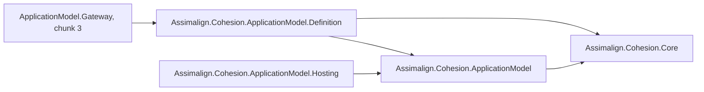
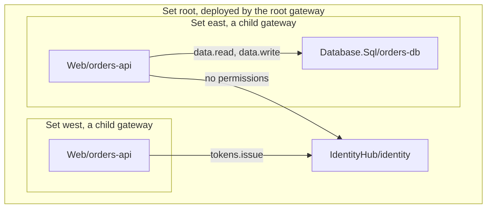

# Assimalign.Cohesion.ApplicationModel.Definition — Design

> **Status (2026-10-29):** chunk 2 of the Application Model rebuild, the logical side. Until
> 2026-10-29 this was the `Assimalign.Cohesion.ApplicationModel` project, which referenced
> Hosting.Resources; the split (D20) moved the types both sides share into
> [ApplicationModel](../../Assimalign.Cohesion.ApplicationModel/docs/DESIGN.md) and the instance
> side into [ApplicationModel.Hosting](../../Assimalign.Cohesion.ApplicationModel.Hosting/docs/DESIGN.md).
> The previous implementation (plans and planners, providers and stores, commands, externals) is
> retired; its source is at commit `6576e7c64`. ApplicationModel.Gateway is chunk 3.

## Purpose

The library has three parts:

1. **The application.** `Application.CreateBuilder(name, args)` returns an `IApplicationBuilder`,
   which is the root gateway's set. `UseGateway` selects the `IApplicationGateway` that runs it, and
   `Build()` closes composition and returns an `IApplication`: its immutable `IApplicationModel` and
   `RunAsync`, which hands the model to the gateway.
2. **Declarative.** What each gateway deploys. An `IApplicationSet` is one gateway's scope: the
   application resources it runs and the child gateways it runs, each with a set of its own. An
   `IApplicationResourceDefinition` declares one resource: through `DependsOn`, the resources it
   needs and the permissions it needs on each; through `WithSetting`, the configuration values its
   instances receive with their deployment, given in the model or filled in from another resource's
   output. `GetManifest()` projects a set and everything below it as `ApplicationManifest` data; the
   root's manifest is the global manifest.
3. **Runtime.** `IApplicationResourceDeployment` is a gateway's deployment of one defined resource:
   the instances running it and the state written to them since the gateway was deployed. It
   answers an instance's publication with the state to restore, and a recorded write with the
   instances that must restore it.

A resource's definition, its deployment, and each of its instances (ApplicationModel.Hosting's
`IApplicationResourceInstance`) are three forms of one `IApplicationResource`, which the shared
contracts declare. The library references Core and those contracts, never the instance side. The
arrow below means "references".

## The hierarchy

The root set belongs to the root gateway, which runs its own resources (here the tenant's identity
provider) and its child gateways. Each child gateway runs its own set. A resource's provider and
name are unique within its set, so `east` and `west` may both run `Web/orders-api`. Gateway names
are unique across the whole hierarchy. A dependency may point into any set of the same hierarchy;
in the diagram an arrow is a `DependsOn`, labeled with its permissions.

## The model

| Type | Role |
| --- | --- |
| `IApplicationBuilder`, `ApplicationBuilder` | The root set, plus `Args`, `UseGateway`, and `Build`. `Application.CreateBuilder(name, args)` creates it. |
| `IApplication`, `Application` | A built application: `Model` and `RunAsync`, which runs the selected gateway with the model, once. |
| `IApplicationModel`, `ApplicationModel` | The immutable model for one gateway: `Manifest` (the whole hierarchy, validated and read-only), `Name` and `Deployment` (that gateway and its part), `Role`, and `Outputs` (the values passed down from the gateways above). `ApplicationModel.Create(manifest, gateway, outputs)` builds one from data. |
| `ApplicationGatewayRole` | `Root` for the hierarchy's top gateway, `Composite` for any other. |
| `IApplicationResourceAction` | An infrastructure action on a resource, such as `scale`, executed against the platform. Same invocation and result types as a control. |
| `IApplicationGateway` | The seam ApplicationModel.Gateway implements: `RunAsync(model)`. Deliberately minimal until chunk 3. |
| `IApplicationSet` | One gateway's scope. The builder is the root; `AddGateway` makes a child; `AddResource` declares a resource. |
| `IApplicationResourceDefinition` | One declared resource. `DependsOn(resource, permissions)` records a dependency, which also orders deployment; declaring it again adds the new permissions, and one that would close a cycle is refused. `WithSetting(name, value)` and `WithSetting(name, output)` give its instances a configuration value; the second depends on the output's resource. `WithExtension(platform, name, json)` configures how one platform deploys it. `Endpoint` and `Output(name)` hand out its own output placeholders. |
| `ApplicationManifest`, `ApplicationResourceManifest`, `ApplicationResourceDependency`, `ApplicationResourceSetting`, `ApplicationResourceExtension`, `ApplicationResourceOutputValue` | The hierarchy as data. A dependency names its target by gateway, provider, and name. A setting has a name and either a value or an `ApplicationResourceOutput`. An extension has a platform, a name, and a JSON value. An output value is an output with the value a gateway passes down. |
| `IApplicationResourceDeployment`, `ApplicationResourceDeployment` | A gateway's deployment of one resource: `Register` an instance's published manifest, `Record` a stateful write's snapshot, `Unregister` a stopped instance, and `ExecuteAsync` one of its infrastructure `Actions`. The gateway also sets its `Outputs` and clears its state when a deployment redefines it. |
| `IApplicationResource` (in ApplicationModel) | The base all three forms share: provider, name, and id. |
| `GatewayName`, `GatewayId`, `Permission`, `OutputName`, `SettingName`, `PlatformName`, `ExtensionName` | Value objects. `GatewayId` is a version 5 UUID of the name, like chunk 1's ids. `SettingName` is a configuration key and compares case-insensitively. `PlatformName` names an infrastructure provider's platform, such as `kubernetes`. |

## Decisions

**D1 — Resource names are scoped per gateway.** The management routes put resources under
`/gateways/{gatewayId}`, and one service commonly runs in several child gateways (east and west),
so a resource's provider and name are unique within its set only. Across the hierarchy a resource is
identified by its set's `GatewayId` and its `ResourceId` together. Gateway names are unique across the
hierarchy because they key the routes under a tenant. This settles chunk 1's first open question
without changing `ResourceId`.

**D2 — Descriptors are build-time objects; the gateway works from data.** A gateway may receive its
deployment manifest as JSON through its arguments, with no descriptor objects in memory. So
`ApplicationResourceDeployment` is created from an `ApplicationResourceManifest`, and a dependency is recorded
as data (gateway, provider, name) rather than as a reference to another descriptor.

**D3 — One set type at every level.** The root gateway's set and each child gateway's set are both
`IApplicationSet`, and nothing limits the depth. Nothing differs between a root and a composite set
in this chunk, so separate types would only duplicate the composition API. The gateway chunk decides
what a root does that a composite does not.

**D4 — `DependsOn` records access and order, so there are no cycles (owner decision, 2026-10-28).**
A dependency carries the permissions the dependent resource needs, which the gateway registers with
the tenant's identity provider so that provider can issue credentials just in time. It also orders
deployment: the gateway deploys a resource once what it depends on runs and its outputs are known,
so a dependent can be configured from them. A cycle could therefore never start, and it is refused
where it is declared: `DependsOn` refuses a dependency that leads back to its own resource, naming
the path (`east/Database.Sql/db -> root/Web/web -> east/Database.Sql/db`), and `Create` refuses a
manifest whose dependencies form a cycle anywhere in the hierarchy. A resource that must change one
it depends on does so at run time, through an action the other exposes, such as a Web resource
adding its path rule to the application gateway deployed before it. This replaces the first
version of this decision, which recorded access only and accepted mutual dependencies.

**D5 — `Register` and `Record` are atomic with respect to each other.** Each runs under one lock and
returns its answer from the state that lock protects. An instance that registers before a write is
recorded is in the write's restore list; one that registers after it gets the snapshot in its
registration answer. Every instance therefore receives every recorded snapshot exactly once. The
alternative, a gateway that lists the instances and then records, lets an instance that registers
in between miss the write.

**D6 — Version skew is filtered, not refused.** An instance receives only snapshots for actions its
own manifest declares stateful, and `Record` accepts a snapshot only from an instance that declares
the action stateful. During a rollout, an instance of another version neither receives nor reports
state it does not understand.

**D7 — Durability belongs to the gateway.** The aggregate keeps its state in memory for the life of
one deployment. A gateway that restarts within the same deployment seeds a new aggregate through
`ApplicationResourceDeployment.Create(manifest, state)`. A gateway should persist a recorded snapshot before it
acknowledges the write, or a restart can lose a write that running instances already apply. A
gateway seeds the aggregate before it knows whether the run redefines the resource, and calls
`ClearState()` when it does; instances already registered keep what they restored.

**D8 — Reads take no lock.** `Instances` and `State` return read-only copies that each change
replaces, so a management read never waits on a registration, and a debugger never deadlocks on a
held lock.

**D9 — One set of identity, manifest, and snapshot types — superseded by D20.** A deployment
aggregates the instances that publish to it, so the model and the instance side use the same
identity, instance manifest, and snapshot types. The previous model duplicated `ResourceName` and
`ResourceId` instead. Until D20 the model got those types by referencing Hosting.Resources; they now
live in the shared contracts, ApplicationModel, which both sides reference.

**D10 — The builder is the root set.** `IApplicationBuilder` extends `IApplicationSet`, so a
program composes with `builder.AddResource(...)` and `builder.AddGateway(...)`, and a root resource's
`Set` and a child set's `Parent` are the builder itself. The alternative, a builder that exposes a
separate root set object, made `builder.Set.AddResource(...)` the spelling and gave the root two
identities. The builder and each child set share one internal composition type, so the rules exist
once. Child sets are internal; `IApplicationSet` is their public surface.

**D11 — One validation path.** `Build()` freezes the hierarchy, projects its manifest, and creates
the model with `ApplicationModel.Create(manifest)`, the same call a gateway makes for a manifest it
receives as JSON through its arguments. Composition checks its rules early, at each `Add` and
`DependsOn`, for a precise error at the line that broke them; `Create` is the authority. `Create`
also copies the lists read-only, so a caller that keeps a deserialized list cannot change a model.

**D12 — Building needs no gateway; running does.** A build step can create the model and its
manifest, such as the static assets the SDK will generate for a resource reference, without
selecting or contacting a gateway. `RunAsync` without a gateway throws, and an application runs
once.

**D13 — `IApplicationGateway` is a seed.** The builder needs a type to select, so the interface
exists with one member, `RunAsync(model)`. ApplicationModel.Gateway implements it; the publication
endpoint and the infrastructure provider live there.

**D14 — A model is for one gateway and keeps the whole hierarchy.** `Manifest` is always the whole
hierarchy, so a dependency outside the gateway's own part resolves; `Name` and `Deployment` say
which gateway the model is for and what that gateway deploys, and `Role` follows from them. A model
built in code is for the root; `ApplicationModel.Create(manifest, gateway)` creates a child gateway's.
This settled what a child gateway receives: the whole manifest plus its own name, not its subtree,
and, since D18, the output values its parent passed down.

**D15 — Infrastructure actions sit on the aggregate.** A gateway's provider supplies each resource's
infrastructure actions to `ApplicationResourceDeployment.Create`, and `ExecuteAsync` dispatches them with the
statuses a control plane uses (`NotFound`, `NotSupported`, `Rejected` for input that does not bind).
The contract lives here rather than in the gateway library so a transport can expose the actions
without referencing a gateway package.

**D16 — Outputs are placeholders until the platform reports them (owner request, 2026-10-28).** A
resource has values only once it is deployed, such as the endpoint of the load balancer in front of
its instances. A descriptor hands out an `ApplicationResourceOutput` for one (`Endpoint`, or
`Output(name)`), which names its gateway, resource, and output, and carries no value. The gateway
that runs the resource records what its infrastructure provider reports on the aggregate
(`IApplicationResourceDeployment.Outputs`, `ApplicationResourceDeployment.SetOutputs`) and fills the value in where a
dependent refers to it. Output names follow the action-name grammar; the provider decides which
outputs a resource has. Values are strings, as configuration and environment variables carry them.
Outputs belong to the logical resource, not to an instance: an instance's own address is a separate
question for the gateway-to-instance channel.

**D17 — Settings are configuration values delivered with the deployment (owner request,
2026-10-29).** `WithSetting(name, value)` gives a resource's instances a configuration value, and
`WithSetting(name, output)` gives them one filled in from another resource's output, as in
`api.WithSetting("ConfigurationStore:Endpoint", store.Endpoint)`. The gateway fills outputs in when
it deploys the resource, and its infrastructure provider delivers the values, for example as
environment variables, so an instance reads them through its configuration like any other key.
This is the "outputs passed to dependent resources" part of the goal: the value is generated at run
time but arrives the way configuration always does. A setting from an output makes the resource
depend on the output's resource, with no permissions, because only a dependency deploys that
resource first; `DependsOn` grants permissions on the same dependency. The builder adds the
dependency itself, as an ARM or Bicep reference does, and a dependency that would close a cycle is
refused before the setting is recorded. In manifest data the dependency must be declared, since
`Create` validates data rather than adding to it. A resource's own outputs cannot be its settings:
they exist only once it is deployed. Names are configuration keys (colon-separated segments of
letters, digits, `_`, `-` and `.`) and compare case-insensitively, as configuration keys do;
setting a name again replaces its value in place. *Rejected:* requiring an explicit `DependsOn`
before an output can be used. It adds a call that can only ever be required, and forgetting it
would be an error instead of the ordering the setting needs anyway. *Not chosen:* the name
"inputs". It pairs well with outputs, but the instance reads these values as configuration, and the
owner's direction treats configuration as the instance's settings model.

**D18 — A child gateway's model carries the output values from above (owner request,
2026-10-29).** A setting may use an output of a resource in its own gateway or in one above it, such
as east's `orders-api` reading the root identity provider's endpoint. The gateway that runs the
resource fills in its own resources' outputs. A value from above arrives with the child's
deployment manifest, because the parent deploys the child only once those resources are ready
(ApplicationModel.Gateway G19, G24). `IApplicationModel.Outputs` holds those values, and
`ApplicationModel.Create(manifest, gateway, outputs)` accepts only values for outputs of resources
the manifest declares in a gateway above `gateway`, each once; the root's model has none. The
values are run-time data, so they sit beside `Manifest` and `Deployment` rather than in them, and
the hierarchy rules do not depend on them. *Rejected:* a child reading its parent's outputs back at
run time. That needs a gateway-to-gateway channel and ties the child's start to the parent being
reachable, while the parent already has every value when it deploys the child.

**D19 — Platform extensions apply only on their platform (owner direction, 2026-10-28; built
2026-10-29).** Some configuration belongs to one platform's deployment of a resource, not to the
resource: a Kubernetes autoscaler, a node selector, a Docker restart policy. A platform package adds
a verb for it, such as `ConfigureHpa`, which calls the generic `WithExtension(platform, name, json)`
with its options serialized through its own source-generated JSON context. The model stores the
extension as data, a platform, a name, and an opaque `JsonElement`, so the manifest still travels as
JSON and the base model needs no platform types. The platform is the extension's apply condition: a
gateway hands it only to an infrastructure provider of that platform, and every other provider never
sees it (ApplicationModel.Gateway G25). One resource can therefore carry extensions for each
platform it may run on, and the in-process gateway of a local run ignores the Kubernetes ones. A
platform and name are unique per resource, and declaring them again replaces the value in place. The
value is cloned, so the model never depends on a document its caller disposes. *Rejected:* typed
extension objects held in memory. The manifest must cross to child gateways as data, and a typed
object would make the base model reference every platform's options. *Rejected:* string key/value
pairs like settings. Platform options are structured, such as an autoscaler's metrics, and pairs
would flatten them into keys only the provider could reassemble. *Open:* conditions beyond the
platform, such as a gateway or an environment (open question 8).

**D20 — The model is split into contracts, definitions, and hosting (owner decision, 2026-10-29).**
A resource has three forms: its definition, which a model declares; its deployment, a gateway's view
of it across its instances; and each instance, one running copy. They share an
`IApplicationResource` base with the resource's provider, name, and id. The projects follow them:

| Project | Holds | References |
| --- | --- | --- |
| `ApplicationModel` | What both sides exchange: `IApplicationResource`, the identity value objects, the instance manifest, snapshots, the action context and result, and the content-serializer and publisher seams | Core |
| `ApplicationModel.Definition` | The logical side: `IApplicationResourceDefinition`, sets, the builder, manifests, the validated model, and `IApplicationResourceDeployment` | ApplicationModel |
| `ApplicationModel.Hosting` | The physical side: `IApplicationResourceInstance`, health contributors, the control plane, `ApplicationInstanceService`, and the publishers | ApplicationModel, Hosting |

The instance side never loads the logical model, and the logical side never loads the instance
runtime: each references only the contracts, which is the line between the logical and the physical
instance drawn on 2026-10-28. One type per concept means an in-process gateway and an instance
exchange the same `ApplicationInstanceManifest` object. The root and Definition share the
`Assimalign.Cohesion.ApplicationModel` namespace, so a gateway's `Program.cs` still needs one
`using`; Hosting has its own. The deployment sits here rather than in the gateway, because it is
built from a definition and keeps D15's reason: a transport can expose it without a gateway
reference. Hosting.Resources is removed, and `Web.Hosting.Resources` is
`Web.Hosting.ApplicationModel`. *Rejected:* linking Hosting.Resources' files into the model as
shared source. Each assembly would compile its own public copy of every type, so the gateway,
which sees both, could not tell them apart, and an in-process instance would hand the gateway a
manifest of the wrong type.

## Threading

An application builder and its sets are composed on one thread and are not safe for concurrent
changes. An `ApplicationResourceDeployment` is safe for concurrent use.

## AOT

No reflection or runtime code generation. The manifest records are plain data; their value objects
carry their own JSON converters.

## Diagnostics

None. The library raises no events and has no event source.

## Open questions

1. **Tenant and identity provider.** Neither is modeled yet. Is the tenant's identity provider a
   resource of the root set, an external service, or both? Permissions are only recorded until then.
2. **Permission vocabulary.** A permission is checked against its grammar only. The target's
   provider should declare the permissions it accepts; that arrives with the area packages.
3. **Composite depth.** May a child gateway run child gateways of its own? This chunk allows it.
4. **Deployment manifest — settled in chunk 3.** ApplicationModel.Gateway's
   `ApplicationDeploymentManifest` carries the "what" (this manifest plus a gateway name) and the "where"
   (provider settings), with its JSON wire contract. The `/infra` routes' transport is still open.
5. **Area verbs.** `set.AddWeb("orders-api")` and resource options belong to the area packages, once
   area implementations consolidate into `<Area>.ApplicationModel`.
6. **Static assets.** The SDK will generate assets for each `CohesionResourceReference` that the
   gateway needs. A descriptor and its manifest record have no slot for them yet; the slot's shape
   comes with the generation that fills it.
7. **A child gateway's model — settled in chunk 3** (D14): the whole manifest plus the child's name,
   carried by an `ApplicationDeploymentManifest`.
8. **Apply conditions beyond the platform.** An extension applies on one platform (D19). A
   condition on the gateway (only east's cluster autoscales) or on an environment (only production)
   would need the condition as data beside the platform. Today the same resource declared in two
   gateways can already carry different extensions, because resources are declared per gateway.
9. **Secret settings.** A setting's value is a plain string. A secret one, such as a connection
   string with a password, needs a marker so a provider delivers it as a platform secret rather than
   a plain environment variable.
