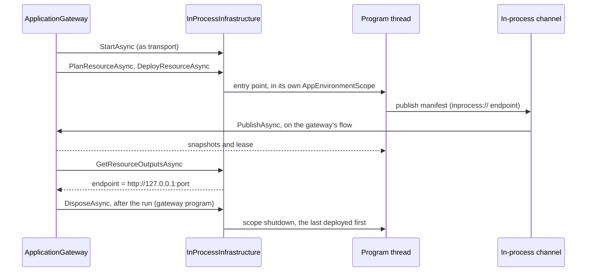

# Assimalign.Cohesion.ApplicationModel.Gateway.InProcess — Design

> **Status (2026-10-29):** rebuilt on the restarted application model. The plan-driven
> in-process gateway (`InProcessGateway`, `ProcessHost`, member supervision, plan compilation) is
> gone; this package is now an infrastructure provider of the gateway in
> [ApplicationModel.Gateway](../../Assimalign.Cohesion.ApplicationModel.Gateway/docs/DESIGN.md).

## Purpose

A gateway deploys its resources onto an infrastructure provider. This package's provider,
`InProcessInfrastructure`, deploys them into the gateway's own process. Each resource is a program
the gateway program references. Deploying it calls the program's entry point on a thread of its
own, and the program reads its environment from a scope of its own: where its gateway is, where it
listens, and its settings. Every program then publishes to its gateway like any instance. So one
`dotnet run` of the gateway program runs the whole application, with each resource's code exactly
as it runs on any other platform.

The package references ApplicationModel.Gateway, for the provider and transport seams, and
ApplicationModel.Hosting, for the in-process endpoint its programs publish to. It references no
resource area: the gateway program references the programs.

## How a deployment runs

The gateway deploys in dependency order. Each step below runs once per resource, and a resource
that depends on another starts only once that one is ready.

The gateway starts the channel as one of its transports before it deploys anything. It plans and
deploys the resource. The infrastructure starts the program, whose host publishes its manifest to
the in-process endpoint its environment names. The channel hands the publication to the gateway,
and the gateway reads the resource's outputs, so what depends on it can be planned with its
address. Once the gateway has stopped, the gateway program disposes the infrastructure, which stops
the programs.

## Decisions

**I1 — In process is a platform, not a gateway (2026-10-29).** The retired package was a gateway of
its own, with its own plans, readiness gate, and supervision. Now the one gateway reconciles,
orders, waits, and records, whatever it deploys onto, and in-process is its `inprocess` platform:
`InProcessInfrastructure : IInfrastructureProvider`. A resource's extensions for `inprocess` apply
here, as any platform's do (Gateway G25).

**I2 — A program is bound by its entry point.** `AddProgram(provider, name, main)` binds a resource
to the delegate the gateway program calls, such as `Orders.Program.Main`. Nothing is discovered: no
assembly scanning, no reflection over entry points, no generated host-construction convention. The
entry point is called with no arguments, because everything a platform tells a workload arrives in
its environment (I4). *Rejected:* binding by assembly (`Assembly.EntryPoint`), which is reflection a
trimmed program keeps only with generated roots. The SDK can generate the `AddProgram` calls later.

**I3 — Each program runs on its own thread in its own environment.** A process gives every program
one set of environment variables and one set of shutdown signals, so programs that share one
process cannot read theirs from it. Each program runs on a new background thread that enters an
`AppEnvironmentScope` (Core) before it calls the entry point. Inside the scope,
`AppEnvironment.GetValue` reads the scope's variables, a runtime-contract variable the scope does
not set reads as unset, and a host's `RunAsync` stops on the scope's shutdown token, not on SIGTERM.
The thread starts without the gateway's execution context (`Thread.UnsafeStart`), so a program
inherits nothing ambient from the gateway. A background thread does not keep the process alive.
This is the "In-process: ambient context" delivery the runtime contract
([RUNTIME_CONTRACT.md](../../../../docs/RUNTIME_CONTRACT.md)) names for every variable, and the
"outer host signal" it names for stopping.

**I4 — What a program receives.** Its scope holds what a container's environment would:

| Variable | Value |
| --- | --- |
| `Application`, `Resource` | The name of the model the gateway runs, and the resource's name |
| `Gateway` | `inprocess`, the kind of platform, as the contract defines it |
| `ManifestEndpoint` | The infrastructure's in-process endpoint, `inprocess://<id>/` |
| `ControlPlaneEndpoint` | `http://127.0.0.1:<port>/`, the instance's private control-plane listener |
| `Deployment` | The id of the deployment that started the program, which its manifest repeats (Gateway G34); an update starts the replacement with the new deployment's id |
| `Endpoint("http", HOST/PORT/SCHEME)` | `127.0.0.1`, a free port, `http`: where the program serves |
| `Environment` | The gateway program's own environment name, when it has one |
| `Configuration(key)` | Each setting, under its configuration key (`Orders:Url` → `…CONFIG__Orders__Url`) |

The ports are chosen when a resource first deploys and kept for its lifetime in the
infrastructure, so an update listens where its predecessor did and its dependents' values do not
move. A Web application binds the `http` endpoint when it configures no listener of its own
(Web.Hosting), and its configuration reads the settings through its environment-variable source.

**I5 — The transport is a channel (owner suggestion, 2026-10-29).** The owner kept one publisher
seam so each platform can bring its own transport, and suggested named pipes or channels for this
one. A program publishes through its ordinary publisher to the in-process endpoint
(`ApplicationInstancePublisher.Register`, ApplicationModel.Hosting). The infrastructure registers a
channel there and drains it on the flow the gateway started it on: the infrastructure is also an
`IApplicationGatewayTransport` (Gateway G33). Each request carries its own completion, so the program
waits with its own cancellation, and the gateway handles the request outside the program's
environment. *Rejected:*
- A direct call, the program publishing to the gateway object itself. The gateway's code would run
  inside the program's scope, and the program's cancellation would reach the gateway's record save.
- Named pipes. They would serialize every publication and hold operating-system handles, for no
  isolation that one process does not already lack. They fit a local provider that runs each
  resource as its own process.

**I6 — The channel receives only while a gateway runs.** A publication or renewal made before a
gateway starts the channel, or after it stops, is refused at once, as one to an HTTP endpoint that
nothing listens on is. A program's publication then fails its host's start; a refused renewal is
retried on the program's next tick. The request being handled when the gateway stops is cancelled,
and every request still queued is refused.

**I7 — Programs outlive their gateway.** A gateway that stops leaves its programs running, as a
platform's workloads outlive their gateway. A gateway that runs again over the same infrastructure
plans each running program `None` and adopts it: the program's next renewal finds its instance
unknown, so it publishes again and restores what the gateway answers with. The gateway program owns
the infrastructure, and `DisposeAsync` stops every program, the last deployed first, so a program
stops before what it depends on.

**I8 — Plans compare what runs.** A resource whose program does not run, or ended, plans `Create`;
one that runs with the same settings plans `None`; one that runs with other settings plans `Update`,
which stops the running program and starts a new one on the same ports. The revision is constant:
the program is part of the gateway program's own build, so its versions are not told apart, and a
resource is a new definition only when its model changes.

**I9 — Stopping is the scope's shutdown.** Tearing a resource down, replacing it, or disposing the
infrastructure cancels the program's shutdown token; its host drains and its entry point returns.
`StopTimeout` (thirty seconds) bounds the wait. A program that does not stop in time is left on its
background thread, which ends with the process, because a thread cannot be ended from outside.

**I11 — A program that stops before it publishes is reported at once (2026-10-29).** The gateway
watches each deployment while it waits for its first instance (Gateway G36). The infrastructure's
watch waits for the deployment's program: it returns when the entry point returns, and throws the
exception the entry point threw. So a program that fails its composition fails the gateway's run
within moments, with its own exception as the run's inner exception, instead of a timeout after
the whole window. A deployment whose program no longer runs has ended.

**I10 — The endpoint output is the loopback address.** `GetResourceOutputsAsync` reports
`endpoint` = `http://127.0.0.1:<port>` for a running program, so a dependent's setting that uses
`orders.Endpoint` receives the address the program serves.

## Non-goals

- Isolation comparable to separate processes. A program that crashes the process, exhausts memory,
  or changes process-wide state affects every program in it.
- Rolling updates. An update stops one program and starts another.

## AOT

No reflection, runtime code generation, or assembly loading. Programs are delegates the gateway
program binds; the channel is `System.Threading.Channels`; ports come from a loopback
`TcpListener`.

## Diagnostics

None. The package raises no events and has no event source.

## Open questions

1. **A program that ends before it publishes — settled by I11.** The gateway hears it at once, with
   the program's exception.
2. **Generated bindings.** The SDK should emit the `AddProgram` calls for a gateway's referenced
   programs. A top-level-statements program has no entry point a delegate can name, so the binding
   needs either a generated wrapper or `Assembly.EntryPoint` with trimming roots.
3. **Process-wide state in programs.** Each Web application that `CreateBuilder(args)` builds
   registers its default event-source forwarding, which listens process-wide, so two in-process Web
   programs each forward the other's events. Console output is not attributed per program.
4. **The gateway program's signals — settled by Gateway G37.** `ApplicationGateway.RunAsync` stops on
   SIGINT, SIGQUIT and SIGTERM, so a gateway program that `await using`s its infrastructure ahead of
   the gateway stops its programs once the run returns.
5. **Supervision.** The retired package restarted failing members; this one restarts nothing.
   Restarting a program belongs with health and liveness, which the model has not settled.
