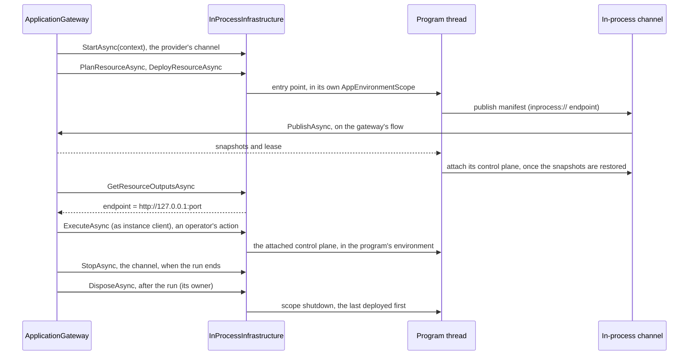

# Assimalign.Cohesion.ApplicationModel.Gateway.InProcess — Design

> **Status (2026-10-30):** this package is an infrastructure provider of the gateway in
> [ApplicationModel.Gateway](../../Assimalign.Cohesion.ApplicationModel.Gateway/docs/DESIGN.md).
> Since 2026-10-30 it is the gateway half of the in-process platform, whose instance half is
> [ApplicationModel.Hosting.InProcess](../../Assimalign.Cohesion.ApplicationModel.Hosting.InProcess/docs/DESIGN.md)
> (I12).
> Since 2026-11-01 the gateway can own it: `UseInProcess(configure)` builds the infrastructure
> with an `InProcessInfrastructureBuilder` through the gateway's `UsePlatform` (I14), and the
> gateway program's build binds every resource program it references (I15).

## Purpose

A gateway deploys its resources onto an infrastructure provider. This package's provider,
`InProcessInfrastructure`, deploys them into the gateway's own process. Each resource is a program
the gateway program references. Deploying it calls the program's entry point on a thread of its
own, and the program reads its environment from a scope of its own: where its gateway is, where it
listens, and its settings. Every program then publishes to its gateway like any instance. So one
`dotnet run` of the gateway program runs the whole application, with each resource's code exactly
as it runs on any other platform.

The package references ApplicationModel.Gateway, for the provider (which carries the channel) and instance-client seams;
ApplicationModel.Hosting, for the instance's control plane it calls; and the platform's instance
half, ApplicationModel.Hosting.InProcess, for the endpoints both halves meet at. It references no
resource area: the gateway program references the programs, and each program opts into the platform
with the instance half's `UseInProcess()`.

## How a deployment runs

The gateway deploys in dependency order. Each step below runs once per resource, and a resource
that depends on another starts only once that one is ready.



The gateway starts the infrastructure's channel, with its context, before it deploys anything (Gateway G39). It plans and
deploys the resource. The infrastructure starts the program, whose in-process client publishes its
manifest to the endpoint its environment names. The channel hands the publication to the gateway,
and the gateway reads the resource's outputs, so what depends on it can be planned with its
address. Once its restored state is in effect the program attaches its control plane at the same
endpoint, and the gateway's operator actions and restores reach it there directly (I12). Once the
gateway has stopped, the gateway program disposes the infrastructure, which stops the programs.

## Decisions

**I1 — In process is a platform, not a gateway (2026-10-29).** It is not a gateway of
its own, with its own plans, readiness gate, and supervision: the one gateway reconciles,
orders, waits, and records, whatever it deploys onto, and in-process is its `inprocess` platform:
`InProcessInfrastructure : IApplicationGatewayInfrastructureProvider`. A resource's extensions for `inprocess` apply
here, as any platform's do (Gateway G25).

**I2 — A program is bound by its entry point.** `AddProgram(provider, name, main)` binds a resource
to the delegate the gateway program calls, such as `Orders.Program.Main`. Nothing is discovered: no
assembly scanning, no reflection over entry points, no generated host-construction convention. The
entry point is called with no arguments, because everything a platform tells a workload arrives in
its environment (I4). *Rejected:* binding by assembly (`Assembly.EntryPoint`), which is reflection a
trimmed program keeps only with generated roots. Since 2026-11-01 the build generates the bindings
(I15), and `AddProgram` stays for a program the build does not bind.

**I3 — Each program runs on its own thread in its own environment.** A process gives every program
one set of environment variables and one set of shutdown signals, so programs that share one
process cannot read theirs from it. Each program runs on a new background thread that enters an
`AppEnvironmentScope` (Core) before it calls the entry point. Inside the scope,
`AppEnvironment.GetValue` reads the scope's variables, a runtime-contract variable the scope does
not set reads as unset, and a host's `RunAsync` stops on the scope's shutdown token, not on SIGTERM.
The thread starts without the gateway's execution context (`Thread.UnsafeStart`), so a program
inherits nothing ambient from the gateway. A background thread does not keep the process alive.
This is the "In-process: ambient context" delivery the runtime contract
([RUNTIME_CONTRACT.md](../../../../docs/RUNTIME_CONTRACT.md)) names for every variable, and the
"outer host signal" it names for stopping.

**I4 — What a program receives.** Its scope holds what a container's environment would:

| Variable | Value |
| --- | --- |
| `Application`, `Resource` | The name of the model the gateway runs, and the resource's name |
| `Gateway` | `inprocess`, the platform's name, which selects the program's in-process client (ApplicationModel.Hosting D19) |
| `ManifestEndpoint` | The infrastructure's in-process endpoint, `inprocess://<id>/`, where the program publishes and attaches its control plane |
| `Deployment` | The id of the deployment that started the program, which its manifest repeats (Gateway G34); an update starts the replacement with the new deployment's id |
| `Endpoint("http", HOST/PORT/SCHEME)` | `127.0.0.1`, a free port, `http`: where the program serves |
| `Environment` | The gateway program's own environment name, when it has one |
| `Configuration(key)` | Each setting, under its configuration key (`Orders:Url` → `…CONFIG__Orders__Url`) |

No control-plane address is given: the gateway calls the program directly (I12). The port is
chosen when a resource first deploys and kept for its lifetime in the infrastructure, so an update
listens where its predecessor did and its dependents' values do not move. A Web application binds the `http` endpoint when it configures no listener of its own
(Web.Hosting), and its configuration reads the settings through its environment-variable source.

**I5 — The transport is a channel (owner suggestion, 2026-10-29).** The owner kept one publisher
seam so each platform can bring its own transport, and suggested named pipes or channels for this
one. A program publishes through its in-process client to the in-process endpoint, which the
infrastructure registers its channel at (`InProcessPlatform.RegisterGateway`,
ApplicationModel.Hosting.InProcess). It drains the channel on the flow the gateway started it on:
since 2026-10-31 the infrastructure provider's own `StartAsync(context)` starts it on that flow, over
`context.Publisher`, and `StopAsync` stops it (Gateway G39; formerly an `IApplicationGatewayTransport`,
G33). Each request carries its
own completion, so the program waits with its own cancellation, and the gateway handles the request
outside the program's environment. *Rejected:*
- A direct call, the program publishing to the gateway object itself. The gateway's code would run
  inside the program's scope, and the program's cancellation would reach the gateway's record save.
- Named pipes. They would serialize every publication and hold operating-system handles, for no
  isolation that one process does not already lack. They fit a local provider that runs each
  resource as its own process.

**I6 — The channel receives only while a gateway runs.** A publication or renewal made before a
gateway starts the channel, or after it stops, is refused at once, as one to an HTTP endpoint that
nothing listens on is. A program's publication then fails its host's start; a refused renewal is
retried on the program's next tick. The request being handled when the gateway stops is cancelled,
and every request still queued is refused.

**I7 — Programs outlive their gateway.** A gateway that stops leaves its programs running, as a
platform's workloads outlive their gateway. A gateway that runs again over the same infrastructure
plans each running program `None` and adopts it: the program's next renewal finds its instance
unknown, so it publishes again and restores what the gateway answers with. Whoever created the
infrastructure owns it: the gateway program for `new InProcessInfrastructure()`, the gateway for
`UseInProcess(configure)` (I14). `DisposeAsync` stops every program, the last deployed first, so a program
stops before what it depends on.

**I8 — Plans compare what runs.** A resource whose program does not run, or ended, plans `Create`;
one that runs with the same settings plans `None`; one that runs with other settings plans `Update`,
which stops the running program and starts a new one on the same ports. The revision is constant:
the program is part of the gateway program's own build, so its versions are not told apart, and a
resource is a new definition only when its model changes.

**I9 — Stopping is the scope's shutdown.** Tearing a resource down, replacing it, or disposing the
infrastructure cancels the program's shutdown token; its host drains and its entry point returns.
`StopTimeout` (thirty seconds) bounds the wait. A program that does not stop in time is left on its
background thread, which ends with the process, because a thread cannot be ended from outside.

**I11 — A program that stops before it publishes is reported at once (2026-10-29).** The gateway
watches each deployment while it waits for its first instance (Gateway G36). The infrastructure's
watch waits for the deployment's program: it returns when the entry point returns, and throws the
exception the entry point threw. So a program that fails its composition fails the gateway's run
within moments, with its own exception as the run's inner exception, instead of a timeout after
the whole window. A deployment whose program no longer runs has ended.

**I10 — The endpoint output is the loopback address.** `GetResourceOutputsAsync` reports
`endpoint` = `http://127.0.0.1:<port>` for a running program, so a dependent's setting that uses
`orders.Endpoint` receives the address the program serves.

**I12 — The gateway calls a program's control plane directly (owner, 2026-10-30).** The platform
owns the transport in both directions (ApplicationModel C5), so this package is the gateway half of
a pair, and ApplicationModel.Hosting.InProcess is the instance half a program opts into. In the
other direction, from the gateway to the programs:
- **Attach.** A program's in-process client attaches its control plane to the channel once the
  state its publication answered with is restored, and detaches it when the program stops. Its
  manifest names the in-process endpoint as its control plane's address.
- **Call.** The infrastructure is the gateway's `IApplicationGatewayInstanceClient` (`UseInProcess` sets it
  with the infrastructure, which is also the channel). It finds the attached control plane by the manifest's
  instance key and calls it. The content crosses as bytes, rewrapped with the control plane's own
  serializer, as between processes.
- **Environment.** The program's client runs each call in the execution context it attached from, so
  an action runs in the program's environment, not the gateway's.
- **No answer.** A call for an instance that is not attached, because it has not finished starting or
  has stopped, throws, and the gateway drops the instance until it publishes again (Gateway G38).

*Superseded:* the same-day decision that the gateway reached each program's control plane over
loopback HTTP, with a control-plane port per program and the gateway's own HTTP client.
*Rejected:* the program's control plane found among its host's services, which the gateway cannot
reach without the program's host.

**I13 — The verb sets two things now (2026-10-31).** With the transport folded into the provider
(Gateway G39), `InProcessApplicationGatewayBuilderExtensions.UseInProcess(infrastructure)` (renamed
from `InProcessApplicationBuilderExtensions` with the builder) calls `UseInfrastructure` and
`UseInstanceClient` only. `InProcessInfrastructure` implements
`IApplicationGatewayInfrastructureProvider`, with the channel's start and stop, and
`IApplicationGatewayInstanceClient`. The rendezvous through `InProcessPlatform` and
`IInProcessGateway`, and this package's references to Hosting and Hosting.InProcess, are unchanged;
reworking them is a later chunk.

**I14 — The gateway can own the infrastructure (2026-11-01).** `UseInProcess(Action<InProcessInfrastructureBuilder>? configure = null)`
registers the platform through the gateway's `UsePlatform` (Gateway G42): the gateway's `Build()`
creates an `InProcessInfrastructureBuilder`, applies `configure`, builds the infrastructure, and owns
it, so disposing the gateway stops the gateway's run and then the programs. The builder carries
`Options` (`InProcessInfrastructureOptions`, with `StopTimeout`) and `AddProgram`, and each `Build()`
makes new infrastructure at a new endpoint. `UseInProcess(infrastructure)` and
`new InProcessInfrastructure()` stay for a caller that owns the infrastructure itself; the gateway
borrows that one and never disposes it.

```csharp
ApplicationGatewayBuilder builder = ApplicationGateway.CreateBuilder("shop").UseInProcess(inProcess =>
{
    inProcess.Options.StopTimeout = TimeSpan.FromSeconds(10);
    inProcess.AddProgram("Web", "legacy-api", Legacy.Program.MainAsync);
});
```

**I15 — The build binds the programs (2026-11-01).** A top-level program compiles to an internal
`Program` with a private `<Main>$` that the gateway program cannot name, so a binding needs the
program's own build. The Cohesion source generator does both halves (its
[DESIGN.md](../../../../analyzers/Assimalign.Cohesion.SourceGeneration/docs/DESIGN.md), "In-process
program bindings"):
- **Resource.** An executable that references ApplicationModel.Hosting.InProcess, and not the
  gateway, gets a public `InProcessEntryPoint.RunAsync(string[])` that calls its entry point, and
  `[assembly: InProcessProgram(typeof(InProcessEntryPoint), "<provider>")]`.
- **Gateway.** Sdk.Gateway turns each project reference that carries `CohesionResource="<name>"`
  (and optionally `CohesionProvider`) into compiler-visible metadata. In a gateway that references
  this package, the generator emits a module initializer that calls
  `InProcessProgramCatalog.Register(provider, name, bridge.RunAsync)` for each one.

`InProcessInfrastructureBuilder.Build()` binds every catalog program the builder did not bind with
`AddProgram`, so an explicit binding wins and a bare `UseInProcess()` runs every referenced
resource. `new InProcessInfrastructure()` binds nothing from the catalog: a caller that creates the
infrastructure itself binds what it runs. The catalog is process-wide, public only for the generated
code (`[EditorBrowsable(Never)]`), and refuses a second program for one resource. Resource names
still come from the resource's `AddResource(name)` and the gateway's model; the reference's
`CohesionResource` must name the same resource, and a mismatch shows as a resource that never
publishes. *Rejected:* `Assembly.EntryPoint` with trimming roots (I2), and a discovery scan of the
referenced assemblies at run time, which is reflection.

## Non-goals

- Isolation comparable to separate processes. A program that crashes the process, exhausts memory,
  or changes process-wide state affects every program in it.
- Rolling updates. An update stops one program and starts another.

## AOT

No reflection, runtime code generation, or assembly loading. Programs are delegates the gateway
program or its generated module initializer binds (I15), and a top-level program is reached through
an `UnsafeAccessor` its own build generates; the channel is `System.Threading.Channels`; ports come from a loopback
`TcpListener`.

## Diagnostics

None. The package raises no events and has no event source.

## Open questions

1. **A program that ends before it publishes — settled by I11.** The gateway hears it at once, with
   the program's exception.
2. **Generated bindings — settled by I15.** The resource's build emits a public bridge to its entry
   point, and the gateway's build registers it in `InProcessProgramCatalog`.
3. **Process-wide state in programs.** Each Web application that `CreateBuilder(args)` builds
   registers its default event-source forwarding, which listens process-wide, so two in-process Web
   programs each forward the other's events. Console output is not attributed per program.
4. **The gateway program's signals — settled by Gateway G37.** `ApplicationGateway.RunAsync` stops on
   SIGINT, SIGQUIT and SIGTERM, so a gateway program that `await using`s its infrastructure ahead of
   the gateway stops its programs once the run returns.
5. **Supervision.** This package restarts nothing.
   Restarting a program belongs with health and liveness, which the model has not settled.
