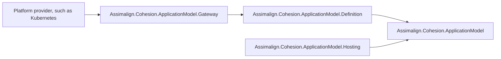
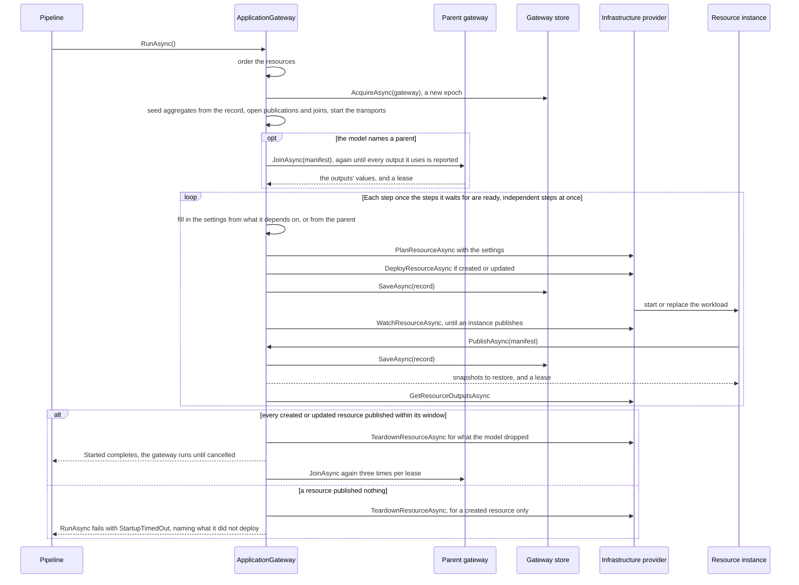
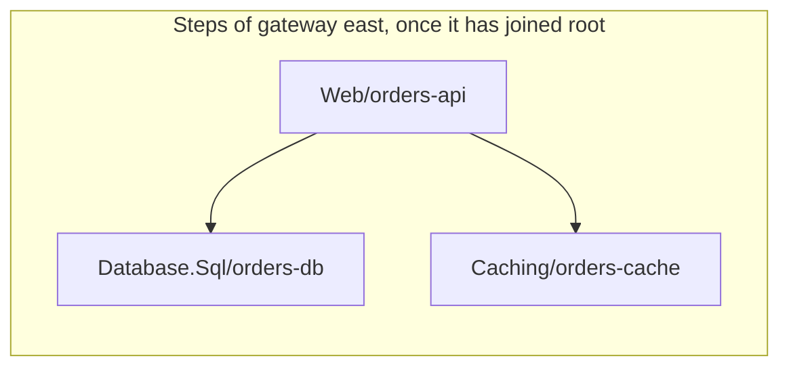

# Assimalign.Cohesion.ApplicationModel.Gateway — Design

> **Status (2026-10-27):** chunk 3 of the Application Model rebuild, built on
> [ApplicationModel.Definition](../../Assimalign.Cohesion.ApplicationModel.Definition/docs/DESIGN.md)
> (chunk 2) and the shared contracts of
> [ApplicationModel](../../Assimalign.Cohesion.ApplicationModel/docs/DESIGN.md). The instance side,
> [ApplicationModel.Hosting](../../Assimalign.Cohesion.ApplicationModel.Hosting/docs/DESIGN.md)
> (chunk 1, formerly Hosting.Resources), is not a dependency. Since 2026-10-29 (G26, G27) each
> gateway runs a model of its own and a child joins its parent; the deployment view and the gateway
> seam moved here from ApplicationModel.Definition. The previous implementation (Local gateway,
> records, credentials, certificates) is retired; its source is at commit `6576e7c64`.

## Purpose

A gateway runs one gateway's application model. It deploys the model's resources through an
infrastructure provider, receives the manifests the deployed resources' instances publish, keeps
each resource's deployment (its instances and the state written since the gateway was deployed),
and exposes each resource's infrastructure actions. A child gateway joins its parent and fills its
settings in from the parent's outputs; the parent knows nothing of a child before it joins. The
library is transport-neutral and platform-neutral: a transport binds its endpoints, and an
infrastructure provider supplies the platform.

The arrow below means "references". A platform package, such as a Kubernetes provider, references
the gateway; the gateway references the definitions, which reference the shared contracts. The
instance side references only the contracts, so a gateway and an instance speak through the same
manifest and action types without either loading the other's code.

## Startup: reconcile, then run

`RunAsync` orders the gateway's resources (G17), takes its record over from its
`IApplicationGatewayStore` with a new epoch, which fences off any earlier run still going (G35),
creates one aggregate per resource as the previous run left it (G23),
and opens publications and joins, starting the transports its instances publish through (G33). A
gateway whose model names a parent then joins it, and waits
within the startup window until the parent reports every output of its resources that the
gateway's settings use (G26). It then deploys in dependency order: each resource is a step that runs
once the steps it waits for are ready, and independent steps run at the same time. A resource's step
fills in its settings from the outputs of what it depends on or from the parent's answer, plans it
with the infrastructure provider, keeps what the plan leaves in place (G12), deploys it only when the
plan creates or updates it, waits for an instance of that deployment to publish within the startup
window, and reads its outputs (G18). After startup it tears down what the record holds but the model
no longer declares, renews its membership with its parent, and runs until cancelled. A gateway
restarted with the same model and the same outputs plans no change, so it deploys nothing and waits
for no publication: it adopts what runs.

## Deployment order

A gateway's steps are its own resources. A step waits for the steps of the resources it depends
on. Nothing waits on another gateway's steps: a child waits for its parent's outputs before it
deploys anything (G26), and a parent never waits for a child. In gateway east below, `orders-api`
waits for `orders-db` and `orders-cache`. An arrow means "waits for".

East therefore deploys `orders-db` and `orders-cache` at the same time, then `orders-api` once both
are ready.

## The types

| Type | Role |
| --- | --- |
| `ApplicationGateway` | The orchestrator. Implements `IApplicationGateway` (`Model`, `RunAsync`), `IApplicationInstancePublisher` (`PublishAsync`, the publication endpoint's logic), and `IApplicationParentGateway` (`JoinAsync`, a child's join). `RecordAsync` records a write's snapshot and saves the record. Exposes `Name`, `Resources` (the aggregates), `Children`, `StartupTimeout`, `LeaseDuration`, and `Started`. `CreateBuilder(name)` creates its builder. |
| `ApplicationBuilder`, `IApplicationGatewayBuilder` | The builder a gateway program uses: `IApplicationModelBuilder` and `IApplicationGatewayBuilder` side by side (G27). The gateway half sets the infrastructure (`UseInfrastructure`), the record store (`UseStore`), the parent (`UseParent`), and `StartupTimeout` and `LeaseDuration`; `Build()` builds the model and the gateway that runs it. |
| `IApplicationParentGateway`, `ApplicationGatewayMembership` | A gateway as its children see it. `JoinAsync(manifest)` registers or renews a child and answers with the values of the outputs its settings use, and a lease (G26). |
| `IInfrastructureProvider` | The platform, named by `Platform`: plans a resource with its settings' values (`PlanResourceAsync`), deploys it with those values and the deployment's id its instances must repeat (G34), watches the deployment's workload until an instance publishes and reports one that stops first (`WatchResourceAsync`, G36), reports a deployed resource's outputs (`GetResourceOutputsAsync`), tears resources down, and supplies each resource's infrastructure actions. Every method sees a resource with only its platform's extensions. |
| `InfrastructurePlan`, `InfrastructureChange` | What deploying a resource would change (`None`, `Create`, `Update`) and the revision the provider would run, which leaves the settings' values out. |
| `IApplicationResourceDeployment`, `ApplicationResourceDeployment`, `IApplicationResourceAction` | The gateway's deployment of one resource: `Register` an instance's published manifest, `Record` a stateful write's snapshot, `Unregister` a stopped instance, and `ExecuteAsync` one of its infrastructure `Actions`, such as `scale`. The gateway also sets its `Outputs` and clears its state when a run redefines it (G28–G32). |
| `IApplicationGatewayStore`, `ApplicationGatewayRecord`, `ApplicationResourceRecord` | The gateway's persisted record: per resource, the revision deployed, the state recorded, the instances registered, and the outputs read, plus the epoch of the run that holds it. `AcquireAsync` takes the record over with a higher epoch, `SaveAsync` refuses a save from an earlier one, and `LoadAsync` reads without taking anything over (G35). Children are not recorded. |
| `JsonFileApplicationGatewayStore` | One indented JSON file per gateway, replaced atomically on each save; snapshot values as base64. Every read and write holds an exclusive lock on the gateway's lock file, so taking over and saving are atomic across processes. The local default; a platform package backs the store with durable storage of its own. |
| `ApplicationGatewayException`, `ApplicationGatewayErrorCode` | Refused publications (`PublicationsClosed`, `ResourceUnknown`, `ResourceTornDown`), a failed startup (`StartupTimedOut`, also for a parent that never accepted the join; `ResourceFailed` for a workload that stopped before an instance published, with its failure as the inner exception; `OutputMissing` for a setting whose output the provider or the parent did not report), and a run a later one superseded (`RecordSuperseded`). |

In ApplicationModel.Definition: `IApplicationModel.Role` and `ApplicationGatewayRole` say whether a
gateway joins a parent, and `IApplicationParent` names the parent's outputs a model's settings use.

## Decisions

**G1 — The platform is a provider, not a subclass.** The brief names the infrastructure provider as
one of the three layers an application brings together, so the gateway composes an
`IInfrastructureProvider` instead of each platform deriving its own gateway. Orchestration
(aggregates, the startup window, publications) then exists once, and a provider can be tested
without a gateway. The retired design had a platform-specific gateway per platform.

**G2 — The publication endpoint is transport-neutral.** `PublishAsync` is the endpoint's logic: route
the manifest to its resource's aggregate and answer with the snapshots to restore. A transport only
adapts it, and an in-process resource publishes to the gateway object directly, because the gateway
is an `IApplicationInstancePublisher`. Each refusal has an error code a transport can map without
parsing text: `PublicationsClosed` to 503, `ResourceUnknown` to 404, `ResourceTornDown` to 410.

**G3 — What and where travel together, and "what" is the whole hierarchy — superseded by G26.** A
child no longer receives a deployment manifest from its parent: its own pipeline deploys it with its
own model, and its provider's configuration says where it runs.

**G4 — One startup window per resource, decided atomically.** A created or updated resource's
window opens when its deployment starts and lasts `StartupTimeout`, so a resource deep in a
dependency chain is not charged for the time its dependencies took (G18). A resource's first
registration and the window's close race on one atomic transition, so a resource is either
registered or torn down, never both: a registration that loses is undone and refused with
`ResourceTornDown`. A missed resource is torn down and the run fails, so the deployment fails where
its pipeline sees it; resources that published keep running. *Superseded:* one window that opened
when every deployment call had returned and covered every resource.

**G5 — Publications open before deployment.** The aggregates exist before the provider starts
anything, so a fast instance cannot publish before its aggregate exists. An instance that publishes
before its resource is planned, such as a restarted instance of the previous definition while the
resource waits for its dependencies, is registered with the state the previous run recorded (G23)
but does not make the resource ready (G18).

**G6 — Cancellation is not teardown.** Cancelling `RunAsync` stops the gateway, during startup or
after, and leaves what it deployed running. Teardown happens only to a resource that missed its
startup window.

**G7 — Root and composite deploy the same way.** A gateway's role comes from its model: a composite
names a parent, a root names none. Both deploy only their own resources; a composite joins its
parent first (G26). What only a root does, such as serving the tenant's management entry or hosting
the identity provider, arrives with those chunks.

**G8 — Infrastructure actions belong to the provider and keep no state.** The provider supplies each
resource's actions when the gateway starts, such as `scale`. They act on the platform, which keeps
what they set until the next deployment replaces it, so the gateway records nothing for them.
Dispatch uses the controls' statuses: `NotFound`, `NotSupported`, and `Rejected` when the input does
not bind.

**G10 — Reconcile, don't redeploy (owner request, 2026-10-28).** The provider plans each resource
before it deploys it, from what the platform runs: `None`, `Create`, or `Update`, and the revision it
would run. A resource is planned at its step, once its settings' values are known (G22). The gateway
deploys only what changes. A plan of `None` is adopted: the resource starts registered,
outside the startup window, so a gateway restarted with the same model deploys nothing and tears
nothing down. This replaces the restart behaviour open question 2 described, where a restarted
gateway saw no registrations and tore everything down. A plan step separate from the deployment
keeps the decision out of the publication path: in-process providers start instances inside
`DeployResourceAsync`, and those instances publish before it returns. *Rejected:* one idempotent
deploy call that reports what it changed. The gateway would learn of an update only after the new
instances had published with the old state.

**G11 — The record lives behind a store (owner request, 2026-10-28).** `IApplicationGatewayStore` takes the
record over once per run (G35) and saves the whole record after every change: deployment,
registration, recorded write, teardown. Saves never overlap. `JsonFileApplicationGatewayStore` is the
local default. A platform package backs the store with the Database resource, and no gateway uses
the Database resource directly (owner, 2026-10-29): the gateway sees only this contract.
Snapshot values are stored as base64, because the platform's content serializer may not be JSON.

**G12 — State follows the definition.** A resource's revision is a fingerprint of its manifest
(provider, name, dependencies, settings as declared, and this platform's extensions, G25) followed
by the provider's revision (image, the provider's own configuration). The recorded state survives
while the revision does. A new revision is a new
deployment of that resource and starts without the previous state; a workload that disappeared and
is created again keeps it. Registered instances survive only while the plan is `None`, because a
created or updated workload replaces them; an instance that renewed or published during the run
still runs and stays (G23). This refines "state lasts until the next deployment" to each resource: a
deployment that does not change a resource leaves its operator changes in place, which keeps every
running instance consistent with the record. A setting's value filled in from a dependency's output
is not part of the definition (G22), so a dependency that moved updates the resource but keeps its
operator changes; a value changed in the model is part of it.

**G13 — A missed update is not torn down.** A new resource that misses the startup window is torn
down (G4). An updated one is not: its previous instances are the platform's to keep or replace, as
a rolling update does. Its later publications are refused, and the run fails with
`StartupTimedOut`.

**G14 — Retire after startup.** Resources the record holds but the model no longer declares are
torn down only after the deployment has started. A failed deployment therefore
leaves the previous one running. They stay in the record until their teardown succeeds, so a failed
run retries them.

**G15 — Instances hold leases (owner decision, 2026-10-28).** A publication's answer carries a
lease of `LeaseDuration`, 30 seconds by default, and `RenewAsync` renews it. The gateway keeps
renewal times in memory, not in the record, and unregisters an instance whose lease lapses, then
saves the record. After startup every registered instance, the adopted ones included, gets one full
lease, so an instance that died while the gateway was down leaves within one lease. A renewal from
an instance the gateway does not know, such as after a restart without a record, answers `false`,
and the instance publishes again. Registration, renewal and expiry take one lock per resource, so
an instance that publishes again while its lease expires is kept or dropped as a whole.

**G16 — Outputs are read per resource, before what depends on it (owner request, 2026-10-28).** As
soon as a resource is ready (G18), the gateway asks the provider for its outputs
(`GetResourceOutputsAsync`), records them on its aggregate, and saves the record when any changed;
only then are the steps that wait for the resource planned and deployed, with those values in their
settings (G22). An adopted resource starts with the
outputs recorded for the workload that still runs, then takes the platform's current values, so an
address the platform changed while the gateway was down is picked up. `TryGetOutput` resolves a
placeholder for a resource this gateway runs. A placeholder for another gateway's resource does not
resolve here yet: it needs gateway-to-gateway publication. *Superseded:* one read of every
resource's outputs after the whole startup.

**G17 — Deploy in dependency order, independent steps at once (owner request, 2026-10-28).** A
dependency orders deployment (ApplicationModel.Definition D4), so the gateway deploys each resource
once everything it waits for is ready, and starts the steps that do not wait for each other
at the same time, as ARM does with `dependsOn`. A chain therefore takes the sum of its steps, and
independent resources the longest of theirs. The provider may consequently be called concurrently
for different resources, never for the same one. `Resources` lists the aggregates in that order.
*Rejected:* deploying one step at a time in a topological order. It is simpler and deterministic,
but ten independent resources that take thirty seconds each would start in five minutes instead of
thirty seconds. *Superseded:* child gateways first, then resources, each in declaration order
(open question 8).

**G18 — Ready means an instance of the deployment published and the outputs are read.** A created
or updated resource is ready once an instance has published after its deployment started, and the
gateway has read its outputs (G16). An adopted resource is ready once its outputs are read. A first
publication is the whole gate for now:
health checks and "every instance" readiness need the gateway-to-instance channel. The plan marks
the resource current before the gateway calls the provider to deploy it, because an in-process
provider's instances publish before the call returns; an instance that published earlier runs the
previous definition and is registered without opening the gate. Since G34 the instance must also
repeat the deployment's id: one an earlier deployment started, such as a pod of the previous
rollout that restarts, is registered without opening the gate.

**G19 — A child gateway is one step — superseded by G26.** A parent no longer deploys its
children, so they are not steps of its deployment. A child waits for its parent's resources itself,
before it deploys anything, which lifts the limit this decision recorded: a child that both waited
for and was waited for by its parent's steps could not be ordered.

**G20 — A step that fails stops only what depends on it.** When a resource misses its window, the
steps that wait for it, directly or through others, are skipped: they are not deployed, and a
skipped child gateway keeps running its previous manifest. Steps that do not depend on it carry on.
Once every step has ended, the run fails with `StartupTimedOut`, naming the missed resources and
the skipped steps, so one run reports everything a broken deployment left undone, as ARM and
Terraform do. A failure of another kind, such as a provider exception, cancels the remaining steps
and is what `RunAsync` throws. *Rejected:* stopping every step at the first miss. Steps already
waiting for their windows would be abandoned, and the next run would report them one failure at a
time.

**G21 — A resource's record changes only when the run plans it.** Until a resource's step plans it,
every save writes its previous entry unchanged, or nothing for a new resource. A run that fails or
stops before reaching a resource therefore leaves its revision, state, instances, and outputs as
they were. A later run that rolls the model back finds the resource's operator changes, because the
platform never replaced the workload. Without this, the first save of a run would record the new
definition's empty state for resources still waiting for their dependencies. A write recorded on an
instance before its resource is planned is held in memory and saved once the plan keeps it.

**G22 — Settings are filled in at the step, from this gateway's outputs and its parent's (owner
request, 2026-10-29).** A resource's settings (ApplicationModel.Definition D17) are configuration
values its instances receive with their deployment. At the resource's step, everything it depends
on is ready and its outputs are read (G16), so the gateway fills in each output-valued setting from
the aggregate of the resource it names, or, for one of the parent's resources, from the values the
parent answered the join with (G26). It then plans the resource with the values
(`PlanResourceAsync`), because the platform needs an update when it runs other values, and deploys
with the same values (`DeployResourceAsync`); the provider delivers them, for example as
environment variables. The
values are not part of the resource's definition: the gateway fingerprints the settings as declared,
and the provider's revision leaves the values out. A redeployed dependency with a new address
therefore updates its dependents, which keep their operator changes (G12). A setting whose output the
provider did not report fails the run with `OutputMissing`, naming the setting and the output, as a
provider failure does (G20). A gateway learns its own resources' outputs and its parent's from the
join, so its model refuses a setting that uses any other gateway's output (ApplicationModel.Definition
D21). *Superseded:*
planning every resource before the first step (open question 9), which planned a dependent before
the values it would deploy with existed. *Rejected:* recording the values in the gateway's record
and upgrading a `None` plan to `Update` when they changed. The provider could then plan before the
values exist, but it could not tell that the platform drifted from them.

**G23 — Until its step plans it, a resource runs as the previous run left it.** The gateway creates
every aggregate before the first step, so publications are accepted from the start (G5), but a
resource's plan waits for its dependencies. Until then its aggregate holds the recorded state and
outputs, and the recorded instances are carried with fresh leases, so an instance that renews or
restarts while the resource waits keeps its registration or restores the operator's changes. The
plan then keeps what still applies: a plan of `None` for the same definition keeps everything; any
other plan drops the outputs and the carried instances that have not renewed or published since,
because the platform replaces the workload; a new definition also clears the state. An instance that
proved it runs stays registered through an update, so it does not have to publish again, and it does
not open the startup gate either. *Rejected:* refusing publications until the resource is planned. An
instance restarted while a long chain deploys would fail its start until the gateway reached it.

**G24 — Outputs from above travel down in deployment manifests — superseded by G26.** A parent no
longer deploys its children, so it writes no deployment manifest and `DeployGatewayAsync` is gone; a
child reads the values when it joins. This decision had rejected the child reading its parent's
outputs at run time because it tied the child's start to the parent being reachable. G26 accepts
that: a child that names a parent needs the parent running to start, and in return deploys on its
own.

**G25 — A provider sees only its own platform's extensions (owner direction, 2026-10-28; built
2026-10-29).** `IInfrastructureProvider.Platform` names the platform a provider deploys onto, and
`Create` refuses a provider that names none. A resource's platform extensions (ApplicationModel D19)
apply only on their platform, so the gateway passes every provider method the resource as declared
for that platform: the model's manifest without any other platform's extensions. The Kubernetes
autoscaler a resource carries therefore reaches a Kubernetes provider and never the in-process one,
and the provider reads its own with its own JSON contract. The same view is the resource's definition
(G12): the gateway fingerprints it, extensions included, and the provider's revision leaves them
out. An extension for another platform therefore changes nothing here, while a change to one for this
platform is a new definition, like a change to the provider's own configuration, and the provider
plans an update for it. The gateway's aggregate keeps the manifest as declared, every platform's
extensions included, for what reads the model. An extension name the platform does not know is the
provider's to refuse when it plans. *Rejected:* passing every extension and leaving each provider to
filter by name. The filter would be correct only in the providers that remember it, and the
definition would change when another platform's extension did.

**G26 — Children join their parent (owner decision, 2026-10-29).** Each gateway runs a model of
its own and is deployed by its own pipeline. A child's model names its parent
(ApplicationModel.Definition D21), and its builder connects to the parent (`UseParent`). The parent
is an `IApplicationParentGateway`:
- **Join.** Once its aggregates exist, a child calls `JoinAsync` with its manifest. The parent
  validates it, refuses one that names another parent, records the child under its name with a
  lease, and answers with the value of every output of its own resources that the child's settings
  use, as far as it has recorded them.
- **Wait.** The child joins again while the parent is not running or an output is missing, until its
  startup window closes. A parent that never accepted the join fails the run with
  `StartupTimedOut`; a missing output fails it with `OutputMissing`, naming the setting. Nothing
  deploys before the join succeeds, so the child waits for the parent's resources the way a
  resource waits for a dependency.
- **Renew.** After startup the child joins again three times per lease: joining is how it renews. An
  unreachable or stopped parent is retried on the next tick, and the child keeps running.
- **Expire.** The parent drops a child whose lease lapses, in the loop that expires instances.
  Children are not recorded: one still running joins a restarted parent again.
- **Change.** A value a child read applies until the child's next run, which replans what uses it
  (G22).

A parent knows nothing of a child before it joins, so a parent's resource cannot depend on a
child's, and the order across gateways is the child waiting for its parent, never the reverse. This
replaces G3, G19, and G24, and their refusals of parts that could not be ordered or configured.
*Rejected:* the parent deploying its children (G19, G24). A child could not be deployed on its own,
and the parent needed every child's infrastructure and credentials. *Open:* a child applying a
changed value while it runs (question 13), and the transport for joins (G9).

**G27 — A gateway is built with its model (owner decision, 2026-10-29).** `ApplicationBuilder`
implements ApplicationModel.Definition's `IApplicationModelBuilder` and this library's
`IApplicationGatewayBuilder` side by side: one object declares the model and configures the gateway,
the way an area's application builder implements its area's builder beside the host's.
- Its model half is a builder of `ApplicationModel.CreateBuilder`, so a model follows one set of
  rules however it is built. A resource definition's `Set` is therefore that wrapped builder, not
  this object.
- `Build()` builds the model, unless the model builder already did, and the gateway, which holds the
  model for its one run. `RunAsync` takes no model, so a host can run the gateway without arguments.
- A parent named only through the model builder has no connection to join it by, so `Build()`
  refuses the model.
- `ApplicationGateway.Create` is gone: the builder is the one way to make a gateway.

*Rejected:* keeping `RunAsync(model)`, which left a gateway without a model until it ran.

**G28 — `Register` and `Record` are atomic with respect to each other (formerly
ApplicationModel.Definition D5).** Each runs under one lock and returns its answer from the state
that lock protects. An instance that registers before a write is recorded is in the write's restore
list; one that registers after it gets the snapshot in its registration answer. Every instance
therefore receives every recorded snapshot exactly once. The alternative, a gateway that lists the
instances and then records, lets an instance that registers in between miss the write.

**G29 — Version skew is filtered, not refused (formerly ApplicationModel.Definition D6).** An
instance receives only snapshots for actions its own manifest declares stateful, and `Record`
accepts a snapshot only from an instance that declares the action stateful. During a rollout, an
instance of another version neither receives nor reports state it does not understand.

**G30 — Durability belongs to the gateway (formerly ApplicationModel.Definition D7).** The aggregate
keeps its state in memory for the life of one deployment. A gateway that restarts within the same
deployment seeds a new aggregate through `ApplicationResourceDeployment.Create(manifest, state)`. A
gateway should persist a recorded snapshot before it acknowledges the write, or a restart can lose a
write that running instances already apply. A gateway seeds the aggregate before it knows whether
the run redefines the resource, and calls `ClearState()` when it does; instances already registered
keep what they restored.

**G31 — Reads take no lock (formerly ApplicationModel.Definition D8).** `Instances` and `State`
return read-only copies that each change replaces, so a management read never waits on a
registration, and a debugger never deadlocks on a held lock.

**G32 — Infrastructure actions sit on the aggregate (formerly ApplicationModel.Definition D15).** A
gateway's provider supplies each resource's infrastructure actions to
`ApplicationResourceDeployment.Create`, and `ExecuteAsync` dispatches them with the statuses a
control plane uses (`NotFound`, `NotSupported`, `Rejected` for input that does not bind). Until
2026-10-29 the contract lived in ApplicationModel.Definition, so a transport could expose the
actions without referencing a gateway package; it moved here once the definitions held only
definitions.

**G33 — Transports carry publications to the gateway (2026-10-29).** A gateway takes each
publication and renewal through `IApplicationInstancePublisher`, which it implements. How they
reach it from where the instances run is a transport's job: `IApplicationGatewayTransport`, added
with `ApplicationBuilder.UseTransport`, any number per gateway. `RunAsync` starts each one once it
has loaded the record and created the resources, before it joins its parent or deploys, so an
instance the previous run left can publish again. It stops them, last first, when the run ends. A
transport that cannot start fails the run before anything is joined or deployed. A transport that
fails to stop fails the run, unless the run failed already: its own failure is the one reported.
The first transport is in process: Gateway.InProcess's infrastructure is also the channel its
programs publish through. An HTTP manifest endpoint will be another (G9). *Rejected:* passing the
gateway to the provider on each call (`DeployResourceAsync(gateway, …)`). It would tie how
instances reach the gateway to the platform that starts them, which differs on every platform but
in-process.

**G34 — A deployment has an id its instances repeat (2026-10-29).** Readiness counted any
publication after the plan (G18), and an instance manifest did not say which deployment started it.
On a platform that rolls updates out, a pod of the previous rollout that restarted, or whose lease
lapsed, published again and opened the gate: dependents deployed against a resource that had not
updated, and the run reported success. In process it could not happen, because an update stops
the old program first (Gateway.InProcess I8).
- **Derived.** For each `Create` or `Update` the gateway derives a `DeploymentId`: a version 5 UUID,
  in a namespace of its own, of the resource's revision and its settings' values in the manifest's
  order, each value prefixed with its length. The same inputs give the same id. A plan of `None`
  makes no deployment.
- **Delivered.** `DeployResourceAsync` takes the id, and the provider hands it to every instance the
  deployment starts as the runtime contract's deployment variable, kept with the instance for its
  life: on Kubernetes a literal value in the pod template, never a ConfigMap reference.
- **Repeated.** The instance repeats it in its manifest (`ApplicationInstanceManifest.Deployment`).
  A publication opens the gate only when it repeats the plan's id; any other is registered without
  opening it, like an early one (G23).

*Rejected:*
- The revision alone as the id. It leaves the settings' values out (G22), so after an update that a
  moved dependency caused, old and new instances would report the same id.
- A random id per deployment. The gate would work the same, but the same inputs would no longer
  give the same id, which a later check of adopted instances against the plan needs.

**G35 — Each run takes its record over, and the newest run wins (2026-10-29).** Any platform
eventually runs two gateways of one name at once: the old and the new gateway of a rolling update,
or a pipeline run again while the previous one still runs. The store loaded and saved whole records
with nothing to tell the runs apart, so every save overwrote the other run's. If the older run saved
last, the next run read its revisions as a new definition and dropped the operator's state.
- **Take over.** `RunAsync` starts with `AcquireAsync`, which stores and returns the record with an
  epoch higher than any run took before (`ApplicationGatewayRecord.Epoch`), in one atomic step.
- **Fence.** Every save carries the run's epoch, and `SaveAsync` refuses one lower than the stored
  epoch, again in one atomic step, answering `false` instead of writing.
- **Stop.** A gateway whose save is refused closes publications and joins, and its run fails with
  `RecordSuperseded`, whatever the save was for: a registration, a recorded write, an expiry, or a
  step of its own startup. Instances then publish to the run that holds the record.

The JSON file store holds an exclusive lock on the gateway's lock file for every read and write,
which the operating system releases when a process ends, so a crashed gateway never leaves it held.
That also settles the old Windows failure (former open question 14): a read through the store never
meets the file being replaced. A store over a database uses the database's compare-and-swap.
*Rejected:*
- A lock the running gateway holds for its whole run. A rolling update starts the new gateway before
  it stops the old one, so the new one would wait for a lock the old one gives up only once the new
  one is ready; a crashed holder would need a lease to expire first.
- Optimistic concurrency on the record's version. It lets the first writer win, so the old gateway's
  next save would stop the new one, the wrong run.

**G36 — A workload that stops before it publishes fails its step at once (2026-10-29).** The gateway
learned only from publications that a deployment had started, so a workload that crashed on start
(a port in use, a missing setting) cost the whole startup window. The run then failed with
`StartupTimedOut`, naming the resource but never the cause. In process, the program's exception
was swallowed when the program stopped.
- **Watch.** Right after `DeployResourceAsync`, the gateway calls `WatchResourceAsync` and waits for
  whichever comes first: an instance of the deployment publishing, the watch ending, or the window
  closing. The watch returns when the workload ended, throws the platform's failure when it failed,
  and is cancelled once the gateway stops waiting. A provider that cannot observe its workloads waits
  for the cancellation, and the window decides, as before.
- **Fail at once.** A watch that ends first closes the window at once. An instance that registered
  meanwhile still counts, because closing the window and registering race on the same atomic
  transition (G4). The resource is then treated as one that missed its window: a new one is torn
  down, an update keeps whatever the platform runs, and what depends on it is skipped (G20).
- **Report the cause.** When workloads stopped, the run fails with `ResourceFailed`. The message
  names each one with its failure's type and message, or "ended", then anything that missed its
  window and what did not deploy. The failure itself is the inner exception, an
  `AggregateException` when there are several.

Only stopping before the first publication counts: an instance that fails after it published is
supervision's, which waits for health and liveness. *Rejected:* `DeployResourceAsync` returning a
handle with a failure task. The gateway would have to dispose each handle, and the provider would
keep watching a workload nobody waits for; a cancelled watch ends with the wait.

**G37 — A gateway program stops on its signals and reports its steps (2026-10-29).** A gateway
program is an entry point like any resource, but its run registered no shutdown signal: Ctrl+C or a
platform's SIGTERM ended the process mid-save unless the program wired up its own cancellation. And
the run said nothing until it ended, so a deployment could be followed only through its final
exception.
- **Signals.** `RunAsync` registers Core's `AppEnvironment.RegisterShutdown` for the run's duration,
  the registration every host's `RunAsync` uses too (Hosting's now delegates to it). SIGINT, SIGQUIT
  and SIGTERM stop the run as cancelling its token does: it drains, returns, and leaves what it
  deployed running. Inside an in-process program's `AppEnvironmentScope`, the scope's shutdown
  stands in for the signals, as it does for any host.
- **Events.** An internal event source reports each transition (Diagnostics, below).

The gateway program still owns its infrastructure: `await using` it ahead of the gateway, so it is
disposed once the run has returned, and an in-process infrastructure stops its programs last-first.
*Rejected:* making `ApplicationGateway` a `Host<TContext>`. A host reports a failed start through
its own wrapping, has no way to fail a run that already started (`RecordSuperseded` does), and would
reshape every error the gateway reports, for the signals and lifecycle reporting this decision adds
directly.

**G9 — No HTTP here, yet; it will be a transport over Web (owner direction, 2026-10-29).** COHLIB001
bars a library from referencing Web, and COHRES003 bars Web (any resource package) from referencing
a `Gateway*` assembly, so neither side can bind the other today. The options were: serve HTTP from
this library tier with `Http.Connections`, as the retired gateway did; move the endpoint contracts
into ApplicationModel and bind them in `Web.ApplicationModel`; or relax one of the guards. The owner
chose the third: the HTTP transport reuses the Web area as a private reference, so its endpoints run
on Web.Server's engine, as an instance's control plane already does (Web.Hosting.ApplicationModel
W1), and no Web type reaches the gateway's public API. It ships as a transport (G33) in a package of
its own, so a gateway that runs only in process does not carry Web. The retired
`Gateway.ControlPlane`, which served HTTP on `Http.Connections` with its own router, was removed on
2026-10-29: everything it served (the export document, application sets, declarative commands,
trusted-issuer grants) was retired with the old model. Joins have no transport either: a child joins
a parent in the same process directly (G26).

## AOT

No reflection or runtime code generation. The record file is read and written through
source-generated JSON contexts.

## Diagnostics

The library reports through one internal event source, `Assimalign.Cohesion.ApplicationModel.Gateway`
(G37): one event per transition of a run and of each resource's step, so a deployment can be
followed as it happens. Tools enable it by name; a gateway program forwards it into its logging with
`Assimalign.Cohesion.Logging.EventSource`. Every event's first payload is the gateway's name, and a
resource is `{provider}/{name}`. It has no counters.

| Id | Event | Level | Payload |
| --- | --- | --- | --- |
| 1 | `RunStarting` | Informational | `gateway`, `epoch` |
| 2 | `ResourcePlanned` | Informational | `gateway`, `resource`, `change` (`None`, `Create`, `Update`) |
| 3 | `ResourceDeploying` | Informational | `gateway`, `resource`, `deployment` |
| 4 | `ResourceReady` | Informational | `gateway`, `resource` |
| 5 | `ResourceMissed` | Error | `gateway`, `resource`, `windowSeconds` |
| 6 | `ResourceStopped` | Error | `gateway`, `resource`, `failure` (exception type, or `ended`), `failureMessage` |
| 7 | `ResourceSkipped` | Warning | `gateway`, `resource` |
| 8 | `ResourceRetired` | Informational | `gateway`, `resource` |
| 9 | `RunStarted` | Informational | `gateway`, `resources` |
| 10 | `RunSuperseded` | Warning | `gateway`, `epoch` |
| 11 | `RunStopped` | Informational | `gateway` |
| 12 | `RunFailed` | Error | `gateway`, `failure` (exception type), `failureMessage` |

An exception is written as its type's full name and its message, never its stack.

## Open questions

1. **HTTP binding** (G9): settled as a transport over a private Web reference. Still open: the
   package's name and where it lives, its routes for publications, renewals, and joins, and
   authentication.
2. **Instance liveness.** Resolved by leases (G15). A lease only bounds how long a dead instance stays
   registered; asking the platform which instances run would detect a death sooner.
3. **Startup failure scope.** Only missed new resources are torn down (G13). Should a failed startup
   tear down the whole deployment instead, or roll updates back?
4. **Rollout strategy.** An update's rollout is the platform's. Rolling a change through a logical
   resource's instances a few at a time, such as a restart caused by a dependency's new output, needs
   the gateway-to-instance channel (question 5).
5. **Controls fan-out.** Executing a control on one instance and restoring its snapshot on the others
   needs a gateway-to-instance channel, and so the instance's address in its manifest (chunk 1's
   instance-address question). The aggregate's `Record` already names the targets.
6. **Gateway-level routes and identity.** Gateway-wide `/controls` and `/infra`, the tenant id in the
   routes, and authentication: today the gateway accepts publications anonymously, which suits only
   a local gateway.
7. **Build-time infrastructure actions.** Actions a program declares at build time need a slot on
   the descriptor and the manifest.
8. **Deployment order — settled.** Dependencies order deployment within a gateway (G17); across
   gateways a child waits for its parent (G26).
9. **Plans before outputs — settled.** Each resource is planned at its step, with its settings'
   values (G22); until then it runs as the previous run left it, so early publications are accepted
   (G23).
10. **Readiness across gateways — settled for children.** A child waits for the parent's outputs it
    uses (G26). A parent's resource cannot wait for a child's, because the parent does not know the
    child in advance; a downstream resource changes an upstream one at run time through an action
    instead.
11. **Settings across gateways — settled by joining.** A child reads its parent's outputs when it
    joins (G26), so east's `orders-api` reads the root's identity provider endpoint. A grandparent's
    outputs are not reachable yet (ApplicationModel.Definition open question 3).
12. **One platform per provider.** A provider names one platform (G25). A provider that wants
    another platform's extensions too, such as a Compose provider reading Docker's, would need a
    list of platforms, and an order for when two of them configure the same thing.
13. **A parent's changed value while the child runs.** It applies on the child's next run (G26). The
    renewals already carry the current values, so a child could replan the resources whose values
    changed without waiting for its pipeline.
14. **The record file on Windows — settled by G35.** A save replaces the file with `File.Move`,
    which Windows refuses while another handle has the file open. Reads and writes through the store
    now hold the gateway's lock, so they never overlap; a reader outside the store can still block a
    save.
