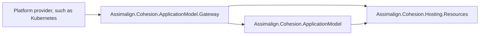
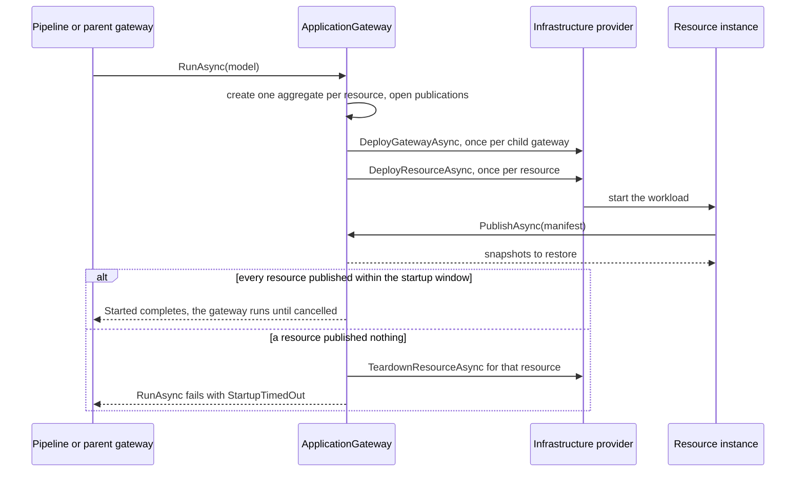

# Assimalign.Cohesion.ApplicationModel.Gateway — Design

> **Status (2026-10-27):** chunk 3 of the Application Model rebuild, built on
> [ApplicationModel](../../Assimalign.Cohesion.ApplicationModel/docs/DESIGN.md) (chunk 2) and
> [Hosting.Resources](../../../Hosting/Assimalign.Cohesion.Hosting.Resources/docs/DESIGN.md) (chunk 1).
> The previous implementation (Local gateway, records, credentials, certificates) is retired; its
> source is at commit `6576e7c64`.

## Purpose

A gateway runs an application model. It deploys its part of the hierarchy through an
infrastructure provider, receives the manifests the deployed resources' instances publish, keeps
each resource's aggregate (its instances and the state written since the deployment), and exposes
each resource's infrastructure actions. The library is transport-neutral and platform-neutral: a
transport binds its endpoints, and an infrastructure provider supplies the platform.

The arrow below means "references". A platform package, such as a Kubernetes provider, references
the gateway; the gateway references the model and Hosting.Resources.

## Startup

`RunAsync` creates one aggregate per resource and opens publications, deploys each child gateway,
then deploys each resource. Every resource must have an instance publish within the startup window.
If one does not, the gateway tears it down and the run fails; otherwise the gateway runs until
cancelled.

## The types

| Type | Role |
| --- | --- |
| `ApplicationGateway` | The orchestrator. Implements `IApplicationGateway` (`RunAsync`) and `IResourceManifestPublisher` (`PublishAsync`, the publication endpoint's logic). Exposes `Model`, `Resources` (the aggregates), `StartupTimeout`, and `Started`. |
| `IInfrastructureProvider` | The platform: deploys resources and child gateways, tears down a resource that missed its window, and supplies each resource's infrastructure actions. |
| `GatewayDeploymentManifest` | What a gateway deploys (the whole hierarchy plus the gateway's name) and where (opaque provider settings). UTF-8 JSON with camel-case names. `ToModel()` creates the gateway's model. |
| `ApplicationGatewayException`, `ApplicationGatewayErrorCode` | Refused publications (`PublicationsClosed`, `ResourceUnknown`, `ResourceTornDown`) and a failed startup (`StartupTimedOut`). |

In ApplicationModel: `IApplicationModel.Role` and `GatewayRole` say whether a model's gateway is the
root or a composite; `IApplicationResourceAction` is an infrastructure action, and
`IApplicationResource.Actions` and `ExecuteAsync` expose and dispatch them.

## Decisions

**G1 — The platform is a provider, not a subclass.** The brief names the infrastructure provider as
one of the three layers an application brings together, so the gateway composes an
`IInfrastructureProvider` instead of each platform deriving its own gateway. Orchestration
(aggregates, the startup window, publications) then exists once, and a provider can be tested
without a gateway. The retired design had a platform-specific gateway per platform.

**G2 — The publication endpoint is transport-neutral.** `PublishAsync` is the endpoint's logic: route
the manifest to its resource's aggregate and answer with the snapshots to restore. A transport only
adapts it, and an in-process resource publishes to the gateway object directly, because the gateway
is an `IResourceManifestPublisher`. Each refusal has an error code a transport can map without
parsing text: `PublicationsClosed` to 503, `ResourceUnknown` to 404, `ResourceTornDown` to 410.

**G3 — What and where travel together, and "what" is the whole hierarchy.** A deployment manifest
names its gateway and carries the global manifest, so a child gateway resolves a dependency outside
its own part (east's `orders-api` on the root's `identity`). "Where" is opaque JSON that only the
gateway's infrastructure provider reads. The provider writes it for each child gateway it deploys.

**G4 — One startup window, decided atomically.** The window opens when deployment finishes and
covers every resource. A resource's first registration and the window's close race on one atomic
transition, so a resource is either registered or torn down, never both: a registration that
loses is undone and refused with `ResourceTornDown`. A missed resource is torn down and the run
fails, so the deployment fails where its pipeline sees it; resources that published keep running.

**G5 — Publications open before deployment.** The aggregates exist before the provider starts
anything, so a fast instance cannot publish before its aggregate exists.

**G6 — Cancellation is not teardown.** Cancelling `RunAsync` stops the gateway, during startup or
after, and leaves what it deployed running. Teardown happens only to a resource that missed its
startup window.

**G7 — Root and composite deploy the same way, for now.** A gateway's role comes from its model's
position: the root's model is for the hierarchy's top gateway, a composite's for any other. Both
deploy their own resources and their child gateways. What only a root does, such as serving the
tenant's management entry or hosting the identity provider, arrives with those chunks.

**G8 — Infrastructure actions belong to the provider and keep no state.** The provider supplies each
resource's actions when the gateway starts, such as `scale`. They act on the platform, which keeps
what they set until the next deployment replaces it, so the gateway records nothing for them.
Dispatch uses the controls' statuses: `NotFound`, `NotSupported`, and `Rejected` when the input does
not bind.

**G9 — No HTTP here, yet.** COHLIB001 bars a library from referencing Web, and COHRES003 bars Web
(any resource package) from referencing a `Gateway*` assembly, so neither side can bind the other
today. The options are: serve HTTP from this library tier with `Http.Connections`, as the retired
gateway did; move the endpoint contracts into ApplicationModel and bind them in `Web.ApplicationModel`;
or relax one of the guards. That choice is open, so this chunk stops at transport-neutral logic.

## AOT

No reflection or runtime code generation. The deployment manifest is read and written through a
source-generated JSON context.

## Diagnostics

None. The library raises no events yet; a missed startup window and a refused publication are
candidates for an event source.

## Open questions

1. **HTTP binding** (G9): which of the three options.
2. **Gateway restart within a deployment.** Instances publish once, at start, so a restarted gateway
   would see no registrations and tear its resources down. It needs instances to publish again, or
   a provider that reports what already runs, with idempotent deployment.
3. **Startup failure scope.** Only missed resources are torn down. Should a failed startup tear down
   the whole deployment instead?
4. **State persistence.** Recorded snapshots live in memory. A store seam, which a restarted gateway
   would seed its aggregates from, is not built.
5. **Controls fan-out.** Executing a control on one instance and restoring its snapshot on the others
   needs a gateway-to-instance channel, and so the instance's address in its manifest (chunk 1's
   instance-address question). The aggregate's `Record` already names the targets.
6. **Gateway-level routes and identity.** Gateway-wide `/controls` and `/infra`, the tenant id in the
   routes, and authentication: today the gateway accepts publications anonymously, which suits only
   a local gateway.
7. **Build-time infrastructure actions.** Actions a program declares at build time need a slot on
   the descriptor and the manifest.
8. **Deployment order.** Child gateways deploy before resources, each in declaration order. Should
   dependencies order them?
