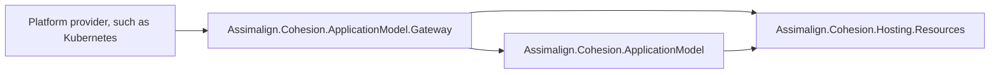
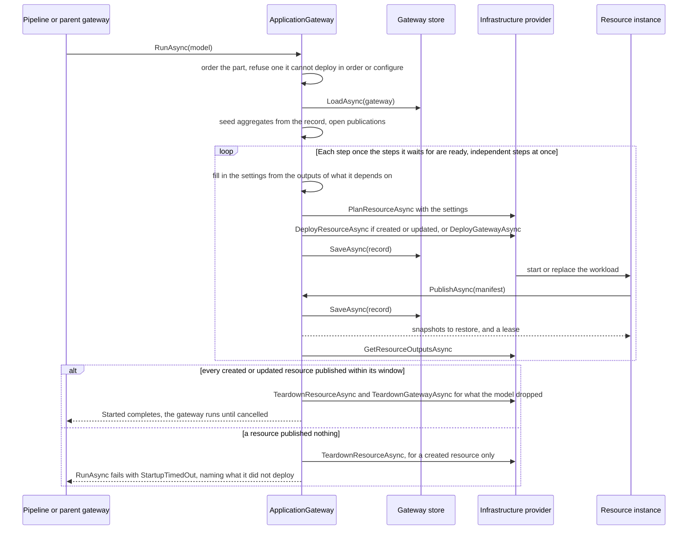
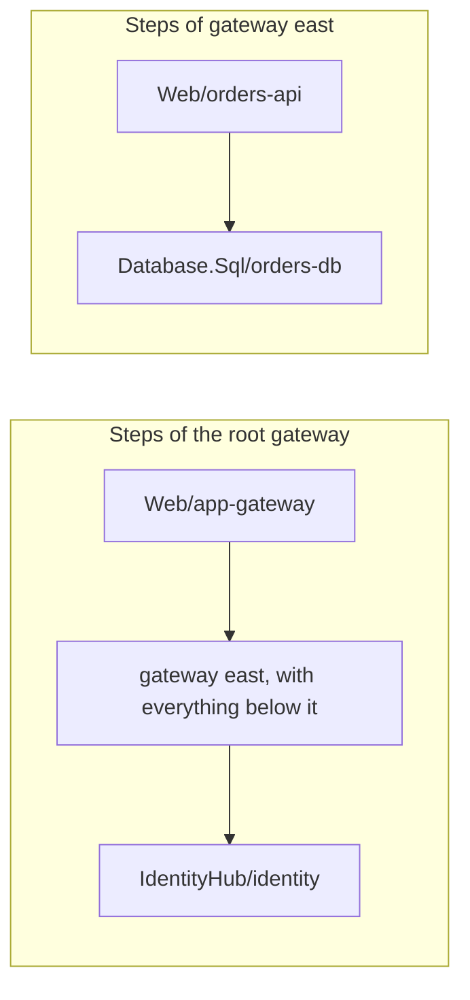

# Assimalign.Cohesion.ApplicationModel.Gateway — Design

> **Status (2026-10-27):** chunk 3 of the Application Model rebuild, built on
> [ApplicationModel](../../Assimalign.Cohesion.ApplicationModel/docs/DESIGN.md) (chunk 2) and
> [Hosting.Resources](../../../Hosting/Assimalign.Cohesion.Hosting.Resources/docs/DESIGN.md) (chunk 1).
> The previous implementation (Local gateway, records, credentials, certificates) is retired; its
> source is at commit `6576e7c64`.

## Purpose

A gateway runs an application model. It deploys its part of the hierarchy through an
infrastructure provider, receives the manifests the deployed resources' instances publish, keeps
each resource's aggregate (its instances and the state written since the deployment), and exposes
each resource's infrastructure actions. The library is transport-neutral and platform-neutral: a
transport binds its endpoints, and an infrastructure provider supplies the platform.

The arrow below means "references". A platform package, such as a Kubernetes provider, references
the gateway; the gateway references the model and Hosting.Resources.

## Startup: reconcile, then run

`RunAsync` first orders its part of the hierarchy, and refuses a part that it, or a gateway below
it, cannot deploy in dependency order (G19) or whose settings it cannot fill in (G22). It loads the
gateway's record from its `IGatewayStore`, creates one aggregate per resource as the previous run
left it (G23), and opens publications. It then deploys in dependency order (G17): each resource and
child gateway is a step that runs once the steps it waits for are ready, and independent steps run
at the same time. A resource's step fills in its settings from the outputs of what it depends on,
plans it with the infrastructure provider, keeps what the plan leaves in place (G12), deploys it
only when the plan creates or updates it, waits for an instance of that deployment to publish within
the startup window, and reads its outputs (G18). After startup it tears down what the record holds
but the model no longer declares, and runs until cancelled. A gateway restarted with the same model
and the same outputs plans no change, so it deploys nothing and waits for no publication: it adopts
what runs.

## Deployment order

A gateway's steps are its own resources and its child gateways, each child with everything below
it. A step waits for the steps that own what its resources depend on. In the hierarchy below,
`orders-api` waits for `orders-db`. The child gateway `east` waits for the root's `identity`, because
a resource in its part depends on it. The root's `app-gateway` waits for `east`, because it routes to
a resource in east's part. An arrow means "waits for".

The root therefore deploys `identity`, waits until it is ready, then deploys `east`, and deploys
`app-gateway` once `east` has started. East deploys `orders-db`, then `orders-api` once
`orders-db` is ready.

## The types

| Type | Role |
| --- | --- |
| `ApplicationGateway` | The orchestrator. Implements `IApplicationGateway` (`RunAsync`) and `IResourceManifestPublisher` (`PublishAsync`, the publication endpoint's logic). `RecordAsync` records a write's snapshot and saves the record. Exposes `Model`, `Resources` (the aggregates), `StartupTimeout`, and `Started`. |
| `IInfrastructureProvider` | The platform: plans a resource with its settings' values (`PlanResourceAsync`), deploys resources with those values and child gateways, reports a deployed resource's outputs (`GetResourceOutputsAsync`), tears down resources and child gateways, and supplies each resource's infrastructure actions. |
| `InfrastructurePlan`, `InfrastructureChange` | What deploying a resource would change (`None`, `Create`, `Update`) and the revision the provider would run, which leaves the settings' values out. |
| `IGatewayStore`, `GatewayRecord`, `GatewayResourceRecord` | The gateway's persisted record: child gateways and, per resource, the revision deployed, the state recorded, and the instances registered. |
| `JsonFileGatewayStore` | One indented JSON file per gateway, replaced atomically on each save; snapshot values as base64. The placeholder for a store over the Database area. |
| `GatewayDeploymentManifest` | What a gateway deploys (the whole hierarchy, the gateway's name, and the values of the outputs from above that its part's settings use) and where (opaque provider settings). UTF-8 JSON with camel-case names. The parent gateway writes the "what" and its provider adds the "where". `ToModel()` creates the gateway's model, values included. |
| `ApplicationGatewayException`, `ApplicationGatewayErrorCode` | Refused publications (`PublicationsClosed`, `ResourceUnknown`, `ResourceTornDown`) and a failed startup (`StartupTimedOut`, or `OutputMissing` for a setting whose output the provider did not report). |

In ApplicationModel: `IApplicationModel.Role` and `GatewayRole` say whether a model's gateway is the
root or a composite; `IApplicationResourceAction` is an infrastructure action, and
`IApplicationResource.Actions` and `ExecuteAsync` expose and dispatch them.

## Decisions

**G1 — The platform is a provider, not a subclass.** The brief names the infrastructure provider as
one of the three layers an application brings together, so the gateway composes an
`IInfrastructureProvider` instead of each platform deriving its own gateway. Orchestration
(aggregates, the startup window, publications) then exists once, and a provider can be tested
without a gateway. The retired design had a platform-specific gateway per platform.

**G2 — The publication endpoint is transport-neutral.** `PublishAsync` is the endpoint's logic: route
the manifest to its resource's aggregate and answer with the snapshots to restore. A transport only
adapts it, and an in-process resource publishes to the gateway object directly, because the gateway
is an `IResourceManifestPublisher`. Each refusal has an error code a transport can map without
parsing text: `PublicationsClosed` to 503, `ResourceUnknown` to 404, `ResourceTornDown` to 410.

**G3 — What and where travel together, and "what" is the whole hierarchy.** A deployment manifest
names its gateway and carries the global manifest, so a child gateway resolves a dependency outside
its own part (east's `orders-api` on the root's `identity`), and the values of the outputs from
above that its settings use (G24). "Where" is opaque JSON that only the gateway's infrastructure
provider reads. The parent gateway writes the rest of a child's manifest, and its provider adds
"where" when it deploys the child.

**G4 — One startup window per resource, decided atomically.** A created or updated resource's
window opens when its deployment starts and lasts `StartupTimeout`, so a resource deep in a
dependency chain is not charged for the time its dependencies took (G18). A resource's first
registration and the window's close race on one atomic transition, so a resource is either
registered or torn down, never both: a registration that loses is undone and refused with
`ResourceTornDown`. A missed resource is torn down and the run fails, so the deployment fails where
its pipeline sees it; resources that published keep running. *Superseded:* one window that opened
when every deployment call had returned and covered every resource.

**G5 — Publications open before deployment.** The aggregates exist before the provider starts
anything, so a fast instance cannot publish before its aggregate exists. An instance that publishes
before its resource is planned, such as a restarted instance of the previous definition while the
resource waits for its dependencies, is registered with the state the previous run recorded (G23)
but does not make the resource ready (G18).

**G6 — Cancellation is not teardown.** Cancelling `RunAsync` stops the gateway, during startup or
after, and leaves what it deployed running. Teardown happens only to a resource that missed its
startup window.

**G7 — Root and composite deploy the same way, for now.** A gateway's role comes from its model's
position: the root's model is for the hierarchy's top gateway, a composite's for any other. Both
deploy their own resources and their child gateways. What only a root does, such as serving the
tenant's management entry or hosting the identity provider, arrives with those chunks.

**G8 — Infrastructure actions belong to the provider and keep no state.** The provider supplies each
resource's actions when the gateway starts, such as `scale`. They act on the platform, which keeps
what they set until the next deployment replaces it, so the gateway records nothing for them.
Dispatch uses the controls' statuses: `NotFound`, `NotSupported`, and `Rejected` when the input does
not bind.

**G10 — Reconcile, don't redeploy (owner request, 2026-10-28).** The provider plans each resource
before it deploys it, from what the platform runs: `None`, `Create`, or `Update`, and the revision it
would run. A resource is planned at its step, once its settings' values are known (G22). The gateway
deploys only what changes. A plan of `None` is adopted: the resource starts registered,
outside the startup window, so a gateway restarted with the same model deploys nothing and tears
nothing down. This replaces the restart behaviour open question 2 described, where a restarted
gateway saw no registrations and tore everything down. A plan step separate from the deployment
keeps the decision out of the publication path: in-process providers start instances inside
`DeployResourceAsync`, and those instances publish before it returns. *Rejected:* one idempotent
deploy call that reports what it changed. The gateway would learn of an update only after the new
instances had published with the old state.

**G11 — The record lives behind a store (owner request, 2026-10-28).** `IGatewayStore` loads the
record once and saves the whole record after every change: deployment, registration, recorded
write, teardown. Saves never overlap. `JsonFileGatewayStore` is the placeholder. A store over the
Database area replaces it in each gateway once that area is ready, and the gateway does not change.
Snapshot values are stored as base64, because the platform's content serializer may not be JSON.

**G12 — State follows the definition.** A resource's revision is a fingerprint of its manifest
(provider, name, dependencies, settings as declared) followed by the provider's revision (image,
platform settings). The recorded state survives while the revision does. A new revision is a new
deployment of that resource and starts without the previous state; a workload that disappeared and
is created again keeps it. Registered instances survive only while the plan is `None`, because a
created or updated workload replaces them; an instance that renewed or published during the run
still runs and stays (G23). This refines "state lasts until the next deployment" to each resource: a
deployment that does not change a resource leaves its operator changes in place, which keeps every
running instance consistent with the record. A setting's value filled in from a dependency's output
is not part of the definition (G22), so a dependency that moved updates the resource but keeps its
operator changes; a value changed in the model is part of it.

**G13 — A missed update is not torn down.** A new resource that misses the startup window is torn
down (G4). An updated one is not: its previous instances are the platform's to keep or replace, as
a rolling update does. Its later publications are refused, and the run fails with
`StartupTimedOut`.

**G14 — Retire after startup.** Resources and child gateways the record holds but the model no
longer declares are torn down only after the deployment has started. A failed deployment therefore
leaves the previous one running. They stay in the record until their teardown succeeds, so a failed
run retries them.

**G15 — Instances hold leases (owner decision, 2026-10-28).** A publication's answer carries a
lease of `LeaseDuration`, 30 seconds by default, and `RenewAsync` renews it. The gateway keeps
renewal times in memory, not in the record, and unregisters an instance whose lease lapses, then
saves the record. After startup every registered instance, the adopted ones included, gets one full
lease, so an instance that died while the gateway was down leaves within one lease. A renewal from
an instance the gateway does not know, such as after a restart without a record, answers `false`,
and the instance publishes again. Registration, renewal and expiry take one lock per resource, so
an instance that publishes again while its lease expires is kept or dropped as a whole.

**G16 — Outputs are read per resource, before what depends on it (owner request, 2026-10-28).** As
soon as a resource is ready (G18), the gateway asks the provider for its outputs
(`GetResourceOutputsAsync`), records them on its aggregate, and saves the record when any changed;
only then are the steps that wait for the resource planned and deployed, with those values in their
settings (G22). An adopted resource starts with the
outputs recorded for the workload that still runs, then takes the platform's current values, so an
address the platform changed while the gateway was down is picked up. `TryGetOutput` resolves a
placeholder for a resource this gateway runs. A placeholder for another gateway's resource does not
resolve here yet: it needs gateway-to-gateway publication. *Superseded:* one read of every
resource's outputs after the whole startup.

**G17 — Deploy in dependency order, independent steps at once (owner request, 2026-10-28).** A
dependency orders deployment (ApplicationModel D4), so the gateway deploys each resource and child
gateway once everything it waits for is ready, and starts the steps that do not wait for each other
at the same time, as ARM does with `dependsOn`. A chain therefore takes the sum of its steps, and
independent resources the longest of theirs. The provider may consequently be called concurrently
for different resources, never for the same one. `Resources` lists the aggregates in that order.
*Rejected:* deploying one step at a time in a topological order. It is simpler and deterministic,
but ten independent resources that take thirty seconds each would start in five minutes instead of
thirty seconds. *Superseded:* child gateways first, then resources, each in declaration order
(open question 8).

**G18 — Ready means an instance of the deployment published and the outputs are read.** A created
or updated resource is ready once an instance has published after its deployment started, and the
gateway has read its outputs (G16). An adopted resource is ready once its outputs are read. A child
gateway is ready once `DeployGatewayAsync` returns. A first publication is the whole gate for now:
health checks and "every instance" readiness need the gateway-to-instance channel. The plan marks
the resource current before the gateway calls the provider to deploy it, because an in-process
provider's instances publish before the call returns; an instance that published earlier runs the
previous definition and is registered without opening the gate. An instance manifest does not say
which revision it runs, so an old instance that publishes during the rollout still opens it.

**G19 — A child gateway is one step.** A gateway cannot see the readiness of what its child deploys,
so it orders the child with everything below it as one step. The child waits for the gateway's own
resources that anything in its part depends on: the root's identity provider is ready before a child
whose resources use it is deployed, and readiness below follows from that, because the child deploys
its own part after it starts. In the other directions the guarantee is deployment order only. A
resource that depends on something in a child's part waits until that child has started, not until
the resource it depends on is ready, and a child that depends on a sibling's part waits until the
sibling has started. Both need gateway-to-gateway publication to wait for readiness. A child that
both waits for one of the gateway's steps and is waited for by it cannot be ordered: for example, the
root's `app-gateway` routes to `east/orders-api` while `east/orders-worker` calls through
`app-gateway`. `RunAsync` refuses such a part with an `ArgumentException` that names each wait and
the dependency behind it. It checks the gateway and every gateway below it before it loads its
record, so nothing is deployed. The model accepts the hierarchy, because no resource depends on
itself; the limit is this gateway's, and it lifts once a child can wait for its parent's resources
itself.

**G20 — A step that fails stops only what depends on it.** When a resource misses its window, the
steps that wait for it, directly or through others, are skipped: they are not deployed, and a
skipped child gateway keeps running its previous manifest. Steps that do not depend on it carry on.
Once every step has ended, the run fails with `StartupTimedOut`, naming the missed resources and
the skipped steps, so one run reports everything a broken deployment left undone, as ARM and
Terraform do. A failure of another kind, such as a provider exception, cancels the remaining steps
and is what `RunAsync` throws. *Rejected:* stopping every step at the first miss. Steps already
waiting for their windows would be abandoned, and the next run would report them one failure at a
time.

**G21 — A resource's record changes only when the run plans it.** Until a resource's step plans it,
every save writes its previous entry unchanged, or nothing for a new resource. A run that fails or
stops before reaching a resource therefore leaves its revision, state, instances, and outputs as
they were. A later run that rolls the model back finds the resource's operator changes, because the
platform never replaced the workload. Without this, the first save of a run would record the new
definition's empty state for resources still waiting for their dependencies. A write recorded on an
instance before its resource is planned is held in memory and saved once the plan keeps it.

**G22 — Settings are filled in at the step, from this gateway's outputs and those passed down
(owner request, 2026-10-29).** A resource's settings (ApplicationModel D17) are configuration values
its instances receive with their deployment. At the resource's step, everything it depends on is
ready and its outputs are read (G16), so the gateway fills in each output-valued setting from the
aggregate of the resource it names, or, for a resource above this gateway, from the values its
deployment manifest carried (G24). It then plans the resource with the values (`PlanResourceAsync`), because the
platform needs an update when it runs other values, and deploys with the same values
(`DeployResourceAsync`); the provider delivers them, for example as environment variables. The
values are not part of the resource's definition: the gateway fingerprints the settings as declared,
and the provider's revision leaves the values out. A redeployed dependency with a new address
therefore updates its dependents, which keep their operator changes (G12). A setting whose output the
provider did not report fails the run with `OutputMissing`, naming the setting and the output, as a
provider failure does (G20). A gateway learns its own resources' outputs and receives those from
above, so a setting that uses an output of a resource in a child's or a sibling's part is refused
before anything deploys, for this gateway and every gateway below it, as G19 refuses an unorderable
part (open question 11). So is a setting whose value from above the deployment manifest lacks.
*Superseded:*
planning every resource before the first step (open question 9), which planned a dependent before
the values it would deploy with existed. *Rejected:* recording the values in the gateway's record
and upgrading a `None` plan to `Update` when they changed. The provider could then plan before the
values exist, but it could not tell that the platform drifted from them.

**G23 — Until its step plans it, a resource runs as the previous run left it.** The gateway creates
every aggregate before the first step, so publications are accepted from the start (G5), but a
resource's plan waits for its dependencies. Until then its aggregate holds the recorded state and
outputs, and the recorded instances are carried with fresh leases, so an instance that renews or
restarts while the resource waits keeps its registration or restores the operator's changes. The
plan then keeps what still applies: a plan of `None` for the same definition keeps everything; any
other plan drops the outputs and the carried instances that have not renewed or published since,
because the platform replaces the workload; a new definition also clears the state. An instance that
proved it runs stays registered through an update, so it does not have to publish again, and it does
not open the startup gate either. *Rejected:* refusing publications until the resource is planned. An
instance restarted while a long chain deploys would fail its start until the gateway reached it.

**G24 — Outputs from above travel down in deployment manifests (owner request, 2026-10-29).** A
gateway deploys a child once the resources the child's part depends on are ready (G19), so by then it
has their outputs. It writes the child's deployment manifest itself: the whole hierarchy, the child's
name, and the values of the outputs from this gateway and those above that settings in the child's
part use. Values of the gateway's own resources come from their aggregates; the others are values it
received from above and passes on. `DeployGatewayAsync` takes that manifest, and the provider adds
only where the child runs. The child fills in its settings from the values (ApplicationModel D18)
and passes on those a grandchild's part uses; outputs inside the child's own part are the child's
to read. A changed output changes the manifest, so the child is deployed again and replans what
uses the value, the same way a dependency that moved updates a resource in the gateway's own part
(G22). The values follow the declaration order of the settings, so a manifest with unchanged values
is byte-for-byte unchanged. *Superseded:* `DeployGatewayAsync(model, gateway)`, where the provider
built the manifest and knew nothing of the values. *Rejected:* the child reading its parent's
outputs at run time (ApplicationModel D18), and the provider looking the values up itself, which
would make every provider walk the settings of the hierarchy.

**G9 — No HTTP here, yet.** COHLIB001 bars a library from referencing Web, and COHRES003 bars Web
(any resource package) from referencing a `Gateway*` assembly, so neither side can bind the other
today. The options are: serve HTTP from this library tier with `Http.Connections`, as the retired
gateway did; move the endpoint contracts into ApplicationModel and bind them in `Web.ApplicationModel`;
or relax one of the guards. That choice is open, so this chunk stops at transport-neutral logic.

## AOT

No reflection or runtime code generation. The deployment manifest and the record file are read and
written through source-generated JSON contexts.

## Diagnostics

None. The library raises no events yet; a missed startup window and a refused publication are
candidates for an event source.

## Open questions

1. **HTTP binding** (G9): which of the three options.
2. **Instance liveness.** Resolved by leases (G15). A lease only bounds how long a dead instance stays
   registered; asking the platform which instances run would detect a death sooner.
3. **Startup failure scope.** Only missed new resources are torn down (G13). Should a failed startup
   tear down the whole deployment instead, or roll updates back?
4. **Rollout strategy.** An update's rollout is the platform's. Rolling a change through a logical
   resource's instances a few at a time, such as a restart caused by a dependency's new output, needs
   the gateway-to-instance channel (question 5).
5. **Controls fan-out.** Executing a control on one instance and restoring its snapshot on the others
   needs a gateway-to-instance channel, and so the instance's address in its manifest (chunk 1's
   instance-address question). The aggregate's `Record` already names the targets.
6. **Gateway-level routes and identity.** Gateway-wide `/controls` and `/infra`, the tenant id in the
   routes, and authentication: today the gateway accepts publications anonymously, which suits only
   a local gateway.
7. **Build-time infrastructure actions.** Actions a program declares at build time need a slot on
   the descriptor and the manifest.
8. **Deployment order — settled.** Dependencies order deployment (G17), child gateways included
   (G19).
9. **Plans before outputs — settled.** Each resource is planned at its step, with its settings'
   values (G22); until then it runs as the previous run left it, so early publications are accepted
   (G23).
10. **Readiness across gateways.** A parent waits for a child gateway to start, not for the
    resources it deploys (G19). Waiting for them needs a child to publish its resources' readiness
    and outputs to its parent, the gateway-to-gateway publication already needed for outputs.
11. **Settings across gateways — settled downward.** Outputs from above travel down in deployment
    manifests (G24), so east's `orders-api` reads the root's identity provider endpoint. A setting
    that uses an output of a resource in a child's or a sibling's part is still refused (G22): it
    needs that child to publish its outputs to its parent (question 10).
