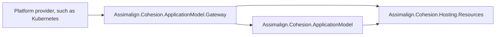
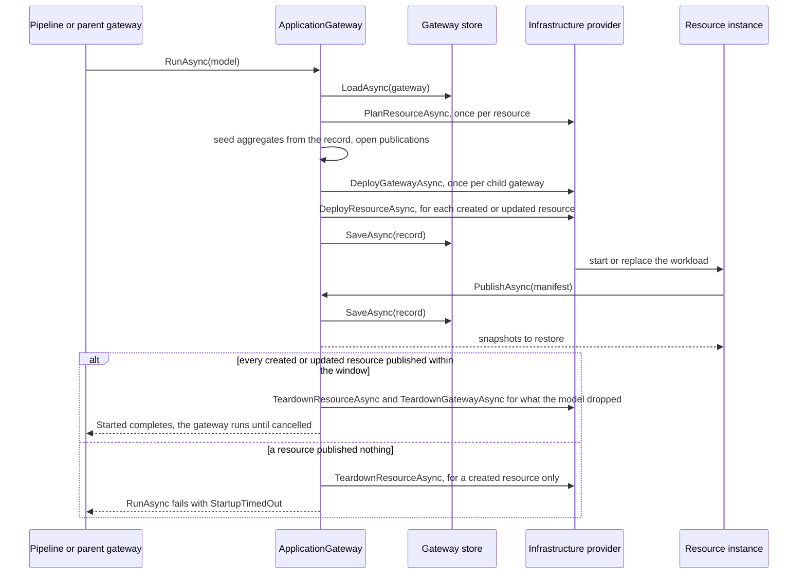

# Assimalign.Cohesion.ApplicationModel.Gateway — Design

> **Status (2026-10-27):** chunk 3 of the Application Model rebuild, built on
> [ApplicationModel](../../Assimalign.Cohesion.ApplicationModel/docs/DESIGN.md) (chunk 2) and
> [Hosting.Resources](../../../Hosting/Assimalign.Cohesion.Hosting.Resources/docs/DESIGN.md) (chunk 1).
> The previous implementation (Local gateway, records, credentials, certificates) is retired; its
> source is at commit `6576e7c64`.

## Purpose

A gateway runs an application model. It deploys its part of the hierarchy through an
infrastructure provider, receives the manifests the deployed resources' instances publish, keeps
each resource's aggregate (its instances and the state written since the deployment), and exposes
each resource's infrastructure actions. The library is transport-neutral and platform-neutral: a
transport binds its endpoints, and an infrastructure provider supplies the platform.

The arrow below means "references". A platform package, such as a Kubernetes provider, references
the gateway; the gateway references the model and Hosting.Resources.

## Startup: reconcile, then run

`RunAsync` loads the gateway's record from its `IGatewayStore` and plans every resource with the
infrastructure provider. It creates one aggregate per resource, seeded from the record (G12), and
opens publications. It then deploys each child gateway and only the resources whose plan creates or
updates them, and saves the record. Every created or updated resource must have an instance publish
within the startup window. After startup it tears down what the record holds but the model no
longer declares, and runs until cancelled. A gateway restarted with the same model plans no change,
so it deploys nothing and waits for no publication: it adopts what runs.

## The types

| Type | Role |
| --- | --- |
| `ApplicationGateway` | The orchestrator. Implements `IApplicationGateway` (`RunAsync`) and `IResourceManifestPublisher` (`PublishAsync`, the publication endpoint's logic). `RecordAsync` records a write's snapshot and saves the record. Exposes `Model`, `Resources` (the aggregates), `StartupTimeout`, and `Started`. |
| `IInfrastructureProvider` | The platform: plans a resource (`PlanResourceAsync`), deploys resources and child gateways, tears down resources and child gateways, and supplies each resource's infrastructure actions. |
| `InfrastructurePlan`, `InfrastructureChange` | What deploying a resource would change (`None`, `Create`, `Update`) and the revision the provider would run. |
| `IGatewayStore`, `GatewayRecord`, `GatewayResourceRecord` | The gateway's persisted record: child gateways and, per resource, the revision deployed, the state recorded, and the instances registered. |
| `JsonFileGatewayStore` | One indented JSON file per gateway, replaced atomically on each save; snapshot values as base64. The placeholder for a store over the Database area. |
| `GatewayDeploymentManifest` | What a gateway deploys (the whole hierarchy plus the gateway's name) and where (opaque provider settings). UTF-8 JSON with camel-case names. `ToModel()` creates the gateway's model. |
| `ApplicationGatewayException`, `ApplicationGatewayErrorCode` | Refused publications (`PublicationsClosed`, `ResourceUnknown`, `ResourceTornDown`) and a failed startup (`StartupTimedOut`). |

In ApplicationModel: `IApplicationModel.Role` and `GatewayRole` say whether a model's gateway is the
root or a composite; `IApplicationResourceAction` is an infrastructure action, and
`IApplicationResource.Actions` and `ExecuteAsync` expose and dispatch them.

## Decisions

**G1 — The platform is a provider, not a subclass.** The brief names the infrastructure provider as
one of the three layers an application brings together, so the gateway composes an
`IInfrastructureProvider` instead of each platform deriving its own gateway. Orchestration
(aggregates, the startup window, publications) then exists once, and a provider can be tested
without a gateway. The retired design had a platform-specific gateway per platform.

**G2 — The publication endpoint is transport-neutral.** `PublishAsync` is the endpoint's logic: route
the manifest to its resource's aggregate and answer with the snapshots to restore. A transport only
adapts it, and an in-process resource publishes to the gateway object directly, because the gateway
is an `IResourceManifestPublisher`. Each refusal has an error code a transport can map without
parsing text: `PublicationsClosed` to 503, `ResourceUnknown` to 404, `ResourceTornDown` to 410.

**G3 — What and where travel together, and "what" is the whole hierarchy.** A deployment manifest
names its gateway and carries the global manifest, so a child gateway resolves a dependency outside
its own part (east's `orders-api` on the root's `identity`). "Where" is opaque JSON that only the
gateway's infrastructure provider reads. The provider writes it for each child gateway it deploys.

**G4 — One startup window, decided atomically.** The window opens when deployment finishes and
covers every resource. A resource's first registration and the window's close race on one atomic
transition, so a resource is either registered or torn down, never both: a registration that
loses is undone and refused with `ResourceTornDown`. A missed resource is torn down and the run
fails, so the deployment fails where its pipeline sees it; resources that published keep running.

**G5 — Publications open before deployment.** The aggregates exist before the provider starts
anything, so a fast instance cannot publish before its aggregate exists.

**G6 — Cancellation is not teardown.** Cancelling `RunAsync` stops the gateway, during startup or
after, and leaves what it deployed running. Teardown happens only to a resource that missed its
startup window.

**G7 — Root and composite deploy the same way, for now.** A gateway's role comes from its model's
position: the root's model is for the hierarchy's top gateway, a composite's for any other. Both
deploy their own resources and their child gateways. What only a root does, such as serving the
tenant's management entry or hosting the identity provider, arrives with those chunks.

**G8 — Infrastructure actions belong to the provider and keep no state.** The provider supplies each
resource's actions when the gateway starts, such as `scale`. They act on the platform, which keeps
what they set until the next deployment replaces it, so the gateway records nothing for them.
Dispatch uses the controls' statuses: `NotFound`, `NotSupported`, and `Rejected` when the input does
not bind.

**G10 — Reconcile, don't redeploy (owner request, 2026-10-28).** The provider plans each resource
first, from what the platform runs: `None`, `Create`, or `Update`, and the revision it would run.
The gateway deploys only what changes. A plan of `None` is adopted: the resource starts registered,
outside the startup window, so a gateway restarted with the same model deploys nothing and tears
nothing down. This replaces the restart behaviour open question 2 described, where a restarted
gateway saw no registrations and tore everything down. A plan step separate from the deployment
keeps the decision out of the publication path: in-process providers start instances inside
`DeployResourceAsync`, and those instances publish before it returns. *Rejected:* one idempotent
deploy call that reports what it changed. The gateway would learn of an update only after the new
instances had published with the old state.

**G11 — The record lives behind a store (owner request, 2026-10-28).** `IGatewayStore` loads the
record once and saves the whole record after every change: deployment, registration, recorded
write, teardown. Saves never overlap. `JsonFileGatewayStore` is the placeholder. A store over the
Database area replaces it in each gateway once that area is ready, and the gateway does not change.
Snapshot values are stored as base64, because the platform's content serializer may not be JSON.

**G12 — State follows the definition.** A resource's revision is a fingerprint of its manifest
(provider, name, dependencies) followed by the provider's revision (image, platform settings). The
recorded state survives while the revision does. A new revision is a new deployment of that
resource and starts without the previous state; a workload that disappeared and is created again
keeps it. Registered instances survive only while the plan is `None`, because a created or updated
workload replaces them. This refines "state lasts until the next deployment" to each resource: a
deployment that does not change a resource leaves its operator changes in place, which keeps every
running instance consistent with the record.

**G13 — A missed update is not torn down.** A new resource that misses the startup window is torn
down (G4). An updated one is not: its previous instances are the platform's to keep or replace, as
a rolling update does. Its later publications are refused, and the run fails with
`StartupTimedOut`.

**G14 — Retire after startup.** Resources and child gateways the record holds but the model no
longer declares are torn down only after the deployment has started. A failed deployment therefore
leaves the previous one running. They stay in the record until their teardown succeeds, so a failed
run retries them.

**G15 — Instances hold leases (owner decision, 2026-10-28).** A publication's answer carries a
lease of `LeaseDuration`, 30 seconds by default, and `RenewAsync` renews it. The gateway keeps
renewal times in memory, not in the record, and unregisters an instance whose lease lapses, then
saves the record. After startup every registered instance, the adopted ones included, gets one full
lease, so an instance that died while the gateway was down leaves within one lease. A renewal from
an instance the gateway does not know, such as after a restart without a record, answers `false`,
and the instance publishes again. Registration, renewal and expiry take one lock per resource, so
an instance that publishes again while its lease expires is kept or dropped as a whole.

**G9 — No HTTP here, yet.** COHLIB001 bars a library from referencing Web, and COHRES003 bars Web
(any resource package) from referencing a `Gateway*` assembly, so neither side can bind the other
today. The options are: serve HTTP from this library tier with `Http.Connections`, as the retired
gateway did; move the endpoint contracts into ApplicationModel and bind them in `Web.ApplicationModel`;
or relax one of the guards. That choice is open, so this chunk stops at transport-neutral logic.

## AOT

No reflection or runtime code generation. The deployment manifest and the record file are read and
written through source-generated JSON contexts.

## Diagnostics

None. The library raises no events yet; a missed startup window and a refused publication are
candidates for an event source.

## Open questions

1. **HTTP binding** (G9): which of the three options.
2. **Instance liveness.** Resolved by leases (G15). A lease only bounds how long a dead instance stays
   registered; asking the platform which instances run would detect a death sooner.
3. **Startup failure scope.** Only missed new resources are torn down (G13). Should a failed startup
   tear down the whole deployment instead, or roll updates back?
4. **Rollout strategy.** An update's rollout is the platform's. Rolling a change through a logical
   resource's instances a few at a time, such as a restart caused by a dependency's new output, needs
   the gateway-to-instance channel (question 5).
5. **Controls fan-out.** Executing a control on one instance and restoring its snapshot on the others
   needs a gateway-to-instance channel, and so the instance's address in its manifest (chunk 1's
   instance-address question). The aggregate's `Record` already names the targets.
6. **Gateway-level routes and identity.** Gateway-wide `/controls` and `/infra`, the tenant id in the
   routes, and authentication: today the gateway accepts publications anonymously, which suits only
   a local gateway.
7. **Build-time infrastructure actions.** Actions a program declares at build time need a slot on
   the descriptor and the manifest.
8. **Deployment order.** Child gateways deploy before resources, each in declaration order. Should
   dependencies order them?
