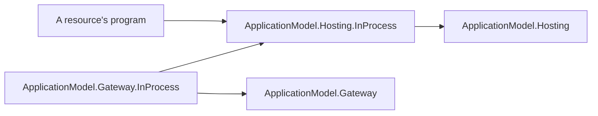

# Assimalign.Cohesion.ApplicationModel.Hosting.InProcess — Design

> **Status (2026-10-30):** created when the owner moved every transport out of the application
> model's core packages into platform packages (ApplicationModel C5, ApplicationModel.Hosting D19).
> It holds what ApplicationModel.Hosting's in-process publisher and endpoint registry did, plus the
> direction they lacked: the gateway's calls into the instance.

## Purpose

A platform comes in two halves. A resource references the instance half and the gateway references
the gateway half, so neither carries the other's side of the model. This package is the in-process
platform's instance half: when a gateway runs a resource inside the gateway's own process, the
instance publishes to that gateway and the gateway calls the instance's control plane, both by
direct calls through an endpoint inside the process. Its gateway half is
[ApplicationModel.Gateway.InProcess](../../Assimalign.Cohesion.ApplicationModel.Gateway.InProcess/docs/DESIGN.md).

The arrow below means "references". The gateway half references this package for the endpoints
both halves meet at; this package references only the hosting abstractions, never a gateway.

## The types

| Type | Role |
| --- | --- |
| `UseInProcess()` (`InProcessApplicationInstanceOptionsExtensions`) | Opts a resource of any area into the platform: adds the in-process client to its `ApplicationInstanceOptions` and returns the area's own options. |
| `InProcessPlatform` | The platform's name, `inprocess`, which is also its endpoints' scheme; and the process's endpoints: `RegisterGateway(endpoint, gateway)` until its registration is disposed. |
| `IInProcessGateway` | What the gateway half registers at its endpoint: an `IApplicationInstancePublisher` that also takes attached control planes (`Attach`). |
| `InProcessGatewayClient` (internal) | The instance's client: publishes and renews to the gateway registered at its endpoint, names that endpoint as its control plane's address, and attaches the control plane between `StartAsync` and `StopAsync`. |
| `InProcessControlPlane` (internal) | The control plane as the gateway calls it: every call runs in the execution context the instance attached it from. |
| `InProcessProgramAttribute` | Names the public entry point a program's build generated, and the provider of the resource it runs, for a gateway program that references it (H6). The Cohesion source generator applies it; application code does not. |

## Decisions

**H1 — The endpoint is resolved on every call.** The client reads its gateway's endpoint from the
instance's environment (`AppEnvironment.Variables.ManifestEndpoint`) when the resource opts in, and
finds the gateway registered there each time it publishes, renews, or attaches, as an HTTP client
reaches whatever listens at its URL. A gateway that runs again over the same infrastructure is
reached without the instance knowing, and a call while nothing is registered fails as one to an
address nothing listens on does. The registry is process-wide, as the names of named pipes are
machine-wide; a registration is removed only by its own handle. *Rejected:* handing the program the
gateway object, which would need the gateway in the program's closure and an ambient registry the
hosting abstractions forbid (ApplicationModel.Hosting D1).

**H2 — The control plane opens to the gateway only once its state is restored.** The client
attaches the control plane in `StartAsync`, which the instance service calls after every host
`StartingAsync`, so after the publication's snapshots are restored, and detaches it in `StopAsync`.
A gateway call between publication and attach, or after detach, gets no answer, and the gateway
drops the instance until it publishes again: the same outcome as an HTTP listener that has not
opened yet (ApplicationModel.Hosting open question 7).

**H3 — The manifest names the endpoint as the control plane's address.** The gateway requires an
address before it calls an instance (ApplicationModel.Gateway G38), and in process the gateway
reaches the control plane through the endpoint the instance publishes to, so the client names that
endpoint in every manifest it sends. The gateway half finds the attached control plane by the
manifest's instance key, not by the address.

**H4 — Calls run in the instance's environment.** The gateway calls from its own flow. The client
captures the instance's execution context when it attaches the control plane, and every call starts
inside it, so an action reads the instance's variables and ambient state, as a request to its own
listener would, never the gateway's. The caller's context is restored once the call first yields.

**H5 — Nothing is serialized on the way out; content crosses as bytes on the way in.** The gateway
receives the manifest object itself. An invocation's content is already bytes, written by the
gateway's serializer, and the gateway half rewraps them with the control plane's own serializer, as
a request body would be read (ApplicationModel C5).

**H6 — A program's build exposes its entry point (2026-11-01).** A gateway runs a resource's
program by calling its entry point, and a top-level program's entry point is a private `<Main>$` in an
internal `Program` that nothing outside its assembly can name. So the program's own build exposes it:
in an executable that references this package and not the gateway, the Cohesion source generator
emits a public, `[EditorBrowsable(Never)]` `InProcessEntryPoint` whose `RunAsync(string[] args)`
calls the entry point (directly when it can name it, otherwise through an `UnsafeAccessor`, which
works under NativeAOT), in a namespace derived from the assembly name so the bridges of several
resources never collide. It also applies `[assembly: InProcessProgram(typeof(InProcessEntryPoint), provider)]`,
with the area of the one `<Area>.Hosting.ApplicationModel` assembly the program references as the
provider (none when it references none or several). A gateway program's build reads the attribute
and binds the program (Gateway.InProcess I15). The attribute is the contract between the two
builds, so it lives here, in the package both reference. A program that ends with a nonzero exit
code faults the task `RunAsync` returns, as a platform takes a process that exits nonzero for one
that failed. Design of the generators: [SourceGeneration DESIGN](../../../../analyzers/Assimalign.Cohesion.SourceGeneration/docs/DESIGN.md).

## AOT

No reflection or runtime code generation. Endpoints are a `ConcurrentDictionary` keyed by absolute
URL, and calls are direct.

## Diagnostics

None. The package raises no events and has no event source.

## Open questions

1. **Selection by more than the name.** Two in-process gateways in one process are told apart by
   their endpoints, not their platform name, so a program always reaches the gateway that started
   it. A platform with several gateways of one kind outside a process will need the same: an
   address its client reads, not a second name.
