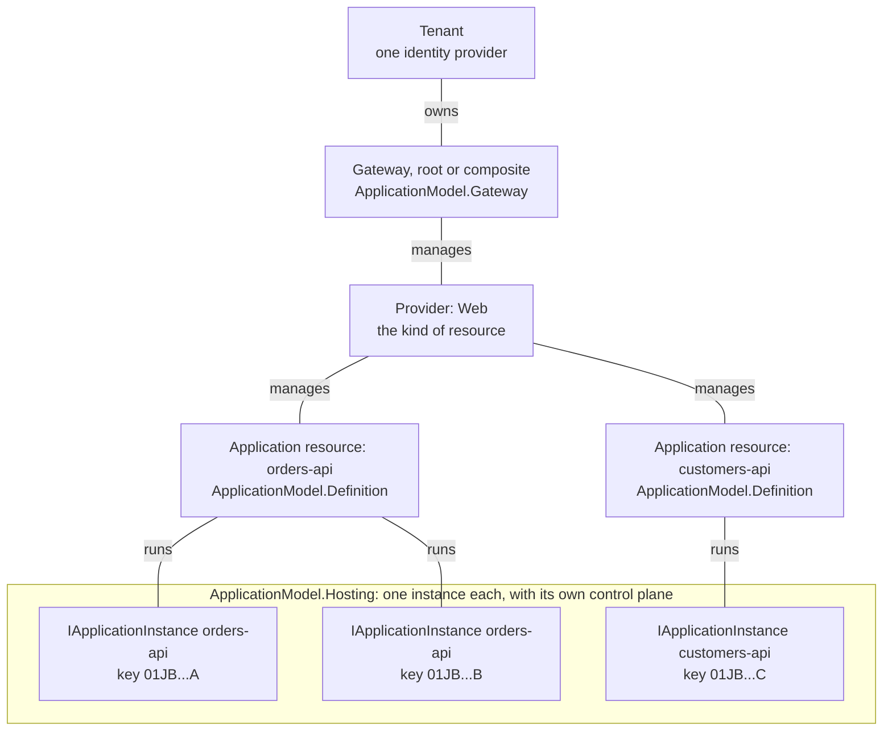
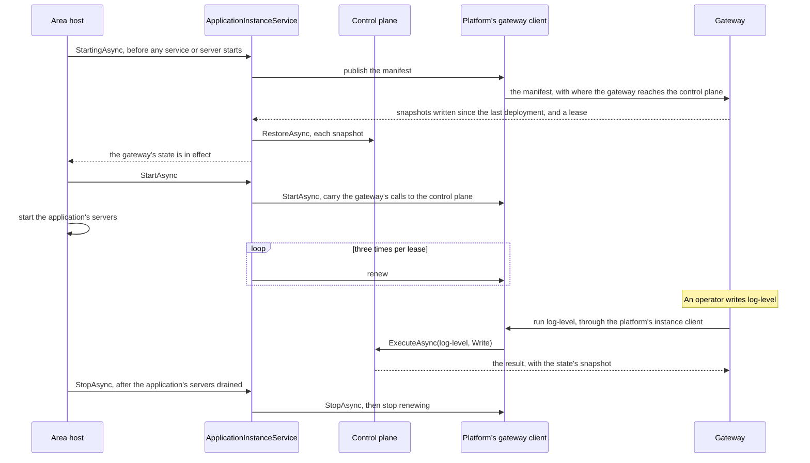

# Assimalign.Cohesion.ApplicationModel.Hosting — Design

> **Status (2026-10-29):** chunk 1 of the Application Model rebuild. On 2026-10-29 it became the physical side of the model
> (ApplicationModel.Definition D20): the types it shares with the logical side moved to
> [ApplicationModel](../../Assimalign.Cohesion.ApplicationModel/docs/DESIGN.md), and `IResource`
> became `IApplicationInstance`. The library was restarted from scratch on 2026-10-27; the
> previous implementation is retired, and its source is at commit `6576e7c64`. On 2026-10-30 its transports left
> for the platform packages (D19): it holds only the abstractions for hosting an instance, and the
> options through which a resource takes each platform's client. Since D20 (2026-10-31) it
> references [ApplicationModel.Protocol](../../Assimalign.Cohesion.ApplicationModel.Protocol/docs/DESIGN.md)
> instead of the root, and its instance seams carry the `IApplicationInstance` names.

## Purpose

This library defines what a **resource instance** is: the identity it starts with, the actions its
control plane exposes and the state those actions leave, its health contributors, the manifest it
publishes, the generic control plane that runs all of it, and the host service that joins it to its
gateway through a platform's client. It knows no transport and no gateway: a platform's instance half
supplies the client (`IApplicationInstanceGatewayClient`), and a resource opts into it through
`ApplicationInstanceOptions`. It references Core, Hosting, and ApplicationModel.Protocol (with
the identity root behind it) only, because it sits in the closure of every resource; never
Definition or Gateway. A gateway references the protocol but not this library.

## Where it sits

Cohesion mirrors a cloud provider in three layers: a tenant with one identity provider, an
infrastructure platform, and the gateways that join them. A gateway manages providers (kinds of
resource); a provider manages application resources (logical services); each application resource
runs one or more instances. Only the instances belong to this library. The links below are
management, not references, so they carry no arrows; the library itself references only Core,
Hosting, and the protocol.

## The model

The instance's own types live here. The types it exchanges with its gateway live in
ApplicationModel.Protocol (D20), and the identity in the root: `IApplicationResource`, the identity
value objects and `PlatformName`, `ApplicationActionContext` and `ApplicationActionResult`,
`IApplicationContentSerializer`, `JsonApplicationContentSerializer` and `ApplicationContentException`,
`ApplicationActionSnapshot`, `ApplicationInstanceManifest` and `ApplicationActionDescriptor`, and
`IApplicationInstancePublisher` with `ApplicationInstancePublication`. The table lists both, because
an area builds against both.

| Type | Role |
| --- | --- |
| `IApplicationInstance` | One running instance: `Provider` + `Name` (shared by every instance), `Key` (this instance), `Deployment` (the deployment that started it, which its environment names and its manifest repeats; ApplicationModel.Gateway G34), its actions and health contributors. `Id` derives from provider and name. It names no address (D19). |
| `IApplicationInstanceAction` | A named operation. `Kind` says which operations it accepts (`Read`, `Write`, or both); `State`, when present, is what its writes change. |
| `IApplicationInstanceActionState`, `ApplicationInstanceActionState<TState>` | The state a stateful action's writes change. A snapshot is the whole value, written by the content serializer; restoring one applies it. |
| `ApplicationActionContext`, `ApplicationActionResult` | One invocation and its outcome. The context carries the control plane's content serializer, which reads the input and writes the output. |
| `IApplicationContentSerializer`, `JsonApplicationContentSerializer`, `ApplicationContentException` | The format of everything an instance exchanges (D12), from the contracts. JSON over source-generated contexts is the default; content the instance refuses is an `ApplicationContentException`. |
| `ApplicationActionSnapshot` | One action's state, as a gateway keeps it until the next deployment. |
| `ApplicationInstanceManifest`, `ApplicationActionDescriptor` | What an instance publishes about itself when its host starts. The control plane's manifest names no control-plane address; the client that publishes it does (D19). |
| `IApplicationInstanceControlPlane`, `ApplicationInstanceControlPlane` | The instance's actions and state: a plain object with no lifecycle that executes actions and restores snapshots from the moment it is created (D15). |
| `IApplicationInstanceService`, `ApplicationInstanceService` | The `IHostLifecycleService` an area registers with the platform's client: it publishes the manifest and restores the answer in `StartingAsync`, renews the lease, opens the control plane to the gateway's calls in `StartAsync`, and closes it and stops renewing in `StopAsync` (D15, D19). |
| `IApplicationInstanceGatewayClient` | The instance half of a platform: publishes and renews (`IApplicationInstancePublisher`), names where the gateway reaches the control plane, and carries the gateway's calls in between `StartAsync` and `StopAsync` (D19). |
| `ApplicationInstanceOptions` | The base of every area's resource options: the clients a resource opts into, one per platform; the platform its environment names, which selects one; the deployment that started it (D19); and the actions the application adds, with the JSON contexts they came with (D21). |
| `IApplicationInstanceHealthContributor`, `ApplicationInstanceHealthContribution` | Health, contributed per component. A default contribution is `Unhealthy`, so unset health fails closed. |

Value objects carry the identity: `ProviderName`, `ProviderId`, `ResourceName`, `ResourceId` from the
root, and `InstanceKey`, `ActionName`, `DeploymentId` from the protocol.

## Lifecycle

The diagram follows one instance through its host's start, an operator's write, and its host's stop.

1. The area registers an `ApplicationInstanceService` with the client its options select. Where it
   sits among the host's registrations does not matter.
2. `StartingAsync` publishes the manifest through the client and restores every snapshot the gateway
   answers with. A host completes `StartingAsync` for every lifecycle service before it starts any
   service or server, so the application serves only after the returned state is in effect. A failed
   publication or restore fails the host's start. When the answer carries a lease, the service
   renews it until `StopAsync` (D14).
3. `StartAsync`, after every `StartingAsync`, starts the client carrying the gateway's calls, so they
   reach the control plane only once the gateway's state is in effect. The Web host stops its
   servers before its other services, so the control plane stays reachable while the application
   drains.
4. `ExecuteAsync` runs actions and `RestoreAsync` applies snapshots whenever they are called: the
   control plane has no lifecycle.

## Decisions

**D1 — No ambient state.** A control plane exists only where an area creates one; there is no
process-wide registry of control planes. The tier rule needs this:
a Tier 2 or Tier 3 area that composes Web inside its own host must not stand up a second control
plane, and an ambient registry let a nested Web builder discover the outer resource (the old code
keyed the registry by entry assembly to stop it). Explicit creation makes "only the outer resource has a
control plane" structural, and lets one process host several instances. *Cost:* an area attaches
the control plane through a registration of its own, `AddResource` on the application's `Services`
(Web.Hosting.ApplicationModel W10). What
an instance reads from its environment can be a scope of its own (Core's `AppEnvironmentScope`, which
a gateway that runs it in process enters for it), but that is the environment, not a registry of
control planes: this library still creates nothing ambiently.

**D2 — The provider is a name on the resource, not an object.** The scaffold's `IResourceProvider`
held one `IApplicationInstance` and published it. In process, such a provider is one per instance, because its
actions bind to that instance's runtime, so it would duplicate the resource's identity and lifetime.
The provider that manages many application resources (orders-api and customers-api under Web) is the
gateway's object, built in a later chunk. This library keeps `ProviderName` and `ProviderId` as the
shared vocabulary; publishing is the resource service's start (D15), through `IApplicationInstancePublisher`.

**D3 — State is a snapshot per action; replication restores, it does not replay.** Replaying writes
needs every write to be idempotent and order-independent, and repeats any divergence between
instances. A snapshot is the whole value: restoring it is idempotent, restores of different actions
commute, and a write executes once, on one instance, while the gateway restores its snapshot on the
others. Only a write may change state, so `Create` refuses state on an action that accepts no writes.

**D4 — Startup state is pulled in the publication's answer, not pushed afterwards.** With a push,
a new instance serves with its code defaults (for example, without a CORS restriction an operator
added) until the gateway's call lands, and every new instance costs one more inbound call. The
publisher returns the snapshots instead, and the resource service restores them before the host
starts serving (D15). `RestoreAsync` remains for live changes.

**D5 — Publication fails fast.** The resource service does not retry: a publisher that throws fails
the host's start, and the gateway's startup timeout and the platform's restart policy decide what
happens next. A publisher may retry inside `PublishAsync`.

**D6 — Dispatch returns statuses.** `NotFound`, `NotSupported`, and `Rejected` are results, so a
transport maps them to its own codes (404, 405, 400 over HTTP) without catching exceptions. An
`ApplicationContentException`, from the serializer binding input or a snapshot or from an action or
apply callback refusing a value, is `Rejected`. Any other exception is a failure and reaches the
transport. `ApplicationActionResult.NotFound()` and `NotSupported()` are public so
other dispatchers, such as an application resource's infrastructure actions, report the same results.

**D7 — Ids are version 5 UUIDs with one namespace per kind.** The scaffold derived both ids from the
name alone in Core's default namespace (the RFC 4122 DNS namespace), so a resource and a provider
with the same text shared one GUID, and `orders` under Web collided with `orders` under Database.
`ResourceId.FromName` hashes `{provider}/{name}` and `ProviderId.FromName` hashes the provider name,
each in its own namespace, with the provider name in lowercase because provider names compare
case-insensitively. The namespace GUIDs are wire contract; a test pins both derivations against an
independent RFC 9562 implementation.

**D8 — Names have grammars.** A resource name is an RFC 1035 label, the form Kubernetes requires of
a Service name. A provider name is dot-separated segments compared case-insensitively. An action
name is hyphen-separated lowercase words, at most 64 characters, so it fits one route segment.
"Orders API" is a display name, not a resource name.

**D9 — No identity on `IApplicationInstance` yet.** The scaffold's `IResourceIdentity` was empty. The identity
provider belongs to the tenant and just-in-time credentials to `DependsOn`, both ApplicationModel
concerns, and a local gateway is anonymous, so this chunk works without one. Identity returns when
the identity-provider chunk defines what an instance presents and verifies.

**D10 — `ApplicationActionKind` has a zero `None`.** The scaffold's `[Flags] ActionKind` gave `Read` the
value 0, which made `HasFlag(Read)` true for every value and `Read | Write` equal to `Write`. `None`
is 0, `Read` 1, `Write` 2, `ReadWrite` 3. There is no delete: a resource is marked deleted and its
platform removes it, so no action can destroy what it manages.

**D11 — State is an interface plus a sealed generic.** The scaffold's abstract
`ApplicationActionState` exposed `object? State { get; set; }`, which boxed and had no serialization
contract. `IApplicationInstanceActionState` is the contract the control plane uses; `ApplicationInstanceActionState<TState>`
is the typed implementation areas construct, with an apply callback. It is written and read by the
control plane's content serializer (D12).

**D12 — The content format is a serializer the platform chooses (owner request, 2026-10-28).**
Actions, states, the publisher, and the transports took `JsonTypeInfo<T>` directly, which fixed
the format at JSON in every area. `IApplicationContentSerializer` is now the one place the format
lives: a control plane is created with one, invocation contexts carry it, and transports write the
manifest and results with it and label content with its media type. A platform that exchanges
another format brings its own serializer, and that serializer must know every type the instances
exchange, this library's and each area's action types. The owner accepted that cost.
`JsonApplicationContentSerializer` is the default. It resolves each type from this library's own,
internal context, then from the contexts it was created with, and writes each type with its own context's options,
so an area's naming survives being combined with others. *Rejected:* one merged
`JsonSerializerOptions` over all resolvers would impose one naming policy on every area's types.
Content the instance refuses is an `ApplicationContentException` rather than a `JsonException`, so the
control plane's error model no longer names a format. `ApplicationInstanceControlPlane.Create` snapshots
every state once, so a serializer that does not know a state's type fails at composition. Otherwise
it would fail the first write, after the write had already changed the instance.

**D13 — Superseded by D19 (2026-10-30).** The HTTP publisher behind
`ApplicationInstancePublisher.Create(ApplicationInstancePublisherOptions)`, with its
`HttpClientFactory` callback and shared `SocketsHttpHandler`, was removed with every other transport
in this library. Its source is in this branch's history before D19.

**D14 — Registrations are leases (owner decision, 2026-10-28).** Instances published once and sent
nothing after, so a gateway could not tell a dead instance from a live one, least of all after its
own restart. The publication answer, an `ApplicationInstancePublication`, now carries a lease. The resource
service renews it three times per lease through `IApplicationInstancePublisher.RenewAsync`, which
carries no snapshots, so renewals cost no restores. A gateway that answers `false` does not know the
instance: the service publishes again and restores the answer, which is idempotent (D3). A failed
renewal is retried on the next one, so an unreachable gateway never stops the instance. How a
renewal travels is the platform's (D19). *Rejected:*
renewing by publishing again, which would restore every snapshot, and rebuild what each one
applies, on every renewal. *Rejected for now:* asking the platform which instances run, which
detects a death faster but needs each provider to map its instances to instance keys.

**D15 — The control plane has no lifecycle; a resource service joins the host (owner decision,
2026-10-28; its server half superseded by D19).** `IApplicationInstanceControlPlane` was an
`IHostService` whose start published and renewed, so one object held two lifetimes: its actions and
state, which last as long as the application, and its gateway registration, which lasts one host
run. The control plane is now a plain object that accepts invocations from the moment it is
created. `ApplicationInstanceService`, written once here for every area, is an `IHostLifecycleService`.
`StartingAsync` publishes, restores and starts renewing. `StopAsync` stops renewing, which also
covers a failed start, because the host's rollback calls only `StopAsync`. A host completes every
`StartingAsync` before it starts any service or server, concurrent start included, so the instance
serves only once the gateway's state is in effect, wherever the area registered the service. Before,
the service started in registration order, and a service registered ahead of it started before the
restore.

The service knows no server. Until D19 an area that served the control plane over a network
registered its server as a host service of its own; since D19 the platform's client carries the
gateway's calls, and the service starts it in `StartAsync`, after every `StartingAsync`, so it opens
only once the state is in effect. *Rejected:* a host runner around `RunAsync`, which never runs for
a host started with `StartAsync`, as a nested host (`AsService`), a test host, and an in-process
gateway's instances are. *Consequence:* a gateway call that reaches an instance before its client
opens gets no answer, and the gateway drops the instance until it publishes again (open questions 6
and 7).

**D16 — This is the physical side of the application model (owner decision, 2026-10-29).** The
library was the instance half of one undivided model, which referenced it for the
identity, manifest, and snapshot types a deployment shares with its instances. The model is now
three projects (ApplicationModel.Definition D20): the shared contracts in ApplicationModel, the
logical side in ApplicationModel.Definition, and this one. The types both sides exchange moved to the
contracts, `IResource` became `IApplicationInstance` on the shared `IApplicationResource`
base, and the namespace is `Assimalign.Cohesion.ApplicationModel.Hosting`. The instance runtime
therefore loads neither the builder nor the validated model, and the gateway loads none of this
library. `ApplicationActionResult.WithState` became public on the way, because the control plane that
attaches a write's snapshot now lives in a different assembly from the result.

**D17 — Superseded by D19 (2026-10-30).** `ApplicationInstancePublisher.Create` chose a transport by
the endpoint's scheme, `http`/`https` or `inprocess`, and `ApplicationInstancePublisher.Register` held
the process's in-process endpoints. The endpoint registry survives, moved to the in-process
platform's instance half (`InProcessPlatform.RegisterGateway` in ApplicationModel.Hosting.InProcess);
the scheme switch does not, because a resource now names its platforms rather than this library
guessing one from a URL.

**D18 — The manifest names where the gateway reaches the control plane (2026-10-30; amended by
D19).** The gateway ran no action on an instance and restored no write itself: it knew an instance's
address only when it had assigned it. The manifest now names where the gateway reaches the instance's
control plane (`ApplicationInstanceManifest.ControlPlaneEndpoint`), so the gateway calls the instance
it registered: an operator's action, and a restore of a write made on another instance
(ApplicationModel.Gateway G38). An instance whose manifest names none cannot be called; its gateway
unregisters it after a write, and it restores the write when it publishes again. Since D19 the
platform's client names the address, in its own terms, as it publishes; the resource and the control
plane name none, and `IApplicationInstance.ControlPlaneEndpoint` is gone. *Rejected:* the
platform reporting each instance's address to the gateway. A provider does not know instance keys, and
an in-process provider would report what it had just assigned.

**D19 — The platform owns the transport; the host takes its client through options (owner,
2026-10-30).** The publishers here and the area's control-plane server made Hosting and every area
carry transports, and the gateway's HTTP client needed a Web reference no library may take
(COHLIB001). The owner moved all of it to the platforms. This library keeps only what hosting an
instance needs:
- **`IApplicationInstanceGatewayClient`** is a platform's instance half. It publishes and renews
  (`IApplicationInstancePublisher`), names where the gateway reaches the control plane in the
  manifest it publishes, and between `StartAsync` and `StopAsync` carries the gateway's calls to the
  control plane. `ApplicationInstanceService.Create(controlPlane, client)` drives it: publish and
  restore in `StartingAsync`, open in `StartAsync`, close then stop renewing in `StopAsync`.
- **`ApplicationInstanceOptions`** is the base of every area's resource options. A platform's
  hosting package adds its opt-in verb to it with a generic receiver
  (`extension<TOptions>(TOptions options) where TOptions : ApplicationInstanceOptions`), so
  `resource => resource.UseInProcess()` works on every area's options and returns them for chaining.
  `UseGatewayClient` adds a client, at most one per platform.
- **Selection.** `Platform` defaults to the gateway variable a gateway sets for every instance it
  starts (`AppEnvironment.Variables.Gateway`), read through `AppEnvironment` when the options are
  created. `GetGatewayClient()` returns `null` when no platform is named, so the instance runs
  unmanaged; the named platform's client; or throws when the resource opted into none for it, so an
  instance never runs unmanaged where a gateway waits for it to publish. A malformed variable throws
  at once. `Deployment` moved here from Web's options, since every area repeats it.

*Rejected:* one package per platform for both halves, which would put the gateway and the logical
model into every resource's closure; selecting the transport by the endpoint's scheme (D17), which
cannot tell two platforms with the same scheme apart and keeps transports here; and an HTTP binding
every area serves (ApplicationModel C5, superseded), which made each area a transport.

**D20 — The instance runtime references the protocol, and its seams say `Instance` (owner,
2026-10-31).** The root was split into the identity and ApplicationModel.Protocol (ApplicationModel
C1), and this library references Protocol and `Assimalign.Cohesion.Hosting` only:
- **Renames.** `IApplicationResourceInstance` is `IApplicationInstance`;
  `IApplicationActionState` is `IApplicationInstanceActionState`, and its implementation
  `ApplicationActionState<TState>` is `ApplicationInstanceActionState<TState>`; the health trio is
  `IApplicationInstanceHealthContributor`, `ApplicationInstanceHealthStatus`, and
  `ApplicationInstanceHealthContribution`. The control plane's `Resource` property is `Instance`.
- **The client is `IApplicationInstanceGatewayClient : IApplicationInstancePublisher`** (was
  `IApplicationGatewayClient`), with `Platform`, `StartAsync(IApplicationInstanceControlPlane, ct)`,
  and `StopAsync(ct)`. The name reads holder then target, the instance's client to its gateway,
  as the gateway's client to an instance is `IApplicationGatewayInstanceClient`.
- **No `Platform` on the service.** A `PlatformName Platform` on `IApplicationInstanceService`
  was removed before it shipped: it would have been the third copy, after
  `ApplicationInstanceOptions.Platform` and the client's own.
- **The control plane stays here** for now; whether it moves to Protocol, where a platform's
  gateway half could call it without referencing this library, is a later chunk.
- **Invocations carry `ApplicationActionOperation`** (Protocol P2); the control plane dispatches with
  `Kind.HasFlag((ApplicationActionKind)operation)`.

**D21 — The actions an application adds are shared by every area (2026-10-31).** Web's options
carried `AddAction` and the JSON contexts its actions came with; every area's resource needs the
same surface, so it moved to `ApplicationInstanceOptions`:
- **`AddAction(IApplicationInstanceAction, JsonSerializerContext?)`** and
  **`AddAction(Func<IServiceProvider, IApplicationInstanceAction>, JsonSerializerContext?)`** add an
  action as an instance or as a factory over the application's services. Both return the base
  options, so they chain after a platform's generic verb (`resource.UseInProcess().AddAction(...)`)
  and with each other; an area's own verbs go first when chained.
- **`JsonContexts`** lists each context once, in the order it was first added. The area writes
  control-plane content with `JsonApplicationContentSerializer.Create([areaContext, .. options.JsonContexts])`.
- **`CreateActions(IServiceProvider)`** runs every factory once, in order, from the factory that
  creates the resource's control plane; a factory that returns `null` throws
  `InvalidOperationException` (`ActionFactoryResultNull`). The area lists the result after its own
  actions, and the control plane's duplicate-name check rejects an added action that reuses a name.
- **A factory-created action is never disposable (2026-11-01).** The action a factory creates is not
  a container registration, and neither `ApplicationInstanceService` nor the control plane owns it,
  so the application's provider would never dispose it. `CreateActions` therefore rejects an
  `IDisposable` or `IAsyncDisposable` result (`ActionFactoryResultDisposable`, naming the action and
  its type), the way Web.Hosting rejects a disposable `IHttpFeature`. A disposable collaborator is
  resolved from the services, which own it. An action added as an instance is borrowed, matching the
  container's owned/borrowed split, and may be disposable: its caller disposes it.

*Rejected for disposal:* making `ApplicationInstanceService` `IAsyncDisposable` and handing it the
actions it should dispose. It would add an ownership channel beside the container and change every
area's registration for a case no shipped action needs.

*Rejected:* each area copying the surface (Web's was the first copy, and every generated area would
have repeated it); and a typed `IServiceProvider`-free factory over the area's context, which would
give each area a different action signature.

## Concurrency

Reads run concurrently. Writes and restores run one at a time per resource, under one gate, so the
snapshot a write returns is the state that write left. `ApplicationInstanceActionState<TState>` holds no lock of
its own: change it only from an action. Use an immutable `TState` so a concurrent read is never torn.

## Tiers and area implementations

This library is under `libraries/`, so it cannot reference a resource area (COHLIB001) and knows
nothing of Web. No area serves the control plane: the platform's client carries the gateway's calls
(D19). An area exposes only the actions its own resource lists. An action is a standalone object, so
an area can list selected Web actions explicitly; nothing is exposed by nesting, and enabling the
Application Model on it creates its control plane only.

An area's implementation of this library (its actions, its options deriving from
`ApplicationInstanceOptions`, and its registration of the instance service) ships as
`<Area>.Hosting.ApplicationModel`; Web's is the first, and EmailHub's is the template the other areas are generated from. A platform's instance half ships as
`ApplicationModel.Hosting.<Platform>`; the in-process one is the first. The area
`<Area>.ApplicationModel` packages of the retired design were deleted on 2026-10-30 (owner): a
gateway declares any resource generically.

## AOT

No reflection or runtime code generation. `JsonApplicationContentSerializer` resolves metadata only
from source-generated contexts, and an undeclared type is `NotSupportedException`, never a
reflection fallback. The generated value objects carry their own JSON converters. A platform's own
serializer has to meet the same bar.

## Diagnostics

None. The library raises no events and has no event source.

## Open questions

1. **Name scope — settled in chunk 2.** A resource name is unique among one gateway's resources of
   the same provider. Across a hierarchy, the gateway's id qualifies the resource id, so
   `ResourceId` stays as it is (ApplicationModel DESIGN.md, D1).
2. **Health aggregation.** Contributors exist; who aggregates them, and do readiness and liveness differ?
3. **Instance key.** The key is a process-generated ULID. Does the manifest also need the platform's
   instance id (a Kubernetes pod UID) for the gateway's infrastructure actions?
4. **Attaching the control plane — settled 2026-10-31.** The area's `AddResource` registration on
   the application's `Services` creates it (D1; Web.Hosting.ApplicationModel W10).
5. **Management routes.** `/resources/providers/{provider}/controls` has no segment for the
   application resource or the instance an action addresses. The gateway's `ExecuteAsync` addresses
   the resource and picks the instance (ApplicationModel.Gateway G38); a platform's routes, if it
   has any, come with its transport (D19).
6. **Restore order.** Since ApplicationModel.Gateway G38 the gateway restores writes on running
   instances. When a gateway that forgot an instance answers its new publication, a restore it sends
   afterward can reach the instance first, and the late answer then overwrites the newer state until
   the next write. Snapshots need a version the instance checks before it applies one.
7. **A call between publication and opening.** An instance is registered when it publishes, but
   its client opens only once the publication's state is restored (D19). An operator's action in
   that window gets no answer, and the gateway drops the instance until its next renewal, a third of
   a lease away. Options: the instance reports that it serves in a renewal, and the gateway calls
   only instances that do; or a platform's instance client waits briefly for an instance that is
   still starting. For the owner.
