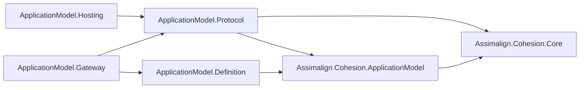

# Assimalign.Cohesion.ApplicationModel.Protocol — Design

> **Status (2026-10-31):** created when the root `Assimalign.Cohesion.ApplicationModel` was split
> into the identity every plane shares and this protocol (root C1, owner). Its types came from the
> root unchanged in shape and in wire form; the decisions they carried from there are restated
> below.

## Purpose

A gateway and the instances of its resources exchange a small set of messages: an instance
publishes its manifest and renews its registration, its gateway answers with the state to restore
and a lease, and an operator's action reaches the instance as an invocation that returns a result
and, after a stateful write, a snapshot. This library holds those messages, the publisher seam both
sides use, and the content format, and nothing either side does on its own.

**Membership test.** A type belongs here when it is part of a message a gateway and an instance
exchange, or of a seam both sides use. A seam only one side uses lives in that side's package
(root C1).

The arrow below means "references". The two runtimes reference the protocol; the logical model
does not, so a gateway program's model never loads the wire types through it.

## The types

| Type | Role |
| --- | --- |
| `ApplicationInstanceManifest`, `ApplicationActionDescriptor` | What an instance publishes about itself: its identity, key, the deployment that started it, where its gateway reaches its control plane, and its actions. |
| `InstanceKey`, `DeploymentId` | The manifest's physical ids: a ULID per process start, and the version 5 UUID a gateway derives from what it deployed (ApplicationModel.Gateway G34). |
| `ApplicationInstancePublication` | What a gateway answers a publication with: the snapshots to restore and a lease. |
| `IApplicationInstancePublisher` | The seam both sides use: the gateway implements it, and the instance's gateway client extends it. |
| `ActionName`, `ApplicationActionKind`, `ApplicationActionOperation` | An action's name, what it accepts (a set), and what one invocation does (one operation). |
| `ApplicationActionContext`, `ApplicationActionResult`, `ApplicationActionStatus` | One invocation, on an instance or a gateway's deployment action, and its outcome. |
| `ApplicationActionSnapshot` | One action's state after a write, as a gateway records and replays it. |
| `IApplicationContentSerializer`, `ApplicationContentException`, `JsonApplicationContentSerializer` | The format of action content, the refusal of content that does not bind, and the default: UTF-8 JSON through source-generated contexts, this library's own first. |
| `ApplicationActionResultJsonConverter`, `ApplicationActionSnapshotJsonConverter` | The wire form of a result and a snapshot. Public, because a type-level `[JsonConverter]` is named by the code a source-generated context in another assembly emits (Gateway's record context reaches the snapshot); hidden from IntelliSense with `[EditorBrowsable(Never)]`. |

## Decisions

**P1 — The wire form did not move with the types.** Every JSON key and value is byte-identical to
what the root wrote before the split: the manifest's camel-case properties and enum names
(`"kind": "ReadWrite"`), a publication's `snapshots` and `lease`, a result's `status`, `output`,
`reason`, and `state`, and a snapshot's `action` and `value`. The internal source-generated context
was renamed `ApplicationProtocolJsonContext` (from `ResourceJsonContext`) with the same options.
A C# name may change; a wire key changes only with a versioned protocol change, because platforms
carry these messages between processes whose package versions can differ.

**P2 — Kind is a capability, operation is one invocation (2026-10-31).** `ApplicationActionKind`
stays `[Flags]` (`Read`, `Write`, `ReadWrite`): what an action accepts. An invocation's
`ApplicationActionContext.Operation` is the new non-flags `ApplicationActionOperation` (`Read`,
`Write`), so the type system says an invocation requests exactly one operation; `Create` still
refuses an undefined value. Each operation has the value of the kind of the same name, so a
dispatcher checks `kind.HasFlag((ApplicationActionKind)operation)`. The operation has no wire form
of its own today: in process it crosses as the object; an out-of-process platform writes it in its
own terms. *Rejected:* keeping the flags enum for both jobs, which made `ReadWrite` a run-time
refusal of every invocation.

**P3 — One copy of each type, one grammar.** Both runtimes reference this assembly instead of
compiling its types, so a manifest an in-process instance publishes is the same type the gateway
registers. `ActionName` validates with the root's `shared/Names/` grammar, compiled in through
`CohesionSharedSource`: a stateless static, the one linked file in the model.

**P4 — Errors.** `ApplicationContentException` is sealed: a serializer throws it for content that
is not a value of the requested type, and an action or state throws it for a value it refuses; a
control plane reports it as `Rejected`. The converters throw `JsonException` for malformed wire
content. Messages come from this assembly's own `ErrorMessages.resx`; the keys the move renamed are
`ApplicationActionOperationInvalid` and `ApplicationContentTypeUnsupported`.

## AOT

No reflection or runtime code generation. The value objects carry their own JSON converters, the
result and snapshot carry hand-written ones, and `JsonApplicationContentSerializer` resolves every
type through source-generated contexts.

## Diagnostics

None. The library raises no events.

## Open questions

- When the parent/child join goes out of process, does the model manifest a child sends become a
  Protocol message, or stay a Definition-owned shape with its own context?
