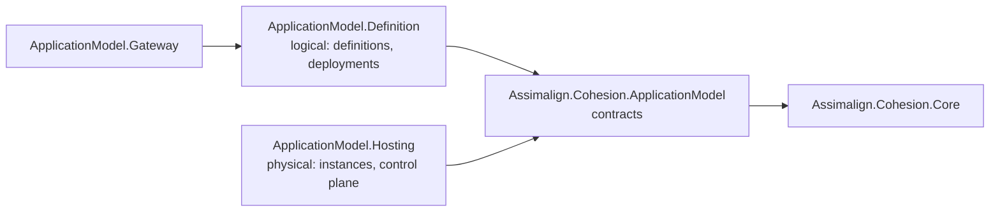

# Assimalign.Cohesion.ApplicationModel — Design

> **Status (2026-10-29):** created when the application model was split into contracts,
> definitions, and hosting (ApplicationModel.Definition D20). Its types came from
> Hosting.Resources, which the split removed; their history is in
> [ApplicationModel.Hosting](../../Assimalign.Cohesion.ApplicationModel.Hosting/docs/DESIGN.md)'s
> decisions. Until the split this project held the logical model, now in
> [ApplicationModel.Definition](../../Assimalign.Cohesion.ApplicationModel.Definition/docs/DESIGN.md).

## Purpose

A resource takes three forms: its definition, which a model declares; its deployment, a gateway's
view of it across its instances; and each instance, one running copy. This library holds what the
three share and what a gateway and an instance exchange, and nothing either side does on its own.
It references Core only.

The arrow below means "references". The logical side and the physical side both reference the
contracts, and neither references the other.

## The types

| Type | Role |
| --- | --- |
| `IApplicationResource` | The base of the three forms: `Provider`, `Name`, and the `Id` derived from them. |
| `ProviderName`, `ProviderId`, `ResourceName`, `ResourceId`, `InstanceKey`, `ActionName`, `DeploymentId` | Identity value objects. Ids are version 5 UUIDs of the names; an instance key is a ULID per process start; a deployment id is a version 5 UUID of what a gateway deployed (ApplicationModel.Gateway G34). |
| `ApplicationInstanceManifest`, `ApplicationActionDescriptor`, `ApplicationActionKind` | What an instance publishes about itself: its identity, key, the deployment that started it, and its actions. |
| `ApplicationActionContext`, `ApplicationActionResult`, `ApplicationActionStatus` | One invocation of an action, on an instance or a gateway's infrastructure action, and its outcome. |
| `ApplicationActionSnapshot` | One action's state after a write, as a gateway records and replays it. |
| `IApplicationContentSerializer`, `ApplicationContentException` | The format of action content, and the refusal of content that does not bind. |
| `IApplicationInstancePublisher`, `ApplicationInstancePublication` | The seam an instance publishes through, which a gateway implements, and its answer: the snapshots to restore and a lease. |

## Decisions

**C1 — Only what both sides exchange.** A type belongs here when the logical and the physical side
both use it, or when it crosses between them. `IApplicationResourceInstance`, the control plane, and
health contributors stay with the instance (ApplicationModel.Hosting) because no gateway uses them;
the definition and the model stay with ApplicationModel.Definition, and the deployment with
ApplicationModel.Gateway, because no instance uses them. A contract that only one side needs is a dependency the other side carries
for nothing.

**C2 — One copy of each type.** Both sides reference this assembly instead of compiling shared
source, so a manifest an in-process instance publishes is the same type the gateway registers, and
code that sees both sides has no two types of one name. *Rejected:* linking the files into both
sides, which would compile a public copy of each type into each assembly.

**C3 — The namespace is the model's.** The types declare `Assimalign.Cohesion.ApplicationModel`, the
namespace ApplicationModel.Definition shares, so a gateway program composes with one `using`.

**C4 — One prefix, then the concept (2026-10-29).** Every type of the model starts with `Application`,
followed by the concept it is: `ApplicationActionResult`, `IApplicationContentSerializer`. `Instance`,
`Resource`, or `Gateway` follows `Application` only where the bare concept would collide or mislead:
- the instance's manifest, publisher, and publication (`ApplicationManifest` is the application's);
- its actions (the gateway's infrastructure action is `IApplicationResourceAction`);
- its host service;
- its control plane (the gateway is the application's control plane).

Value objects carry no prefix, only the noun they identify and `Name`, `Id`, or `Key`: `ResourceName`,
`InstanceKey`, `ActionName`, `Permission`. The same rule names the definition's and the gateway's
types (`ApplicationGatewayRole`, `ApplicationGatewayRecord`, `IApplicationGatewayStore`). Until
this decision the contracts and the instance side were `Resource`-prefixed (`ResourceManifest`,
`IResourceControlPlane`), beside the `IApplicationResource` family.

*Rejected:*
- `ApplicationResource` before every resource-level name: it collides with `ApplicationResourceManifest`
  and `IApplicationResourceAction`, and adds eleven characters to each name.
- `Resource` as the only prefix: it would undo the `IApplicationResource` family.

## AOT

No reflection or runtime code generation. The value objects carry their own JSON converters, and
`ApplicationActionSnapshot` and `ApplicationActionResult` carry hand-written ones for their wire form.

## Diagnostics

None. The library raises no events.

## Open questions

None of its own yet; the model's questions are in ApplicationModel.Definition and
ApplicationModel.Hosting.
