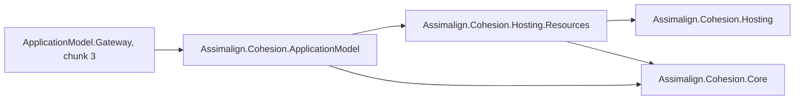
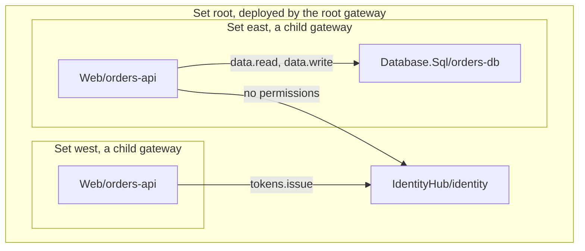

# Assimalign.Cohesion.ApplicationModel — Design

> **Status (2026-10-27):** chunk 2 of the Application Model rebuild, built on
> [Hosting.Resources](../../../Hosting/Assimalign.Cohesion.Hosting.Resources/docs/DESIGN.md) (chunk 1).
> The previous implementation (plans and planners, providers and stores, commands, externals) is
> retired; its source is at commit `6576e7c64`. ApplicationModel.Gateway is chunk 3.

## Purpose

The library has three parts:

1. **The application.** `Application.CreateBuilder(name, args)` returns an `IApplicationBuilder`,
   which is the root gateway's set. `UseGateway` selects the `IApplicationGateway` that runs it, and
   `Build()` closes composition and returns an `IApplication`: its immutable `IApplicationModel` and
   `RunAsync`, which hands the model to the gateway.
2. **Declarative.** What each gateway deploys. An `IApplicationSet` is one gateway's scope: the
   application resources it runs and the child gateways it runs, each with a set of its own. An
   `IApplicationResourceDescriptor` declares one resource and, through `DependsOn`, the resources it
   needs and the permissions it needs on each. `GetManifest()` projects a set and everything below
   it as `ApplicationManifest` data; the root's manifest is the global manifest.
3. **Runtime.** `IApplicationResource` is a gateway's view of one declared resource: the instances
   running it and the state written to them since the gateway was deployed. It answers an
   instance's publication with the state to restore, and a recorded write with the instances that
   must restore it.

The library references Core and Hosting.Resources. The arrow below means "references".

## The hierarchy

The root set belongs to the root gateway, which runs its own resources (here the tenant's identity
provider) and its child gateways. Each child gateway runs its own set. A resource's provider and
name are unique within its set, so `east` and `west` may both run `Web/orders-api`. Gateway names
are unique across the whole hierarchy. A dependency may point into any set of the same hierarchy;
in the diagram an arrow is a `DependsOn`, labeled with its permissions.

## The model

| Type | Role |
| --- | --- |
| `IApplicationBuilder`, `ApplicationBuilder` | The root set, plus `Args`, `UseGateway`, and `Build`. `Application.CreateBuilder(name, args)` creates it. |
| `IApplication`, `Application` | A built application: `Model` and `RunAsync`, which runs the selected gateway with the model, once. |
| `IApplicationModel`, `ApplicationModel` | The immutable model for one gateway: `Manifest` (the whole hierarchy, validated and read-only), `Name` and `Deployment` (that gateway and its part), and `Role`. `ApplicationModel.Create(manifest, gateway)` builds one from data. |
| `GatewayRole` | `Root` for the hierarchy's top gateway, `Composite` for any other. |
| `IApplicationResourceAction` | An infrastructure action on a resource, such as `scale`, executed against the platform. Same invocation and result types as a control. |
| `IApplicationGateway` | The seam ApplicationModel.Gateway implements: `RunAsync(model)`. Deliberately minimal until chunk 3. |
| `IApplicationSet` | One gateway's scope. The builder is the root; `AddGateway` makes a child; `AddResource` declares a resource. |
| `IApplicationResourceDescriptor` | One declared resource. `DependsOn(resource, permissions)` records a dependency, which also orders deployment; declaring it again adds the new permissions, and one that would close a cycle is refused. |
| `ApplicationManifest`, `ApplicationResourceManifest`, `ApplicationResourceDependency` | The hierarchy as data. A dependency names its target by gateway, provider, and name. |
| `IApplicationResource`, `ApplicationResource` | A gateway's aggregate of one resource: `Register` an instance's published manifest, `Record` a stateful write's snapshot, `Unregister` a stopped instance, and `ExecuteAsync` one of its infrastructure `Actions`. |
| `GatewayName`, `GatewayId`, `ResourcePermission` | Value objects. `GatewayId` is a version 5 UUID of the name, like chunk 1's ids. |

## Decisions

**D1 — Resource names are scoped per gateway.** The management routes put resources under
`/gateways/{gatewayId}`, and one service commonly runs in several child gateways (east and west),
so a resource's provider and name are unique within its set only. Across the hierarchy a resource is
identified by its set's `GatewayId` and its `ResourceId` together. Gateway names are unique across the
hierarchy because they key the routes under a tenant. This settles chunk 1's first open question
without changing `ResourceId`.

**D2 — Descriptors are build-time objects; the gateway works from data.** A gateway may receive its
deployment manifest as JSON through its arguments, with no descriptor objects in memory. So
`ApplicationResource` is created from an `ApplicationResourceManifest`, and a dependency is recorded
as data (gateway, provider, name) rather than as a reference to another descriptor.

**D3 — One set type at every level.** The root gateway's set and each child gateway's set are both
`IApplicationSet`, and nothing limits the depth. Nothing differs between a root and a composite set
in this chunk, so separate types would only duplicate the composition API. The gateway chunk decides
what a root does that a composite does not.

**D4 — `DependsOn` records access and order, so there are no cycles (owner decision, 2026-10-28).**
A dependency carries the permissions the dependent resource needs, which the gateway registers with
the tenant's identity provider so that provider can issue credentials just in time. It also orders
deployment: the gateway deploys a resource once what it depends on runs and its outputs are known,
so a dependent can be configured from them. A cycle could therefore never start, and it is refused
where it is declared: `DependsOn` refuses a dependency that leads back to its own resource, naming
the path (`east/Database.Sql/db -> root/Web/web -> east/Database.Sql/db`), and `Create` refuses a
manifest whose dependencies form a cycle anywhere in the hierarchy. A resource that must change one
it depends on does so at run time, through an action the other exposes, such as a Web resource
adding its path rule to the application gateway deployed before it. This replaces the first
version of this decision, which recorded access only and accepted mutual dependencies.

**D5 — `Register` and `Record` are atomic with respect to each other.** Each runs under one lock and
returns its answer from the state that lock protects. An instance that registers before a write is
recorded is in the write's restore list; one that registers after it gets the snapshot in its
registration answer. Every instance therefore receives every recorded snapshot exactly once. The
alternative, a gateway that lists the instances and then records, lets an instance that registers
in between miss the write.

**D6 — Version skew is filtered, not refused.** An instance receives only snapshots for actions its
own manifest declares stateful, and `Record` accepts a snapshot only from an instance that declares
the action stateful. During a rollout, an instance of another version neither receives nor reports
state it does not understand.

**D7 — Durability belongs to the gateway.** The aggregate keeps its state in memory for the life of
one deployment. A gateway that restarts within the same deployment seeds a new aggregate through
`ApplicationResource.Create(manifest, state)`. A gateway should persist a recorded snapshot before it
acknowledges the write, or a restart can lose a write that running instances already apply.

**D8 — Reads take no lock.** `Instances` and `State` return read-only copies that each change
replaces, so a management read never waits on a registration, and a debugger never deadlocks on a
held lock.

**D9 — The base model references Hosting.Resources.** An application resource aggregates the
instances Hosting.Resources defines, so the model shares that library's identity, manifest, and
snapshot types. The previous model duplicated `ResourceName` and `ResourceId` instead. This deviates
from the "base ApplicationModel remains Core-only" rule in `.claude/rules/resource-areas.md`; the
csproj carries the marker, and the rule text changes with the area consolidation rule.

**D10 — The builder is the root set.** `IApplicationBuilder` extends `IApplicationSet`, so a
program composes with `builder.AddResource(...)` and `builder.AddGateway(...)`, and a root resource's
`Set` and a child set's `Parent` are the builder itself. The alternative, a builder that exposes a
separate root set object, made `builder.Set.AddResource(...)` the spelling and gave the root two
identities. The builder and each child set share one internal composition type, so the rules exist
once. Child sets are internal; `IApplicationSet` is their public surface.

**D11 — One validation path.** `Build()` freezes the hierarchy, projects its manifest, and creates
the model with `ApplicationModel.Create(manifest)`, the same call a gateway makes for a manifest it
receives as JSON through its arguments. Composition checks its rules early, at each `Add` and
`DependsOn`, for a precise error at the line that broke them; `Create` is the authority. `Create`
also copies the lists read-only, so a caller that keeps a deserialized list cannot change a model.

**D12 — Building needs no gateway; running does.** A build step can create the model and its
manifest, such as the static assets the SDK will generate for a resource reference, without
selecting or contacting a gateway. `RunAsync` without a gateway throws, and an application runs
once.

**D13 — `IApplicationGateway` is a seed.** The builder needs a type to select, so the interface
exists with one member, `RunAsync(model)`. ApplicationModel.Gateway implements it; the publication
endpoint and the infrastructure provider live there.

**D14 — A model is for one gateway and keeps the whole hierarchy.** `Manifest` is always the whole
hierarchy, so a dependency outside the gateway's own part resolves; `Name` and `Deployment` say
which gateway the model is for and what that gateway deploys, and `Role` follows from them. A model
built in code is for the root; `ApplicationModel.Create(manifest, gateway)` creates a child gateway's.
This settled what a child gateway receives: the whole manifest plus its own name, not its subtree.

**D15 — Infrastructure actions sit on the aggregate.** A gateway's provider supplies each resource's
infrastructure actions to `ApplicationResource.Create`, and `ExecuteAsync` dispatches them with the
statuses a control plane uses (`NotFound`, `NotSupported`, `Rejected` for input that does not bind).
The contract lives here rather than in the gateway library so a transport can expose the actions
without referencing a gateway package.

**D16 — Outputs are placeholders until the platform reports them (owner request, 2026-10-28).** A
resource has values only once it is deployed, such as the endpoint of the load balancer in front of
its instances. A descriptor hands out an `ApplicationResourceOutput` for one (`Endpoint`, or
`Output(name)`), which names its gateway, resource, and output, and carries no value. The gateway
that runs the resource records what its infrastructure provider reports on the aggregate
(`IApplicationResource.Outputs`, `ApplicationResource.SetOutputs`) and fills the value in where a
dependent refers to it. Output names follow the action-name grammar; the provider decides which
outputs a resource has. Values are strings, as configuration and environment variables carry them.
Outputs belong to the logical resource, not to an instance: an instance's own address is a separate
question for the gateway-to-instance channel.

## Threading

An application builder and its sets are composed on one thread and are not safe for concurrent
changes. An `ApplicationResource` is safe for concurrent use.

## AOT

No reflection or runtime code generation. The manifest records are plain data; their value objects
carry their own JSON converters.

## Diagnostics

None. The library raises no events and has no event source.

## Open questions

1. **Tenant and identity provider.** Neither is modeled yet. Is the tenant's identity provider a
   resource of the root set, an external service, or both? Permissions are only recorded until then.
2. **Permission vocabulary.** A permission is checked against its grammar only. The target's
   provider should declare the permissions it accepts; that arrives with the area packages.
3. **Composite depth.** May a child gateway run child gateways of its own? This chunk allows it.
4. **Deployment manifest — settled in chunk 3.** ApplicationModel.Gateway's
   `GatewayDeploymentManifest` carries the "what" (this manifest plus a gateway name) and the "where"
   (provider settings), with its JSON wire contract. The `/infra` routes' transport is still open.
5. **Area verbs.** `set.AddWeb("orders-api")` and resource options belong to the area packages, once
   area implementations consolidate into `<Area>.ApplicationModel`.
6. **Static assets.** The SDK will generate assets for each `CohesionResourceReference` that the
   gateway needs. A descriptor and its manifest record have no slot for them yet; the slot's shape
   comes with the generation that fills it.
7. **A child gateway's model — settled in chunk 3** (D14): the whole manifest plus the child's name,
   carried by a `GatewayDeploymentManifest`.
