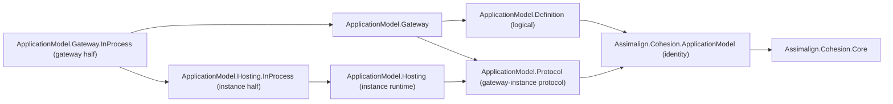

# Assimalign.Cohesion.ApplicationModel — Design

> **Status (2026-10-31):** reduced to resource identity when the gateway-to-instance protocol moved
> to [ApplicationModel.Protocol](../../Assimalign.Cohesion.ApplicationModel.Protocol/docs/DESIGN.md)
> (C1, C5). It was created on 2026-10-29 when the application model was split into contracts,
> definitions, and hosting (ApplicationModel.Definition D20); its first types came from
> Hosting.Resources, whose history is in
> [ApplicationModel.Hosting](../../Assimalign.Cohesion.ApplicationModel.Hosting/docs/DESIGN.md)'s
> decisions.

## Purpose

A resource takes three forms: its definition, which a model declares; its deployment, a gateway's
view of it across its instances; and each instance, one running copy. This library holds the names
all three share, and nothing else: a resource's provider and name, the ids derived from them, and
the name of the platform it runs on. It references Core only.

It is a deliberate identity kernel. Merging it into Definition would make the instance runtime load
the logical model; merging it into Protocol would put wire types into the logical model. A
four-type package is the cost of keeping the two sides apart.

The arrow below means "references". Every package of the model reaches this one. Definition, the
logical side, references only this one. Protocol adds what a gateway and an instance exchange, and
the two runtimes reference it: Hosting directly, Gateway beside Definition. A platform is a pair of
packages, one on each side (C5).

## The types

| Type | Role |
| --- | --- |
| `IApplicationResource` | The base of the three forms: `Provider`, `Name`, and the `Id` derived from them. |
| `ProviderName`, `ResourceName` | What a resource is (its provider, such as `Web`) and which one it is (`orders-api`). |
| `ProviderId`, `ResourceId` | Version 5 UUIDs of the names. Nothing reads them outside this library's tests yet; whether to keep them for a management API is an open owner question. |
| `PlatformName` | Names a platform, such as `inprocess` or `kubernetes`: what a gateway deploys onto, when an extension applies, and which client an instance reaches its gateway through (C5). |

The hyphenated-words grammar `PlatformName` validates with is shared source in this project's
`shared/Names/` module: Protocol's `ActionName` and Definition's output and extension names compile
the same file (`CohesionSharedSource`), so there is one grammar and no public helper. It is a
stateless static, so linking it is safe.

## Decisions

**C1 — The placement rule (2026-10-31, owner).** A type lives in the lowest package that every one
of its consumers already references:
- **Names every plane uses live here:** a resource's provider and name, their ids, and the platform
  name.
- **Anything inside a gateway-to-instance message, or a seam both sides use, lives in
  [Protocol](../../Assimalign.Cohesion.ApplicationModel.Protocol/docs/DESIGN.md):** the manifest an
  instance publishes, the publication its gateway answers with, action invocations, results and
  snapshots, the content serializer, the instance key and deployment id the manifest carries, and
  `IApplicationInstancePublisher`, which the gateway implements and the instance's client
  implements too.
- **A seam one side uses lives in that side's package:** the gateway's client to an instance
  (`IApplicationGatewayInstanceClient`) in Gateway; the instance's client to its gateway
  (`IApplicationInstanceGatewayClient`) and the control plane in Hosting; the definitions and the
  model in Definition.

*Superseded:* the first C1, "only what both sides exchange", which put the identity and the
protocol in one package, so the logical model loaded the wire types and the root read as unrelated
types from either side.

**C2 — One copy of each type.** Every package references the one that owns a type instead of
compiling shared source, so a manifest an in-process instance publishes is the same type the
gateway registers. The one shared file is the name grammar, an internal stateless helper (see the
types above). *Rejected:* linking public types into several assemblies.

**C3 — The namespace is the model's.** The types declare `Assimalign.Cohesion.ApplicationModel`, the
namespace Protocol and Definition share, so a gateway program composes with one `using`.

**C4 — One prefix, then the side, then the concept (2026-10-29; sides 2026-10-31).** Every type of
the model starts with `Application`, then the side it belongs to, then the concept:
- **Side.** `Gateway` when the gateway owns it or a platform's gateway half implements it
  (`ApplicationGatewayDeploymentRecord`, `IApplicationGatewayInfrastructureProvider`); `Instance`
  when it belongs to one running copy (`IApplicationInstanceAction`, `ApplicationInstanceManifest`);
  `Model` for the whole logical model and `Resource` for one resource's definition
  (`ApplicationModelManifest`, `ApplicationResourceManifest`). Protocol's action and content types
  take no side word (`ApplicationActionResult`, `IApplicationContentSerializer`), because both sides
  use them.
- **Client direction.** A client is named `IApplication<Holder><Target>Client`: the gateway's client
  to an instance is `IApplicationGatewayInstanceClient`, the instance's client to its gateway is
  `IApplicationInstanceGatewayClient`. The first words of each summary say the direction.
- **State and snapshot.** State is the live object on an instance (`IApplicationInstanceActionState`);
  a snapshot is its recorded bytes, on the wire or in a record (`ApplicationActionSnapshot`).
- **Kind and operation.** `ApplicationActionKind` is what an action accepts, a set;
  `ApplicationActionOperation` is what one invocation does.
- **Files.** A file's name equals the type it declares.

Value objects carry no prefix, only the noun they identify and `Name`, `Id`, or `Key`: `ResourceName`,
`InstanceKey`, `ActionName`, `Permission`. Implementations of a contract are named for their
technology or platform: `JsonApplicationContentSerializer`, `JsonFileApplicationGatewayStore`,
`InProcessInfrastructure`.

*Known exceptions, kept for now:* some members still say `State` for snapshot bytes
(`ApplicationActionResult.State`, `IApplicationGatewayDeployment.State`, the record's `State`),
because their JSON keys are wire contract; renaming the C# members is a follow-up.
*Rejected:*
- `ApplicationResource` before every resource-level name: it adds eleven characters to each name.
- `Resource` as the only prefix: it would undo the `IApplicationResource` family.

**C5 — A platform owns the channel between an instance and its gateway, both ways (2026-10-30,
owner; seams placed 2026-10-31).** The core packages carry no transport. A platform implements one
seam per direction, each in the package of the side that uses it:
- **The instance half**, which a resource opts into in its area builder (`resource =>
  resource.UseInProcess()`), is the instance's gateway client (`IApplicationInstanceGatewayClient`,
  ApplicationModel.Hosting). It publishes the instance's manifest through Protocol's
  `IApplicationInstancePublisher`, which it extends, and carries the gateway's calls in.
- **The gateway half**, which the gateway opts into in its builder, is the gateway's infrastructure
  provider, whose `StartAsync`/`StopAsync` run its inbound channel (ApplicationModel.Gateway), and
  its instance client (`IApplicationGatewayInstanceClient`, ApplicationModel.Gateway G38).
- **Selection.** A resource that runs on several platforms opts into each; an instance uses the
  client of the platform its gateway names (`AppEnvironment.Variables.Gateway`, a `PlatformName`).
  None named runs it unmanaged; a name it has no client for fails its build.
- **Address.** The manifest's `ControlPlaneEndpoint` is where the gateway reaches the control plane
  in the platform's own terms; the instance's client names it, and only the platform's instance
  client reads it.
- **Content.** An invocation's content crosses as bytes, which the instance's control plane reads
  with its own serializer, whether or not a process boundary lies between them.

So an area does no transport: Web exposes its settings as actions and nothing else.
*Superseded:* this library holding both client seams (2026-10-30), which the placement rule (C1)
moved to the sides that use them; and before it, an HTTP control-plane binding every area served
on its own listener. *Rejected:* one package per platform for both halves; a resource that
references it carries the gateway and the logical model.

## AOT

No reflection or runtime code generation. The value objects carry their own JSON converters.

## Diagnostics

None. The library raises no events.

## Open questions

- Delete `ResourceId` and `ProviderId` until something reads them (recording their UUIDv5
  namespaces, `e10d0c39-063e-43de-ac58-32a831744cbd` and `7a1afa1e-6690-4108-8c87-dc141c045fda`,
  so they can return without changing ids), or keep them for a management API?
- Keep `IApplicationResource` as the shared identity base, although no member takes it?
- `Provider` names both the resource kind (`ProviderName`) and the platform seam
  (`IApplicationGatewayInfrastructureProvider`). Rename `ProviderName` to a resource kind, which
  changes the manifest's JSON field, or accept the overload?
