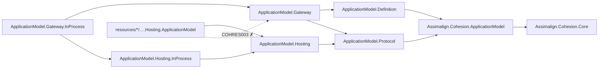

# ApplicationModel Library Area

> **Rebuilt since 2026-10-27.** Since 2026-10-31 the area is seven projects: four core ones, the shared
> [identity](Assimalign.Cohesion.ApplicationModel/docs/DESIGN.md), the gateway-to-instance
> [protocol](Assimalign.Cohesion.ApplicationModel.Protocol/docs/DESIGN.md), the logical side in
> [Definition](Assimalign.Cohesion.ApplicationModel.Definition/docs/DESIGN.md), and the instance
> runtime in [Hosting](Assimalign.Cohesion.ApplicationModel.Hosting/docs/DESIGN.md). The [gateway](Assimalign.Cohesion.ApplicationModel.Gateway/docs/DESIGN.md)
> builds on the definitions and the protocol. Each gateway runs a model of its own, deployed by its own pipeline, and
> a child gateway joins its parent. Since 2026-10-30 every transport belongs to a platform, which is
> a pair of packages: the in-process platform is
> [Hosting.InProcess](Assimalign.Cohesion.ApplicationModel.Hosting.InProcess/docs/DESIGN.md), which a
> resource opts into, and [Gateway.InProcess](Assimalign.Cohesion.ApplicationModel.Gateway.InProcess/docs/DESIGN.md),
> which runs a gateway's resources in its own process. The first out-of-process platform, the
> Kubernetes pair (`ApplicationModel.Gateway.Kubernetes` and `ApplicationModel.Hosting.Kubernetes`),
> lives in the `cohesion-platforms` repository.

The L2 application-composition and orchestration plane: the shared identity and protocol, the definitions a
gateway program declares, and the instance side every area's `<Area>.Hosting.ApplicationModel`
package builds on, plus the gateway family that deploys and manages resources without loading their
runtimes.

The area's architecture record lives in
[docs/libraries/ApplicationModel/DESIGN.md](../../docs/libraries/ApplicationModel/DESIGN.md);
this README is the project map. The full reference graph for every Cohesion assembly is in
[docs/DEPENDENCIES.md](../../docs/DEPENDENCIES.md).

## Layering

In the repo's L1/L2/L3 model (see [docs/programs/DELIVERY_ROADMAP.md](../../docs/programs/DELIVERY_ROADMAP.md)),
this area is **L2 — application runtime and composition**: it sits above the L1 foundation
libraries (`Core`, `Hosting`) and below every L3 service platform under `resources/`.

## Project map

The arrow means "references": `Gateway.InProcess --> Gateway` reads "`Gateway.InProcess`
references `Gateway`". Every package reaches the identity root. The logical side (Definition)
references only the identity; the instance runtime (Hosting) references the protocol; the gateway
references both the definitions and the protocol. Definition and Hosting never reference each other,
and Definition never references the protocol. A platform is a pair: its instance half references
Hosting, and its gateway half references the Gateway and, for now, the instance half (the in-process
rendezvous; a later chunk removes that edge). A resource references only the instance half.

Solid edges are the references the layering permits. The dotted edge is the one `COHRES003`
rejects: no shipped project under `resources/**` may resolve an
`Assimalign.Cohesion.ApplicationModel.Gateway*` assembly, because gateway orchestration belongs
outside resource-area packages. That prohibition has no opt-out and no exemption property.

| Project | Role |
| --- | --- |
| `Assimalign.Cohesion.ApplicationModel` | The shared identity: the `IApplicationResource` base, resource provider and name with their ids, and the platform name |
| `Assimalign.Cohesion.ApplicationModel.Protocol` | What a gateway and an instance exchange: the instance manifest and its ids, the publication and the publisher seam both sides use, action invocation, results and state snapshots, and the default JSON content serializer |
| `Assimalign.Cohesion.ApplicationModel.Definition` | The logical side: what one gateway runs, declared as a model: its resources with their dependencies, settings, and platform extensions, and the parent it joins |
| `Assimalign.Cohesion.ApplicationModel.Hosting` | The instance runtime: a running resource instance, its actions and their state, its health contributors, its control plane, the host service that publishes and restores through a platform's client (`IApplicationInstanceGatewayClient`), and the options every area's resource opts into platforms with |
| `Assimalign.Cohesion.ApplicationModel.Hosting.InProcess` | The in-process platform's instance half: `UseInProcess()` on a resource's options; it publishes to its gateway's in-process endpoint and attaches the instance's control plane there for direct calls |
| `Assimalign.Cohesion.ApplicationModel.Gateway` | The gateway: deploys its model's resources through an infrastructure provider, keeps each resource's deployment across its instances, receives instance publications and child gateways' joins, runs operators' actions through its platform's `IApplicationGatewayInstanceClient`, and exposes deployment actions; `ApplicationGatewayBuilder` declares the model and builds the gateway, which starts, stops, and reports its run's `Completion` |
| `Assimalign.Cohesion.ApplicationModel.Gateway.InProcess` | The in-process platform's gateway half: runs each resource's program on a thread of its own in the gateway's process, in an environment scope of its own, receives their publications over a channel, and calls their attached control planes directly |

## Further reading

- [docs/libraries/ApplicationModel/DESIGN.md](../../docs/libraries/ApplicationModel/DESIGN.md) — the area architecture record
- [docs/RUNTIME_CONTRACT.md](../../docs/RUNTIME_CONTRACT.md) — the language-neutral `COHESION_*` runtime contract
- Per-project `docs/OVERVIEW.md` and `docs/DESIGN.md` beside each project's `src/`
