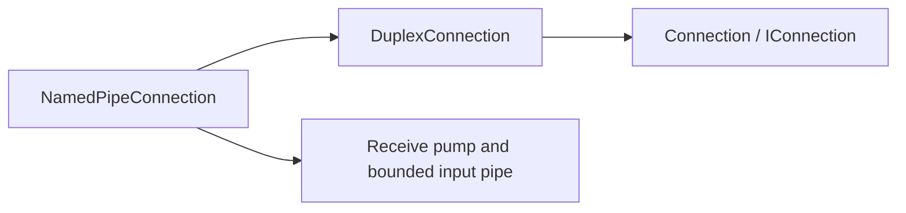

# Assimalign.Cohesion.Connections.NamedPipes Design

## Design Intent

Provide a named-pipe implementation of the Connections contracts: the Windows-native local
inter-process transport, and the cross-platform peer of the Unix domain socket path in the stream
(`Tcp`) driver. It is the same *shape* as the socket drivers — a reliable, ordered, single-stream
`IDuplexConnectionListener` / `IDuplexConnectionFactory` producing `IDuplexConnection`s — but the wire is a named pipe
(`NamedPipeServerStream` / `NamedPipeClientStream`) rather than a socket.

Named pipes matter for Cohesion's own architecture. The ApplicationModel LocalGateway spawns
co-located service processes; local IPC over a named pipe (or a Unix domain socket) removes port
allocation, firewall, and loopback-security concerns and replaces them with filesystem/ACL access
control. Because the Connections stack selects transports by **capability, not protocol identity**, a
named-pipe listener drops into the same `UseHttp1/2(IDuplexConnectionListener)` seams a TCP or UDS listener
uses, with no change to the HTTP stack above it.

The driver is a peer of `Tcp` / `Udp` / `Quic` / `InMemory`: it lives beside them under
`libraries/Connections`, depends only on the Connections contracts (plus `Core`), and adds no contract
changes. This mirrors Kestrel's `ListenNamedPipe` surface, expressed through the Cohesion connection
model instead of a bespoke transport abstraction.

## The Stream Bridge

The input side uses a receive pump that copies from the native pipe stream into a bounded
`Pipe`. It keeps a read pending while the application is idle, so observed peer closure cancels
`ConnectionClosed` without requiring application I/O. A `PipeWriter.Create` adapter serves output.
The connection owns the stream, cancels a blocked flush during teardown, and awaits the pump
before disposal completes. Input backpressure bounds buffered memory.

The driver depends on the duplex base and shares the root lifecycle:

## Accept Model

A `NamedPipeServerStream` instance serves exactly one client. `BindAsync` creates the initial instance
and reserves the pipe name; it is idempotent while the listener is active. `AcceptAsync` consumes that
reserved instance, awaits `WaitForConnectionAsync`, and returns a `NamedPipeConnection` wrapping the
connected instance; the next `AcceptAsync` creates the next instance. A continuously-accepting consumer
(the HTTP connection listener loops accept) therefore always has one instance waiting, so the pipe name
stays live between connections. `MaxServerInstances` (default: unlimited) bounds how many instances may
share the name; the practical bound is the consumer's concurrency, not the transport.

The in-flight listening instance is tracked so `DisposeAsync` can dispose it, which unblocks a pending
`WaitForConnectionAsync` (it observes `ObjectDisposedException`) and surfaces as
`OperationCanceledException` from the pending `AcceptAsync` — the same disposal contract the other
drivers honor. A client that aborts mid-handshake surfaces as an `IOException`, which the accept loop
absorbs by retrying with a fresh instance.

## Buffer Sizing

The pipe buffers default to a non-zero size (`NamedPipeConnectionListenerOptions.DefaultBufferSize`, 4
KiB). This gives the pipe socket-like semantics: a peer's small write completes without this end
actively reading, exactly as a TCP send buffer would absorb it. A buffer size of `0` requests the
operating-system default, under which — on Windows — a write can block until the reader drains it (a
synchronous rendezvous), which is surprising for a connection abstraction. The default is deliberately
non-zero so write-then-read on a single task does not deadlock; consumers that want strict flow-control
realism can lower it.

## Access Control

Access control is applied at pipe-creation time (builder-time), never per request:

- **`PipeSecurity` (Windows).** When set, the server pipe is created through
  `NamedPipeServerStreamAcl.Create`, so the caller supplies a full Windows ACL controlling which
  principals may connect. Reading and using this option is guarded by `OperatingSystem.IsWindows()`
  behind a `[SupportedOSPlatform("windows")]` helper, so the analyzer is satisfied and non-Windows
  builds never touch the Windows-only API. A `PipeSecurity` value can only be constructed on Windows, so
  the option is naturally inert elsewhere.
- **`CurrentUserOnly`.** A cross-platform convenience that restricts the pipe to the current user via
  `PipeOptions.CurrentUserOnly`. It is ignored when an explicit `PipeSecurity` is supplied, since the ACL
  fully specifies the policy (and `NamedPipeServerStreamAcl.Create` rejects the combination).

A `NamedPipeConnectionListener` can only bind a pipe on the local host (`NamedPipeEndPoint.ServerName`
must be `"."`), because a named-pipe server cannot be created on a remote machine; a
`NamedPipeConnectionFactory` may dial a remote host.

## Lifecycle and Error Model

- A connection is **live when produced**. Read `Input` and write `Output` immediately.
- **Graceful dispose** completes both pipe halves without an error and disposes the pipe stream, so the
  peer observes end-of-stream on its next read; state becomes `Closed`. Dispose is idempotent.
- **Abort(reason)** completes the halves with the reason and disposes the stream so the peer's next
  read/write faults; state becomes `Aborted` and `ConnectionClosed` is signaled. A `null` reason
  surfaces a `ConnectionAbortedException`.
- `ConnectionClosed` fires on local disposal, abort, and observed peer closure, no later than disposal
  completes. The receive pump observes an idle peer closing.
- Listener disposal releases only its reserved server instance and is terminal. Accepted connections
  remain owned by the callers who accepted them. A later bind uses a new listener instance.

## Diagnostics

The diagnostics tests link the canonical test-only `build/TestSupport/EventSourceRecorder.cs`
with MSBuild `Compile`/`Link` (see `.claude/rules/testing.md`); it records
events and counter publication without adding a shipped dependency.

The driver reports through its own internal event source, named for the assembly:
`Assimalign.Cohesion.Connections.NamedPipes` (`Internal/EventSource/NamedPipeConnectionEventSource.cs`),
per the repository EventSource convention (`.claude/rules/event-source.md`). Tools enable it by name;
an application forwards it into its logging with `Assimalign.Cohesion.Logging.EventSource`, where the
source name becomes the log category.

| Id | Event | Level | Payload |
|---|---|---|---|
| 1 | `ListenerBound` | Informational | `listenerId`, `endPoint` |
| 2 | `ListenerClosed` | Informational | `listenerId` |
| 3 | `ConnectionOpened` | Informational | `connectionId`, `listenerId` (empty when dialed), `localEndPoint`, `remoteEndPoint` |
| 4 | `ConnectionClosed` | Informational | `connectionId` |

Counters: `current-connections`, `total-connections`, and `connections-per-second`.

The connection, not the listener, reports its own lifecycle, so dialed connections are counted too
(the listener used to report only accepted ones, and nothing reported a close). `Abort` and
`DisposeAsync` both end a connection; whichever runs first reports the close, once.

## AOT Posture

No reflection, no runtime code generation, no serialization. A pure `System.IO.Pipes` +
`System.IO.Pipelines` composition over BCL types, with the driver's own internal
`System.Diagnostics.Tracing` event source and counters. Fully NativeAOT/trim compatible (`IsAotCompatible=true`). The Windows-only
ACL surface is isolated behind `[SupportedOSPlatform("windows")]` guards so no platform-specific code is
reachable on other operating systems.

## Non-Goals

- **No message framing.** The pipe is created in `PipeTransmissionMode.Byte` (a byte stream), never
  message mode; the transport delivers an ordered byte stream and leaves framing to the protocol above,
  consistent with the single-stream connection shape.
- **No datagram or multiplexed variant.** Named pipes model a single reliable, ordered stream.
- **No security layer of its own beyond OS access control.** A TLS-secured named-pipe connection is
  produced by composing the Connections `Security` (TLS) layer over it, exactly as for any other
  transport; ACLs handle local authorization.
- **No request-time service location or per-connection middleware.** Access control and tuning are
  builder-time options, matching the Connections philosophy.

## Relationships

- **`Assimalign.Cohesion.Connections`** — the `DuplexConnection` / `DuplexConnectionListener` / `DuplexConnectionFactory`
  guided bases this driver implements, plus `ConnectionCapabilities`, `ConnectionProtocol.NamedPipe`,
  `ConnectionAbortedException`, and `ListenerId`. Diagnostics are this driver's own internal event
  source (see *Diagnostics*), not a seam on the contracts library.
- **`Assimalign.Cohesion.Connections.Tcp`** — the sibling stream driver whose Unix domain socket path is
  the POSIX counterpart to this Windows-native local IPC transport.
- **`Assimalign.Cohesion.Http.Connections`** — composes this listener via
  `UseHttp1/UseHttp2(IDuplexConnectionListener)` with no HTTP-layer change (validated by the
  `HttpOverNamedPipeTests` end-to-end test).
- **ApplicationModel LocalGateway** — the intended consumer: co-located service processes addressed by a
  named pipe instead of a loopback port.

## Connection hierarchy compatibility

Decision 58 changes the hierarchy shipped in 10.0.0-preview.1 under decision 15's accepted
preview source and binary breaks. Byte-pipe APIs use `IDuplexConnection` and `DuplexConnection`, with duplex listener/factory bases.
Their public accept/connect results are interfaces. The generic listener base supplies `Id`,
`Connections`, and the shared accept core.
Every connection shares root lifecycle and features. Accepted connections stay in the live set
until their closed token fires; listener disposal never closes handed-out connections.
Only the code that accepted a connection reads or writes it.
