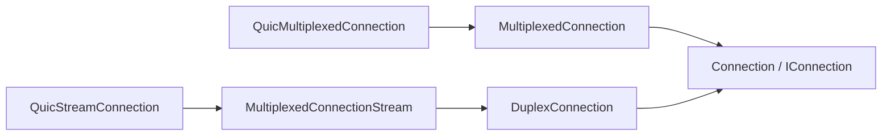

# Assimalign.Cohesion.Connections.Quic — Design

## Design intent

This library is the QUIC **driver** for the Connections contracts in
`Assimalign.Cohesion.Connections`: it adapts `System.Net.Quic` to the
`MultiplexedConnection` / `MultiplexedConnectionListener` /
`MultiplexedConnectionFactory` shapes and nothing more. It carries no
application-protocol semantics — no HTTP/3 framing, no ALPN-specific
behavior switches, no stream-type interpretation. Protocols (HTTP/3 in
`Assimalign.Cohesion.Http.Connections`, and any future QUIC-borne
protocol) consume the contracts by capability and own their own wire
rules.

The one place protocol reality deliberately shapes this driver is
**teardown ordering** (see "Lifecycle and teardown"): how a multiplexed
connection announces its death to the peer is wire-visible and must be
correct for the protocols that run over it.

## Family map

| Type | Visibility | Role |
| --- | --- | --- |
| `QuicConnectionListener` | `public sealed` | Constructed unbound from options; async `BindAsync` acquires the endpoint and `AcceptAsync` yields server-side connections. `CreateAsync` remains the construct-and-bind convenience. |
| `QuicConnectionFactory` | `public sealed` | Dials outbound connections; `ConnectAsync` yields client-side connections. |
| `QuicConnectionListenerOptions` / `QuicConnectionFactoryOptions` | `public sealed` | Endpoint, TLS/ALPN, stream limits, pipe buffer sizes, default error codes, and the bound on disposal's wait for stream delivery (`CloseDeliveryTimeout`, see "Lifecycle and teardown"). The listener also exposes `HandshakeTimeout`. Both default ALPN to HTTP/3 (see "Error model"). |
| `QuicMultiplexedConnection` | `public sealed` | One QUIC connection; `AcceptStreamAsync` / `OpenStreamAsync` surface streams as `MultiplexedConnectionStream`s and track them for teardown. Registers `Tls` and `StreamLimits` feature objects (see below), and implements the root coded connection close (see "Application error codes"). |
| `QuicStreamConnection` | `internal` | One QUIC stream as a `MultiplexedConnectionStream`: pipes over the stream, direction from the stream's readable/writable halves, whole-stream reset and input completion on the root. Registers itself as the `DirectionalAbort` feature. |

`QuicMultiplexedConnection` and the listener/factory are `public sealed`
concretes (not interface-first `internal` implementations) because they
*are* the driver's surface: consumers select the driver by constructing
it, then immediately fall back to the `IMultiplexedConnection` /
`IMultiplexedConnectionStream` contracts. This mirrors the Tcp/Udp sibling drivers.

## Connection features (#1452)

The driver references `Connections.Tls`, `Connections.StreamLimits` and `Connections.StreamAbort`.
Its lazy `ConfigureFeatures` hook registers separate TLS and stream-limit objects, each returning
its contract's pinned `FeatureName`. Distinct objects matter because one feature has only one name.
The existing public facts properties remain on `QuicMultiplexedConnection`; the TLS and limits
contracts are implemented only by the two dedicated objects. Keeping both contracts on the
connection would give it two incompatible required feature names through the single
`IConnectionFeature.Name` member. Each QUIC stream registers itself only for `DirectionalAbort`.
Stream collections never fall back to their parent connection.

Applications read `connection.Tls`, `connection.StreamLimits` and `stream.DirectionalAbort`,
which continue through layers that override `InnerFeatures`. Features allocate only on first
access. Cache a discovered feature when using it repeatedly on a connection or stream.

Adding `Features` to the three connection interfaces breaks implementers of 10.0.0-preview.1
under owner decisions 15 and 56; the guided bases cover subclasses. Moving these optional
contracts breaks no released API because they postdate preview.1. Removing
`ITlsConnectionInfo` and `IMultiplexedConnectionStreamLimits` from the public concrete connection
is an additional public-surface change required by the one-object, one-name rule, recorded for
owner review under escalations. These implementations also postdate preview.1; existing public
facts properties remain available, while consumers discover the contracts through the features.

## Stream surfacing

- Direction is derived once at wrap time from `(CanRead, CanWrite)`:
  bidirectional, `ReadOnly` (peer-initiated unidirectional), or
  `WriteOnly` (locally opened unidirectional). A peer cannot open a
  stream that only the remote side writes to, so `OpenStreamAsync`
  rejects `ReadOnly`.
- Unidirectional streams surface honest halves rather than throwing
  lazily: a `WriteOnly` stream's `Input` is a pre-completed reader; a
  `ReadOnly` stream's `Output` is an `UnwritablePipeWriter` whose writes
  throw `InvalidOperationException`.
- Every stream of one connection draws from a **single shared**
  `StreamPipeOptionsContext` (one adaptive memory pool per connection,
  not per stream), owned by the connection and disposed last, after all
  streams and the QUIC connection have released their buffers.
- **Each half ends on its own (#1330).** The stream pipes are created with
  `leaveOpen: true`, and the halves a holder sees end only their own
  direction:
  - completing `Output` flushes what the pipe holds and sends the FIN
    (`QuicStream.CompleteWrites`), and the stream stays readable until the
    peer ends its side. Completing it with an error sends `RESET_STREAM`
    with `DefaultStreamErrorCode` instead, so an abnormal end never looks
    like a complete one, and so does a completion whose own final flush
    fails — a write still in flight on the stream, for instance — which
    would otherwise put a FIN after partial data. The completion is the
    first signal for the sending direction, so a later `AbortWrite` does
    nothing and `Abort` stops only the receiving direction:
    `QuicStream` keeps the direction open until the peer acknowledges the
    FIN, and would put `RESET_STREAM` on the wire after it, letting the
    peer discard data it was told was complete (an HTTP/3 tunnel or
    request body that fails after the response's FIN reaches this);
  - completing `Input` stops the receiving direction with
    `DefaultStreamErrorCode` (`STOP_SENDING`), unless it has already
    ended — read to its end, or stopped with a code — and leaves the
    sending direction alone.

  Once every usable half has been completed the stream is finished, so the
  `QuicStream` is disposed in the background — it waits for the stream's
  shutdown, which a graceful FIN reaches once the peer has the data — and
  the stream's `DisposeAsync` waits for that same disposal. That keeps the
  connection-first teardown below intact: a bidirectional stream disposed by
  its connection still delivers its FIN before the `CONNECTION_CLOSE`, for
  as long as the connection's `CloseDeliveryTimeout` allows.
  One completed direction leaves the stream usable. Once all usable native directions
  complete or the native stream is released, `ConnectionClosed` fires. Before
  #1330 the pipes were created with `leaveOpen: false`, so completing either
  one disposed the `QuicStream` synchronously, which ended both directions
  and blocked the completing thread until the peer acknowledged the FIN.

### A FIN already observed (#1427)

Each stream's root `IMultiplexedConnectionStream.IsInputCompleted` checks the existing
`QuicStream.ReadsClosed` task for successful completion and excludes a locally aborted read.
.NET 10 completes that task when its final buffered bytes are copied to the caller, before
returning that final nonzero read. Thus a stream-backed `PipeReader` can expose the fact without
waiting for another read to return zero. The consumer must still check for unread pipe bytes:
a FIN after data is not an empty input until those bytes are consumed.

The implementation uses [the runtime's completion behavior](https://github.com/dotnet/runtime/blob/v10.0.0/src/libraries/System.Net.Quic/src/System/Net/Quic/QuicStream.cs#L284-L301),
with real-QUIC tests pinning it. There is no prefetch task, extra read buffer, or speculative read;
late FINs remain conservative until the runtime observes them. Moving the completion fact to the
stream root (#1453) adds no HTTP dependency: every byte-stream multiplexer supports a half-close.
The incremental HTTP/3 body signal it improves was introduced after 10.0.0-preview.1; the root's
stream return type changes are recorded under "Breaking changes" below.

## Inbound stream allowance (#1425)

`QuicMultiplexedConnection` registers an `IMultiplexedConnectionStreamLimits` feature from
`Connections.StreamLimits`, available through `connection.StreamLimits`.
Its `InboundBidirectionalStreamLimit` starts at the inbound bidirectional concurrency configured
for the connection and increases once per inbound bidirectional stream whose disposal starts,
saturating at QUIC's maximum of 2^60 streams. Outbound streams and unidirectional streams do not
change it. The listener freezes its bidirectional limit at bind time and uses that same snapshot
in every handshake and accepted wrapper; mutations of the original option after binding cannot
make those two disagree. Factory-created wrappers take the actual client options' inbound limit
(currently the BCL client default of zero).

The value is a **conservative cumulative upper bound**, not an exact snapshot of the current
native MAX_STREAMS value. .NET 10 requests
[`DELAY_ID_FC_UPDATES`](https://github.com/dotnet/runtime/blob/v10.0.0/src/libraries/System.Net.Quic/src/System/Net/Quic/QuicConnection.cs#L644-L663),
which defers replenishment until the native stream handle closes. The driver increments before
starting native disposal, including cleanup after a wrapper-construction failure, so a concurrent
consumer never rejects a stream against already-replenished but unrecorded credit. The callback
is cached per connection and guarded by the stream's existing one-shot release latch.

During pending disposal the bound can include credit not advertised yet. This permits some
references beyond the exact native limit, rather than falsely rejecting legitimate references
on a long-lived connection after stream credit is replenished. `System.Net.Quic` offers no public
getter for the local cumulative allowance; its stream-capacity callback reports the opposite
direction. Protocols retain their own bounded storage as a backstop. No reflection, native calls,
or HTTP-specific semantics are added. The facet is an additive API relative to
10.0.0-preview.1; changing the bound listener's bidirectional option is now explicitly ineffective.

## Listener option ranges (#1488)

The listener options reject invalid numeric assignments with `ArgumentOutOfRangeException` before
binding or accepting connections. Both `MaxBidirectionalStreamCount` and
`MaxUnidirectionalStreamCount` accept 0 through 65535 inclusive, matching
[.NET 10's `QuicConnectionOptions.Validate`](https://github.com/dotnet/runtime/blob/v10.0.0/src/libraries/System.Net.Quic/src/System/Net/Quic/QuicConnectionOptions.cs#L136-L145).
This is the runtime's concurrent stream allowance limit, distinct from QUIC's cumulative stream-ID
limit. The existing bind-time bidirectional snapshot and all-zero idle-close fallback are preserved.

`Backlog` accepts nonnegative integers. Zero still selects
[the runtime's default backlog](https://github.com/dotnet/runtime/blob/v10.0.0/src/libraries/System.Net.Quic/src/System/Net/Quic/QuicListenerOptions.cs#L38-L49).
The .NET 10 listener does not reject a negative backlog at bind time; its
[incoming-connection capacity check](https://github.com/dotnet/runtime/blob/v10.0.0/src/libraries/System.Net.Quic/src/System/Net/Quic/QuicListener.cs#L295-L310)
then refuses incoming connections. Guarding assignment avoids that apparently healthy listener and
also prevents invalid stream allowances from reaching the per-connection handshake callback.
Rejected assignments retain the previous value, including when callers retain and mutate options.
The setter tests run without a native QUIC provider; real-QUIC tests retain `QuicFact`/`QuicTheory`.

## Handshake facts

QUIC runs a TLS 1.3 handshake inside its own (RFC 9001), so a QUIC connection is a TLS-terminating
connection in the contracts' sense. `QuicMultiplexedConnection` registers an `ITlsConnectionInfo`
feature from `Connections.Tls`, available through `connection.Tls`, reporting what that handshake negotiated: the ALPN application protocol, the TLS version (always
TLS 1.3), the cipher suite, and the peer's certificate (the client's on a server-side connection,
present when the listener's `ServerAuthenticationOptions` requested one). The values are captured
when the connection is wrapped, after `System.Net.Quic` has completed the handshake, and are the
same for the lifetime of the connection; streams do not inherit the connection's features. The
driver reads the values and never branches on them, so it stays free of protocol semantics.

Reading `QuicConnection.RemoteCertificate` hands the certificate's ownership to the reader (a
`QuicConnection` no longer disposes a certificate it has exposed), so `QuicMultiplexedConnection`
disposes the peer certificate after it has disposed the QUIC connection.

## Lifecycle and teardown

Connections are live when produced; there is no separate open step.
Teardown has two paths:

The listener itself has an explicit lifecycle: construction captures configuration without opening a
socket, `BindAsync` asynchronously acquires the endpoint and is idempotent while active, and
`DisposeAsync` releases the endpoint terminally. Restart creates a new listener.

- **`DisposeAsync` (graceful)** — wire-visible ordering is load-bearing:
  1. **Bidirectional streams complete first.** Their write halves carry
     application data (an HTTP/3 response, for example) whose FIN and
     delivery acknowledgement must precede the connection close, or the
     tail of the data could be lost. The streams are disposed together,
     and their waits for delivery share one bound, `CloseDeliveryTimeout`
     (five seconds by default, on both options types). A peer that
     withholds stream credit for a response's tail while it keeps the
     connection alive with PINGs never acknowledges the FIN, and MsQuic's
     send buffering has already completed every write, so nothing above
     the driver sees a stall; without the bound the disposal, and the
     host's connection slot, would wait for as long as the peer chose.
     When the bound runs out the close in step 2 ends every stream still
     delivering, which completes its disposal, and the tail is lost. An
     abort after disposal started ends the delivery wait immediately with disposal's chosen
     default close code, so a shorter host shutdown budget can still force teardown.
     (Before #1330 the wait happened on the exchange's own thread, inside
     the blocking disposal of the `QuicStream`; the bound was added with
     the half-close, which moved it into this phase.)
  2. **The connection closes** (`CONNECTION_CLOSE` carrying
     `DefaultCloseErrorCode`).
  3. **Unidirectional streams are released only after the close.** In
     multiplexed protocols they are typically long-lived control
     channels; HTTP/3 designates its control and QPACK streams
     *critical* (RFC 9114 §6.2.1, RFC 9204 §4.2), and a peer that
     observes one terminate — including a STOP_SENDING request, which is
     what disposing a partially-read inbound stream emits — before the
     connection close MUST fail the connection with
     `H3_CLOSED_CRITICAL_STREAM`. Disposing them after `CloseAsync`
     releases pipes and handles without putting stream-level frames on
     the wire. All remaining disposals start together and share a second
     `CloseDeliveryTimeout` bound, including bidirectional streams
     still delivering and streams accepted after the first snapshot.
     Repeated disposal waits for the same native release, so no separate
     unbounded sweep retries that wait afterward; native connection
     disposal finishes teardown (#1424).
     This ordering is the driver-level guarantee that lets the
     HTTP/3 layer tear down without a per-stream shutdown protocol.
- **`Abort` (immediate)** — synchronous; fires the connection close
  (fire-and-forget, observing its own faults) and cancels
  `ConnectionClosed`. In-flight data may be discarded; that is the
  contract of abort. `Abort(Exception?)` closes with
  `DefaultCloseErrorCode`; `Abort(long errorCode, Exception?)`
  on the multiplexed root closes with the caller's code. The first abort or disposal decides
  the close code under the state lock, before any delivery wait: a later abort interrupts
  disposal's delivery wait while retaining its default code, and disposal retains a preceding
  abort's code even if it overtakes that abort before its asynchronous close starts. `QuicConnection` sends one
  `CONNECTION_CLOSE`, and a later close request has no effect on the wire.

A stream's `ConnectionClosed` fires on its own `Abort` and `DisposeAsync`,
and also when the stream ends underneath it (#1329): the stream watches
`QuicStream.ReadsClosed` and `WritesClosed` and signals when either faults
with anything but `QuicError.OperationAborted`, that is, a peer
`RESET_STREAM` or `STOP_SENDING` (`StreamAborted`) or the loss of the
connection. Faults from this end's own operations (`OperationAborted`)
and a half that ends cleanly signal nothing. The check runs on the thread
pool, never on the QUIC event thread that completed the task. A consumer
learns that the peer abandoned the stream without reading or writing,
which is how an HTTP/3 server fires `RequestCancelled` for a request the
client cancelled.

Stream and connection dispose are idempotent. Once the background
`QuicStream` release finishes, the driver untracks its wrapper and reports
`StreamClosed` exactly once (#1424), whether it was released by completing
both usable halves or by explicit disposal. Until that release finishes it
stays tracked, so connection teardown still waits for delivery within
`CloseDeliveryTimeout`. Completing just one half neither untracks the stream
nor changes its state or cancellation signal; completing both halves still
leaves those signals alone. Explicit abort/disposal retains its existing
state and cancellation behavior. Aborting a stream also starts its pipe and native
cleanup, so reset requests do not retain wrappers either. Concurrent disposals
wait for the same native release instead of skipping a delivery already in progress.

The driver owns this transition rather than asking HTTP/3 to await stream
disposal: every protocol that completes both halves needs the same release,
and waiting in an exchange would bypass the connection's delivery bound.
This fixes preview.1's retention of one wrapper (pipes, CTS and TCS) per
request until connection teardown. A remote unauthenticated client can
retain managed memory by repeatedly requesting on one opt-in HTTP/3
connection (CWE-401; availability impact). The current-streams gauge now
falls at release instead of remaining inflated until connection teardown;
that diagnostic behavior change is recorded against preview.1 on decision
15's terms.

Close failures during teardown (`QuicException` — peer already gone,
`ObjectDisposedException` — abort raced dispose) are swallowed: teardown
must converge, not throw. Pipe completion during stream dispose
likewise absorbs `IOException` (`QuicException` derives from it), which
is routine for streams released after their owning connection closed.

## Error model

- **A failed inbound handshake never ends the accept (#1304).** `System.Net.Quic` runs each inbound
  connection's handshake in the background and reports one that fails from the next
  `QuicListener.AcceptConnectionAsync`, as an `AuthenticationException` or a `QuicException` (a client
  certificate the policy refuses, a handshake that exceeds its timeout, an error from the
  connection-options callback), while the listener stays usable and the failed connection is already
  disposed. `QuicConnectionListener.AcceptAsync` treats every such exception as that one connection's:
  it reports `HandshakeFailed` (see "Diagnostics") and accepts the next connection, as the contracts'
  `AcceptAsync` requires. Only `ObjectDisposedException` (the listener's disposal, which every later
  accept would report again) and the caller's own cancellation leave `AcceptAsync`. Before #1304 the
  exception left `AcceptAsync`, so a single client without a required certificate stopped the HTTP/3
  endpoint and, through the HTTP listener's fatal accept handling, every other endpoint of the server.
  Kestrel's QUIC transport makes the same call.
- **Pending handshakes are bounded by `Backlog`.** It becomes `QuicListenerOptions.ListenBacklog`,
  which counts connections whose handshake is in progress plus those waiting to be accepted;
  `System.Net.Quic` refuses new connections beyond it. `MaxConcurrentHandshakes` belongs to the
  TCP TLS layer and does not control this backlog.
- **The inbound handshake timeout is configurable (#1311).**
  `QuicConnectionListenerOptions.HandshakeTimeout` is copied into
  `QuicServerConnectionOptions.HandshakeTimeout` by the options factory used by the listener's
  actual connection-options callback. Its ten-second default preserves the previous
  `System.Net.Quic` default. Positive values bound each handshake, and
  `Timeout.InfiniteTimeSpan` disables that timeout. Other negative values are rejected on assignment;
  remaining runtime validation belongs to `System.Net.Quic`. The connection-options factory takes
  the frozen bidirectional stream allowance from bind time, preserving the snapshot described above.

  Zero is passed through unchanged. Although the BCL property describes zero as choosing the
  native default, [.NET 10's server path starts its managed cancellation timer with that value](https://github.com/dotnet/runtime/blob/v10.0.0/src/libraries/System.Net.Quic/src/System/Net/Quic/QuicListener.cs#L207-L223),
  so zero can expire immediately; callers should use `Timeout.InfiniteTimeSpan` to disable it.
  Web.Hosting maps `TlsServerOptions.HandshakeTimeout` into this option for its TLS-options
  overload and binds the endpoint's configured timeout. Its TLS non-positive/disabled convention
  maps to `Timeout.InfiniteTimeSpan`. A timeout still drops only the failed connection, as #1304
  requires. This option is additive relative to 10.0.0-preview.1 and leaves default behavior intact.
- Contract-level failures surface through the area's
  `ConnectionException` family where the contracts demand it; raw
  `QuicException` / `SocketException` pass through on driver-specific
  paths (callers at the protocol layer classify them — see the HTTP/3
  receive loop).
- **Default error codes are the HTTP/3 codes**: `DefaultCloseErrorCode =
  0x100` (`H3_NO_ERROR`) and `DefaultStreamErrorCode = 0x10c`
  (`H3_REQUEST_CANCELLED`), RFC 9114 §8.1. QUIC application error codes
  are meaningless without an application protocol, and both options
  types already default their ALPN list to HTTP/3 — the error codes
  follow the same default so the out-of-the-box configuration is
  self-consistent and RFC-honest on the wire. A listener or factory
  serving a different ALPN protocol overrides the codes alongside
  `ApplicationProtocols`. The defaults apply only where the caller gives
  no code (see "Application error codes"): the stream default on a
  stream's `Abort(Exception?)`, its disposal, the completion of its
  `Input`, and the completion of its `Output` with an error; the close
  default on the connection's `Abort(Exception?)` and disposal. The options' XML docs say the same.

## Application error codes

The connection and stream roots carry the coded close and whole-stream reset (#1453).
The driver also registers the `Connections.StreamAbort` directional-abort feature, so a
protocol may end one direction independently where QUIC supports it. QUIC validates its own
code range, 0 to 2^62 - 1; the generic roots do not impose QUIC's range on other transports.

| Call | `System.Net.Quic` call | Frame |
| --- | --- | --- |
| stream `AbortRead(errorCode)` | `QuicStream.Abort(QuicAbortDirection.Read, errorCode)` | `STOP_SENDING` |
| stream `AbortWrite(errorCode)` | `QuicStream.Abort(QuicAbortDirection.Write, errorCode)` | `RESET_STREAM` |
| stream `Abort(errorCode, reason)` | Both directional aborts, then stream lifecycle teardown | `STOP_SENDING` and `RESET_STREAM` for directions still open |
| connection `Abort(errorCode, reason)` | `QuicConnection.CloseAsync(errorCode)` | `CONNECTION_CLOSE` |

- **A direction ends once.** `QuicStream.Abort` skips a direction that
  has already ended (read to its end, aborted, or completed and
  acknowledged), so a stream `Abort(Exception?)` or disposal after a
  coded abort sends the default code only for a direction still open.
  The root `Abort(errorCode, reason)` performs both directional aborts and ends the
  lifecycle in one call, retaining any direction's earlier code or clean completion.
  A sending direction whose FIN is queued but not
  yet acknowledged is still open to `QuicStream`, so the driver tracks
  `Output`'s completion itself and skips that direction too.
- **A half abort is not the stream ending.** It changes no `State` and
  does not fire the stream's `ConnectionClosed`: the `ReadsClosed` or
  `WritesClosed` fault it causes is `OperationAborted`, which the
  peer-closure watch ignores (see "Lifecycle and teardown").
- **After `AbortRead`, every read fails.** The contract says so, and the
  in-memory driver does it, but the pipe `PipeReader.Create` builds over
  the `QuicStream` returns octets it has buffered and the holder has not
  examined without reading the stream. So a readable stream's `Input` is
  a thin delegating reader that checks a flag `AbortRead` sets before the
  stream is aborted, and fails `ReadAsync`, `TryRead`, and
  `ReadAtLeastAsync` with `QuicException(OperationAborted)`, the error
  `QuicStream` gives a read the abort overtakes. A read already waiting
  on the stream fails in `QuicStream` itself. Everything else passes
  through, so a read costs one flag check.
- **Aborting a stream that has ended does nothing.** A disposed stream,
  or one whose connection is gone, has nothing to tell the peer, so the
  driver swallows `ObjectDisposedException` and `QuicException` there. A
  code outside 0 to 2^62 - 1 throws `ArgumentOutOfRangeException` before
  the stream is touched.
- **Completing a half uses the default code; abort first for another.**
  Completing `Input` on a stream the peer is still sending stops it with
  `DefaultStreamErrorCode`, and completing `Output` with an error resets
  with it. A protocol that wants its own code calls `AbortRead` or
  `AbortWrite` first, and the completion then leaves that direction alone.
  Completing `Output` cleanly needs nothing first: it sends the FIN and
  leaves reading open (#1330), so the peer may keep sending. An abort after
  it cannot turn the FIN into a reset.

## Diagnostics

The diagnostics tests link the canonical test-only `build/TestSupport/EventSourceRecorder.cs`
with MSBuild `Compile`/`Link` (see `.claude/rules/testing.md`); it records
events and counter publication without adding a shipped dependency.

The driver reports through its own internal event source, named for the assembly:
`Assimalign.Cohesion.Connections.Quic` (`Internal/EventSource/QuicConnectionEventSource.cs`), per the
repository EventSource convention (`.claude/rules/event-source.md`). Tools enable it by name
(`dotnet-trace`, `dotnet-counters`); an application forwards it into its logging with
`Assimalign.Cohesion.Logging.EventSource`, where the source name becomes the log category.

| Id | Event | Level | Payload |
| --- | --- | --- | --- |
| 1 | `ListenerBound` | Informational | `listenerId`, `endPoint` |
| 2 | `ListenerClosed` | Informational | `listenerId` |
| 3 | `ConnectionOpened` | Informational | `connectionId`, `listenerId` (empty when dialed), `localEndPoint`, `remoteEndPoint` |
| 4 | `ConnectionClosed` | Informational | `connectionId` |
| 5 | `StreamOpened` | Verbose | `streamId`, `connectionId`, `direction` |
| 6 | `StreamClosed` | Verbose | `streamId` |
| 7 | `HandshakeFailed` | Warning | `listenerId`, `exceptionType`, `exceptionMessage` — an inbound connection whose handshake failed, which the listener dropped |

Counters: `current-connections`, `total-connections`, `connections-per-second`, `current-streams`,
and `streams-per-second`.

- Streams report at Verbose and apart from connections: HTTP/3 opens one per request, and folding them
  into the connection events (as the retired shared forwarder did) made every stream look like a
  connection.
- `Abort` and `DisposeAsync` both end a connection or stream; whichever runs first reports the close,
  once, behind an `Interlocked` flag, so the `current-*` gauges stay exact when an aborted object is
  disposed later — or never.
- Lifetimes use `Opened`/`Closed`/`Bound` names rather than `Start`/`Stop`: they begin and end on
  different async flows, which EventSource's activity tracking would mis-nest.
- TLS handshake events come from the runtime's own `System.Net.Security` and `System.Net.Quic`
  sources; forward them by adding those prefixes to the forwarder.
- `HandshakeFailed` is the one handshake event this driver raises, because dropping the connection
  is its decision. It is a warning (the connection is lost, the listener recovered) and carries the
  exception's type and message, never a certificate or key material. A dropped connection never
  reports `ConnectionOpened`: `System.Net.Quic` disposed it before this driver wrapped it.

## AOT posture

No reflection, no runtime code generation, no serialization. The driver
is `System.Net.Quic` calls plus pipe plumbing from the contracts
library's `shared/` folder - `PipeOptionsFactory` and `StreamPipeOptionsContext` are compiled
into this driver as internal types - with lifecycle reporting through its own
internal event source (see "Diagnostics"). Fully
NativeAOT compatible. Platform support follows `System.Net.Quic`
(`windows` / `linux` / `macos`, gated by `QuicListener.IsSupported` at
runtime).

## Platform-dependent tests (#1460)

Real-QUIC tests use `QuicFact` or `QuicTheory` to report a discovery-time skip when
`QuicListener.IsSupported` is false, including a missing native msquic provider.
On supported platforms the same cases execute all their behavior assertions.
The skip path can be checked with `DOTNET_SYSTEM_NET_DISABLEIPV6=1` for the test process:
.NET requires IPv6 support for QUIC and returns false before loading msquic.
This changes test infrastructure only, with no behavior change from 10.0.0-preview.1.

## Breaking changes

These are behavior breaks against 10.0.0-preview.1, which shipped this
driver with stream pipes created with `leaveOpen: false`. They are
accepted on the terms of decision 15 of the HTTP/Web program plan: a
break is accepted during the previews and recorded here.

1. **Completing `Output` no longer releases the stream or stops
   reading (#1330).** It used to dispose the `QuicStream`, which also
   stopped the receiving direction with `DefaultStreamErrorCode`. Now it
   ends only the sending direction: a consumer that completes only
   `Output` leaves the receiving direction open, so the peer may keep
   sending up to the stream window, and the `QuicStream` stays alive
   until `Input` is completed too or the stream is disposed.
2. **Completing `Output` with an error sends `RESET_STREAM`, not a
   FIN.** `Output.Complete(exception)` used to end the direction
   gracefully, so an abnormal end looked complete. It now resets with
   `DefaultStreamErrorCode`, and so does a completion whose final flush
   fails.
3. **Completing `Input` no longer ends the sending direction.** It used to
   dispose the `QuicStream`, which ended both directions; it now stops
   only the receiving direction (`STOP_SENDING` with
   `DefaultStreamErrorCode`, unless it has already ended).
4. **Disposal waits for the delivery of streams already completed.** A
   stream whose halves were both completed is released in the
   background, and its `DisposeAsync`, and therefore the connection's
   `DisposeAsync`, waits for the peer to acknowledge its data and FIN.
   Before, that wait blocked the thread that completed the pipe instead,
   and a later disposal of the stream, or of its connection, found the
   `QuicStream` already disposed and returned at once. The connection's
   wait is bounded by `CloseDeliveryTimeout` (five seconds by default);
   a single stream's is not.
5. **The inbound bidirectional limit is fixed when the listener binds (#1425).**
   Changing the original `MaxBidirectionalStreamCount` option after binding used to
   change the value used by subsequent handshakes. It now leaves the bound listener's
   allowance unchanged, keeping its handshake and generic limit facet consistent.
6. **Multiplexed stream return types change (#1453).** The connection's typed accept/open
   members now return `ValueTask<MultiplexedConnectionStream>` instead of `ValueTask<Connection>`;
   the interface returns `ValueTask<IMultiplexedConnectionStream>`. Assigning the awaited stream to
   `IConnection` still compiles, but existing binaries and implementations must migrate.
   `Abort(long, Exception?)` is now required on the multiplexed connection root and guided
   base. The new stream root requires whole-stream reset and `IsInputCompleted`.
   Retired optional contracts postdate preview.1, so their removal breaks nothing released.
7. **The first disposal selects the connection close (#1453).** A coded abort made while
   disposal waits for stream delivery cannot replace its default close code. The abort
   still interrupts the delivery wait and changes the state to `Aborted`, preserving bounded
   host shutdown. Earlier code allowed the later abort to choose the wire close. The coded
   overload postdates preview.1, so this code-selection rule changes only unreleased behavior.

8. **Invalid listener limits fail at assignment (#1488).** Negative `Backlog` values and
   either inbound stream count outside 0 through 65535 now throw `ArgumentOutOfRangeException`
   immediately and preserve the previous option value. In 10.0.0-preview.1 these assignments
   succeeded, deferring failure until binding or incoming connections. Valid values and defaults
   retain their behavior; callers must fix configuration before assigning it.

Completing a half also no longer blocks the completing thread until the
peer acknowledges the FIN; that is not expected to break a consumer.

## Non-goals

- **No protocol semantics.** Stream-type prefixes, SETTINGS, GOAWAY,
  and graceful drain belong to the protocol layer. (When the HTTP/3
  layer grows GOAWAY-driven drain, it will run *before* disposal; the
  driver's close ordering stays the final word on the wire.)
- **No per-stream close protocol on connection teardown.** The
  connection close supersedes stream-level signals; see "Lifecycle and
  teardown".
- **No QUIC datagrams, 0-RTT, or connection migration surface.** Not
  exposed by the contracts; add a contract first, then drive it.
- **No transport abstraction re-export.** Consumers depend on
  `Assimalign.Cohesion.Connections` contracts; this package is a driver
  selection.

## Root lifecycle and listener ownership

`QuicMultiplexedConnection` derives from the pipe-less `Connection` root; its streams derive
from `MultiplexedConnectionStream : DuplexConnection`. The listener inherits the generic live
connection set and exposes the same `ListenerId` its events report. Root and typed accepts consume
one queue, and listener disposal leaves handed-out connections to their owners.

One inbound-stream accept pump observes idle peer closure: `System.Net.Quic` has no public
connection-closed task, and refuses native accept when both inbound stream allowances are zero.
Factory connections therefore grant one concurrent inbound unidirectional stream; listeners use an
effective native unidirectional allowance of one only when both the bound bidirectional allowance
and `MaxUnidirectionalStreamCount` are zero. With positive bidirectional credit, a configured zero
unidirectional allowance stays zero: native accept already observes idle closure in that case.
The bidirectional allowance is unchanged. The all-zero fallback differs from preview.1 by
permitting one unidirectional stream. It is the smallest local way to observe idle peer closure through
the supported runtime API; no synthetic stream or protocol bytes are sent.
The pending native accept sees loss, completes the application queue with
the original failure, and signals `ConnectionClosed`. This includes a TLS certificate refusal
arriving after the client finished its side of the handshake: stream acceptance receives the
authentication failure, while disposal completes the normal transport cleanup. Queued wrappers retain native stream handles,
so the negotiated concurrent inbound-stream limit bounds the queue. Native credit returns only
when a wrapper is disposed. Connection disposal closes the native connection, awaits the pump,
releases queued wrappers along with tracked streams, and clears the queue. No stream reads are added.
Stream notifications observe reset, loss, and completion of every usable native direction;
completing one direction remains a half-close. Local disposal signals closure before returning.

The implementation depends on the common hierarchy as follows:

## Connection hierarchy compatibility

Decision 58 changes the hierarchy shipped in 10.0.0-preview.1 under decision 15's accepted
preview source and binary breaks. Listener/factory results are typed interfaces; streams are named `IMultiplexedConnectionStream`
and `MultiplexedConnectionStream`.
Every connection shares root lifecycle and features. Accepted connections stay in the live set
until their closed token fires; listener disposal never closes handed-out connections.
Only the code that accepted a connection reads or writes it.

## Exception message resources (#1467)

Resource keys name the failure with a short PascalCase noun phrase, at most 40 characters
(#1471). These internal names are independent of the preserved message text and placeholders.

Exception text lives in `src/Properties/ErrorMessages.resx`. The shared MSBuild targets generate
an internal `ErrorMessages` accessor in the project's root namespace during CLI and CI builds;
its embedded resources are available under NativeAOT. Formatted messages use
`string.Format(CultureInfo.CurrentCulture, ...)`, preserving the existing text and arguments.
EventSource templates and payload handling keep their existing behavior. This changes no public
API or exception text relative to 10.0.0-preview.1.

The local read-aborted message is cached in a `static readonly` field for stream cancellation.
