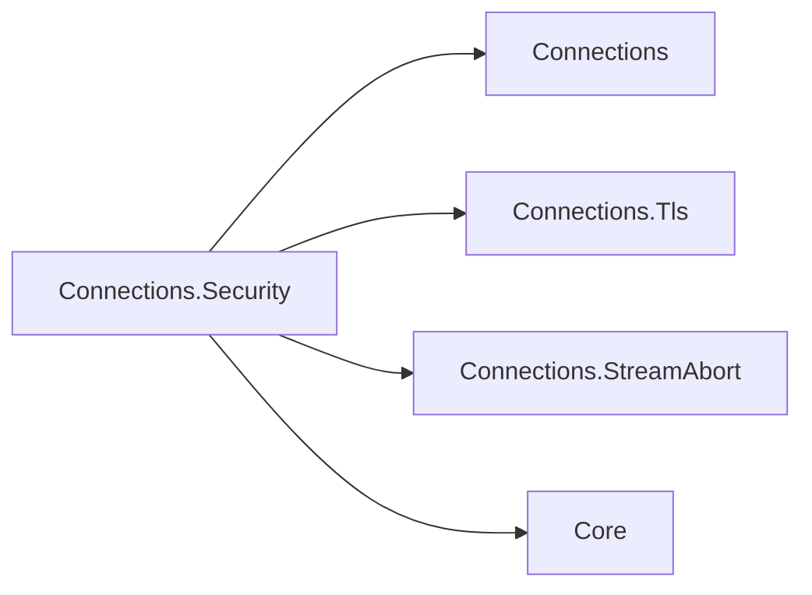

# Assimalign.Cohesion.Connections.Security Design

## Design Intent

Provides TLS as a *connection layer*: given an established, plaintext `IDuplexConnection`, produce a new
`IDuplexConnection` whose duplex pipe is TLS-encrypted. An `IDuplexConnection` *is* an `IDuplexPipe` — the
consumer reads bytes received from the peer off `Input` and writes bytes to send to `Output` — so
securing a connection means substituting those pipes with encrypted ones, not attaching a side
property. This library lives in the Connections area because it composes directly over the
connection contracts; it does not depend on (or pull in) the Security area's certificate tooling.

## Why a Layer, Not Middleware

The previous transport pipeline ran a callback once, after the connection's duplex pipe was already
constructed and wired to the socket. It could observe the connection but could not *substitute* the
pipe, so it could never secure the bytes the consumer read. A connection layer avoids this by
returning a *new* `IDuplexConnection`: the inner (plaintext) connection is wrapped in an `SslStream`, and
the secured connection exposes the encrypted stream as its `Input` / `Output`. The consumer reads
and writes plaintext transparently; the encryption happens in between.

## Public Surface

Two composition styles, both backed by the same decorator:

- **Layered (preferred for servers/clients).** `TlsConnectionLayer` implements `IConnectionLayer`.
  Compose it onto the accept/connect path with the extension members:
  - `IDuplexConnectionListener.UseTls(TlsServerOptions)` — secures every accepted connection (server auth).
  - `IDuplexConnectionFactory.UseTls(TlsClientOptions)` — secures every established connection (client auth).
- **One-shot.** `IDuplexConnection.UpgradeToTlsAsync(TlsServerOptions | TlsClientOptions, …)` performs the
  handshake on an individual, already-established connection and returns the secured one.

`TlsServerOptions` / `TlsClientOptions` wrap the BCL `SslServerAuthenticationOptions` /
`SslClientAuthenticationOptions` (exposed as `AuthenticationOptions`) plus a `HandshakeTimeout`.
`TlsServerOptions` also carries the client-certificate policy (see "Client certificates") and
`MaxConcurrentHandshakes`, the bound of a TLS-layered listener (see "Handshakes on a TLS-layered
listener").

## How It Works

- `TlsConnectionLayer.UpgradeAsync` (and the `UpgradeToTlsAsync` extensions) delegate to the internal
  `TlsConnection` decorator.
- Internally: the inner `IDuplexConnection` (itself an `IDuplexPipe`) is adapted to a `Stream` via
  `DuplexPipeStream`; an `SslStream` is constructed over it; the handshake runs
  (`AuthenticateAsServerAsync` / `AuthenticateAsClientAsync`); then the `SslStream` is exposed back
  as the connection's pipe via `PipeReader.Create` / `PipeWriter.Create`.
- The returned `TlsConnection` delegates `Id`, endpoints, `Direction`, `State`, `ConnectionClosed`,
  and `Abort` to the inner connection, reports `Capabilities` with `Security = Tls`, and exposes the
  encrypted pipe as its `Input` / `Output`.
- It registers itself as `ITlsConnectionInfo` from `Connections.Tls` in `ConfigureFeatures`, with
  `Name = ITlsConnectionInfo.FeatureName` (`Tls`). Its `InnerFeatures` returns `_inner.Features`, so
  features registered beneath TLS remain visible unless TLS hides them. It removes
  `IMultiplexedStreamAbort.FeatureName` (`StreamAbort`): aborting the inner transport cannot invalidate
  plaintext already buffered in TLS's outer `PipeReader`, so the inner feature cannot guarantee that
  every later read fails. `connection.Features.Get<IMultiplexedStreamAbort>()` therefore returns
  `null` through TLS; the inner connection's collection is unchanged. The TLS result remains an
  `IDuplexConnection`; `DirectionalAbort` is an accessor on `IMultiplexedConnectionStream` after #1453. An application protocol reads `connection.Tls`
  without referencing this library: the ALPN application protocol, the TLS
  version, the cipher suite, and the peer's certificate (`SslStream.NegotiatedApplicationProtocol`,
  `SslProtocol`, `NegotiatedCipherSuite`, `RemoteCertificate`), captured once when the handshake
  completes. HTTP reads them to serve HTTP/2 or HTTP/1.1 on one listener and to show its handlers
  the session. This holds on the server and the client side alike.
- Reading `SslStream.RemoteCertificate` hands the certificate's ownership to the reader (an
  `SslStream` no longer disposes a certificate it has exposed), so the secured connection disposes
  the peer certificate when it is disposed.
- `TlsConnectionLayer.Describe` advertises `Security = Tls` so the capability is visible on the
  layered listener/factory before a connection is upgraded.

## Lifecycle and Error Model

- Disposing the secured connection disposes the `SslStream`, then the inner connection, then the
  peer's certificate. The inner connection and certificate are released even when stream disposal
  throws. The wrapped `ConnectionClosed` token fires on abort, peer closure, and before disposal
  finishes.
- A TLS-layered listener forwards `BindAsync` to its inner listener and owns that listener for
  disposal, so layering does not change endpoint acquisition or release timing. Its `Id` is the
  inner listener's identity: one bound endpoint, one id.
- The handshake honors a configurable `HandshakeTimeout` (linked with the caller's cancellation
  token). On failure the `SslStream` is disposed and the exception (typically
  `AuthenticationException` from the platform TLS stack, `IOException` for bytes that are not a TLS
  handshake, `OperationCanceledException` when the timeout elapses) propagates; the caller still owns
  the inner connection and is responsible for disposing it. Through a TLS-layered listener that
  caller is the layered listener, which disposes it (next section).

## Handshakes on a TLS-layered listener

`UseTls` composes this layer through the contracts library's layered listener, which runs the
handshake as described in that library's design ("Layered Listeners: Where an Upgrade Runs and How a
Failure Is Contained"). For a TLS endpoint that means (#1304):

- **Each handshake runs on its own task.** A client that sends nothing holds only its own handshake;
  every other client is accepted and handshaken alongside it. `AcceptAsync` returns secured
  connections in the order their handshakes complete.
- **A failed handshake fails only its connection.** Bytes that are not a ClientHello, a client the
  certificate policy refuses, a handshake that exceeds `HandshakeTimeout`, and a client that hangs up
  mid-handshake each close that connection, are reported as `UpgradeFailed` by the
  `Assimalign.Cohesion.Connections` event source (the exception's type and message, never a
  certificate or key material), and leave the listener accepting.
- **`HandshakeTimeout` applies per connection.** Short of the client hanging up or the listener
  being disposed, it is what ends a silent client's handshake. Disabling it (a non-positive value)
  lets such a client hold its slot until it disconnects.
- **`MaxConcurrentHandshakes` bounds the connections held at once** (default 512): a connection
  counts from accept until `AcceptAsync` returns it secured or its handshake fails. At the bound the
  listener stops accepting from the transport, and new clients wait in the transport's backlog, so a
  flood of stalled handshakes cannot grow memory without bound. The value is read when `UseTls`
  composes the listener. A QUIC listener given the same `AuthenticationOptions` does not use it:
  QUIC bounds its pending handshakes with its own listener backlog.

The option lives on `TlsServerOptions` rather than on the TCP listener because only a listener that
handshakes has handshakes to bound, and an endpoint's TLS settings are configured in one place.

## Client certificates

`TlsServerOptions.RequireClientCertificate(validate)` and `AllowClientCertificate(validate)` set the
server's mutual-TLS policy:

| Method | A client without a certificate | A presented certificate |
|---|---|---|
| (neither) | completes the handshake; none is requested | — |
| `AllowClientCertificate` | completes the handshake | must pass validation, or the handshake fails |
| `RequireClientCertificate` | fails the handshake | must pass validation, or the handshake fails |

Validation is the `validate` callback, which receives the certificate, the chain the platform built,
and the platform's verdict; with no callback a certificate passes only when the platform reports no
policy error, which means it chains to a root the machine trusts. A private CA therefore needs a
callback.

How it is applied, and why:

- **The methods write into `AuthenticationOptions`.** They set `ClientCertificateRequired`, which
  makes the server send a `CertificateRequest` during the handshake (RFC 8446 §4.3.2), and install a
  `RemoteCertificateValidationCallback` carrying the policy. The authentication options are then
  the single source of truth that every consumer applies: this library's layer for TCP listeners,
  and a QUIC listener handed the same options (QUIC runs TLS 1.3 itself, RFC 9001). A policy held in
  separate properties would have needed each consumer to translate it, and a QUIC listener never
  sees this library.
- **The certificate is requested in the handshake only.** HTTP/2 forbids TLS 1.3 post-handshake
  authentication (RFC 9113 §9.2.3) and TLS 1.2 renegotiation (§9.2.1), so a deferred request, as
  Kestrel's `DelayCertificate` mode makes on HTTP/1.1, is not offered: the policy is the same on
  every protocol a listener serves.
- **No silent overwrite.** The methods refuse to replace a validation callback they did not
  install, so code that configured the raw options keeps its callback; calling either method again
  replaces the earlier policy. Assigning a new `AuthenticationOptions` after calling them drops the
  policy, so they are called last.
- **A refused client is a failed handshake**, handled like any other: `UpgradeAsync` throws, and a
  TLS-layered listener closes that connection, reports it, and keeps accepting (see "Handshakes on a
  TLS-layered listener"). Before #1304 the failure came out of `AcceptAsync`, so `RequireClientCertificate`
  made every client without a certificate stop the listener.

Reading the certificate after the handshake is the application's job (`connection.Tls` from
`Connections.Tls`, and over
HTTP `context.TlsConnection` from `Assimalign.Cohesion.Http.Tls`); authenticating a user from it is out
of scope here.

## Composition

```csharp
// Server: secure every accepted connection.
IDuplexConnectionListener secured = listener.UseTls(serverOptions);
IDuplexConnection connection = await secured.AcceptAsync(cancellationToken);

// Or upgrade a single established connection.
IDuplexConnection secure = await connection.UpgradeToTlsAsync(serverOptions, cancellationToken);
// hand the secured connection to the application protocol
```

Transports remain TLS-agnostic. Application protocols consume an `IDuplexConnection` without knowing
whether it is secured; they can inspect `Capabilities.Security` if they need to.

## AOT Posture

No reflection or runtime code generation. Uses the platform `SslStream` and `System.IO.Pipelines`.
NativeAOT compatible.

## Non-Goals

- Not a general-purpose connection/application middleware pipeline.
- Does not source or manage certificates; certificates and authentication settings are supplied via
  options. A platform-agnostic certificate manager is the responsibility of the Security area
  (tracked separately).
- Does not implement cryptography; it delegates to the platform TLS stack via `SslStream`.

## Relationships

The TLS layer references the contracts whose features it registers or hides:



- **`Assimalign.Cohesion.Connections`** — the `IDuplexConnection` / `IConnectionLayer` contracts, the
  `UseTls` composition points (`IDuplexConnectionListener` / `IDuplexConnectionFactory`), and the
  `DuplexPipeStream` adapter.
- **`Assimalign.Cohesion.Connections.Tls`** — the optional handshake-facts contract and accessors.
- **`Assimalign.Cohesion.Connections.StreamAbort`** — the directional-abort feature name that TLS
  hides because the inner implementation does not govern its outer pipes.
- **`Assimalign.Cohesion.Core`** — foundational library support.
- **Security area (certificate management)** — supplies certificates for the TLS options. The
  platform-agnostic certificate manager is owned by the Security area and is intentionally not a
  dependency of this layer.

## Compatibility with 10.0.0-preview.1

Hiding `StreamAbort` corrects the unreleased #1452 feature propagation behavior. It adds no break
against 10.0.0-preview.1: that release had neither connection features nor directional aborts.
Consumers of the unreleased behavior must treat a missing `StreamAbort` feature as unsupported on
the TLS connection. The #1453 multiplexed root changes do not widen the TLS layer's `IDuplexConnection`
result to a multiplexed stream. Other inner features and TLS handshake facts remain discoverable.

## Connection hierarchy compatibility

Decision 58 changes the hierarchy shipped in 10.0.0-preview.1 under decision 15's accepted
preview source and binary breaks. TLS composition and upgrade methods accept and return duplex contracts. The secured connection
inherits `DuplexConnection`; a TLS listener reports its inner listener's `Id`.
Every connection shares root lifecycle and features. Accepted connections stay in the live set
until their closed token fires; listener disposal never closes handed-out connections.
Only the code that accepted a connection reads or writes it.
