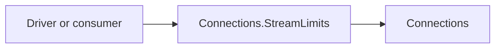

# Assimalign.Cohesion.Connections.StreamLimits Design

## Design intent

Read the cumulative inbound bidirectional stream allowance of a multiplexed transport. Owner decision 56 (#1452) places this optional capability in its own package, keeping the Connections core limited to shared contracts and generic feature discovery. Consumers read `StreamLimits` instead of testing a connection's runtime type.

## Family map

The feature package depends on core Connections; drivers and consumers reference the feature package.

| Package | Role |
| --- | --- |
| `Assimalign.Cohesion.Connections` | Connection roots, guided bases and layered feature collection. |
| `Assimalign.Cohesion.Connections.StreamLimits` | `IMultiplexedConnectionStreamLimits` and `StreamLimits` discovery. |

## Registration and layering

The contract extends `IConnectionFeature`; every implementation returns `IMultiplexedConnectionStreamLimits.FeatureName` ("StreamLimits") as its `Name`. One feature object fills one named slot. A driver registers the object in `ConfigureFeatures`, which runs once when its collection is first accessed.

The accessor uses `Features.Get<IMultiplexedConnectionStreamLimits>()`. The connection's own features take precedence over inner features, and a removed or replaced name hides that inner slot. Typed lookup on the concrete collection allocates nothing. Layers opt into pass-through by overriding `InnerFeatures`; a layer that invalidates the capability removes its slot. A multiplexed stream does not inherit features from its parent connection.

## Semantics and lifetime

`InboundBidirectionalStreamLimit` is a nonnegative, nondecreasing conservative upper bound on the number of bidirectional streams the peer may have been allowed to initiate over the connection lifetime. It includes credit whose release has begun but may not yet have been advertised. It is not a concurrent-stream count or permission to open an outbound stream. The multiplexed root migration (#1453) retains this optional feature: QUIC and WebTransport have cumulative allowances; HTTP/2's concurrent-stream limit is a different quantity.

The collection does not own or dispose feature objects. Features that delegate to a driver share the driver's lifetime. QUIC registers distinct objects for TLS and stream limits; its stream registers itself for directional abort, as does the in-memory multiplexed stream.

## Compatibility and AOT

The contract's existing members move unchanged from Connections. Its XML documentation describes feature registration, the `StreamLimits` accessor and `InnerFeatures` propagation. The contract did not ship in 10.0.0-preview.1, so its move introduces no released API break. Adding `Features` to the three connection root interfaces does break preview.1 implementers, accepted under decision 15; subclasses of the guided bases inherit the implementation.

The package uses ordinary interfaces and a C# extension property, with no reflection, dynamic generation or generic virtual lookup on the read path. NativeAOT compatibility remains enabled by repository defaults.
