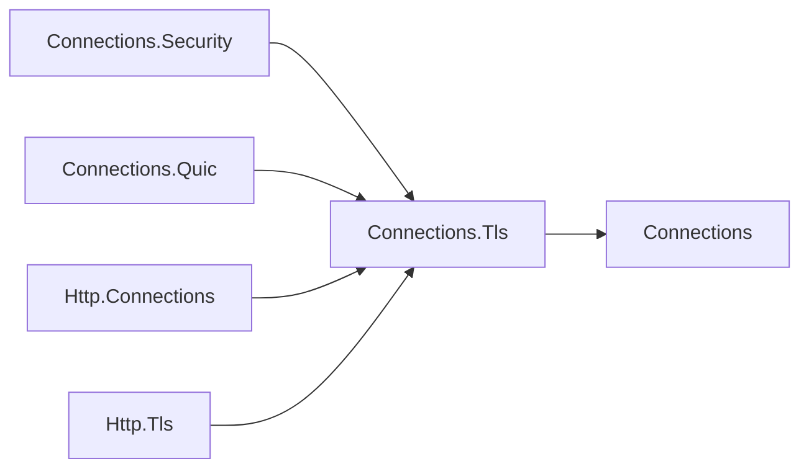

# Assimalign.Cohesion.Connections.Tls — Design

## Intent

TLS is optional and can be added by a connection layer. Its handshake facts belong in a separate
feature package so plaintext transports and the base connection contracts do not carry TLS APIs.
Owner decision 56 moves `ITlsConnectionInfo` from Connections into this package, preserving its
namespace and four handshake members, and adds `IConnectionFeature` and the `FeatureName` constant.
Its XML documentation describes feature registration, the `Tls` accessor and `InnerFeatures` propagation.
`Connections.Security` remains the SslStream layer; this package runs no
handshake and imposes no certificate policy.

## Family map

Arrows show references: TLS producers and consumers depend on this contract package, which depends
only on core Connections.

| Package | Role |
| --- | --- |
| `Assimalign.Cohesion.Connections` | Connection roots and the layered feature collection. |
| `Assimalign.Cohesion.Connections.Tls` | `ITlsConnectionInfo` and the `Tls` extension property. |
| `Assimalign.Cohesion.Connections.Security` | Negotiates TLS over an existing byte stream and registers the facts. |
| `Assimalign.Cohesion.Connections.Quic` | Registers the handshake QUIC already negotiated. |
| `Assimalign.Cohesion.Http.Connections` | Reads `Tls` for ALPN and snapshots it into HTTP connection info. |
| `Assimalign.Cohesion.Http.Tls` | Builds the HTTP feature from HTTP's connection-info snapshot. |

## Registration and lookup

Each implementation returns `ITlsConnectionInfo.FeatureName` (`"Tls"`) from `Name`.
Drivers register explicitly in `ConfigureFeatures`. The TLS layer registers itself and passes
`_inner.Features` through `InnerFeatures`. QUIC registers a separate TLS object beside its stream-limit
object, because one object fills one named slot.

The single `Tls` extension property on `IConnection` calls `Features.Get<ITlsConnectionInfo>()`. Own features are searched
before effective inner features; setting a feature with the same name replaces the inner feature,
and removing the name hides it. The concrete collection performs typed lookup without allocation.
A missing TLS feature returns `null`. A wrapper preserves features by forwarding `InnerFeatures`,
without implementing and forwarding every optional contract. Multiplexed streams do not inherit
connection-level TLS facts from their parent connection. The #1453 `IMultiplexedConnectionStream` root
inherits `IDuplexConnection` and `IConnection`, so existing stream-level `Tls` access remains available but reports only
features registered on that stream.

## Ownership and errors

Handshake values are fixed before consumers receive the connection. The connection owns its
certificate and releases it on disposal; neither the feature collection nor the accessor disposes
features. Code retaining a certificate copies it first. Accessors reject a null connection with
`ArgumentNullException`. Handshake failures belong to the TLS producer, not this contract package.

## Compatibility and AOT

Against 10.0.0-preview.1, the new `Features` members on connection root interfaces break direct
implementers; deriving from the guided bases supplies them. This break is accepted by owner
decisions 15 and 56. `ITlsConnectionInfo` postdates preview.1, so its assembly move breaks no released
API. Builds against intervening commits must reference this package and register the feature.
The package is an App kernel root beside Connections.

The accessors use ordinary generic feature lookup, with no reflection or runtime code generation.
The package retains the repository's NativeAOT compatibility requirement.

## Connection hierarchy compatibility

Decision 58 changes the hierarchy shipped in 10.0.0-preview.1 under decision 15's accepted
preview source and binary breaks. `Tls` is a single extension on `IConnection`; multiplexed callers bind to the root extension.
Every connection shares root lifecycle and features. Accepted connections stay in the live set
until their closed token fires; listener disposal never closes handed-out connections.
Only the code that accepted a connection reads or writes it.
