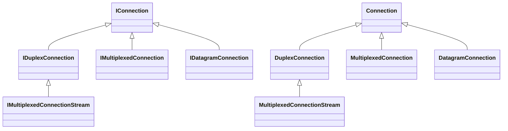
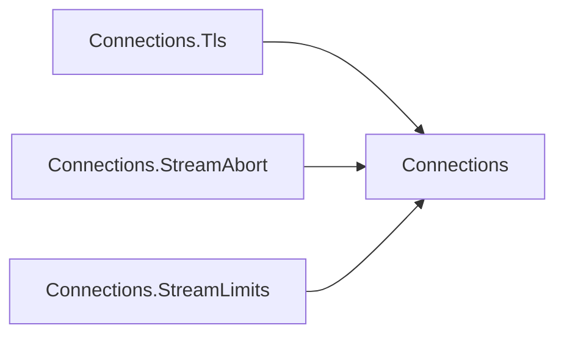
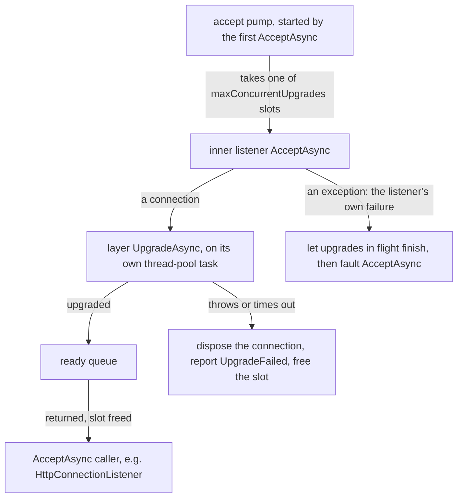

# Assimalign.Cohesion.Connections Design

## Design Intent

This library defines the connection contract for the Cohesion networking stack: the small set of
interfaces that describe how to accept, establish, layer, and use a network connection,
independent of any concrete protocol (TCP, UDP, QUIC) or any application protocol (HTTP, AMQP)
built on top. It is the lowest layer in the stack and depends only on `Assimalign.Cohesion.Core`.
Concrete transports implement these contracts; application protocols consume them; security and
other connection transformations compose over them. Neither direction inherits the other's
concerns.

## The Contract at a Glance

All connections implement `IConnection`: identity, endpoints, capabilities, state, features,
closure notification, abort and asynchronous disposal. It has no byte pipe. Only its duplex
branch exposes bytes; multiplexed and datagram roots express their own data planes.
The interfaces and guided bases follow the same inheritance tree:



Three data-plane shapes, each honest about its delivery model:

| Shape | Contract | Data plane |
|---|---|---|
| Single stream | `IDuplexConnection` (+ `IDuplexConnectionListener` / `IDuplexConnectionFactory`) | **is** a duplex pipe (`IDuplexConnection : IDuplexPipe`) |
| Multiplexed | `IMultiplexedConnection` (+ listener/factory) | **yields** streams, each an `IMultiplexedConnectionStream : IDuplexConnection` |
| Datagram | `IDatagramConnection` | **speaks** discrete messages; no pipe |

One generic composition unit:

- `IConnectionLayer` — a connection-to-connection arrow (`UpgradeAsync(IDuplexConnection) → IDuplexConnection`),
  applied once per connection at establishment via `listener.Use(layer)` / `factory.Use(layer)`.
  TLS (in `Assimalign.Cohesion.Connections.Security`) is the first implementation; proxy-protocol handling,
  traffic accounting, throttling, and connection-level compression are the same shape. A layer
  whose upgrade fails leaves the connection to its caller, which disposes it. The layered listener
  does so for a connection it accepted (see "Layered Listeners", below), and the layered factory
  for a connection it dialed. A TLS layer that fails releases only its own stream, so before #1309
  a failed client handshake left the dialed connection open.

Selection is by **capability**, not protocol identity: `ConnectionCapabilities` (delivery mode,
reliability, ordering, multiplexing, security) is what consumers gate on; `ConnectionProtocol` is
diagnostics-only.

---

## Connection features

Every connection inherits from `IConnection` and exposes an
`IConnectionFeatureCollection` through `Features`. A feature implements `IConnectionFeature` and
has one stable, non-empty `Name`. `Set<TFeature>` installs it in that named slot, replacing any
feature with the same ordinal, case-sensitive name; null features and null or empty names throw.
An object fills one slot, so a driver offering two named capabilities registers two feature objects.

The public `ConnectionFeatureCollection(inner)` exposes the wrapped connection's effective set.
A lookup checks the layer's own names first, then its inner collection. `Remove(name)` leaves a
local tombstone: it hides both today's inner value and future registrations of that name, and
returns whether a visible feature was removed. `Set` can replace that tombstone. Enumeration yields
own features first and then inner features whose names are neither replaced nor hidden. Typed
`Get<TFeature>()` follows the same order; replacing a name with a different type still hides the
inner feature of the requested type. Exact built-in collections are scanned without allocating;
custom collections and subclasses retain their own enumeration semantics.

Named lookup keeps the local-slot check in the small public entry point, then walks exact built-in
inner collections iteratively. This removes repeated interface dispatch and name validation at each
built-in level and keeps stack usage independent of built-in layer depth. It stops at a custom
collection or subclass and calls that object's interface `Get(name)`; a subclass's private base
snapshot is not a substitute for its named lookup implementation. Tombstones still stop traversal,
and every level reads its current immutable snapshot. No result cache or invalidation state is added.

Collections serialize mutations and publish immutable arrays. Named and typed reads require no
lock, and an enumerator retains the local snapshot it started with. Concurrent changes never
invalidate a reader; a traversal across independently changing layers is not one atomic snapshot.
Features themselves own the thread safety of their values.

`Connection` owns the feature plumbing once; every derived base inherits it. It creates no collection until the
first `Features` access. Its initializer resolves protected `InnerFeatures`, constructs the collection, and calls
protected `ConfigureFeatures` exactly once before publishing it with `Interlocked.CompareExchange`.
Concurrent first readers wait for the configured collection; a failed configuration is remembered
and rethrown rather than retried or partially published. The bases do not implement the collection.
A driver's configuration uses its supplied collection; it must not recursively access `Features`.
A layer overrides `InnerFeatures` to return its wrapped connection's `Features`. A multiplexed
stream retains its own collection and does not inherit features from its parent connection.

Optional contracts belong to their feature packages, all with the family namespace
`Assimalign.Cohesion.Connections`. The driver registers a feature and consumers reference only the
package that describes it. The package dependency direction is:



| Package | Contract and pinned name | Access |
|---|---|---|
| `Assimalign.Cohesion.Connections.Tls` | `ITlsConnectionInfo`, `"Tls"` | `Tls` on `IConnection`, including HTTP wrappers |
| `Assimalign.Cohesion.Connections.StreamAbort` | `IMultiplexedStreamAbort`, `"StreamAbort"` | `DirectionalAbort` on `IMultiplexedConnectionStream` |
| `Assimalign.Cohesion.Connections.StreamLimits` | `IMultiplexedConnectionStreamLimits`, `"StreamLimits"` | `StreamLimits` on a multiplexed connection |

A byte-rewriting layer removes any inherited capability whose behavior it invalidates. TLS facts
remain valid through accounting or compression above TLS. Hot-path consumers resolve a feature
once per connection or stream and cache it. `ConnectionCapabilities` remains the pre-connection
description of a transport class and does not move into this collection.

**Breaking change against 10.0.0-preview.1 (owner decisions 15 and 56, #1452):** adding `Features`
to the root interface breaks direct implementers. Deriving from the guided bases supplies
the implementation. The three optional contracts were added after preview.1, so moving them into
feature packages breaks no released API. The multiplexed root changes below complete the migration.

## Design Rationale

This section consolidates the reasoning that produced this design, recorded so future changes are
made with the original constraints in view. It replaced an earlier model
(`ITransport` / `ITransportConnection` / `ITransportConnectionContext` plus a connection
middleware pipeline) after a full design review.

### Why the old transport abstraction dissolved

The old `ITransport` had one meaningful member: `InitializeAsync() → ITransportConnection`. Every
consumer call site followed the same pattern — call it, then immediately **downcast** the result
(`is ISingleStreamTransportConnection` / `is IMultiplexTransportConnection`) to find out what it
really had, throwing at runtime on mismatch. An abstraction whose every use is a factory call
followed by a type test is not an abstraction; the downcast targets were the real contract. This
design promotes them into the type system:

- **Direction is structural.** Servers are `IDuplexConnectionListener` (accept); clients are
  `IDuplexConnectionFactory` (connect). The old `TransportKind` flag is gone — handing a client where a
  server is required is now a compile error, not a runtime check. Note that direction is a
  property of *establishment only*: once produced, inbound and outbound connections are
  indistinguishable `IDuplexConnection`s (a BitTorrent node, which simultaneously listens and dials and
  runs one wire protocol over both, is the canonical demonstration).
- **Stream multiplicity is structural.** HTTP/1.1 and HTTP/2 take an `IDuplexConnectionListener`;
  HTTP/3 takes an `IMultiplexedConnectionListener`. The old runtime switch became parameter types.
- **Datagrams are a separate shape.** The old model forced UDP datagrams through a byte
  `Pipe`, erasing message boundaries — the one property UDP guarantees. `IDatagramConnection`
  speaks messages (`ReceiveAsync` into a caller buffer, `SendAsync` to an endpoint) and never
  pretends to be a stream.

The old connection middleware pipeline (`ITransportPipeline`) was removed outright: it ran once
per connection *after* the connection's pipe was already constructed and wired, so it could
observe a connection but could never substitute the byte stream the consumer read. Its one
motivating use case — TLS — was therefore unimplementable through it. The capability it was
reaching for exists correctly as `IConnectionLayer` (below).

"Transport" survives in this stack only as a *concept* — the underlying medium a driver speaks —
never as a type. The medium is described by data (`ConnectionCapabilities` and the
diagnostics-only `ConnectionProtocol`), implemented by the **driver packages**
(`Assimalign.Cohesion.Connections.Tcp/Udp/Quic`), and supported by this library's internal
composition **primitives** — pipe-pair wiring and pool-owning options as `shared/` source the
drivers compile in — while each driver reports its own diagnostics through an internal event
source. Transports are
configuration; connections are runtime. The naming rule
follows: every type and package is named for the connection domain — the unit you consume
(`IDuplexConnection`), its producers (`IDuplexConnectionListener`/`IDuplexConnectionFactory`), its description
(`ConnectionCapabilities`/`ConnectionProtocol`/`ConnectionDelivery`/`ConnectionSecurity`), and its
diagnostics correlation (`ListenerId`, stamped only on listener-produced connections —
factory-dialed connections carry none). No type or assembly carries the word "transport", because
there is no transport abstraction.

### Layering: abstract the lifecycle, not the datapath

The obvious generic model — a uniform `ILayer` interface with L1–L7 instances, modules stacked
OSI-style — has a forty-year experimental record and lost on performance every time it was tried
at the data plane (AT&T STREAMS, the x-kernel). A uniform per-layer interface must reduce every
boundary to a least-common-denominator message and pay a virtual hop, and often a buffer handoff,
*per layer per IO operation*; it also dissolves type safety, since L3 packets and L4 streams do
not share a service vocabulary. The frameworks that survived (netty's channel pipeline, Kestrel's
connection middleware) all made the same retreat: the recurring unit is the **connection**, and
layers are transformations attached to one.

Hence the rule this library is built on: **abstract the lifecycle, not the datapath.**

- **Control plane (per-connection, at establishment): generic.** `IConnectionLayer` composes via
  `Use(...)`; each layer costs one interface dispatch and at most one wrapper allocation, once per
  connection. A pass-through layer (metrics, a proxy-protocol preamble reader) may return the
  inner connection unchanged — zero steady-state cost.
- **Data plane (per byte): concrete.** One best-in-class primitive, `System.IO.Pipelines`, with
  no framework frames between the consumer and the transport's buffers. A transforming layer
  (TLS) inserts only its intrinsic cost; the composition mechanism adds nothing per byte.

The OSI model maps onto this as an *algebra of arrows between the three shapes*, not as seven
nominal layers:

| OSI | Here | Arrow shape |
|---|---|---|
| L4 | TCP/UDP drivers | origin → `IDuplexConnection` / `IDatagramConnection` |
| L5 (sessions/mux) | QUIC streams; any future stream-mux layer | `IDuplexConnection` ⇄ `IMultiplexedConnection`; streams are `IMultiplexedConnectionStream : IDuplexConnection` (the recursion) |
| L6 (TLS, compression) | `IConnectionLayer` | `IDuplexConnection → IDuplexConnection` |
| L7 | HTTP, AMQP | consume `IDuplexConnection`, produce protocol sessions |
| L1–L3 | the operating system | below the framework boundary |

Two properties of the algebra matter:

1. **Fusion is permitted.** QUIC is L4+L5+L6 in one protocol — an origin arrow landing directly on
   `IMultiplexedConnection`. A rigid layer stack cannot express that; arrows can. (Modern
   performance work — QUIC itself, kTLS — comes from fusing layers, so the model must allow it.)
2. **The recursion is real.** L4 itself is an arrow: TCP is, literally, a layer that turns
   unreliable IP datagrams into a reliable ordered stream, and QUIC turns UDP datagrams into a
   multiplexed secure stream bundle. A userspace protocol of the same kind (µTP, reliable-UDP
   variants) would be implemented as `IDatagramConnection → IDuplexConnection` and every consumer above
   it — TLS layer, HTTP, AMQP — would compose unchanged, because they bind to shapes, not
   protocols. Likewise DTLS is `IDatagramConnection → IDatagramConnection`, and tunnels are
   `IDuplexConnection → IDatagramConnection`. This is the recursive-layer insight (cf. RINA): layers
   differ in scope and policy, not in kind, and the recurring unit is the connection.

### Why `IDuplexConnection : IDuplexPipe` (the flattened data plane)

Earlier drafts gave the connection a `Transport` property carrying an `IDuplexPipe` (and the
pre-redesign code wrapped the pipe in a bespoke `ITransportConnectionPipe`). Both were removed
for the same reasons:

- **`IDuplexPipe` already is the abstraction.** It is two members over `PipeReader`/`PipeWriter`,
  which are abstract classes that exist precisely so implementations vary. A wrapper interface
  adds a seam with nothing varying behind it — and the bespoke wrapper's one addition (`Stream`)
  forced an eager stream allocation per connection and `Stream.Null` fakes where no stream
  existed. The BCL ships the lazy equivalents (`AsStream()`).
- **`Input`/`Output` are holder-relative**, and nesting (`connection.Transport.Input`) multiplies
  the perspectives a reader must track. Every duplex connection is internally *two* mirrored pipe
  views (the consumer's end and the wire pump's end), and surfacing a pairing object invites that
  mirror into consumer code. Flattening makes the connection itself the only pipe-bearing object:
  `connection.Input` is what the peer sent you, `connection.Output` is what you send — anchored,
  documented, and identical at every level of the recursion (a TCP connection and a QUIC stream
  read the same). The mirrored pump end lives in the drivers' compiled-in shared source
  (`DuplexPipePair`), separate from the consumer-facing connection contract.
- **Polarity.** Pipe → stream is a cheap lazy adapter (`DuplexPipeStream`, `AsStream()`);
  stream → pipe re-buffers. Making the pipe canonical lets hot consumers (HTTP/AMQP frame
  parsers) read zero-copy sequences while stream-based APIs (`SslStream`) adapt at their own
  boundary.
- **Interop is free.** Anything accepting `IDuplexPipe` accepts the connection itself.

The shapes stay honest because the flattening is scoped: only the single-stream shape *is* a
pipe. A multiplexed connection has no pipe (it yields streams); a datagram connection has no pipe
(a pipe erases message boundaries — making it carry one would force inventing a framing protocol
just to satisfy the interface). Nothing in the stack ever holds two duplex pipes.

### Directionality

Multiplexed transports produce unidirectional streams (QUIC; HTTP/3's control and QPACK streams
are unidirectional in practice), so "duplex" cannot be an unconditional promise.
`ConnectionDirection` makes it explicit per channel instance — `Bidirectional`, `ReadOnly`
(inbound unidirectional: output throws), `WriteOnly` (outbound unidirectional: input is
pre-completed) — and `IMultiplexedConnection.OpenStreamAsync(direction)` chooses the stream type
per call (an HTTP/3 endpoint needs bidirectional request streams *and* unidirectional control
streams on one connection, so a per-connection setting cannot work). Direction lives on the
connection, not on `ConnectionCapabilities`, because it varies per instance, not per transport
class.

A transport that supports only bidirectional streams throws `NotSupportedException` for
`OpenStreamAsync(ConnectionDirection.WriteOnly)` and never returns a `ReadOnly` stream from
`AcceptStreamAsync`. `ReadOnly` remains invalid when opening a stream: only the peer can initiate it.
A transport-level unidirectional capability flag waits until such a driver exists.

### Capability selection, not protocol identity

Consumers state *requirements*, not protocol names: HTTP/1.1 needs a reliable, ordered,
single-stream listener — satisfied by TCP today, by a Unix domain socket, an in-memory transport,
or a userspace reliable-UDP protocol tomorrow, with no consumer change. Branching on
`ConnectionProtocol` would close that set and re-create the old hardcoded
protocol-to-transport mapping this design deleted. `ConnectionProtocol` exists for diagnostics
and logging only.

### Handshake facts: `ITlsConnectionInfo`

`ConnectionSecurity.Tls` says a connection is secured; it cannot say what the handshake agreed,
because capabilities describe a transport class and the handshake is per connection. An
application protocol needs that agreement: HTTP chooses between HTTP/2 and HTTP/1.1 from the
application protocol ALPN selected (RFC 7301), and shows its handlers the client certificate,
TLS version, and cipher suite. `ITlsConnectionInfo`, owned by
[Connections.Tls](../../Assimalign.Cohesion.Connections.Tls/docs/DESIGN.md), is the typed feature
that carries it. A connection that terminates TLS registers it under `ITlsConnectionInfo.FeatureName`,
and a consumer reads the `Tls` extension property on the connection it holds:

- the secured `IDuplexConnection` the TLS layer returns (`Assimalign.Cohesion.Connections.Security`),
  which captures the values once its handshake completes;
- a multiplexed connection whose transport is TLS itself (QUIC, RFC 9001).

The feature reports four values, all fixed once the handshake completes:

| Member | Meaning |
|---|---|
| `ApplicationProtocol` | the protocol ALPN selected (RFC 7301), or none when the client offered none |
| `TlsProtocol` | the negotiated TLS version |
| `CipherSuite` | the negotiated cipher suite |
| `RemoteCertificate` | the certificate the peer presented, or `null`: the client's on a server-side connection (present only when the server requested one, RFC 8446 §4.3.2), the server's on a client-side one |

The connection owns `RemoteCertificate` and disposes it with itself. Both platform stacks hand
ownership of the peer certificate to whoever reads it (`SslStream.RemoteCertificate`,
`QuicConnection.RemoteCertificate`), so an implementation that reads it to report it must
release it; a consumer that keeps the certificate past the connection copies it.

Why this shape:

- **The feature package owns the contract.** The TLS layer, QUIC driver, and consumers reference
  `Connections.Tls`; HTTP never references the TLS layer. HTTP republishes the handshake values on
  its own connection-info object, which `Assimalign.Cohesion.Http.Tls` keeps reading.
- **The facts stay typed and fixed at handshake time.** Public feature registration does not change
  the certificate ownership or handshake semantics.
- **The capability stays optional.** Cleartext connections and individual QUIC streams do not
  claim connection-level handshake facts.
- **Layers preserve visibility.** An outer layer supplies `InnerFeatures`, so it need not implement
  TLS's contract or forward its individual members.

### What every multiplexed transport supports, and what only some do (#1453)

Owner decision 56 follows the approved transport survey. A root member must have semantics every
byte-stream multiplexer can honor. Optional capabilities stay named features; a root member cannot
require most transports to do nothing or contradict its documentation.

| | QUIC | WebTransport (H3/H2) | HTTP/2 streams | SSH channels | yamux | mplex |
|---|---|---|---|---|---|---|
| Half-close | FIN | FIN | END_STREAM | CHANNEL_EOF | FIN | Close |
| Whole-stream reset | RESET_STREAM + STOP_SENDING | both directions | RST_STREAM | CHANNEL_CLOSE | RST | Reset |
| Stream reset code | 62-bit | 32-bit | 32-bit | none | none | none |
| Independent directional abort | yes | yes | no | no | no | no |
| Connection close code | 62-bit | 32-bit plus message | 32-bit | 32-bit plus description | three fixed values | none |
| Cumulative inbound stream allowance | MAX_STREAMS | WT_MAX_STREAMS | none | none | none | none |
| Unidirectional streams | yes | yes | no | no | no | no |

The survey and its specification references are in the approved
[scope, §3](../../../../docs/programs/CONNECTIONS_MULTIPLEXED_CONTRACT_SCOPE.md#3-transport-survey).
SCTP's message streams have no individual close and belong to the datagram shape.

`IMultiplexedConnection.Abort(code, reason)` closes the connection; its first abort or disposal
wins. Drivers validate their own code range, always rejecting negative codes. QUIC accepts 0 through
2^62 - 1; a transport without close codes closes as `Abort(reason)` does.

`IMultiplexedConnectionStream : IDuplexConnection` owns the whole-stream `Abort(code, reason)` and
`IsInputCompleted`. The reset ends both directions, carrying the code where supported, and then ends
the lifecycle. Each direction preserves its first end signal. HTTP/3 resets a stream with one root
call. Per-direction aborts remain `DirectionalAbort` on `IMultiplexedConnectionStream`; cumulative stream
allowance remains `StreamLimits` on `IMultiplexedConnection`.

**Breaking changes against 10.0.0-preview.1 (owner decisions 15 and 56):**

- `AcceptStreamAsync` and `OpenStreamAsync` now return `ValueTask<IMultiplexedConnectionStream>` instead of
  `ValueTask<IConnection>`. Implementers and binaries break; a caller awaiting and assigning to
  `IConnection` still compiles.
- The guided base returns `ValueTask<MultiplexedConnectionStream>` instead of `ValueTask<Connection>`.
- `Abort(long, Exception?)` is required on `IMultiplexedConnection` and abstract on its guided base,
  breaking implementers and subclasses.
- The removed coded-close and input-completion facets, and the narrowed `DirectionalAbort`
  accessor, postdate preview.1 and break no released API.

### Observed input completion: `IMultiplexedConnectionStream.IsInputCompleted` (#1427, #1453)

Every surveyed byte-stream multiplexer has a half-close. The root reports a clean transport end
once every received byte has been delivered to `Input`; it neither reads nor waits. A conservative
`false` means the end is not known yet. The pipe may still buffer bytes, so consumers combine the
property with their empty-buffer check. Aborts and failed reads never count as a clean end.

QUIC reads its existing `ReadsClosed` task, excluding a locally aborted read. In-memory streams
observe their peer's clean output completion. A buffering layer preserves the distinction between
transport completion and buffered bytes. No HTTP contracts or interpretation enter Connections.

### Cumulative stream allowance: `IMultiplexedConnectionStreamLimits` (#1425)

The optional `InboundBidirectionalStreamLimit` feature in `Connections.StreamLimits` reports a
conservative upper bound on how
many peer-initiated bidirectional streams the transport may have allowed over the connection's
lifetime. It is cumulative, not the number that may be open concurrently, and never decreases.
Protocols can reject a referenced stream ordinal at or beyond that bound; they still own the
mapping between their identifiers and stream ordinals. No application-protocol types enter the
Connections contracts.

A conservative bound may include credit whose release has started but is not advertised yet.
Consumers must retain their own state limits; this facet is not a replacement for flow control.
Drivers without the feature remain valid. Consumers use `connection.StreamLimits`, and decorators
preserve it through `InnerFeatures`. Its feature contract postdates 10.0.0-preview.1; the root
`Features` addition is the breaking change recorded above.

### Application error codes and directional aborts (#1080, #1453)

The root coded aborts communicate a protocol's reason directly. For HTTP/3 that distinguishes
`H3_REQUEST_REJECTED` from `H3_MESSAGE_ERROR`, and a connection error such as
`H3_FRAME_UNEXPECTED` from `H3_NO_ERROR`. The error code is wire data, independent of the optional
reason exception, whose type belongs to the caller.

| Contract | Member | QUIC frame |
|---|---|---|
| `IMultiplexedConnectionStream` | `Abort(errorCode, reason)` | RESET_STREAM and STOP_SENDING |
| `IMultiplexedConnection` | `Abort(errorCode, reason)` | CONNECTION_CLOSE |
| `IMultiplexedStreamAbort` feature | `AbortRead(errorCode)` | STOP_SENDING |
| `IMultiplexedStreamAbort` feature | `AbortWrite(errorCode)` | RESET_STREAM |

Only a transport that can end directions independently offers the `Connections.StreamAbort`
feature. QUIC, WebTransport and the in-memory model can; HTTP/2, SSH, yamux and mplex cannot.
HTTP/3 keeps its no-code fallback keyed on `stream.DirectionalAbort`. It uses the feature to stop
an unread request with `H3_NO_ERROR` while completing its response with FIN.

- The first signal for each direction wins. Whole-stream reset, later abort and disposal retain
  a direction's earlier code. The first abort or disposal likewise decides the connection close.
- A directional abort leaves the holder's lifecycle alone: it changes neither `State` nor
  `ConnectionClosed`. A whole-stream reset ends the lifecycle. The peer observes an abandoned
  stream in either case.
- After `AbortRead`, every read fails, including pending reads and buffered bytes. In-memory
  throws `ConnectionAbortedException`; QUIC throws `QuicException(OperationAborted)`.
- Root code ranges are transport-specific. The directional feature retains its 0 through
  2^62 - 1 contract; QUIC and its in-memory model validate that range and throw
  `ArgumentOutOfRangeException` outside it.
- The peer sees a carried code in `QuicException.ApplicationErrorCode` on QUIC or
  `ConnectionResetException.ApplicationErrorCode` on in-memory streams.

Completing `Output` cleanly sends FIN without closing input. Completing it with an error resets
output with the configured default code; completing `Input` aborts reading with its default code.
A consumer needing another code ends that direction through the feature first.

### Precedents

The shape matches the systems that survived production: Kestrel
(`Microsoft.AspNetCore.Connections.Abstractions`: `IConnectionListener`/`IConnectionFactory`/
`ConnectionContext` over `IDuplexPipe`; its "Transport.*" packages contain drivers, not
abstractions), netty (`Channel` + pipeline of per-connection handlers), and ADO.NET (consumers
hold `DbConnection`; the driver is a package choice, not an interface applications touch).
Validation cases worked during the design review: HTTP/1.1–HTTP/3 and AMQP (the in-repo
consumers), and BitTorrent as an adversarial external case — peer wire over TCP or µTP, MSE
encryption as a non-TLS `IConnectionLayer`, DHT/KRPC over datagrams, simultaneous
listener+factory in one node — mapped onto the algebra with no new shapes.

---

## Guided Abstract Bases

The root `Connection` owns lazy features, `InnerFeatures`, and `ConfigureFeatures` once.
`DuplexConnection` adds abstract `Input` and `Output`, with a virtual bidirectional `Direction`.
`MultiplexedConnection` and `DatagramConnection` derive directly from the root;
`MultiplexedConnectionStream` derives from the duplex base. Multiplexed accept/open members
return `ValueTask<MultiplexedConnectionStream>` on the guided base and forward explicitly to
`ValueTask<IMultiplexedConnectionStream>` on the interface.

`ConnectionListener<TConnection>` implements both accept methods over one protected
`AcceptCoreAsync`. Drivers implement that core and do no tracking. Its reference-type constraint
lets one covariant `IReadOnlyCollection<TConnection>` object serve both collection properties.
`DuplexConnectionListener` and `MultiplexedConnectionListener` add endpoint and capabilities.
The interface `IConnectionListener<TConnection>` deliberately has no `out`: the return type
`ValueTask<TConnection>` is invariant, so C# rejects a covariant declaration with CS1961.
`IConnectionFactory<TConnection>` has the same restriction. Its guided generic base forwards
both connect views through `ConnectCoreAsync`; the duplex and multiplexed factory bases name
the connection kind.

## Live listener connections

`IConnectionListener` exposes `Id`, `Connections`, `BindAsync` and `AcceptAsync`.
`IConnectionListener<TConnection>` narrows the collection and result with `new`; both accept
methods drain the same queue. Transport listeners retain their `EndPoint` and `Capabilities`.
A driver returns the listener id it uses in events; a layer returns its inner listener's id,
because it represents the same bound endpoint. An HTTP aggregate has its own id.

An accepted connection enters the live set before hand-out and leaves when `ConnectionClosed`
fires. Tracking adds first and registers second, so an already-closed connection is removed by
the token's immediate callback. The set uses a reference-keyed `ConcurrentDictionary`: expected
constant-time add/remove, a nonthrowing weakly consistent enumeration, and an interlocked count.
A concurrent count or traversal is an observation, not an atomic snapshot. Duplicate ids do not
collapse distinct connection objects. A cached per-listener callback takes the connection itself
as state, so tracking needs no per-connection closure or public tracking helper.

The listener holds a **strong reference to every open connection it handed out**. An owner that
drops an open connection without disposing it leaves that reference until the peer closes.
This is the deliberate cost of a useful live view. Only the code that accepted the connection
reads or writes it; enumeration gives observation, never competing I/O ownership. Disposing the
listener releases its endpoint and unaccepted backlog, but never closes handed-out connections.
Their owners dispose them. Layered listeners follow the same rule at each layer: an inner
transport listener tracks the connection handed to its layer, and the outer listener tracks
the upgraded connection handed to its caller. An HTTP listener similarly tracks its protocol
wrapper. Each accepting listener therefore pays its own entry and registration; wrappers that
share the transport closure token leave all of those views together.

### TCP accept allocation measurement

Measured on Windows Arm64 with .NET 10.0.12, Release, workstation GC, and TCP
`IOQueueCount = 0`. The baseline is commit `e0b623246`. A one-off harness binds loopback
port zero, warms two batches, then measures seven batches of 256 accepts. It connects each raw
client socket before the measured interval and disposes all sockets/connections after the batch.
The interval surrounds only `await listener.AcceptAsync(token)` and sums precise
`GC.GetTotalAllocatedBytes(true)` deltas, so asynchronous receive/send pump allocations on other
threads are included. EventSource listeners are disabled. These are whole-accept costs, not a
microbenchmark of the collection alone.

| Tree | Median bytes per accepted connection | Range across seven batches |
| --- | ---: | ---: |
| Baseline | 8,477.812 | 8,476.156–8,480.000 |
| Unified hierarchy and live tracking | 8,580.375 | 8,573.500–8,582.562 |
| Difference | +102.563 (+1.21%) | |

The live set itself allocates one dictionary entry and one cancellation registration per
connection; the callback is cached once per collection and its state is the connection itself.
The baseline TCP driver already allocated a set entry, token registration and boxed
(listener, connection) tuple. The new tracker removes that tuple and execution-context capture.
There is no closure or per-connection tracking helper. A pending typed accept also needs
an asynchronous continuation in the generic base so it can track the result before handing it
out (synchronously completed accepts need no continuation box); a root-interface accept adds
the return-type adaptation already required by invariant
`ValueTask<T>`. TCP also retains shared pipe-pool ownership until accepted connections are
disposed, and holds two pump-task references (two 8-byte fields on this runtime; object padding
can also affect size) so disposal can await the pumps before releasing their pools. The reference-counted pool adds no
per-connection lease allocation. These establishment costs buy centralized lifetime observation and independent
listener/connection ownership; they add no work to per-byte I/O. Process-wide allocation noise
means the measured difference is not an exact size attribution to any one object.

## Why this, not that

- A multiplexed connection inheriting a byte pipe would invent a byte stream it does not have.
- An accept member on a root that some listeners cannot honor would make substitutability false.
  Every listener instead returns `IConnection`, and typed listeners narrow that result.
- Removing transport listener endpoints or capabilities would lose port-zero bind results,
  HTTP/3 Alt-Svc port discovery, and registration-time capability validation.
- A caller-chosen `AcceptAsync<T>()` lets a caller request a kind the listener cannot produce.
  The listener declares its kind once.
- A connection collection cannot replace HTTP's `EndPoints`: it is empty at server bind.
- A separate identity-only connection interface duplicates the root; `IConnection` already
  expresses the lifecycle all connection kinds share.

## Breaking changes against 10.0.0-preview.1 (#1459)

Every Connections package shipped in preview.1. These source and binary breaks are accepted on
owner decision 15's terms:

- `IConnection` and `Connection` no longer expose pipe members or `Direction`. Byte consumers
  and subclasses use `IDuplexConnection` and `DuplexConnection`.
- Multiplexed and datagram connections inherit the root. Datagram implementations now provide
  `Id`, `State`, `ConnectionClosed` and `Abort`; their local endpoint is nullable.
- Multiplexed streams use `IMultiplexedConnectionStream` and `MultiplexedConnectionStream`.
  The current accept/open result types differ from preview.1's `IConnection` / `Connection`.
- Listener and factory roots return `IConnection`; typed duplex/multiplexed interfaces narrow
  the result. Listener implementations add `Id` and the live `Connections` view. Endpoint and
  capability properties live on transport listener specializations, not the listener root.
- The nongeneric listener/factory bases are replaced by generic bases and duplex specializations.
  Subclasses implement the protected accept/connect core instead of overriding public accepts.
  Guided and concrete listener/factory methods now return interface-typed
  `ValueTask<IDuplexConnection>` or `ValueTask<IMultiplexedConnection>` instead of their
  concrete connection bases. `ValueTask<T>` is invariant, so callers storing the old concrete
  task type must update it.
- `InMemoryConnectionPair.Create` returns `DuplexConnection` tuple elements instead of
  `Connection`, preserving the pair's directly accessible pipe members.
- Layer upgrades, `Use`, `UseTls`, and `AsStream` require duplex connections/producers.
  Consumers passing only the root must declare the byte-oriented type they require.
- Listener disposal no longer disposes accepted connections. Owners must release those connections.
  Every connection now signals closure on abort and peer closure and by disposal completion.

The feature-accessor cleanup affects APIs added after preview.1: `Tls` now has one root receiver,
including HTTP connections, and loses its multiplexed overload; `DirectionalAbort` uses the
renamed stream while `StreamLimits` stays multiplexed. These do not add a released-overload break.
The existing feature and coded-abort breaks are detailed in their sections above. QUIC keeps at
least one inbound unidirectional stream credit available so the runtime can observe idle peer
closure, including when the configured inbound limits are zero; the QUIC DESIGN documents
that wire-level behavior change. HTTP-specific API changes are recorded in Http.Connections' DESIGN.

## Lifecycle and Error Model

- A listener is configured when constructed and acquires its endpoint through `BindAsync`. Binding is
  idempotent while active. `DisposeAsync` releases the endpoint and is terminal for that listener
  instance; restart constructs and binds a new listener. Guided bases provide a completed logical-bind
  default for custom listeners that are pre-bound or own no external endpoint, while resource-owning
  drivers override it. `AcceptAsync` remains the connection-production operation, not the endpoint-
  acquisition signal.
- `ConnectionClosed` fires on close, abort and peer closure, no later than `DisposeAsync` completing.
  This guarantee applies to TCP, NamedPipes, in-memory connections and streams, QUIC connections
  and streams, UDP, TLS layers, and HTTP wrappers. A clean multiplexed half-close alone does not
  close the stream; peer abandonment does. UDP has no wire-level peer-close indication and
  therefore reports local closure or transport failure, not a fictional remote session.
- A connection is **live when produced** — there is no separate open step and no
  connection-versus-context duality. Read and write immediately.
- **A listener contains each connection's failure.** `AcceptAsync` (on both listener shapes)
  returns a connection that is ready to use, with any handshake already complete. A failure that
  belongs to one inbound connection, such as a handshake that fails or times out, is the listener's
  to handle: it releases that connection and accepts the next. An exception from `AcceptAsync`
  therefore means the listener itself can produce no more connections (it was disposed, or its
  endpoint failed), or the caller canceled, and a consumer may treat it as fatal. The layered
  listener below and the QUIC driver honor this (#1304). So does the TCP driver: it skips a
  connection whose client reset it before the accept, which Windows reports by failing the
  accept (#1308), and it waits and retries when the process runs out of descriptors or buffers,
  which clears once connections close (#1312).
- Three teardown paths: complete `Output` for a graceful half-close; `DisposeAsync()` to close;
  `Abort(Exception?)` to tear down immediately, discarding in-flight data. A multiplexed transport's
  streams and connections can also abort with a transport-specific application error code. Optional
  directional aborts end one stream direction at a time (see "Application error codes", above). `ConnectionClosed` is
  signaled on closure. A stream of a multiplexed connection also signals it when its peer abandons
  the stream (a QUIC `RESET_STREAM` or `STOP_SENDING`, or the in-memory equivalents), so a consumer
  such as an HTTP/3 request learns of it without reading or writing (#1329). `ConnectionState` tracks
  `Idle → Opening → Open → Closing → Closed`, or `Aborted`.
- `ConnectionException` is the area-scoped exception root (inheriting directly from
  `Exception`; no framework-wide ancestry, per repository rules), with
  `ConnectionAbortedException` and `ConnectionResetException` for the common failures. Transports
  surface reset/abort conditions through this family so consumers catch one hierarchy.
  `ConnectionResetException.ApplicationErrorCode` carries the code a peer reset or stopped a stream with,
  when the driver reports the reset through this family (the in-memory driver does; the QUIC driver
  surfaces `System.Net.Quic`'s `QuicException`).

## Layered Listeners: Where an Upgrade Runs and How a Failure Is Contained

`listener.Use(layer)` returns an internal `LayeredConnectionListener`. Its upgrade is usually a
handshake (TLS through `UseTls`), and a handshake takes as long as the peer chooses: a client can
send garbage, stall, or be refused by a certificate policy. Until #1304 the layered listener ran
the upgrade inside `AcceptAsync`, which made all three a denial of service. Handshakes ran one at
a time on the accept loop, so one silent client held every other client's handshake until the
timeout. A failed handshake's exception left `AcceptAsync`, so a consumer that treats that as the
listener's failure (the HTTP listener does) stopped serving. And the failed connection was never
disposed.

### Where the upgrade runs

The first `AcceptAsync` starts an accept pump. The pump takes a slot, accepts a connection from
the inner listener, hands it to the thread pool to upgrade, and goes straight back to accepting.
`AcceptAsync` reads from a queue of upgraded connections, so it returns connections in the order
their upgrades complete, not the order they arrived.



- **Each upgrade runs on its own task.** Even the synchronous part of an upgrade stays off the
  accept loop: a TLS handshake that finds the client's first flight already buffered signs its
  reply before it first yields, and that work must not serialize every handshake.
- **The pump does not capture the caller's execution context.** It outlives the `AcceptAsync`
  call that starts it, and an ambient activity would otherwise parent every later upgrade.

### How a failure is contained

- **An upgrade that throws fails only its connection.** That covers a handshake that fails, one its
  layer cancels because the handshake timeout elapsed (TLS reports `OperationCanceledException`),
  and a peer that disconnects mid-handshake. The layered listener disposes the connection (a layer
  leaves it to its caller on failure, see `IConnectionLayer.UpgradeAsync`), reports `UpgradeFailed`
  through the event source below with the exception's type and message (never the peer's bytes, a
  certificate, or key material), frees the slot, and keeps accepting.
- **The inner listener's failure is the listener's own.** Any exception from the inner
  `AcceptAsync` means it can produce no more connections. The pump stops, lets the upgrades already
  in flight finish and queue, and then completes the queue with the exception, so a consumer receives
  every connection accepted before the fault and then the fault itself. After disposal,
  `AcceptAsync` throws `ObjectDisposedException`.
- **Canceling `AcceptAsync` abandons that wait and nothing else.** The upgrades keep running and a
  later call returns their connections. Before #1304 the caller's token also canceled the upgrade
  of the connection being accepted, and that connection leaked.
- **Disposal releases everything the listener holds.** It cancels the token every upgrade received
  (a layer must honor it), disposes the inner listener, waits for every upgrade to finish, and
  disposes every upgraded connection `AcceptAsync` has not returned. A cancellation caused by
  disposal is not reported as a failure.

### The bound

At most `maxConcurrentUpgrades` connections are held at once. A connection counts from the moment
the pump accepts it until `AcceptAsync` returns it or its upgrade fails. With every slot taken, the
pump stops accepting, and further peers wait in the inner listener's own backlog (for TCP, the
operating system's listen queue, `TcpConnectionListenerOptions.Backlog`). A flood of stalled
handshakes therefore holds at most that many connections' handshake state instead of growing
memory without bound.

- `listener.Use(layer)` uses 512 and `listener.Use(layer, maxConcurrentUpgrades)` sets it; TLS sets
  it from `TlsServerOptions.MaxConcurrentHandshakes`, which also defaults to 512. 512 matches the TCP
  listener's default backlog and the QUIC listener's default backlog, which bounds the same thing for
  QUIC (handshakes in progress plus connections not yet accepted).
- The bound trades memory for availability. While it is reached, a new client waits until a slot
  frees, which a stalled client does at the latest when its handshake times out. An endpoint that
  expects many slow handshakes at once raises the bound or shortens the timeout. Neither knob can
  make one peer stop the listener.
- Counting connections that are upgraded but not yet returned is deliberate: a consumer that stops
  accepting stops new handshakes too, instead of letting finished ones pile up.

### Alternatives rejected

- **Upgrading inside `AcceptAsync` (the shape before #1304).** It serializes handshakes on the
  accept loop and turns one peer's failure into the listener's.
- **Returning the raw connection and deferring the upgrade to a step the consumer awaits.** The
  handshake would leave the accept loop, but the contract that `AcceptAsync` returns a ready
  connection would break for every consumer, and each consumer would have to rebuild the
  concurrency, the bound, the timeout handling, and the disposal of failed connections. The layered
  listener is the one place that knows which failures belong to a connection.
- **Containing the failure in the consumer.** A consumer such as `HttpConnectionListener` cannot
  tell a connection's failure from its listener's by exception type: a handshake that times out
  throws `OperationCanceledException`, the type the in-memory listener throws once it is disposed,
  and bytes that are not a handshake throw `IOException`, the family of transport I/O failures. A
  wrong guess either stops the server or spins on a dead listener. Only the component that ran the
  upgrade knows which it was.
- **No bound.** Every stalled handshake costs a socket, its buffers, and the TLS state, so an
  unbounded listener is a memory-exhaustion target.
- **Separate bounds for handshakes and for upgraded connections waiting to be accepted.** Two knobs
  for one resource, and the second queue would still need a bound of its own.

## AOT Posture

Contracts, small value types, two allocation-light utilities (`DuplexPipeStream` and the layered
factory decorator), and the layered listener, whose pump uses only `System.Threading.Channels`, a
`SemaphoreSlim`, and the thread pool. No reflection, no runtime code generation, no serialization.
`ConnectionId`, `ListenerId`, and `ConnectionProtocol` are produced by the repository's
`CohesionValueType` MSBuild generator. The ID wrappers implement `ISpanParsable<T>` and
`ISpanFormattable`; their JSON converters also support dictionary keys. `ConnectionProtocol`
uses ordinal equality, hashing and ordering, with `default` representing no value: it compares
equal to another default, sorts first and formats as an empty string. JSON null reads as default,
and default writes as JSON null. Boundaries that require a protocol still need to reject default.
See the [generator contract](../../../../docs/build/MSBUILD_COHESION_PROPS.md#value-types).
Compared with 10.0.0-preview.1, protocol ordering is now ordinal and the string wrapper's
`ToString(format, provider)` overload is removed. The layered listener's event source writes only
string payloads. Fully NativeAOT compatible.

## Non-Goals

- No request/application middleware pipeline, and no per-byte layer interfaces — layers compose
  per connection at establishment only.
- **Owner decision 56 reverses the former no-`Items`-bag non-goal.** Consumers may attach named,
  typed connection features through public `Set<TFeature>`. Feature packages own their contracts;
  layers preserve, replace, or hide them through the collection described above.
- No `ILayer<TLower, TUpper>`-style nominal OSI hierarchy, and no datagram/multiplexed layer
  interfaces until a second real implementation exists (DTLS would justify
  `IDatagramConnection → IDatagramConnection`).
- `ConnectionProtocol` is not a behavior switch.

## Relationships

- **`Assimalign.Cohesion.Connections.Tcp` / `.Udp` / `.Quic` / `.NamedPipes`** — the drivers
  implementing these contracts. Driver-support infrastructure is split by what it is:
  `DuplexPipePair` and the pool-owning pipe options live in this library's `shared/` folder and
  are **compiled into** each driver, `ListenerId` is public API, and diagnostics are each
  driver's own internal event source. There is no separate toolbox assembly and no
  `InternalsVisibleTo` between shipped assemblies.
- **`Assimalign.Cohesion.Connections.Security`** — TLS as `TlsConnectionLayer` / `UpgradeToTlsAsync`.
- **`Assimalign.Cohesion.Http.Connections` / `Assimalign.Cohesion.Amqp.Transports`** — application
  protocols consuming these contracts by capability.

## Driver composition seams

Drivers get their plumbing from this library in exactly one way — **shared source** for types that
are implementation details — and they get nothing for diagnostics: a process-global resource such as
an event source stays inside the one assembly that owns it, so every driver owns its own.

### Shared source — `shared/`, compiled into each driver

`DuplexPipePair`, `PipeOptionsContext`, `StreamPipeOptionsContext`, and `PipeOptionsFactory` live
in this project's `shared/` folder and are **not** part of the `Assimalign.Cohesion.Connections`
assembly at all. A driver names this project in a `CohesionSharedSource` item and compiles its own
internal copy (`.claude/rules/general-rules.md`, *Shared source*):

```xml
<CohesionSharedSource Include="Assimalign.Cohesion.Connections" />
```

- `DuplexPipePair.Create` constructs the fixed mirrored topology; `Input`/`Output` are
  consumer-facing and `TransportOutput`/`TransportInput` belong to the driver's pumps.
- `PipeOptionsFactory.CreatePipeOptions` takes explicit application/driver schedulers and
  receive/send thresholds. Its `PipeOptionsContext` owns one pool and exposes `InputOptions`,
  `OutputOptions`, and `BlockSize`. `CreateStreamOptions` returns
  `StreamPipeOptionsContext` with `ReaderOptions` and `WriterOptions`. The driver completes
  all dependent pipes before calling the context's idempotent `Dispose`.

Linking is safe here precisely because nothing crosses an assembly boundary: `PipeOptionsFactory`
holds only constants, and every context and pipe pair it creates is constructed, used, and
disposed inside the one driver assembly that asked for it. `Assimalign.Cohesion.Connections`
itself neither produces nor consumes one, which is why it does not compile them in either — the
only assemblies that carry these types are the drivers and this project's own test suite.

This replaces what used to be `InternalsVisibleTo` to `Tcp`, `Quic`, and `NamedPipes`, and it
replaces a briefly-public version of the same four types: they were never a contract anyone
outside a driver should implement against, and publishing them would have frozen the pipe
topology and the pool-ownership shape as public API.

### Diagnostics — one internal event source per driver

Each driver owns an internal event source named for its assembly — `Assimalign.Cohesion.Connections.Tcp`,
`.Quic`, `.NamedPipes`, `.Udp` — and reports its listener, connection, and (QUIC) stream lifecycle
through it, with its own counters. This library performs no network operations of its own and has no
diagnostics API; its one internal event source reports the one decision it makes at run time, a layered
listener closing a connection whose upgrade failed (see "The layered listener's event source", below).
The repository-wide rule is `.claude/rules/event-source.md`; the event tables live in each driver's
`docs/DESIGN.md`; applications observe the drivers with `dotnet-trace`/`dotnet-counters` by name, or
forward them into their logging with `Assimalign.Cohesion.Logging.EventSource`.

This replaced a single `ConnectionEventSource` (`Assimalign.Cohesion.Connections`) that every driver
reached through a public, stateless `ConnectionDiagnostics` forwarder. Why the shape changed:

- **The forwarder was public diagnostics API.** Any caller could write fabricated events into a
  process-global provider, and every event's shape was frozen as public surface. The owner's direction
  (2026-09) is that event-source implementations are internal and never exposed to developers.
- **Sharing the source could not be done internally.** It cannot be `shared/` source — linked copies
  would be four providers claiming one process-global name, each under-reporting — and an
  `InternalsVisibleTo` grant between shipped assemblies is not allowed. Per-driver ownership is the
  only internal shape, and it is also how the runtime instruments its own networking
  (`System.Net.Sockets`, `System.Net.Quic`, `System.Net.Security`).
- **The shared source was broken in ways its shape invited.** Its counters were declared but never
  written (issue #1027), `ListenerInitialized` wrote one argument where its method declared two, the
  event methods declared domain value types (`ConnectionProtocol`, `ListenerId`, `ConnectionId`) as
  payload, only QUIC reported a close, and QUIC streams were reported as connections. A per-driver source is small enough to test against its manifest and its real lifecycle,
  which the convention now requires.

`ListenerId` stays public: it is the correlation id every stream driver stamps on the connections its
listeners produce, and a connection's `listenerId` payload is how a forwarded log line ties back to its
listener.

### The layered listener's event source

The diagnostics tests link the canonical test-only `build/TestSupport/EventSourceRecorder.cs`
with MSBuild `Compile`/`Link` (see `.claude/rules/testing.md`); it records
events and counter publication without adding a shipped dependency.

`Assimalign.Cohesion.Connections` (`Internal/EventSource/ConnectionLayerEventSource.cs`) is internal,
follows the same convention, and reports only what a layered listener decides (see "Layered Listeners",
above); the connection itself is still reported by the driver that carries it, under the same
`connectionId`. It reuses the name of the retired shared source because the name is the assembly's, but
nothing about it is public and no driver writes to it.

| Id | Event | Level | Payload |
|---|---|---|---|
| 1 | `UpgradeFailed` | Warning | `connectionId`, `remoteEndPoint`, `exceptionType`, `exceptionMessage` |

Counters: `current-upgrades` (upgrades in flight) and `failed-upgrades` (upgrades that failed since the
process started).

- `UpgradeFailed` is a warning: the connection is lost but the listener recovered, and a refused or
  broken client is routine on a public endpoint. Its payload is the exception's type and message, never
  the bytes the peer sent, a certificate, or key material. A handshake timeout reports
  `System.OperationCanceledException` (or `System.Threading.Tasks.TaskCanceledException`). The TLS
  details of a failed handshake are the runtime's `System.Net.Security` source's to report.
- An upgrade canceled because its listener is being disposed is not a failure and is not reported.
- Every upgrade the pump starts reports its start and its end exactly once, which keeps
  `current-upgrades` exact.

## Exception message resources (#1467)

Exception text lives in `src/Properties/ErrorMessages.resx`. The shared MSBuild targets generate
an internal `ErrorMessages` accessor in the project's root namespace during CLI and CI builds;
its embedded resources are available under NativeAOT. Formatted messages use
`string.Format(CultureInfo.CurrentCulture, ...)`, preserving the existing text and arguments.
EventSource templates and payload handling keep their existing behavior. This changes no public
API or exception text relative to 10.0.0-preview.1.

The default abort and reset messages are cached once in their exception types, since driver
teardown can construct those exceptions as cancellation reasons.
