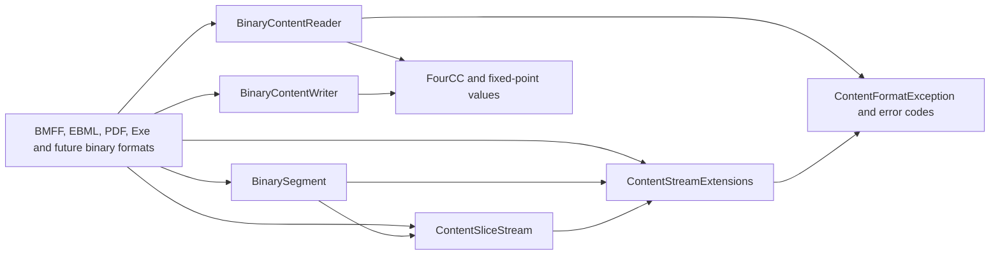

# Assimalign.Cohesion.Content.Binary — Design

## Intent and family

This package supplies the shared byte machinery for forward-only readers, forward-only writers,
and editable document models. It must handle 40 GB inputs without materializing unchanged payloads.
The root Content package supplies the exception contract; Binary supplies no container grammar.

The diagram shows primitive dependencies and the format packages that consume them as the
foundation program progresses. BMFF reaches Binary through Media; the EBML/PDF reference migrations
belong to their format stages.

| Surface | Role |
|---|---|
| BinaryContentReader | A ref struct over a borrowed span; multi-byte integer reads use BinaryPrimitives |
| BinaryContentWriter | A ref struct over a borrowed IBufferWriter; GetSpan(n) then Advance(n), without buffering |
| ContentStreamExtensions | Exact reads, skips and copies; pooled discard/copy buffers; ValueTask async paths |
| ContentSliceStream | A read-only window for child structures, preserving Stream short-read behavior |
| BinarySegment | Memory or a lazy seekable-source range for unchanged document payloads |
| FourCC and fixed-point values | Lossless raw values shared by readers and writers |

## Rejected helpers

Core's `System.IO.OffsetStream` throws when a caller requests more than the remaining bytes.
That violates the normal Stream contract for reading *up to* a buffer size, and it has no
forward-only mode. Media's old `StreamExtensions.ReadBytes` ignores Stream.Read's return value,
silently turning short reads into zero-filled data. Exact reads belong here, where all formats
can depend on one tested implementation (plan D2).

## Reader and writer contracts

Failed span reads consume nothing and throw `ContentFormatException(Truncated)` at the absolute
start of the read. Try variants return false and leave the cursor unchanged. Negative counts,
invalid integer widths, and unrepresentable base offsets are caller argument errors.
Variable-width unsigned fields accept zero through eight bytes; only zero fits a zero-byte write.
Only string reads allocate. UTF-8 decoding and encoding use replacement fallback; a format
requiring stricter text validation must apply that grammar itself. Null-terminated reads consume
the NUL, or accept the remainder of a payload when it is absent (BMFF).

Every nonempty write requests precisely its required byte count and advances by that count.
Empty writes do not access the output. FourCC encodes ISO-8859-1, including ©nam; diagnostic
formatting escapes control bytes. Fixed-point values preserve raw integers and round double
conversion to nearest, ties to even, rejecting nonfinite input or input outside the representable range.

## Clean end, truncation, and limits

TryReadExactly returns false only when no byte of a nonempty request was available. A partial
read is always Truncated. ReadContentExactly treats clean end as Truncated too. All zero-length
operations succeed without accessing a stream, even with a canceled token. SkipExactly seeks
only when its target fits within the stream length; otherwise it reads and discards. Copies
and discard paths rent bounded buffers and return them in finally, including cancellation.

Stream shortfalls report the stream's Position at detection when seekable, the tracked Position
for a forward-only ContentSliceStream, or no position for other non-seekable streams. Per the
stream-helper contract these coordinates belong to the supplied stream: slice positions are
window-relative. A format reader requiring a root byte offset combines its window origin and
position when translating diagnostics. Span readers take the absolute base explicitly.

Range checks use subtraction before addition, rejecting negative and overflowing declared
ranges without allocating. Slice and segment creation report caller misuse as argument errors;
format readers validate wire-declared sizes first and report InvalidStructure. A parser must cap
buffered payloads and depth before allocation (plan D4; the format's default cap is 16 MiB).
BinarySegment.ToArray requires a caller-supplied cap and reports LimitExceeded before allocating;
it also refuses lengths beyond the runtime's array limit.

## Slice ownership, seeking, and concurrency

Create requires a readable, seekable source and a range within its current length. Each read
sets the source cursor first, so independent random-access slices can be read in turn. These
operations are not thread-safe and do not synchronize a shared source.

CreateForwardOnly begins at the current source position, reports CanSeek=false, and tracks
bytes consumed even for non-seekable sources. SourceOffset captures the known creation-time
origin, accumulating enclosing slice origins; it is zero for an otherwise unpositioned source.
Length is the declared window length; short underlying reads are returned normally.

Seek uses FileStream-style origins relative to the window and permits a cursor beyond its end;
reads there return zero and Remaining is zero. Negative or overflowing seeks fail without
moving the cursor. No read crosses the window boundary. Span/Memory overloads avoid temporary
byte arrays, including the ReadByte path.

CreateSlice uses offsets relative to the parent window's beginning. A forward-only parent
cannot rewind, so creation skips to the child's offset and the child exclusively borrows that
cursor until consumed or skipped. SkipToEnd drains abandoned forward-only children, leaving
the parent at the next sibling. Disposal does not drain. Slices borrow by default; leaveOpen=false
transfers disposal responsibility. Nested slices always leave their parent open.

## Lazy-segment lifetime

A lazy segment is valid while its source is open and unmoved: the original byte layout and
offsets must remain valid, and no other operation may move its cursor during a read or copy.
Sequential operations may reposition the source; OpenRead creates a slice that positions it
before each read. A document holding segments does not own the source unless explicitly told to.
No segment automatically closes the source. Save unchanged payloads by copying through, and
keep the source alive until saving completes.

Default and empty segments are materialized empty values. Array-backed memory opens without
copying; non-array ReadOnlyMemory is copied only when OpenRead must produce a MemoryStream.
Equality compares backing identity and ranges, not payload bytes.

## AOT posture and non-goals

The package inherits IsAotCompatible=true and uses direct BCL operations, spans, value types,
and explicit stream composition. No reflection, dynamic code, runtime code generation, or
container registry is involved. The specified ref structs deliberately bypass interface-first
construction to preserve stack lifetimes.

No container parsing, format detection, codec decoding, document ownership policy, PipeReader
adapter, or positional RandomAccess reads are included. Concurrent parsing over one source and
throughput/allocation benchmarks remain plan gap G2.
