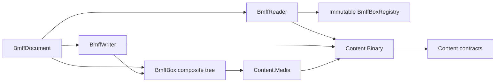

# Assimalign.Cohesion.Content.Bmff — Design

## Intent and scope

This package implements the ISO BMFF container layer: box identity and headers, bounded payloads,
forward-only reading and writing, and an editable document whose opaque payloads remain lazy.
The baseline is [ISO/IEC 14496-12](https://www.iso.org/standard/83102.html); known FourCCs are
identified by the [MP4 Registration Authority](https://mp4ra.org/registered-types/boxes).
These references define the wire format, not a claim that every media profile is implemented.

The package references Content.Media, which references Content.Binary and the root Content contracts.
MP4 and HEIF profiles belong above BMFF. There is no dependency on codecs, playback, storage,
hosting, reflection, assembly discovery or generated runtime code. NativeAOT compatibility is retained.

## Why the composite model stays

The owner explicitly retained the existing abstract BmffBox, BmffBoxComposite, one sealed class
per box, and both visitor interfaces. This is a scoped exception to the repository's interface-first
rule. The tree represents the file's ordered structure directly, lets each box own its payload
Read/Write behavior, and lets visitors inspect or transform models without merging unrelated
field layouts into a generic box.

BmffBoxComposite.Children is an editable IList rather than the former read-only enumeration.
IsLeaf/IsComposite report the structural role. Offset and Limit describe the original header position
and total size; they do not change when a model is edited. Header preserves the parsed wire header.
GetPayloadSize and the writer's size plan determine the new serialized size.

The dependencies between access modes and the shared primitives are:

## Three access modes

| Mode | Intended use | Payload behavior |
| --- | --- | --- |
| Reader | Inspect a large file or consume network input | Header first; consume, descend or skip before advancing |
| Writer | Save a tree or emit one fragment at a time | Precompute sizes, then copy payloads without seeking |
| Document | Inspect and edit an ordered tree from a seekable source | Materialize supported metadata; retain media and opaque ranges as BinarySegments |

### Reader

BmffReader.Create borrows a readable stream at its current position. Read reads the next header,
skipping the previous unread payload if necessary. Header is available immediately; accessing Current
materializes that box. Payload exposes an exclusive bounded stream, valid until the reader advances
or is disposed. ReadChildren enters a supported container after its prefix, preserving registry,
limits and absolute positions. Finish the child reader before using its parent again.

Seekable skips reposition the source without reading payload bytes. Forward-only input cannot reach
a subsequent header without consuming the intervening bytes: callers can consume Payload directly,
or Skip/Read drain it through a fixed pooled transfer buffer. The reader never buffers an entire mdat,
free, skip or unknown payload. Accessing Current for these boxes requires seekable input; on a
non-seekable source use Header and Payload instead. A document intentionally requires seekable input.

BmffStream uses ContentSliceStream for reads. Offset is absolute; Position and Length are relative to
the window. Reads return no more than remains, short delivery is legal, nested windows remain inside
their parent, and writes cannot cross the window boundary. Its public ReadChildren method lets a
profile parse a custom prefix from a payload before enumerating that payload's remaining children.

### Writer

BmffWriter computes the complete tree's sizes before emitting its first header. It detects cycles
and excessive nesting. Each model writes only its payload, into a bounded BmffStream. A mismatched
GetPayloadSize/Write implementation fails with InvalidStructure. Profile composite overrides are
honored; their GetPayloadSize can extend base.GetPayloadSize for a custom prefix.

New or resized boxes use the ordinary header through uint.MaxValue and the large-size header above
that boundary. Unchanged loaded boxes retain their original header encoding, including a small box
that used a large-size header and a final size-zero box. This preservation exception is necessary for
byte equality. UUID extended types retain their network byte order. A size-zero box must remain last
at top level and cannot move inside a container.

For incremental producers, BeginContainer(type, payloadSize) writes a header and streams directly.
EndContainer verifies the supplied payload count. Omitting payloadSize buffers that container up to
the writer's cap, then emits its computed header and payload. WritePayload copies raw segment bytes,
including any prefix a producer needs. Nested streaming containers are supported. Both forms work
on non-seekable outputs; back-patching is unnecessary and is not implemented. A producer must call
EndContainer for every start; Dispose releases unfinished buffers without emitting them.

SaveAsync and WriteAsync use asynchronous output and BinarySegment copy-through for package boxes.
The retained per-box Read/Write signatures are synchronous: LoadAsync performs synchronous parsing
with cancellation checkpoints, and third-party composite Write overrides run synchronously even
when invoked by SaveAsync. Calls on a reader, writer, document, model or shared source are sequential.

### Document and ownership

BmffDocument.Boxes is mutable and ordered. Load captures Source and borrows it by default.
leaveOpen: false transfers source disposal to the document, including on a failed load.
A newly constructed document has no source. The root IContentReader<BmffDocument> and
IContentWriter<BmffDocument> seams are explicitly implemented by BmffReader and BmffWriter.

Readers, writers and BmffStream windows never dispose their supplied stream. Disposing a view does
not drain it. A lazy BinarySegment also borrows its source: keep that source open and byte-stable
through save. Sequential segment reads reposition it; concurrent reads are not supported.

Save copies lazy ranges through and leaves the output open. Use a separate destination; saving to
the document's own Source is rejected. Other aliases of the source are also unsuitable and remain
the caller's responsibility. The writer does not flush or close caller-owned outputs.

## Headers, identities and full boxes

BmffBoxType keeps the known enum values as raw FourCC codes. ToFourCC and ToBmffBoxType preserve
every bit, including unregistered and high-bit values. The enum's historic spellings are retained.

BmffBoxHeader records type, nullable total size, header size, absolute offset, UUID extended type,
and whether the wire size was zero. Header sizes are 8 or 16 bytes, plus 16 for uuid.
A size-zero header consumes the enclosing input to EOF and is legal only at top level; for a
forward-only input with no known length, TotalSize is null. Such a box necessarily is the last box.
Sizes smaller than the header, children outside their parent and Int64-unrepresentable ends are
rejected before allocating a payload.

BmffFullBox centralizes a byte Version and uint Flags constrained to 24 bits for full leaf boxes.
MovieHeaderBox now uses that shared byte Version. MetaBox and
ItemProtectionBox retain composite inheritance and carry their own byte Version and 24-bit Flags.
Version zero and flags zero are supported for both. ipro also validates its 16-bit protection count
and sinf child types. The strategic field models below use the same version/flags convention.

## Registry and profile extension

BmffBoxRegistry.Default is immutable and built once from explicit delegates, with a factory for
every existing concrete box class. UnknownBox is selected for arbitrary unregistered FourCCs.
BmffBoxRegistry.CreateBuilder copies the defaults; new BmffBoxRegistryBuilder starts empty.
Register adds or replaces a factory; Build freezes a snapshot unaffected by later builder changes.
Registering a default deferred type opts into the replacement parser.

Factories receive the validated BmffBoxHeader and must return a matching BoxType. They do not
receive arbitrary wire sizes before header validation. There is no reflection or assembly scanning.
The reader propagates the chosen registry into nested containers.

A profile leaf implements Read, Write and GetPayloadSize and may derive from BmffFullBox.
It reads only its bounded payload and must consume all buffered bytes. Report unsupported versions
or flags with ContentFormatException(Unsupported), and malformed fields with the appropriate
format code and absolute offset. A profile composite can parse/write its own prefix and then call
the base child traversal. For header-only streaming of a profile-specific prefix, consume that
prefix from Payload and call BmffStream.ReadChildren; the built-in reader's ReadChildren knows the
prefix grammar of the package's own containers.

## Unknown and deferred preservation

Lenient mode preserves unregistered types and registered models that cannot parse their
version/flags. UnknownBox retains the raw type, original header, BinarySegment payload and
PreservationReason. The default registry marks deferred models unsupported without calling their
deferred parsers. Only ContentFormatException(Unsupported) selects preservation; other errors
are not swallowed.

Strict mode rejects unregistered/deferred types when their header is encountered and rejects
unsupported versions when materialized. Header-only scanning does not inspect supported boxes'
version fields. On forward-only sources, preservation means leaving the bounded payload available
to the caller; it does not create an in-memory substitute.

Implemented structural models: moov, trak, mdia, minf, stbl, dinf, edts, udta, mvex, moof, traf, mfra,
meta, ipro, sinf, schi, tref, meco and paen. ftyp reads/writes its brands; free, skip and mdat preserve
their bytes lazily. SkipBox is now correctly a leaf; TrackReferenceBox and SchemeInformationBox
are correctly composites. fiin has its own counted field grammar, so it remains deferred.

## Limits and error codes

The reader defaults to a 16 MiB buffered-leaf limit and depth 64 (top-level depth zero).
The writer defaults to the same buffer and depth limits. Declared payload lengths are checked
before rentals or arrays; media and opaque segments do not consume the materialization budget.
Transfer buffers are fixed-size pooled buffers, independent of payload length. A document still
allocates one node per box and a supported ftyp allocates its validated compatible-brand array.

| Code | Meaning in this layer |
| --- | --- |
| Truncated | Partial header, missing full-box prefix or an early payload end |
| InvalidStructure | Size smaller than header, child beyond parent, nested/nonfinal zero size, child-count mismatch, incomplete parser/writer or cyclic tree |
| LimitExceeded | Buffered-payload cap, nesting cap or unsupported numeric size range |
| Unsupported | Strict unknown/deferred handling, unsupported version/flags, or attempting lazy materialization on non-seekable input |
| InvalidValue | Available to profile parsers for invalid field values |
| Unspecified | Legacy root exception constructors; not used for BMFF parsing |

Malformed wire input uses ContentFormatException and absolute byte positions. Argument exceptions
and InvalidOperationException represent API misuse, such as invalid options or consuming a payload
twice. Package-authored exception text is generated from Properties/ErrorMessages.resx.

## Strategic field models

The first wave parses and writes mvhd, mehd, trex, tkhd, elst, mdhd, hdlr, vmhd, smhd, nmhd, hmhd,
dref with url / urn entries, stsd, stts, ctts, stss, stsz, stz2, stsc, stco, co64, sdtp, sbgp, sgpd,
subs, mfhd, tfhd, tfdt, trun, tfra, mfro, cprt, xml / bxml, pitm, iloc, iinf / infe, pdin, frma
and schm. Existing structural containers, including full-box meta, remain composites.
dref, stsd and iinf now also derive from BmffBoxComposite; their entry count comes from Children.
stsd always preserves its children as opaque sample entries, including in strict mode.

Track-reference lists for hint, cdsc, hind, dpnd, ipir, mpod and sync are interpreted only inside
tref. Other reference types remain opaque. New box classes dispatch to the existing
Visit(BmffBox) visitor fallback; neither public visitor interface gained members.

All mutable leaf models retain bytes following the defined fields. Counted containers retain the
suffix after their declared children; uncounted containers must contain complete child boxes.
Versions, optional-field flags, reserved values, widths, raw text bytes and compact-size padding
retain their wire representation. Numeric times are unsigned seconds since the 1904 epoch, not
DateTime, and fixed-point values use Content.Binary types. Callers select versions explicitly.

Large tables use primitive arrays or arrays of nested value-type entries. MaxTableEntryCount
defaults to 1,000,000, including the implicit count in constant-size stsz and fieldless trun.
Every count is checked against the remaining wire bytes, entry limit and cumulative per-leaf
decoded array/string byte budget before allocation; the byte budget is MaxBufferedPayloadSize.
Nested subs/iloc arrays consume the same leaf budget. The input rental is separately bounded by
MaxBufferedPayloadSize. Each counted child list is count-limited without buffering child payloads.

sgpd v1/v2 preserves descriptions as byte arrays. v0 knows fixed lengths for roll/prol (2 bytes)
and rap / sync / tele (1 byte); other nonempty v0 descriptions preserve the entire box.
infe v2/v3 supports typed item identities, names and mime/uri fields; v0/v1 remains opaque.
iloc v0-v2 retains 0/4/8-byte offset, length, base and index widths and all construction methods.

Still deferred: fecr, fiin, segr, fpar, gitn, ipmc, imif, mere, stdp, padb, stsh and tsel.
Other unregistered boxes and codec sample entries remain opaque. Earlier structural meco, paen
and ipro support is retained. MP4/HEIF profile semantics, codecs, sample indexing and decryption
are outside this package.

FileTypeBox.CompatableBrands is renamed CompatibleBrands. TrackBox loses its misplaced Version,
Flags, TimeScale, Duration, Rate, Volume, Reserved, Matrix, PreDefined and NextTrackID properties.
Their applicable wire fields live on mvhd, tkhd or mdhd.

## Relocation and mutation

BmffDocument.RelocateMediaOffsets(outputOffset: 0) measures the edited tree and updates references
from the last loaded or successfully planned layout. Save and SaveAsync call the operation before
writing; seekable output uses its current position, and forward-only output starts at zero.
New documents establish their initial layout without shifting caller-authored references.
Keep new references in the previous layout's coordinates until relocation runs.

The operation updates:

- stco/co64 addresses inside retained mdat payloads; stco becomes co64 on overflow, carrying its
  flags and preserved suffix. External/unmapped addresses stay unchanged.
- iloc method-0 entries with data_reference_index zero: both the base and effective
  base-plus-extent addresses move. A zero base with absolute extent offsets is supported.
  Widths grow from zero to four or eight bytes as necessary. Methods 1/2 and external entries
  stay unchanged.
- Explicit tfhd base_data_offset values inside moved mdat or at retained moof starts.
- trun data_offset relative to an explicit tfhd base, default-base-is-moof, or the first traf's
  implicit moof base. Moving a moof/mdat pair together leaves the relative offset unchanged;
  rebuilding moof or changing its distance to the data updates the signed offset.
- tfra moof_offset values matching retained moof starts, promoting version zero to one when
  necessary; mfro.mfra_size when its enclosing mfra changes size.

Size changes from promotions can move media again. Planning repeats until positions and sizes
stabilize; all reference calculations use the original checkpoint rather than accumulating deltas.
Successful calls checkpoint the new layout, so repeated saves do not apply deltas twice.
Failures restore reference arrays, widths, versions and promoted child replacements. The caller's
structural edits remain in place. Source segments and original Header/Offset/Limit never change.

Removing or shortening a referenced mdat fails with InvalidStructure. Relative offsets outside
Int32 fail with InvalidValue. Opaque offset-bearing standard boxes and implicit previous-traf
bases after the first traf fail with Unsupported if the layout changes. The operation does not
interpret codec/sample-entry fields, arbitrary unknown references, sidx, saio or profile-specific
indexes. Such profiles must implement their reference rules before changing those layouts.

Reordering, adding and removing children preserves list order and recomputes every ancestor size.
The existing writer switches any oversized ancestor to a large-size header without reading media.

## Verification

Portable xUnit/Shouldly fixtures are authored in tests/TestObjects without downloaded media.
The Stage 2 corpus covers bounded streaming, headers, registry extension, ownership and lazy
40 GiB media. BmffModelTests exercises every strategic field model and labels each case with its
ISO/IEC 14496-12 clause, including independent composition-offset and packed-language checks.
