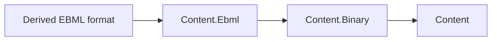

# EBML container design

<!-- Deviates from the repo documentation.md same-commit rule: the Stage 2 brief explicitly
orders the consolidated documentation as its fourth commit, after implementation and corpus work.
The Stage 4 follow-up brief requires the same implementation-first, fourth-commit documentation order. -->

## Intent and dependency direction

EBML is a generic container foundation for reading, streaming and manipulating content. It references
Content.Binary, which supplies exact reads, bounded stream windows and lazy BinarySegments. It does
not reference Content.Media or a derived-format package. Derived formats own their semantics and
compose immutable schemas on top of EBML.

The arrows show the intended dependency direction for derived packages and the delivered EBML dependency.

| Package | Role | Direct dependency in this layer |
| --- | --- | --- |
| Assimalign.Cohesion.Content | Reader/writer contracts and classified format errors | None within Content |
| Assimalign.Cohesion.Content.Binary | Exact reads, bounded streams and lazy byte ranges | Assimalign.Cohesion.Content |
| Assimalign.Cohesion.Content.Ebml | Generic EBML framing, values, trees and schemas | Assimalign.Cohesion.Content.Binary |
| Derived format package | Format-specific schema and semantics | Assimalign.Cohesion.Content.Ebml |

The scope is the container and the RFC header/global definitions. Matroska adds its own IDs, hierarchy,
tracks, codecs, seeking and cues in its package; none of that behavior belongs in this assembly.
[The usage overview](OVERVIEW.md) demonstrates schema composition and all three access modes.

## Reader state and bounds

The public forward-only reader borrows a readable stream and tracks its absolute byte cursor.
For seekable inputs it starts at the current Position; ContentSliceStream origins are accumulated.
A non-seekable input starts at offset zero when the reader is created. To retain positions across a
scan, keep using that reader rather than constructing a new one for each element.

`ReadNext` reads only an ID and size. Its immutable header exposes the VInt ID, nullable data size,
absolute offset, data offset, header length, size width and schema-resolved type.
A current element must be consumed, skipped, entered or opened as a payload stream before advancing.
Entered masters form a bounded stack. Known lengths constrain child headers as well as child payloads;
source and parent
bounds are checked before creating a segment or allocating.

At the current level's end, `ReadNext` returns false. `LeaveMaster` checks required occurrences and,
when requested, the CRC before resuming the outer level. At root level, false means clean end.
Partial headers and incomplete known-size parents produce Truncated.

### Unknown-size masters

Only schema-resolved masters can be processed with unknown size. Strict validation also requires
the definition's unknown-size permission. A known schema element that is not a valid child ends the
current unknown master. The already-read header is retained until its enclosing level consumes it;
it is never sought backwards, so this works on a non-seekable stream.

A known ancestor's end or clean end of input also ends an unknown master. Global elements and
unregistered IDs do not terminate it. Unknown IDs with a known size remain binary; an unknown-size
ID without a master definition cannot be bounded safely and is rejected even in lenient mode.
Unknown-size recursion is prohibited in definitions, following RFC 8794 section 11.1.6.

### Typed values

Integers accept zero through eight bytes; signed values are sign-extended. Floats accept zero,
four or eight bytes. Dates accept zero or eight and retain signed nanoseconds rather than rounding
to ticks. Strings use printable ASCII or strict UTF-8. The first NUL terminates the semantic value;
subsequent bytes are ignored and retained for unchanged document saves. Empty values use a declared
scalar default, otherwise their type's zero/empty value.

A binary read returns a lazy BinarySegment over a seekable source. On a non-seekable source it must
materialize within the configured cap. Skip drains non-seekable payloads with pooled temporary
storage and seeks over seekable payloads when checksum verification does not need their bytes.
Skipping validates framing and schema lengths; numeric and header values are also interpreted.
Skipped body strings and binary payloads do not receive semantic text validation.

### Raw payload streaming

OpenPayloadStream returns a ContentSliceStream over the current element's known-size payload.
It is forward-only even when the input can seek. It neither buffers the payload nor applies the
buffered-value cap. Reads stop exactly at the declared boundary and update the reader's counted
cursor and every active enclosing CRC. Premature source EOF throws Truncated at the absolute input
position. The stream supports synchronous and asynchronous reads, including cancellation.

ReadNext and Skip finish an opened payload: they drain unread bytes (or seek when CRC accounting
permits), dispose the old view and clear the current element. This also works when the caller
disposed the view early. Disposing a payload view alone does not drain it; disposing the reader
invalidates it without draining or closing a borrowed source. Opening a second view, entering the
current master or reading its typed value while a payload view is active is a state error. Consumers
must serialize access; a view cannot be retained across reader advancement.

This is raw access. Scalar semantics and children inside a streamed master are not interpreted.
Use typed reads and EnterMaster for EBML header values, DocType selection and child validation.
Streamed CRC-32 leaves still supply their expected checksum when verification is enabled.
Unknown-size masters have no finite payload window and must be traversed instead.

The view's Position and SourceOffset use payload-relative coordinates (SourceOffset is zero on the
internal forward-only adapter). Save Current.DataOffset before advancing for the absolute origin.
Errors raised by the underlying reader retain absolute positions, including nested source windows.
This local adapter avoids changing Content.Binary's public slice contract.

## Writer and document lifecycle

The writer emits minimal valid typed payloads and size VINTs, unless an explicit width is supplied.
A schema default can use an empty representation. A numeric zero distinct from a nonzero default
gets an explicit zero payload, preventing an empty element from changing its meaning on reload.

Masters support three modes:

| Mode | Strategy | Requirement |
| --- | --- | --- |
| Precomputed | Supply the data size, or write an element tree whose child sizes are calculated first | Any writable output |
| Unknown | Emit the reserved size and complete the logical master with EndMaster | Schema permission; producer supplies boundaries through subsequent elements |
| Back-patched | Reserve a width and fill its actual size at EndMaster, restoring the output cursor | Seekable output and a reserved width large enough for the final size |

No entire master or binary payload is buffered to compute its size. A failed write may leave partial
output. Disposal does not implicitly finish open masters.

GetEncodedLength has an element-tree overload and a typed-value overload. Both measure ID, size
VINT and payload without output or payload reads. The tree overload retains raw scalar lengths and
size widths and reports the available extent of unknown-size masters; the value overload accepts
the same explicit scalar and size widths as the writer. These queries provide layout facts, not
complete document validation. Depth and arithmetic bounds still apply.

WriteRawElement takes a BinarySegment containing one original complete element. It validates the
outer header, schema-authorized ID, known size against the segment extent, and schema length/type
constraints before output. Unknown-size copying requires an eligible schema master and uses the
caller's exact segment extent. It then copies through with bounded memory and accounts for the
writer's position and open master bounds. It does not validate children or scalar contents or
recalculate CRCs. The caller must supply unchanged original bytes and separate destination storage.
This replaces format-specific counting streams and raw-copy paths without exposing EBML internals.

The document owns a typed EbmlHeader and an ordered EbmlBody tree. Header properties cover the RFC
version, read version, maximum widths, DocType and its versions. DocTypeExtension enumerates its
ordered master elements; their name and version children remain editable through the header tree.
Absent mandatory defaults are available from definitions and the typed header accessors, without
inserting synthetic wire elements.

Load requires a readable, seekable source and consumes one document from the current cursor to EOF.
It requires a leading EBML header and one body root, allowing Void beside it. An unregistered body
root remains opaque binary. The document loader does not load a concatenation of documents.

Binary leaves and unknown IDs retain lazy ranges. Loaded scalar leaves also retain original raw
payload ranges alongside their parsed values. Unchanged saves preserve bytes and widths, including
NUL padding and NaN payloads. Replacing Value drops that leaf's original encoding. Save recalculates
master sizes and grows a retained size width if necessary; it does not shrink an explicit width.

Schema validation runs before document output begins. A leniently loaded document can copy malformed
known scalar payloads through as binary, retaining its diagnostics. New or replaced values still
must be encodable. CRC values present as the first child of a master are recomputed on save, including
after metadata edits. CRCs are not inserted automatically.

The Content reader/writer adapters borrow their input/output. Their async methods use asynchronous
stream operations and propagate cancellation through parsing, CRC passes and binary copy-through.
The synchronous streaming reader and writer remain independent of those adapters.

## Ownership and concurrency

Reader and writer factories leave streams open by default. Their leaveOpen flag controls disposal.
A successfully loaded document borrows its source unless leaveOpen is false; ownership transfers only
after loading succeeds. The document owns an explicitly transferred source, not its BinarySegments.
Segments remain usable after a borrowed document is disposed if their source remains valid.

Never dispose, mutate or truncate a borrowed source while its segments are in use. Sequential lazy
reads reposition the shared source, so a segment must not move the cursor during an active scan.
Instances sharing a source are not thread-safe. Save to different storage; the document rejects the
same stream instance, but cannot detect aliases that target the same file.

## Schema composition and validation

EbmlElementDefinition is immutable: encoded ID, descriptive name, parent IDs, type, occurrence bounds,
typed numeric range bounds (including exclusive bounds and one excluded value), scalar default,
wire-length limits, unknown-size permission, recursion and global status. Arrays supplied for parents
are copied. Builders produce frozen snapshots. One encoded ID has one definition, which may list
several parents; duplicate ID registration is rejected.

The active schema is the authority for encoded element IDs. Any initialized VINT explicitly defined
by that schema is an eligible ID, including Matroska's ChapterDisplay 0x80. An undefined ID must pass
VInt.IsValidIdentifier's generic RFC 8794 section 5 rule. Undefined invalid IDs remain fatal in strict
and lenient reading, tree validation and writing; leniency does not legalize framing. VINT markers,
configured width limits and default/uninitialized values retain their existing checks. Definitions
and model factories accept initialized VINTs so schema-aware boundaries can decide eligibility.

Rejected alternative: a global exception list in VInt, including a special case for 0x80. Such a list
would make Matroska IDs valid for unrelated DocTypes and require a core edit for every derived schema.
VInt.IsValidIdentifier and MakeId retain their generic public contract; schema selection controls
the exception in both synchronous and asynchronous reader/writer paths.

EbmlSchema.Header supplies all RFC 8794 section 11.2 header elements and the section 11.3 globals.
CRC-32 has a four-byte payload, at most one occurrence, and must be the first child of a parent.
Void is also valid at root level. Additional global definitions apply to the body, not the RFC header.

EbmlSchemaRegistry is an immutable ordinal DocType map. The reader parses the header, applies its
declared body widths, and selects the registered schema. Unregistered DocTypes keep the supplied
fallback schema, so known-size unknown body elements can still be preserved. The test-only derived
schema demonstrates registration, typed resolution and mandatory/defaulted fields without core edits.

Strict mode throws on a schema violation. Lenient mode records ContentFormatExceptions with the same
codes and positions. Invalid typed payloads can fall back to binary. Limits, broken framing, unsafe
unknown-size leaves and truncation remain fatal; leniency is not permission for unbounded allocation.
The schema's Validate method also checks constructed document trees, including type/ID mismatches.

## CRC-32

With VerifyCrc32 enabled, every active master accumulates IEEE CRC-32 over its other children, excluding
its own CRC element. Ancestors still include a descendant's CRC bytes. Header bytes are withheld from
the accumulators until parentage is resolved, so sibling lookahead cannot contaminate an unknown
master's checksum. Payloads can be drained rather than materialized on either access mode.
Stored checksums use little-endian order. A mismatch reports InvalidValue at the checksum payload.

Saving a document computes CRCs through a streaming sink before emitting each affected parent.
Nested checksum results are cached for that save, avoiding exponential recalculation. Large payloads
may be read in additional bounded-memory passes (up to nesting depth); they are never buffered as a
master-sized array. The public streaming writer leaves checksum production to the producer.

## Errors and limits

Messages come from the build-generated ErrorMessages resources. EbmlDataFormatException derives
from ContentFormatException; legacy constructors remain unclassified for compatibility, while parsing
uses a classified constructor and an absolute position.

| Code | Typical causes |
| --- | --- |
| Truncated | Partial VINT/header, premature payload EOF, incomplete known-size parent |
| InvalidStructure | Invalid/reserved ID, parent crossing, wrong placement or cardinality, missing mandatory child, unknown-sized leaf |
| InvalidValue | Illegal typed width, invalid text, range/type mismatch, inconsistent versions, CRC mismatch |
| LimitExceeded | Configured width, buffering, depth, node or diagnostic cap |
| Unsupported | Unsupported header read version or declared widths beyond the eight-octet implementation ceiling |

| Option | Default | Meaning |
| --- | --- | --- |
| MaxBufferedValueLength | 16 MiB | Maximum bytes materialized for one value; checked before renting or allocating |
| MaxDepth | 64 | Maximum entered master depth; configurable from 1 to 256 |
| MaxIdLength | 4 | Initial ID width before a parsed header supplies the body maximum |
| MaxSizeLength | 8 | Initial size width before a parsed header supplies the body maximum |
| MaxElementCount | 1,000,000 | Maximum document tree nodes |
| MaxDiagnostics | 1,024 | Maximum retained lenient diagnostics |
| Lenient | false | Record recoverable schema violations |
| VerifyCrc32 | false | Verify checksums while consuming a parent |

Options are copied at reader/adapter creation. Width support is one through eight octets; the RFC
header's MaxIDLength must be at least four. Known-size BinarySegments can describe payloads far larger
than the buffering cap. A virtual 40 GiB fixture proves document load reads only its headers.

## Public surface added or changed by the Stage 4 follow-up

- EbmlReader.OpenPayloadStream(): bounded raw payload stream, borrowing the reader.
- EbmlReader.ReadNext(), Skip() and Dispose(): manage an opened payload view's lifetime.
- EbmlWriter.GetEncodedLength(EbmlElement, EbmlSchema?, int): complete tree encoding length.
- EbmlWriter.GetEncodedLength(VInt, EbmlElementType, object, EbmlSchema?, int, int): complete leaf encoding length.
- EbmlWriter.WriteRawElement(BinarySegment): exact original-element copy with outer-header checks.
- EbmlElementDefinition.Create and EbmlElement.Create: accept initialized schema-authorizable IDs.
- EbmlSchema.Validate, reader parsing and writer element APIs: apply active-schema ID authority.
- No public interface, VInt signature or shipped-assembly visibility was widened.

## AOT posture and tests

The implementation uses explicit type switches, immutable definitions, frozen dictionaries, spans,
pooled buffers and statically typed resource access. There is no reflection, dynamic dispatch through
runtime-generated code, XML schema loading or emitted code. NativeAOT compatibility remains enabled
through the repository build.

Tests map display names to RFC sections. The reusable Rfc8794Corpus generates IDs, sizes, header
documents and invalid values. Content.Binary's linked TruncationCorpus checks every header prefix;
its chunked and non-seekable streams replace EBML's old duplicate helper. Fixtures are built in code
or by this package's writer. Coverage includes unknown-size lookahead, nested CRCs, lazy preservation,
ownership, real async I/O, cancellation, size/depth/diagnostic limits and malformed-input regressions.
The follow-up adds defined/undefined 0x80 cases in both modes, bounded non-seekable payload streams,
partial-read advancement, CRC coverage, absolute truncation, raw copies and measurement without payload reads.

## Non-goals and compatibility changes

No XML schema parser, media model, Matroska semantics, codec processing, seeking index, in-place file
editor or format sniffer is included. Schemas use direct parent IDs and fully global definitions,
not XML path expressions or scoped global placeholders. Multiple definitions reusing one ID in
disjoint paths are not supported. VINT widths above eight are unsupported. Header/scalar streaming
async APIs are not exposed separately; payload streams support asynchronous
reads, and asynchronous document operations use the existing Content contracts.

The throwing EbmlStream and empty internal element shells were removed. EbmlReader and EbmlWriter are
public implementations. EbmlDocument, EbmlHeader, EbmlBody and EbmlElement are sealed, usable models.
EbmlElement's old size/remaining/sentinel surface and positional constructor were replaced by a typed
factory, editable values and children; wire metadata is on EbmlElementHeader.

VInt's encoding entry points remain. Identifier validity now rejects all-zero data and accepts the
shortest encoding at a smaller width's reserved boundary. MakeId rejects zero and data outside its
four-octet ID capacity. VInt.Read uses the Binary exact-read contract and reports classified truncation
instead of EndOfStreamException. The original 60 test cases remain, with their incorrect ID expectation
and legacy truncation assertions corrected.
